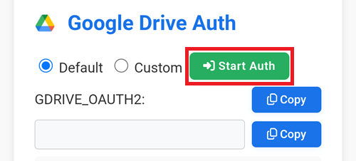
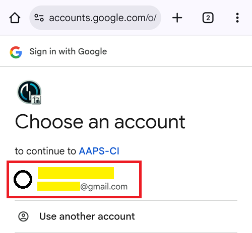
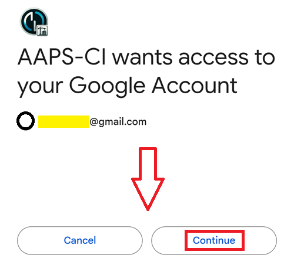
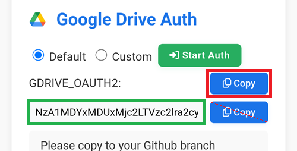
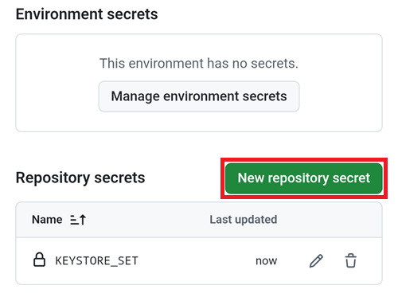
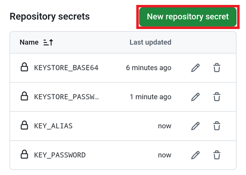
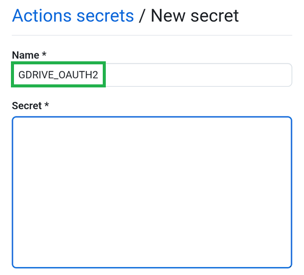
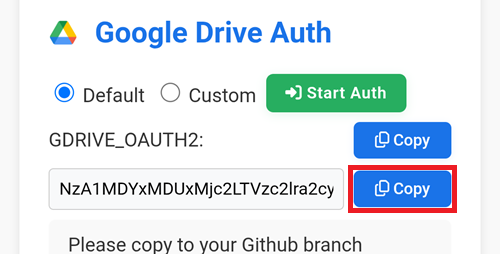
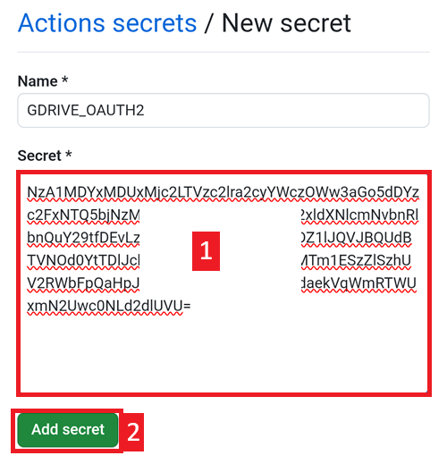
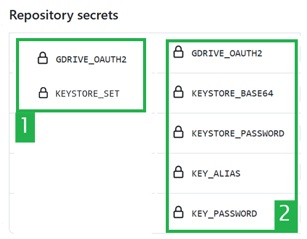

(aaps-ci-google-drive-auth)=

# Izrada u pregledniku – Korak 3: Autorizirajte Google Drive

```{note}
Ovo je **Korak 3** postupka [Izrada u pregledniku](BrowserBuild.md). Najprije dovršite [Korak 2 – Izradite spremište ključeva za potpisivanje](BrowserBuildKeystore.md).
```

```{warning}
Bez obzira koje ste prethodne upute slijedili (Opcija 1 ili Opcija 2), MORATE dodati autorizaciju za Google Drive da biste uspješno koristili izradu u pregledniku.
```

Napomena: ako ste ovaj dio već napravili u videu, sada možete prijeći na [Korak 4 – Izradite APK](BrowserBuildAPK.md).

```{warning}
Ako se Google autorizacija ne pokrene ili stranica za pripremu ne uspije, zatvorite stranicu za pripremu, ponovno otvorite `aaps-ci-preparation.html` na isti način kao u koraku 2 i ponovno započnite ovaj korak. Pogledajte [rješavanje problema](#aaps-ci-preparation-web).
```

Vratite se na karticu sa stranicom za pripremu.

Pomaknite se prema dolje do odjeljka Google Drive Auth i dodirnite Start Auth.



Odaberite svoj Google račun.



Pomaknite se prema dolje i prihvatite pristup. Web stranici je potreban da bi dobila ključ za autentifikaciju Google Drivea.

Dodirnite Continue.



Polje `GDRIVE_OAUTH2` će se popuniti; dodirnite gornji gumb Copy.



Vratite se na karticu GitHuba.

Pomaknite se prema dolje do Repository secrets i dodirnite New repository secret.

Ako ste slijedili Opciju 1, trebali biste vidjeti ovo:



Ako ste slijedili Opciju 2, bit će više ključeva:



U polje Name zalijepite tekst koji ste upravo kopirali. Dugo pritisnite tekstni okvir da se prikaže izbornik za lijepljenje.



Prijeđite na karticu sa stranicom za pripremu.

Dodirnite drugi gumb Copy.



Vratite se na karticu GitHuba.

1. U polje Secret zalijepite tekst koji ste upravo kopirali. Dugo pritisnite tekstni okvir da se prikaže izbornik za lijepljenje.

2. Dodirnite Add secret.



Sada biste trebali imati dva (opcija 1) ili pet (opcija 2) unosa tajni.



GitHub će sada moći spremiti APK datoteku AAPS-a na vaš Google Drive kada bude izrađena.

----

**Sljedeće: [Korak 4 – Izradite APK](BrowserBuildAPK.md) →**
