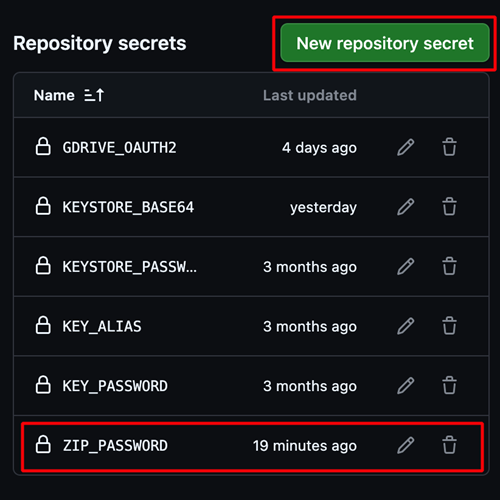
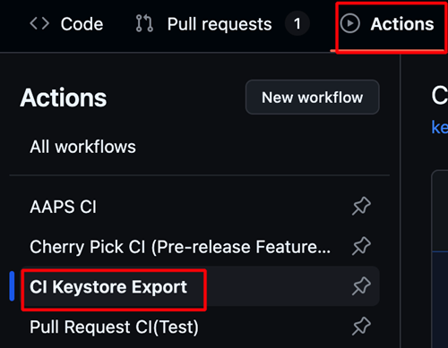
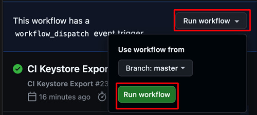

(aaps-ci-preparation)=

# Izrada u pregledniku – Korak 2: Izradite spremište ključeva za potpisivanje

```{note}
Ovo je **Korak 2** [izrade u pregledniku](BrowserBuild.md). Najprije završite [Izrada u pregledniku – Korak 1: Izradite svoj GitHub fork](BrowserBuildFork.md).
```

AAPS mora biti potpisan privatnim ključevima spremljenima u **Java KeyStore (JKS)** (spremište ključeva). Ovo je najvažnija odluka u cijelom postupku, jer o njoj ovisi hoćete li kasnije moći **ažurirati** AAPS bez ponovne instalacije.

```{note}
U sljedećim koracima spremit ćete privatne podatke (svoje spremište ključeva, a kasnije i pristup Google Driveu) u GitHub kao **tajne** (secrets). Tajna je jednostavno šifrirana vrijednost koju može pročitati samo vaša vlastita izrada – nitko drugi je ne može vidjeti, čak ni ljudi koji gledaju vaš fork. Tako vaša izrada ostaje vaša.
```

## Odaberite način za spremište ključeva

Pročitajte obje opcije i odaberite onu koja odgovara vašoj situaciji.

### Opcija 1 – Izradite novo spremište ključeva (novi korisnici)

Odaberite ovo ako vrijedi **bilo što** od ovoga:

- Ovo je **prvi put** da izrađujete AAPS.
- Nemate spremište ključeva od prethodne izrade u Android Studiju (na računalu).
- Zaboravili ste lozinku ili alias svog spremišta ključeva.

```{warning}
Izrada AAPS-a s **Opcijom 1** stvara potpuno novo spremište ključeva, pa vam **neće omogućiti ažuriranje postojećeg AAPS-a** na mjestu. Da prijeđete na ovu novu izradu, morate izvesti svoje postavke, deinstalirati stari AAPS, instalirati novi i ponovno uvesti svoje postavke. Slijedite korake u [Ponovna instalacija AAPS-a s novim spremištem ključeva](#reinstall-aaps).
```

**→ [Nastavite s Opcijom 1 – Izradite novo spremište ključeva](BrowserBuildO1.md)**

### Opcija 2 – Prenesite postojeće spremište ključeva (postojeći / bivši korisnici)

Odaberite ovo ako **već imate** spremište ključeva `.jks` koje ste koristili za prethodnu izradu AAPS-a na računalu u Android Studiju **i** znate njegovu lozinku i alias (obično `key0`).

Tako se vaša trenutna instalacija AAPS-a i dalje može ažurirati: buduća ažuriranja koristit će isto spremište ključeva.

**→ [Nastavite s Opcijom 2 – Prenesite postojeće spremište ključeva](BrowserBuildO2.md)**

----

```{note}
Na sljedećoj stranici odabrat ćete svoj uređaj (računalo ili iPhone). Stranica za svaki uređaj zatim vas vodi kroz preuzimanje i otvaranje datoteke za pripremu na ispravan način za taj uređaj te kroz izradu spremišta ključeva. Izrađena aplikacija AAPS bit će spremljena na vaš Google Drive.
```

**Sljedeće: odaberite [Opciju 1](BrowserBuildO1.md) ili [Opciju 2](BrowserBuildO2.md) iznad, a zatim slijedite stranicu za svoj uređaj.**

----

(ci-keystore-export)=

## Izvezite svoje spremište ključeva (neobavezno)

Ako želite izvesti svoje spremljeno spremište ključeva, koristite ovaj način.

Ova skripta izvozi podatke o spremištu ključeva koje ste prije postavili (u Opciji 1 ili Opciji 2) kao ZIP datoteku zaštićenu lozinkom u mapu `/AAPS/KeyStore` na vašem Google Driveu.

```{warning}
Prije korištenja ovog načina izvoza provjerite jeste li završili postavke spremišta ključeva i Google Drivea.
```

### Koraci:

1. **Dodajte tajnu s lozinkom za ZIP:**
   - Idite u **Settings** → **Secrets and variables** → **Actions** svog repozitorija
   - Kliknite **New repository secret**
   - U polje **Name** upišite: `ZIP_PASSWORD`
   - U polje **Secret** upišite svoju lozinku za šifriranje ZIP datoteke
   - Za lozinku koristite samo engleska slova i brojeve (bez posebnih znakova)
   - Kliknite **Add secret**

   

2. **Pokrenite workflow za izvoz:**
   - Idite na karticu **Actions** u svom repozitoriju
   - Odaberite **CI Keystore Export**
   - Kliknite **Run workflow**
   - Izvezena ZIP datoteka spremišta ključeva bit će spremljena na vaš Google Drive

   

   

```{toctree}
:hidden:

Opcija 1 – Izradite novo spremište ključeva <BrowserBuildO1.md>
Opcija 2 – Prenesite postojeće spremište ključeva <BrowserBuildO2.md>
```
