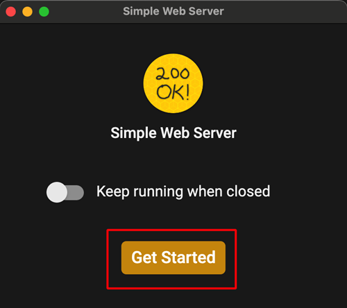
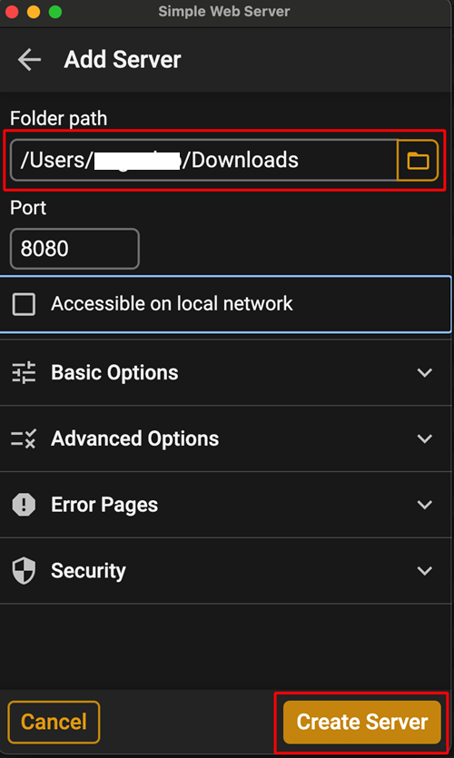

(aaps-ci-option1-computer)=

# Opcija 1 · Računalo – Izradite novo spremište ključeva

```{note}
[Opcija 1](BrowserBuildO1.md) (izrada novog spremišta ključeva) na **računalu** (Windows / Mac / Linux).
```

## 1. Preuzmite pripremnu datoteku

:::{include} BrowserBuildDownloadPrep.md
:::

## 2. Pokrenite lokalni poslužitelj i izradite spremište ključeva

Koristite računalo (podržani su Windows/Mac/Linux)

Otvorite web-stranicu [https://simplewebserver.org/download.html](https://simplewebserver.org/download.html)

Instalirajte Simple Web Server<br/> Ako koristite Windows ili Mac, možete ga instalirati iz trgovine Microsoft Store ili Mac App Store.<br/> Ako vas preglednik pita želite li otvoriti aplikaciju trgovine, dopustite to.<br/><br/> <br/>

Primjer na Macu:

- preuzmi → instaliraj → otvori<br/><br/> <br/><br/>

- Kliknite Get Started<br/><br/> <br/><br/>

- Kliknite New Server<br/><br/> <br/><br/>

- U polju Folder Path odaberite mapu u kojoj se nalazi aaps-ci-preparation.html, a zatim kliknite Create Server.<br/><br/> <br/><br/>

- Ako vidite ovaj zaslon, poslužitelj je pokrenut.<br/><br/> <br/><br/>

- Ne zatvarajte Simple Web Server. Prebacite se u preglednik i otvorite<br/> [http://127.0.0.1:8080/aaps-ci-preparation.html](http://127.0.0.1:8080/aaps-ci-preparation.html)<br/><br/>

- Za sljedeće korake pogledajte videozapis ispod, od 1 minute i 37 sekundi.

  <!--crowdin: exclude-->
  <div align="center" style="max-width: 360px; margin: auto; margin-bottom: 2em;">
    <div style="position: relative; width: 100%; aspect-ratio: 9/16;">
      <iframe
        src="https://geo.dailymotion.com/player/x9rdrpy.html?video=x9rdrpy&startTime=97&loop=true&mute=true"
        loading="lazy"
        style="position: absolute; top: 0; left: 0; width: 100%; height: 100%;"
        frameborder="0"
        allowfullscreen>
      </iframe>
    </div>
  </div>

----

**Sljedeće: [Korak 3 – Autorizirajte Google Drive](BrowserBuildGoogleDrive.md) →**
