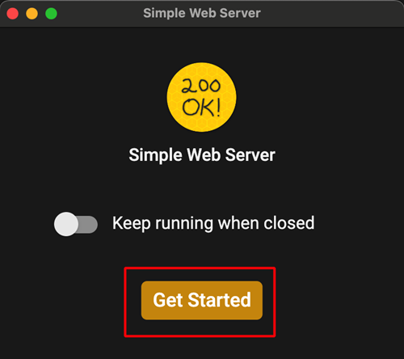
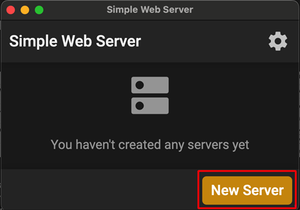
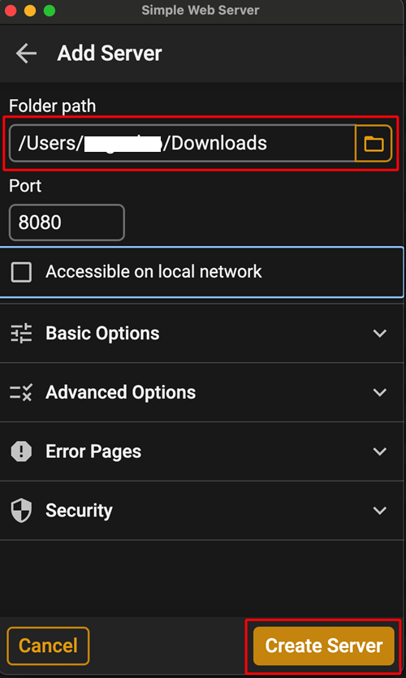

(aaps-ci-option2-computer)=

# Opcija 2 · Računalo – Prenesite postojeće spremište ključeva

```{note}
[Opcija 2](BrowserBuildO2.md) (prijenos postojećeg spremišta ključeva) na **računalu** (Windows / Mac / Linux).
```

## 1. Preuzmite pripremnu datoteku

:::{include} BrowserBuildDownloadPrep.md
:::

## 2. Pokrenite lokalni poslužitelj i prenesite spremište ključeva

Koristite računalo (podržani su Windows/Mac/Linux)

<!--crowdin: exclude-->
<div align="center" style="max-width: 360px; margin: auto; margin-bottom: 2em;">
  <div style="position: relative; width: 100%; aspect-ratio: 9/16;">
    <iframe
      src="https://geo.dailymotion.com/player/x9rdyc6.html?video=x9rdyc6&loop=true&mute=true"
      loading="lazy"
      style="position: absolute; top: 0; left: 0; width: 100%; height: 100%;"
      frameborder="0"
      allowfullscreen>
    </iframe>
  </div>
</div>

Install Simple Web Server<br/><br/> If you are a Windows or Mac user, you can install it from the Microsoft Store or the Mac App Store. Ako vas preglednik pita želite li otvoriti aplikaciju trgovine, dopustite to.<br/><br/> <br/><br/>

Primjer na Macu:

- preuzmi → instaliraj → otvori<br/><br/> <br/><br/>

- Kliknite Get Started<br/><br/> <br/><br/>

- Kliknite New Server<br/><br/> <br/><br/>

- U polju Folder Path odaberite mapu u kojoj se nalazi aaps-ci-preparation.html, a zatim kliknite Create Server.<br/><br/> <br/><br/>

- Ako vidite ovaj zaslon, poslužitelj je pokrenut.<br/><br/> <br/><br/>

- Ne zatvarajte Simple Web Server. Please switch to your browser and open<br/><br/> [http://127.0.0.1:8080/aaps-ci-preparation.html](http://127.0.0.1:8080/aaps-ci-preparation.html)<br/><br/>

- For the subsequent steps, please refer to the video below, starting from 2 minutes 18 seconds.<br/><br/>
  <!--crowdin: exclude-->
  <div align="center" style="max-width: 360px; margin: auto; margin-bottom: 2em;">
    <div style="position: relative; width: 100%; aspect-ratio: 9/16;">
      <iframe
        src="https://geo.dailymotion.com/player/x9rdvt0.html?video=x9rdvt0&startTime=138&loop=true&mute=true"
        loading="lazy"
        style="position: absolute; top: 0; left: 0; width: 100%; height: 100%;"
        frameborder="0"
        allowfullscreen>
      </iframe>
    </div>
  </div>

----

**Sljedeće: [Korak 3 – Autorizirajte Google Drive](BrowserBuildGoogleDrive.md) →**
