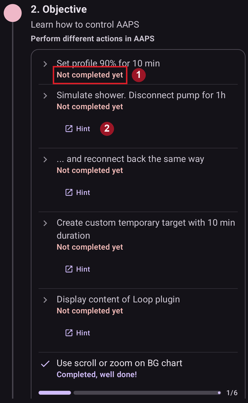
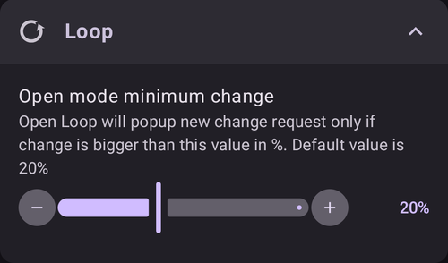
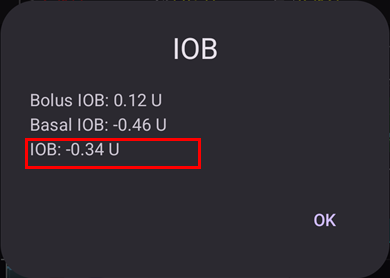
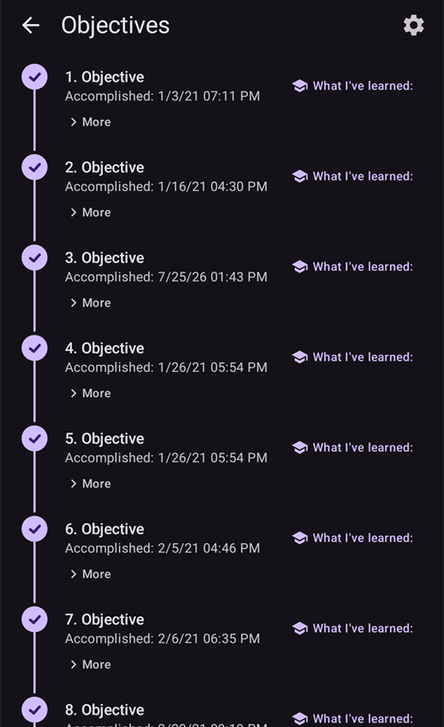
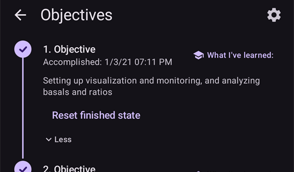
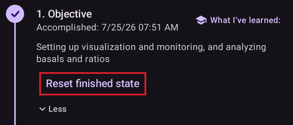

# Ispunjavanje ciljeva

**AAPS** ima niz **ciljeva** koje treba ispuniti. Oni korisnika vode od osnovne otvorene petlje do hibridne zatvorene petlje i svih funkcija **AAPS-a**. Ispunjavanjem **ciljeva** trebate postići da ste:

* sve ispravno postavili u svom **AAPS-u**;
* naučili glavne funkcije **AAPS-a**; i
* stekli osnovno razumijevanje onoga što vaš sustav može učiniti, kako biste s više povjerenja koristili **AAPS**.

Kada se **AAPS** instalira prvi put, svaki cilj morate ispuniti prije prelaska na sljedeći. Nove funkcije postupno se otključavaju kako napredujete kroz svaki **cilj**.

**Ciljevi 1 do 8** vode vas od postavljanja **AAPS-a** na pametnom telefonu do „osnovne” hibridne zatvorene petlje. Za to vam treba oko 6 tjedana. Do **Cilja 5** možete doći s virtualnom pumpom (a inzulin u međuvremenu primati na neki drugi način). **Ciljevi 9 i 10** služe za testiranje naprednijih funkcija **AAPS-a** radi bolje kontrole dijabetesa. Za njih će vam trebati do 3 mjeseca, možda i duže. Više detalja o procjeni potrebnog vremena nalazi se ovdje: [Koliko će to trajati?](#preparing-how-long-will-it-take)

Osim napredovanja kroz **ciljeve**, po potrebi možete i ukloniti napredak i [vratiti se na raniji cilj](#CompletingTheObjectives-go-back-in-objectives).

## Napravite sigurnosnu kopiju postavki

```{admonition} Note
:class: note

Nakon ispunjenja svakog **cilja** preporučuje se izvesti postavke **AAPS-a**!
```

Snažno se preporučuje da nakon ispunjenja svakog cilja [izvezete postavke](../Maintenance/ExportImportSettings.md), kako ne biste izgubili napredak u **AAPS-u**. Izvozom nastaje **datoteka postavki** (.json) koju treba spremiti na jedno ili više sigurnih mjesta (npr. Google Drive, tvrdi disk, privitak e-pošte _itd._). Tako je sav napredak u **AAPS-u** spremljen. Ako izgubite telefon ili slučajno izbrišete napredak, json datoteku možete ponovno učitati u **AAPS** uvozom nedavne datoteke postavki. Sigurnosna kopija **datoteke postavki** potrebna je i kada iz bilo kojeg razloga trebate novi pametni telefon za **AAPS** (novi model, izgubljen ili pokvaren telefon _itd._)

Datoteka **postavki** sprema ne samo vaš napredak kroz **ciljeve**, nego i sve postavke **AAPS-a**, npr. **maksimalni bolus** _itd._

Ako nemate sigurnosnu kopiju postavki, a nešto se dogodi s vašim pametnim telefonom za **AAPS**, **ciljeve** ćete morati ponovno započeti od početka. Napredovanje kroz **ciljeve** traje dugo. Bolje je izbjeći situaciju u kojoj ih morate ponovno ispunjavati, na primjer jer ste izgubili pametni telefon.

(objectives-objective1)=
## Cilj 1: Postavljanje prikaza i nadzora, analiza bazala i omjera

**Cilj 1** traži od korisnika da postavi osnovne tehničke postavke u **AAPS-u**. Ne možete napredovati dok ne završite ovaj korak.

- Odaberite ispravan CGM/FGM u [Konfiguracija → Izvor GUK-a](#Config-Builder-bg-source). Više informacija pogledajte u [Izvor GUK-a](../Getting-Started/CompatiblesCgms.md).
- Odaberite ispravnu pumpu u [Konfiguracija → Pumpa](#Config-Builder-pump) kako bi vaša pumpa mogla komunicirati s **AAPS-om**. Odaberite **virtualnu pumpu** ako koristite model pumpe koji nema upravljački program za petlju u **AAPS-u** ili ako želite proći prve **ciljeve**, a inzulin primati drugim sustavom. Više informacija pogledajte u [inzulinska pumpa](../Getting-Started/CompatiblePumps.md).
- Ako koristite Nightscout:
  - Slijedite upute na stranici [Nightscout](../SettingUpAaps/Nightscout.md) kako bi **Nightscout** mogao primati i prikazivati podatke **AAPS-a**.
  - Imajte na umu da URL u **NSClientV3** mora biti **_bez_ „/api/v1/”** na kraju – pogledajte [Postavke → NSClientV3](#Preferences-nsclient).
- Ako koristite Tidepool:
  - Slijedite upute na stranici [Tidepool](../SettingUpAaps/Tidepool.md) kako bi **Tidepool** mogao primati i prikazivati podatke **AAPS-a**.

Napomena: *Možda ćete morati pričekati sljedeće očitanje glukoze sa senzora prije nego što ga **AAPS** prepozna.*

(objectives-objective2)=
## Cilj 2: Naučite kako kontrolirati AAPS

**Cilj 2** traži da obavite nekoliko „zadataka”, kao na snimci zaslona ispod. Svaki zadatak prikazuje svoj status (**1**): narančasto „**Nije još dovršeno**” mijenja se u „**Dovršeno, bravo!**” čim **AAPS** zabilježi radnju. Dodirnite **Savjet** (**2**) ispod zadatka da otvorite povezanu dokumentaciju, ako neku radnju još ne poznajete.



Zadaci za ispunjenje **Cilja 2** su:
- Postavite **profil** na 90 % na 10 min.
  - _Savjet_: dodirnite naziv profila na glavnom zaslonu da otvorite zaslon **Profil**, zatim koristite gumb **Aktiviraj** (▶) i postavite postotak i trajanje. Više informacija u [Zamjena profila i postotak profila](../DailyLifeWithAaps/ProfileSwitch-ProfilePercentage.md).
  - _Napomena_: **AAPS** ne prihvaća bazalne stope niže od 0,05 J/h. Ako vaš **profil** ima stope od 0,05 J/h ili niže, prije ovog zadatka morate napraviti privremeni **profil** s višim bazalnim stopama. Nakon ovog zadatka vratite se na svoj uobičajeni **profil**.
- Simulirajte „tuširanje” tako da u **AAPS-u** [odspojite pumpu](#AapsScreens-loop-status) na 1 h.
  - _Savjet_: pritisnite ikonu petlje na glavnom zaslonu da otvorite dijalog petlje, zatim odaberite trajanje pod **Odspoji pumpu**.
- Završite „tuširanje” tako da ponovno spojite pumpu.
  - _Savjet_: pritisnite ikonu „odspojeno” da ponovno otvorite dijalog petlje i odaberite **Ponovno spoji pumpu**.
- Postavite prilagođeni [**privremeni cilj**](../DailyLifeWithAaps/TempTargets.md) u trajanju od 10 min.
  - _Savjet_: pritisnite ciljni raspon na glavnom zaslonu da otvorite zaslon privremenog cilja.
- Prikažite sadržaj dodatka **Petlja**.
  - _Savjet_: otvorite **Konfiguracija → Petlja** i dodirnite „**Otvori dodatak**”.
- Pomičite ili zumirajte graf GUK-a da vidite duža ili kraća vremenska razdoblja.


(objectives-objective3)=
## Cilj 3: Dokažite svoje znanje

**Cilj 3** traži od korisnika da položi ispit s višestrukim izborom koji provjerava vaše znanje o **AAPS-u**.

Nekim korisnicima je **Cilj 3** najteži cilj. Uz pitanja čitajte i dokumentaciju **AAPS-a**. Ako i nakon proučavanja dokumentacije **AAPS-a** stvarno ne znate odgovor, potražite „Objective 3” u grupi na [Facebooku](https://www.facebook.com/groups/AndroidAPSUsers) ili [Discordu](https://discord.gg/4fQUWHZ4Mw) (vaše je pitanje vjerojatno već postavljeno i grupa je na njega odgovorila). Te grupe mogu dati korisne savjete ili vas uputiti na odgovarajući dio dokumentacije **AAPS-a**.

U međuvremenu:
- Kako biste u otvorenoj petlji dobivali manje obavijesti i odluka (privremene bazalne stope), postavite širok ciljni raspon u svom **profilu**, _npr._ 90 – 150 mg/dL ili 5,0 – 8,5 mmol/L.
- Noću možete postaviti širu gornju granicu ili čak isključiti otvorenu petlju.

Za nastavak **Cilja 3** dodirnite redak pitanja da ga otvorite. Pažljivo pročitajte svako pitanje i odaberite svoj odgovor (odgovore).

Kod svakog pitanja može biti točno više od jednog odgovora! Ako odaberete netočan odgovor, pitanje se zaključava na 1 sat. Tek nakon toga možete ponovno odgovoriti. Imajte na umu da se redoslijed odgovora pri sljedećem pokušaju može promijeniti. Tako ćete ih pažljivo pročitati i stvarno razumjeti je li svaki odgovor točan ili ne.

```{admonition} __What happens if new question(s) are added to an Objective when I update to a newer version of AAPS?__
:class: note
S vremena na vrijeme u **AAPS** se dodaju nove funkcije zbog kojih ponekad treba dodati novo pitanje u **ciljeve**, osobito u **Cilj 3**. Zato će svako novo pitanje dodano u **Cilj 3** biti označeno kao „nedovršeno”, jer će **AAPS** tražiti da na njega odgovorite. Ne brinite: svaki **cilj** je neovisan, pa **nećete izgubiti postojeće funkcije AAPS-a**, ako ostali **ciljevi** ostanu ispunjeni.
```

## Cilj 4: Početak s otvorenom petljom

Svrha **Cilja 4** je shvatiti koliko često **AAPS** uspoređuje korisnikovu bazalnu stopu s razinom glukoze i preporučuje promjene privremene bazalne stope. U ovom **cilju** prvi put ćete uključiti otvorenu petlju, prihvatiti 20 predloženih promjena privremene bazalne stope i, ako je potrebno, ručno ih unijeti u pumpu. Vidjet ćete i učinak [**privremenih ciljeva**](../DailyLifeWithAaps/TempTargets.md). Ako još ne znate kako u **AAPS-u** postaviti promjenu privremene bazalne stope, pogledajte radnje za pumpu na ploči **Upravljanje** ([Gdje je nestala kartica Radnje?](#screens-action-tab)).

Najkraće vrijeme za ovaj cilj: **7 dana**. To je obavezno vrijeme čekanja. Ne možete prijeći na sljedeći **cilj**, čak i ako ste već primijenili sve promjene bazalne stope.

- Odaberite otvorenu petlju: pritisnite [ikonu petlje](#AapsScreens-loop-status) na glavnom zaslonu i kao način rada odaberite **Otvorena petlja**.
- Ručno primijenite barem 20 prijedloga privremene bazalne stope tijekom 7 dana: unesite ih u svoju (fizičku) pumpu i u AAPS-u potvrdite da ste ih prihvatili. Provjerite prikazuju li se te promjene bazalne stope u **AAPS-u** i **Nightscoutu**.
- Koristite [**privremene ciljeve**](../DailyLifeWithAaps/TempTargets.md) kada je potrebno. Nakon liječenja hipoglikemije koristite unaprijed postavljeni privremeni cilj „Hipo” kako sustav ne bi previše korigirao pri ponovnom porastu.
- Ako ste u ovom trenutku još u [jednostavnom načinu rada](#preferences-simple-mode), sada je vjerojatno dobro vrijeme da ga isključite.

Kako biste u otvorenoj petlji dobivali manje predloženih promjena bazalne stope, i dalje možete koristiti savjete opisane u [**Cilju 3**](#objectives-objective3). Uz to, najmanji postotak za preporučene promjene bazalne stope možete promijeniti postavkom „**Minimalna promjena u otvorenoj petlji**” u **Postavke → Petlja**. Što je vrijednost viša, to ćete dobiti manje obavijesti o promjenama.



```{admonition} Note
:class: note

Ne morate primijeniti baš svaku preporuku sustava!
```
(objectives-objective5)=
## Cilj 5: Razumijevanje otvorene petlje i njezinih preporuka za privremeni bazal

U **Cilju 5** počet ćete razumijevati kako nastaju preporuke za privremeni bazal. To uključuje [logiku određivanja bazala](#aaps-screens-how-predictions-become-a-dosing-decision), analizu učinka praćenjem [linija predviđanja u **Pregledu AAPS-a**](#aaps-screens-prediction-lines) (ili u Nightscoutu) i pregled detaljnih izračuna na zaslonu dodatka **OpenAPS SMB** (**Konfiguracija → APS → Otvori dodatak**).

Procijenjeno vrijeme za ovaj cilj: **7 dana**.

U ovom **cilju** trebate odrediti i postaviti vrijednost „Maksimalna bazalna stopa” (max-basal), kako je opisano u [Funkcije OpenAPS-a](#Open-APS-features-max-u-h-a-temp-basal-can-be-set-to). Ovu vrijednost možete postaviti u [Postavke → OpenAPS SMB](#Preferences-openaps-smb-settings). U [jednostavnom načinu rada](#preferences-simple-mode) **AAPS** ovu vrijednost postavlja automatski i ne trebate je mijenjati. Ako još koristite virtualnu pumpu, ovu sigurnosnu postavku postavite i u **AAPS-u** i u svojoj inzulinskoj pumpi.

Možda ćete htjeti postaviti [cilj GUK-a u **profilu**](#profile-glucose-targets) više nego inače, dok se ne naviknete na izračune i postavke **AAPS-a**. Možete isprobati da **cilj GUK-a** u svom **profilu** postavite u uži raspon (npr. širine 1 mmol/L ili manje [20 mg/dL ili manje]) i pratiti što se događa.


```{admonition} If you have been using a virtual pump, change to a real insulin pump now!
:class: note

Ako koristite otvorenu petlju s virtualnom pumpom, **ovdje stanite**. **Provjeri** dodirnite na kraju ovog **cilja** tek kada prijeđete na „pravu” pumpu koja isporučuje inzulin.

```


(objectives-objective6)=
## Cilj 6: Prvo zatvaranje petlje sa zaštitom od niske razine glukoze


```{admonition} Closed loop will not correct high **BG** values in **Objective 6** as it is limited to **Low Glucose Suspend** only!
:class: note
Visoke vrijednosti GUK-a i dalje morate korigirati sami (ručno, korekcijama pumpom ili penom)!
```

U **Cilju 6** zatvorit ćete petlju i uključiti njezin način **Zaštita od niske razine glukoze** (LGS), dok je [max IOB](#Open-APS-features-maximum-total-iob-openaps-cant-go-over) postavljen na nulu. Za ispunjenje ovog **cilja** morate ostati 5 dana u načinu LGS. To vrijeme iskoristite da provjerite jesu li postavke **profila** točne i ne pokreću li se LGS događaji prečesto.

Najkraće vrijeme za ovaj cilj: **5 dana**. To je obavezno vrijeme čekanja. Ne možete prijeći na sljedeći **cilj** dok to vrijeme ne prođe.

Vrlo je važno da je vaš trenutni **profil** (bazal, ISF, IC) dobro testiran prije nego što zatvorite petlju u načinu **LGS**. Netočne postavke **profila** mogu dovesti do hipoglikemija koje morate liječiti ručno. Točan **profil** smanjit će potrebu za liječenjem niske glukoze tijekom tih 5 dana.

**Ako i dalje imate česte ili teške epizode niske glukoze, razmislite o doradi [DIA za vaš tip inzulina](#Config-Builder-insulin-dia), bazala, ISF-a i omjera ugljikohidrata.** Pogledajte grupu na [Facebooku](https://www.facebook.com/groups/AndroidAPSUsers) ili [Discordu](https://discord.gg/4fQUWHZ4Mw), gdje se o tome mnogo raspravlja.


Tijekom **Cilja 6** **AAPS** će postavku maxIOB prisilno postaviti na nulu. **To prestaje kada prijeđete na Cilj 7.**

To znači da u **Cilju 6**, kada razina glukoze sa senzora pada, **AAPS** smanjuje isporuku bazalnog inzulina umjesto vas. No ako razina glukoze sa senzora raste, **AAPS** će povećati bazalnu stopu iznad vrijednosti iz **profila** samo ako je **bazalni aktivni inzulin** negativan zbog prethodnog **LGS-a**. Inače **AAPS** neće povećati bazal iznad trenutne vrijednosti iz profila, čak i ako razina glukoze raste. Ovaj oprez služi tome da izbjegnete hipoglikemije dok učite koristiti **AAPS**.

**Zbog toga visoke vrijednosti glukoze morate korigirati ručnim korekcijskim bolusima inzulina.**

- Ako je vaš aktivni inzulin negativan (pogledajte snimku zaslona ispod), u **Cilju 6** može se pokrenuti privremena bazalna stopa (TBR) > 100 %.



- Postavite ciljni raspon malo više nego inače, radi sigurnosti i dodatne zaštite.
- Uključite način „Zaštita od niske razine glukoze”: pritisnite ikonu petlje na glavnom zaslonu i kao način rada odaberite **Zaštita od niske razine glukoze**.
- Aktivne privremene bazale pratite preko tirkiznog teksta bazala na zaslonu PREGLED ili tirkizne krivulje bazala na grafu PREGLED.
- Nakon liječenih hipoglikemija možete privremeno imati skokove, jer se bazal pri ponovnom porastu ne može povećati.

(objectives-objective7)=
## Cilj 7: Podešavanje zatvorene petlje, povećanje maxIOB iznad 0 i postupno spuštanje ciljeva GUK-a

Za ispunjenje **Cilja 7** morate zatvoriti petlju i povećati [maxIOB](#Open-APS-features-maximum-total-iob-openaps-cant-go-over). **maxIOB** je u **Cilju 6** automatski postavljen na nulu zbog načina zaštite od niske razine glukoze. To više nije slučaj. **AAPS** će početi koristiti vašu postavljenu vrijednost maxIOB za korekciju visokih vrijednosti glukoze. U [jednostavnom načinu rada](#preferences-simple-mode) **AAPS** maxIOB postavlja automatski i ne trebate ga mijenjati.

Najkraće vrijeme za ovaj cilj: **1 dan**. To je obavezno vrijeme čekanja. Ne možete prijeći na sljedeći **cilj** dok to vrijeme ne prođe.

- Odaberite **Zatvorena petlja**: pritisnite [ikonu petlje](#AapsScreens-loop-status) na glavnom zaslonu i kao način rada odaberite **Zatvorena petlja**. Ostanite u **zatvorenoj petlji** 1 dan.

- Polako povećavajte „Maks. aktivni inzulin (IOB) za SMB” (u OpenAPS-u se zove „max-iob”) iznad 0, dok ne nađete postavke koje vam najbolje odgovaraju.

Zadana preporuka za ovu postavku je „**prosječni bolus za obrok + 3x maksimalni dnevni bazal**”, gdje je „maksimalni dnevni bazal” najveća vrijednost po satu u bilo kojem vremenskom odsječku dana.


Ovu preporuku shvatite kao početnu točku. Ako koristite ovo pravilo, ali AAPS isporučuje previše inzulina kada glukoza raste, možda trebate:
* smanjiti vrijednost „Maks. aktivni inzulin (IOB) za SMB”;
* provjeriti postavke **profila**, i mijenjati samo jednu stvar odjednom.

Ako ste jako otporni na inzulin, možete umjesto toga vrlo oprezno povećati vrijednost **maxIOB**.

Kada budete sigurni koliki **maxIOB** odgovara vašem načinu korištenja petlje, spustite svoje **ciljeve GUK-a** na željenu razinu.

(objectives-objective8)=
## Cilj 8: Prilagodba bazala i omjera po potrebi, zatim uključivanje Autosensa

U ovom **cilju** ponovno ćete provjeriti kako radi vaš **profil** i koristiti funkciju [Autosens](#Open-APS-features-autosens) kao pokazatelj pogrešnih postavki.

Najkraće vrijeme za ovaj cilj: **7 dana**. To je obavezno vrijeme čekanja. Ne možete prijeći na sljedeći **cilj** dok to vrijeme ne prođe.

Uključite [Autosens](../DailyLifeWithAaps/KeyAapsFeatures.md) na 7 dana (u [jednostavnom načinu rada](#preferences-simple-mode) uključen je prema zadanim postavkama) i pratite [bijelu liniju na grafu u **Pregledu**](#AapsScreens-section-g-additional-graphs) koja pokazuje kako vaša osjetljivost na inzulin raste ili pada zbog tjelovježbe, hormona itd. Pratite zaslon dodatka **OpenAPS SMB** (**Konfiguracija → APS → Otvori dodatak**) koji pokazuje kako **AAPS** u skladu s tim prilagođava osjetljivost, bazale i ciljeve.

Sada je dobro vrijeme da provjerite postavke za [Detekcija osjetljivosti](#Config-Builder-sensitivity-detection). Svoju osjetljivost možete vidjeti na glavnom zaslonu u [dodatnom grafu](#AapsScreens-section-g-additional-graphs).

Uz to, možete jednom upotrijebiti [Autotune](#autotune-how-autotune-calculates-adjustments) da provjerite jesu li vam bazali i dalje točni, ili napraviti klasični test bazala.

(objectives-objective9)=
## Cilj 9: Uključivanje dodatnih funkcija oref1 za dnevnu upotrebu, npr. super mikro bolusa (SMB)

U **Cilju 9** upoznat ćete i koristiti **„Super Micro Bolus (SMB)”** kao jednu od glavnih funkcija. Nakon obaveznog čitanja dobro ćete razumjeti što su SMB-ovi, kako rade i zašto se bazal nakon SMB-a privremeno postavlja na nulu (nulti privremeni bazal).

Najkraće vrijeme za ovaj cilj: **28 dana**. To je obavezno vrijeme čekanja. Ne možete prijeći na sljedeći cilj dok to vrijeme ne prođe.

- [Odjeljak o SMB-u u ovoj dokumentaciji](#Open-APS-features-super-micro-bolus-smb) i [opis oref1 u dokumentaciji openAPS](https://openaps.readthedocs.io/en/latest/docs/Customize-Iterate/oref1.html) morate pročitati da biste razumjeli **SMB** i pojam **nultog privremenog bazala** (zero-temping).
- Nakon toga možete [povećati maxIOB](#Open-APS-features-maximum-total-iob-openaps-cant-go-over) kako bi **SMB-ovi** radili učinkovitije. maxIOB sada uključuje sav **aktivni inzulin**, ne samo nakupljeni bazal. Ova granica pauzira **SMB-ove** dok aktivni inzulin ne padne ispod te vrijednosti (_npr._ **maxIOB** je postavljen na 7 J, a za obrok se da bolus od 8 J: SMB-ovi će se pauzirati i neće se davati dok **aktivni inzulin** ne padne ispod 7 J). Dobar početak je postaviti **maxIOB** = **prosječni bolus za obrok + 3x maksimalni dnevni bazal**, gdje je „maksimalni dnevni bazal” najveća vrijednost po satu u bilo kojem vremenskom odsječku dana. Kao referencu pogledajte [cilj 7](#objectives-objective7).
- Procijenite brzinu apsorpcije ugljikohidrata i razmislite o promjeni parametra „min_5m_carbimpact” u [Postavke → Postavke apsorpcije → min_5m_carbimpact](#Preferences-min_5m_carbimpact) ako vam se čini prespora ili prebrza.

(objectives-objective10)=
## Cilj 10: Automatizacija

**Automatizacija** postaje dostupna kada započnete **Cilj 10**.

Najkraće vrijeme za ovaj cilj: **28 dana**. To je obavezno vrijeme čekanja. Ne možete prijeći na sljedeći cilj dok to vrijeme ne prođe.

Najprije pročitajte stranicu dokumentacije [Automatizacija](../DailyLifeWithAaps/Automations.md).

Postavite najjednostavnije pravilo automatizacije, na primjer da za nekoliko minuta pokrene obavijest na Androidu:
- Otvorite **Upravljanje → Automatizacija** i dodirnite gumb **+** (**Dodaj pravilo**).
- Upišite **Naziv zadatka**, na primjer „Moja prva obavijest automatizacije”.
- Pod **Uvjet** dodirnite „**UREDI**”.
  - Dodirnite „**Dodaj okidač**” i odaberite „**Vrijeme**”. **AAPS** stvara unos za danas s trenutnim vremenom.
  - Promijenite vrijeme tako da se okine za nekoliko minuta.
  - Dodirnite ikonu **Spremi** (gore desno) za povratak na pravilo.
- Pod **Radnja** dodirnite „**DODAJ**” i odaberite „**Obavijest**”.
  - Upišite poruku u karticu radnje, na primjer „Moja prva automatizacija”.
- Dodirnite ikonu **Spremi** (gore desno) i provjerite je li pravilo **Omogućeno**.
- Pričekajte da vrijeme pokrene obavijest (ovisno o telefonu, može kasniti nekoliko minuta)

Zatim možete isprobati postavljanje korisnije **automatizacije**. Stranica dokumentacije daje nekoliko primjera, a u grupi na [Facebooku](https://www.facebook.com/groups/AndroidAPSUsers) možete potražiti snimke zaslona „Automation”. U zajednici na [Discordu](https://discord.gg/4fQUWHZ4Mw) postoji i poseban kanal za to.

Na primjer, ako svako jutro u isto vrijeme prije škole ili posla jedete isti doručak, možete napraviti **automatizaciju** npr. „cilj-prije-doručka” koja 30 minuta prije doručka postavlja malo niži **privremeni cilj**. U tom slučaju vaš će uvjet vjerojatno biti „Ponavljajuće vrijeme”, u kojem odaberete određene dane u tjednu (ponedjeljak, utorak, srijeda, četvrtak, petak) i određeno vrijeme (06:30). Radnja će biti „Pokreni privremeni cilj” s ciljnom vrijednošću nižom od uobičajene i trajanjem od 30 minuta.

## Kada su svi ciljevi ispunjeni

Kada ispunite sve **ciljeve**, popis prikazuje svaki od njih s kvačicom i datumom ispunjenja. Stavka **Ciljevi** nestaje s donje navigacije; popis i dalje možete otvoriti preko **Konfiguracija → Ograničenja → Ciljevi → Otvori dodatak**.



Pritisnite „**Više**” ispod cilja da ponovno vidite njegove zadatke:



(CompletingTheObjectives-go-back-in-objectives)=
## Povratak na ranije ciljeve

Ako se iz bilo kojeg razloga želite vratiti na ranije **ciljeve**, otvorite završeni **cilj** s „**Više**” i dodirnite „**Poništi završetak**”:



Na isti način **cilj** na kojem trenutno radite možete ponovno započeti s „**Poništi početak**”.
