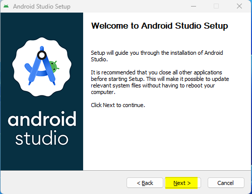
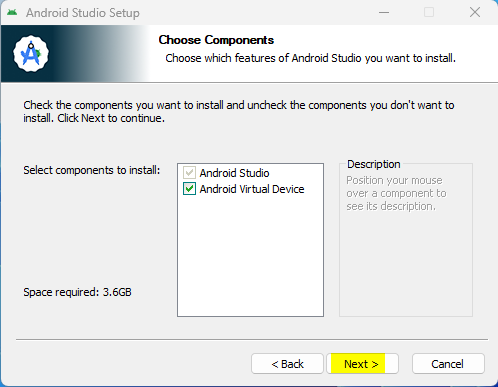
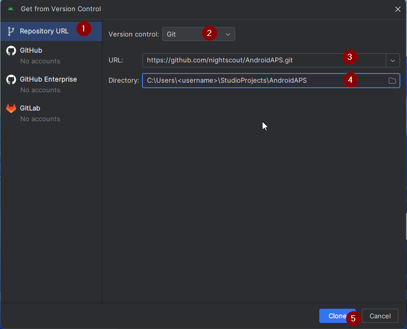
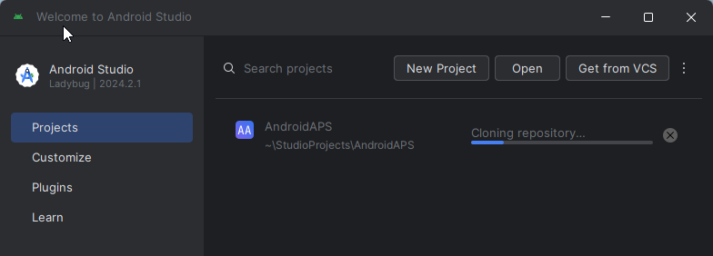
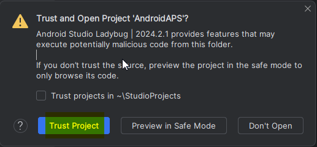
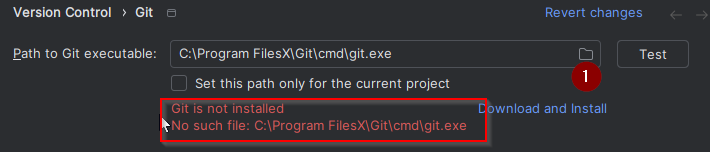
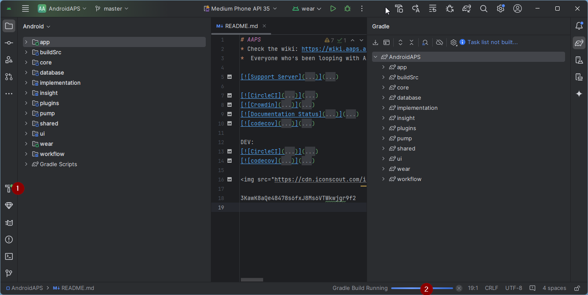

<!-- Android Studio Build, FKA Computer Build. Preserve filenames to avoid breaking URLs. -->

# Izrada s Android Studiom

Ovo je tradicionalni način izrade vaše aplikacije AAPS.

Aplikaciju možete izraditi i bez računala, metodom [Izrada u pregledniku](./BrowserBuild.md).

## Izradite sami umjesto preuzimanja

**Aplikacija AAPS (APK datoteka) nije dostupna za preuzimanje zbog propisa o medicinskim uređajima. Zakonito je izraditi aplikaciju za vlastitu upotrebu, ali kopiju ne smijete dati drugima!**

Pojedinosti pogledajte na stranici [Česta pitanja korisnika petlje](../UsefulLinks/FAQ.md).

---

(Building-APK-recommended-specification-of-computer-for-building-apk-file)=
## Specifikacije računala i softvera za izradu AAPS-a

* Za izradu apk-a možda će biti potrebna određena verzija **[Android Studija](https://developer.android.com/studio/)**. Pogledajte tablicu u nastavku:

| Verzija AAPS-a          | Preporučena<br/>verzija<br/>Android Studija | Alternativna<br/>verzija<br/>Android Studija | Gradle | JVM |
| ----------------------- | ------------------------------------------------------- | -------------------------------------------------------- | ------ |:--- |
| 2.6.2                   | 3.6.1                                                   |                                                          | 5.6.4  | 11  |
| 2.8.2.1                 | 4.1.1                                                   |                                                          | 6.1.1  | 13  |
| [3.1.0.3](#version3100) | 2020.3.1                                                | testirano do Quail 4                                     | 7.3.3  | 17  |
| [3.2.0.4](#version3204) | Hedgehog (2023.1.1)                                     | testirano do Quail 4                                     | 8.2    | 17  |
| [3.3.1.3](#version3300) | Ladybug Feature Drop (2024.2.2)                         | testirano do Quail 4                                     | 8.10   | 21  |
| [3.3.2](#version3300)   | Meerkat (2024.3.1)                                      | testirano do Quail 4                                     | 8.11.1 | 21  |
| [3.3.2.1](#version3321) | Narwhal (2025.1.2)                                      | testirano do Quail 4                                     | 8.13   | 21  |
| [3.4.2.6](#version3426) | Panda 2 (2025.3.2)                                      | testirano do Quail 4                                     | 9      | 21  |
| [4.0.0](#version400)    | Rabbit 2 (2026.2.2)                                     | Latest                                                   | 9.8    | 21  |

„Preporučena verzija“ dolazi s odgovarajućom verzijom JVM-a. Preporučena verzija je ujedno i najniža verzija koju možete koristiti za izradu **AAPS-a**. Na verziji starijoj od „preporučene“ **NEĆETE** moći izraditi aplikaciju. Ako koristite drugu verziju, mogu se pojaviti problemi povezani s verzijom JVM-a. Za rješavanje ovih problema pogledajte stranicu [Rješavanje problema s Android Studiom](#troubleshooting_androidstudio-uncommitted-changes). Ako vaša trenutna verzija Android Studija nije navedena u tablici, najprije je morate ažurirati.

Verzija Gradlea vezana je uz izvorni kôd, pa ćete pri preuzimanju / ažuriranju izvornog kôda uvijek dobiti ispravnu verziju Gradlea. Ovdje je navedena samo radi informacije, ne morate ništa poduzimati.

* Android Studio ne podržava [32-bitne sustave Windows](#troubleshooting_androidstudio-unable-to-start-daemon-process). Imajte na umu da su i **64-bitni procesor i 64-bitni operacijski sustav obavezan uvjet.** Ako vaš sustav NE ispunjava taj uvjet, morate promijeniti dotični hardver ili softver ili cijeli sustav.

<table class="tg">
<tbody>
  <tr>
    <th class="tg-baqh">Operacijski sustav (samo 64-bitni)</th>
    <td class="tg-baqh">Windows 10 or higher</td>
    <td class="tg-baqh">macOS 12 or higher</td>
    <td class="tg-baqh">Any Linux distribution that supports Gnome, KDE, or Unity DE;&nbsp;&nbsp;GNU C Library (glibc) 2.31 or later</td>
  </tr>
  <tr>
    <th class="tg-baqh"><p align="center">Procesor (samo 64-bitni)</th>
    <td class="tg-baqh">x86_64 CPU from 2017 or newer (Intel 8th generation Core i5, AMD Ryzen, or newer) with <a href="https://developer.android.com/studio/install" target="_blank" rel="noopener noreferrer">virtualization support</a> (Intel VT-x or AMD-V) enabled in the BIOS</td>
    <td class="tg-baqh">Apple Silicon (M1 or newer), or 6th generation Intel Core or newer (support for Intel Macs is being phased out)</td>
    <td class="tg-baqh">x86_64 CPU from 2017 or newer (Intel 8th generation Core i5, AMD Ryzen, or newer) with virtualization support (Intel VT-x or AMD-V) enabled in the BIOS</td>
  </tr>
  <tr>
    <th class="tg-baqh"><p align="center">RAM</th>
    <td class="tg-baqh" colspan="3"><p align="center">16GB or more (8GB is the strict minimum for Android Studio alone, 32GB is recommended)</td>
  </tr>
  <tr>
    <th class="tg-baqh"><p align="center">Disk</th>
    <td class="tg-baqh" colspan="3"><p align="center">At least 32GB free space. Preporučuje se SSD.</td>
  </tr>
  <tr>
    <th class="tg-baqh"><p align="center">Razlučivost</th>
    <td class="tg-baqh" colspan="3"><p align="center">1280 x 800 minimum (1920 x 1080 recommended)<br></td>
  </tr>
  <tr>
    <th class="tg-baqh"><p align="center">Internet</th>
    <td class="tg-baqh" colspan="3"><p align="center">Širokopojasni</td>
  </tr>
</tbody>
</table>

**Snažno se preporučuje (nije obavezno) koristiti SSD (Solid State Disk) umjesto HDD-a (Hard Disk Drive), jer će izrada apk datoteke AAPS-a trajati kraće.**  HDD i dalje možete koristiti za izradu apk datoteke **AAPS-a**. Ako to učinite, izrada može dugo trajati, ali kada jednom započne, možete je ostaviti da radi bez nadzora.

## Pomoć i podrška tijekom izrade

Ako tijekom izrade aplikacije **AAPS** naiđete na poteškoće, postoji poseban odjeljak [**Rješavanje problema s Android Studiom**](../GettingHelp/TroubleshootingAndroidStudio.md); prvo pogledajte njega.

Ako mislite da je nešto u uputama za izradu pogrešno, nedostaje ili je nejasno, ili i dalje imate poteškoća, obratite se grupi drugih korisnika **AAPS-a** na [Facebooku](https://www.facebook.com/groups/AndroidAPSUsers) ili [Discordu](https://discord.gg/4fQUWHZ4Mw). Ako želite sami nešto promijeniti (ažurirati snimke zaslona _itd._), pošaljite [pull request (PR)](../SupportingAaps/HowToEditTheDocs.md).

## Vodič korak po korak za izradu aplikacije AAPS

```{admonition} WARNING
:class: warning
Ako ste AAPS već prije izradili, ne morate ponovno proći sve sljedeće korake.
Idite izravno na [vodič za ažuriranje](../Maintenance/UpdateToNewVersion.md)!
```

```{contents} The overall steps for building the **AAPS** apk file
:depth: 1
:local: true
```

U ovom vodiču naći ćete _primjere_ snimaka zaslona izrade apk datoteke **AAPS-a**. Budući da se **Android Studio** – softver koji koristimo za izradu apk datoteke **AAPS-a** – redovito ažurira, ove snimke zaslona možda neće biti iste kao vaša instalacija, ali bi ih ipak trebalo biti moguće pratiti.

Since **Android Studio** runs on Windows, Mac OS X and Linux platforms, there might also be minor differences in the steps for the different  platforms.

(install-git-if-you-dont-have-it)=
### Instalirajte Git

```{admonition} Why Git? 
:class: dropdown

Git je poznat kao „_sustav za upravljanje verzijama_“ (VCS).\
Git je program koji vam omogućuje praćenje promjena u kodu i suradnju s drugima. Git ćete koristiti da napravite kopiju izvornog koda **AAPS-a** s web-mjesta GitHub na svoje lokalno računalo. Then, you will use Android Studio on your computer to build the **AAPS** application (apk). 
```

(BuildingAaps-steps-for-installing-git)=
#### Koraci za instalaciju Gita

1.  Provjerite da **Git** već nije instaliran. You can do this by typing “git” in the Windows search bar – if you see **“Git bash”** or some other form of Git, it is already installed and you can go straight to [installing Android Studio](#Building-APK-install-android-studio):


2. If you don’t have Git installed, download and install the latest version for your system from the "Download" section [**here**](https://git-scm.com/downloads). Trebala bi raditi bilo koja novija verzija Gita; odaberite ispravnu verziju za svoj sustav: Mac, Windows ili Linux.

**Napomena za korisnike Maca:** web-stranica Gita uputit će vas i na instalaciju dodatnog programa „homebrew“ koji pomaže pri instalaciji. Ako Git instalirate putem homebrewa, ne trebate mijenjati nikakve postavke.

(Make_a_note_of_Git_path)=

* Tijekom instalacije, kad vas pita „select destination location“ (odaberite odredišnu lokaciju), zapišite _gdje_ se Git instalira („**putanja instalacije**“) jer ćete je trebati provjeriti u sljedećem koraku. Bit će slična ovoj: "C:\Program Files\Git\cmd\git.exe"

*  Dok prolazite kroz korake instalacije Gita, samo prihvatite sve zadane opcije.

*  Ako ste nakon instalacije zaboravili zapisati gdje je Git instaliran, možete to pronaći ovako: upišite „git“ u traku za pretraživanje na računalu, desnom tipkom kliknite „Git bash“, odaberite „open file location“ (otvori lokaciju datoteke) i mišem prijeđite preko ikone „Git bash“, što će prikazati gdje je instaliran.

* Prije sljedećeg koraka ponovno pokrenite računalo.

(Building-APK-install-android-studio)=
### Instalirajte Android Studio

- **Tijekom sljedećih koraka cijelo vrijeme morate biti spojeni na internet jer Android Studio preuzima nekoliko ažuriranja**

```{admonition} What is Android Studio?
:class: dropdown
Android Studio je program koji radi na vašem računalu. Omogućuje vam preuzimanje izvornog koda s interneta (pomoću Gita) i izradu aplikacija za pametni telefon (i pametni sat). Izradom nove ili ažurirane aplikacije na računalu u Android Studiju ne možete „pokvariti“ trenutnu verziju **AAPS-a** s petljom koja možda radi na vašem pametnom telefonu; to su potpuno odvojeni postupci. 
```

Jedna od najvažnijih stvari pri instalaciji Android Studija je **budite strpljivi!** Tijekom instalacije i postavljanja Android Studio preuzima mnogo toga, što će potrajati.

```{admonition} Different UI
:class: warning
Important note: Android Studio changed its UI during the last releases. Ovaj vodič prikazuje korake s *novim sučeljem*. Snimke zaslona napravljene su s verzijom „Ladybug“, pa novije verzije mogu izgledati malo drugačije. Ako još koristite starije sučelje, možda ćete prvo htjeti prebaciti Android Studio na novo sučelje prema [ovim uputama](#computerbuild-NewUI).
```

Verzija Android Studija vrlo je važna. Za odabir odgovarajuće verzije Android Studija pogledajte [gornje upute](#Building-APK-recommended-specification-of-computer-for-building-apk-file).

Preuzmite [trenutnu verziju Android Studija](https://developer.android.com/studio) ili stariju verziju iz [**Archives**](https://developer.android.com/studio/archive) (arhiva) i prihvatite ugovore za preuzimanje.


Kad preuzimanje završi, pokrenite preuzetu aplikaciju da je instalirate na računalo. Možda ćete morati prihvatiti/potvrditi neka upozorenja Windowsa o preuzetim aplikacijama!

Instalirajte Android Studio klikom na „Next“, kao što je prikazano na sljedećim snimkama zaslona. **Ne** trebate mijenjati nikakve postavke!



If you want to save hard disk space, you can uncheck Android Virtual Device: it is not used for building **AAPS**.




Sada kliknite „Install“:


Kad završi, pritisnite „Next“


In the last step, click on "Finish" to start Android Studio for the first time.


Bit ćete upitani želite li pomoći u poboljšanju Android Studija. Odaberite opciju po želji; to neće utjecati na sljedeće korake.


Početni zaslon pozdravlja vas u instalaciji Android Studija. Pritisnite „Next“.


Kao vrstu instalacije odaberite „Standard“.


Ponovno potvrdite postavke klikom na „Next“.


Sada morate prihvatiti licencne ugovore. Na lijevoj strani imate dva odjeljka (1 + 3) koje morate odabrati jedan za drugim i za svaki na desnoj strani odabrati „Accept“ (2 + 4).

Zatim možete kliknuti gumb „Finish“ (5).


Sada će se preuzeti i instalirati neki Android paketi. Budite strpljivi i pričekajte.

Kad završi, vidjet ćete sljedeći zaslon na kojem ponovno možete odabrati „Finish“.


Sada ćete vidjeti početni zaslon Android Studija.


(Building-APK-download-AAPS-code)=
### Preuzmite kod AAPS-a

```{admonition} Why can it take a long time to download the AAPS code?
:class: dropdown

Kad se **AAPS** preuzima prvi put, Android Studio će se putem interneta spojiti na web-mjesto Github i preuzeti izvorni kod za **AAPS**. To bi trebalo trajati oko 1 minutu. 

Android Studio će zatim pomoću alata **Gradle** (razvojni alat za Android aplikacije) utvrditi koje su još komponente potrebne za izradu na vašem računalu. 
```

Na početnom zaslonu Android Studija provjerite je li lijevo istaknuto „**Projects**“ (1).

Zatim desno kliknite „**Clone Repository**“ (2):


Sada ćemo Android Studiju reći odakle da preuzme kod:



* Lijevo (1) bi trebalo biti odabrano (zadano) „Repository URL“.
* Kao sustav za upravljanje verzijama (2) trebao bi biti odabran (zadano) „Git“.
* Sada kopirajte ovaj URL:
    ```
    https://github.com/nightscout/AndroidAPS.git
    ```
    i zalijepite ga u tekstni okvir URL (3).

* Provjerite da (zadana) mapa za spremanje kloniranog koda već ne postoji na vašem računalu (4). Možete je promijeniti u neku drugu mapu, ali zapamtite gdje ste ga spremili!
* Sada kliknite gumb „Clone“ (5).

```{admonition} INFORMATION
:class: note
Zapišite mapu. Tu je spremljen vaš izvorni kod!
```

Sada ćete vidjeti zaslon koji vam govori da se repozitorij klonira:



U nekom trenutku Android Studio će se zatvoriti i ponovno pokrenuti. Možda ćete biti upitani vjerujete li projektu. Kliknite „Trust project“:

  


Samo za korisnike Windowsa: ako vatrozid traži dopuštenje, odobrite pristup:

 

Nakon uspješnog kloniranja repozitorija Android Studio će otvoriti klonirani projekt.

(computerbuild-NewUI)=
```{admonition} New UI
:class: note
Android Studio je nedavno promijenio svoje sučelje. Nove instalacije Android Studija prema zadanim postavkama koriste novo sučelje!

Samo ako vaš Android Studio izgleda drugačije, možda ćete se morati prebaciti na novo sučelje:
Kliknite izbornik s tri crtice u gornjem lijevom kutu, zatim odaberite **Settings** (ili **Preferences** na Apple računalima).
U **Appearance & Behavior** idite na **New UI** i označite **Enable new UI**. Zatim ponovno pokrenite Android Studio da ga počnete koristiti.

Ako ne pronađete opciju **New UI**, ne brinite: već je koristite!
```


Kad se Android Studio otvori, strpljivo pričekajte (to može potrajati nekoliko minuta) i posebno **nemojte** ažurirati projekt kako predlaže skočni prozor.

Android Studio će automatski pokrenuti „Gradle project sync“ (sinkronizaciju projekta Gradle), što će trajati nekoliko minuta. Možete vidjeti da (još) radi:


```{admonition} NEVER UPDATE GRADLE!
:class: warning

Android Studio bi mogao preporučiti ažuriranje sustava gradle. **Nikad ne ažurirajte gradle!** To će dovesti do problema.
```

Samo na Windows računalima: možda ćete dobiti obavijest da radi Windows Defender. Kliknite **Automatically** i potvrdite, to će ubrzati izradu!


Možete pustiti da sinkronizacija gradlea radi i već nastaviti sa sljedećim koracima.

(Building-APK-set-git-path-in-preferences)=
### Postavite putanju do Gita u postavkama Android Studija

Sada ćemo Android Studiju reći gdje da pronađe Git koji ste instalirali [ranije](#install-git-if-you-dont-have-it).

* Samo za korisnike Windowsa: provjerite jeste li ponovno pokrenuli računalo nakon [instalacije Gita](#install-git-if-you-dont-have-it). Ako niste, ponovno ga pokrenite sada i ponovno otvorite Android Studio

U gornjem lijevom kutu **Android Studija** otvorite izbornik s tri crtice i idite na **File** > **Settings** (na Windowsima) ili **Android Studio** > **Preferences** (na Macu). Otvorit će se sljedeći prozor; kliknite da proširite padajući izbornik **Version Control** (1) i odaberite **Git** (2)


Check if **Android Studio** can automatically locate the correct **Path to Git executable** by clicking the button "Test" (1):


Ako je automatska postavka uspješna, vaša trenutna verzija **Gita** prikazat će se pokraj putanje.

   


Ako **git.exe** nije automatski pronađen ili klik na „Test“ javlja pogrešku, možete
* ručno unijeti putanju koju ste zapisali [ranije](#BuildingAaps-steps-for-installing-git) ili
* click on the folder icon (1) and manually navigate to the directory where **git.exe** was installed [earlier](#BuildingAaps-steps-for-installing-git)
* Provjerite svoje postavke gumbom **Test**!

  

(Building-APK-generate-signed-apk)=
### Izradite „potpisani“ APK AAPS-a

```{admonition} Why does the AAPS app need to be "signed"?
:class: dropdown

Android zahtijeva da svaka aplikacija bude _potpisana_, kako bi se kasnije mogla ažurirati samo iz istog pouzdanog izvora koji je objavio izvornu aplikaciju. Za više informacija o ovoj temi otvorite [ovu poveznicu](https://developer.android.com/studio/publish/app-signing.html#generate-key). 

Za naše potrebe to samo znači da izradimo datoteku za potpisivanje, tj. „spremište ključeva“ (keystore), i koristimo je pri izradi aplikacije **AAPS**.
```


**Važno: prije nastavka provjerite je li sinkronizacija gradlea uspješno završila!**


Kliknite izbornik s tri crtice u gornjem lijevom kutu da otvorite traku izbornika. Odaberite **Build** (1), zatim odaberite **Generate Signed App Bundle / APK** (2)


Odaberite „APK“ (1) umjesto „Android App Bundle“ i kliknite „Next“ (2):


Na sljedećem zaslonu provjerite je li „Module“ postavljen na „AndroidAPS.app“ (1). Dio prije „.app“ naziv je mape u koju ste klonirali kod.

(Building-APK-wearapk)=
```{admonition} INFORMATION!
:class: note
Ako želite izraditi apk za svoj sat, sada morate odabrati AndroidAPS.wear!
```


Kliknite „Create new...“ (2) da započnete izradu spremišta ključeva.

```{admonition} INFORMATION!
:class: note
Spremište ključeva trebate izraditi samo jednom.
If you have built AAPS before, do NOT create a new keystore but select your existing one and enter its passwords!
```

**_Napomena:_** Spremište ključeva je datoteka u kojoj su spremljeni podaci za potpisivanje aplikacije. Šifrirano je, a podaci su zaštićeni lozinkama.


* Kliknite simbol „mape“ (1) da odaberete putanju na računalu za svoje spremište ključeva.

  **Nemojte** koristiti mapu u kojoj ste spremili izvorni kod, nego neku mapu koju biste prenijeli i na novo računalo.

```{admonition} WARNING!
:class: warning
Obavezno zapišite gdje je spremljeno vaše spremište ključeva. You will need it when you build the next AAPS update!
```

* Sada odaberite jednostavnu lozinku (i zapišite je), unesite je u polje za lozinku (2) i potvrdite je (2).

  Lozinke za spremište ključeva i za ključ ne moraju biti složene. Ako u budućnosti izgubite lozinku, pogledajte [Ponovna instalacija AAPS-a s novim spremištem ključeva](#reinstall-aaps).

```{warning}
**Izbjegavajte posebne znakove u lozinkama.** Za lozinke spremišta ključeva i ključa koristite samo slova i brojke. Posebno nemojte koristiti `$`, obrnuti apostrof (backtick), `"` ni `\`. Ako kasnije prijeđete na [Izrada u pregledniku](#aaps-ci-option2) i ponovno koristite ovo spremište ključeva, ti znakovi mogu uzrokovati neuspjeh koraka potpisivanja, pogledajte [Izrada u pregledniku: rješavanje problema](#aaps-ci-password-special-characters).
```

* Zadani alias (3) vašeg ključa je „key0“, ostavite ga nepromijenjenog.

* Sada vam treba lozinka za ključ. Radi jednostavnosti, ako želite, možete koristiti istu lozinku koju ste gore koristili za spremište ključeva. Unesite lozinku (4) i potvrdite je.

```{admonition} WARNING!
:class: warning
Zapišite ove lozinke! Trebat će vam kad budete izrađivali sljedeće ažuriranje AAPS-a!
```

* Valjanost je prema zadanim postavkama 25 godina, ostavite je takvom.

* Unesite svoje ime i prezime (5). Nije potrebno dodavati druge podatke, ali to slobodno možete učiniti (6–7).

* Kliknite „OK“ (8) za nastavak:


Na stranici **Generate signed App Bundle or APK** sada će se prikazati putanja do vašeg spremišta ključeva. Sada ponovno unesite lozinku spremišta ključeva – Key Store password (1) i lozinku ključa – Key password (2) te označite okvir (3) za pamćenje lozinki, da ih ne morate ponovno unositi kad sljedeći put budete izrađivali apk (tj. pri ažuriranju na novu verziju AAPS-a). Kliknite „Next“ (4):


Na sljedećem zaslonu odaberite varijantu izrade „fullRelease“ (1) i kliknite „Create“ (3). Zapamtite odredišnu mapu prikazanu kod (2), jer ćete tamo kasnije naći izrađenu apk datoteku!

   

Android Studio će sada izraditi apk datoteku **AAPS-a**. Dolje desno će prikazati „Gradle Build running“ (2). Postupak traje neko vrijeme, ovisno o vašem računalu i internetskoj vezi, zato **budite strpljivi!** Ako želite pratiti napredak izrade, kliknite mali čekić „build“ (1) na dnu Android Studija:



Sada možete pratiti napredak izrade:


Android Studio će nakon završetka izrade prikazati poruku „BUILD SUCCESSFUL“. Možda ćete vidjeti skočnu obavijest koju možete kliknuti i odabrati „locate“. Ako ovo propustite, kliknite ikonu obavijesti (1) da otvorite Notifications, a zatim **locate** (2):


**_Ako izrada nije bila uspješna, pogledajte odjeljak [Rješavanje problema s Android Studiom](../GettingHelp/TroubleshootingAndroidStudio.md)._**

U okviru Notifications kliknite plavu poveznicu „locate“:

 Otvorit će se upravitelj datoteka i prikazati apk datoteku koju ste upravo izradili.

   

Čestitamo! Sada kad ste izradili apk datoteku **AAPS-a**, u sljedećem odjeljku dokumentacije prenijet ćete tu datoteku na svoj pametni telefon.

```{tip}
Ako mislite da biste u budućnosti mogli koristiti pametni sat s Android Wear, ovo je najbolje vrijeme za izradu apk datoteke AAPS Wear, kako biste bili sigurni da će biti usklađena s vašom apk datotekom AAPS-a.
```

Prijeđite na sljedeću fazu: [Prijenos i instalacija **AAPS-a** na vaš pametni telefon](../SettingUpAaps/TransferringAndInstallingAaps.md).


