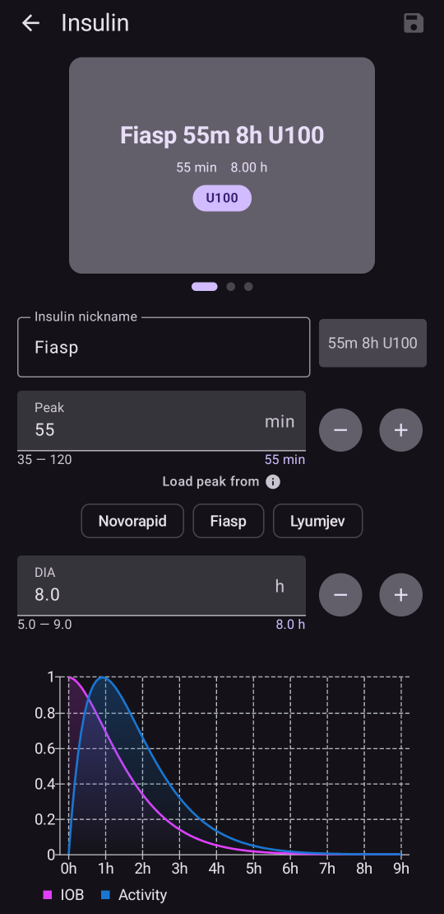
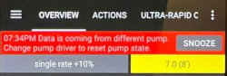

# Konfiguracija (Config Builder)

```{admonition} Coming from AAPS v3?
:class: note
The **Config Builder** is now called **Configuration** and is in the **menu** (☰). See [What changed in AAPS v4](#v4-changes).
```

**Configuration** is where you choose which plugins are active (CGM, pump, APS algorithm, sensitivity, sync, …) and open each plugin and its settings. [Vodič korak po korak](#configuration-v4) nalazi se u nastavku; ostatak ove stranice detaljno opisuje svaki odjeljak.

(configuration-v4)=
## Configuration in AAPS v4

In **AAPS** v4, tap the **menu** (☰) in the **top-left** corner of the main screen and choose **Configuration** (_“Set up your configuration (CGM, pump, …) and enable features”_).


Plugins are grouped by **category** — for example _Smoothing_, _Calibration_, _Sensitivity detection_, _APS_, _Communication_ and _General_. Svaki redak prikazuje naziv kategorije i **trenutno aktivni** dodatak (npr. _APS → OpenAPS SMB_). Dodirnite redak da otvorite kategoriju.


Inside a category you see the plugins available for it. U kategorijama s jednim izborom odabirete aktivni dodatak; neke kategorije dopuštaju višestruki izbor (_„Odaberite sve koji odgovaraju“_). Each plugin offers two actions:

- **Open plugin** — opens the plugin's own screen.
- **Settings** — opens the plugin's preferences (settings may be grouped into expandable sections).


(configuration_sync_icon)=
### The mobile icon — “synced from the master”

A small **mobile (phone) icon** next to a category or setting means that item is **synchronized from the master** — its value/selection is delivered to this device over the NSClientV3 (Nightscout) channel.

Na **klijentu** (**AAPSClient**) ove su stavke **usklađene s glavnim uređajem**. The icon is only shown on a client, so it does not appear in the screenshot above, which was taken on the main **AAPS** app. On a client it typically appears on _Smoothing_, _Calibration_, _Sensitivity detection_ and _APS_. Kako se točno glavni uređaj i klijenti usklađuju — i koje postavke možete mijenjati s koje strane — opisano je u odjeljku [Upravljanje glavni uređaj ↔ klijent](#client-master-config-prefs).

Ista se ikona pojavljuje i **unutar postavki**, pokraj pojedinih postavki koje se sinkroniziraju. In the example below _Absorption cutoff_ carries the icon; settings without the icon are configured per device:


Items **without** the icon are configured **per device**. Najvažniji primjer je sama veza **NSClientV3 (Komunikacija)** — **Nightscout URL**, **pristupni token** i **WebSockets** postavljaju se na svakom telefonu zasebno, pa **nemaju** ikonu mobitela.

---

(Config-Builder-tab-or-hamburger-menu)=
## Opening a plugin screen

Each plugin screen is opened in one of these ways (the tabs and the eye checkbox of **AAPS** v3 are gone, see [What changed in AAPS v4](#v4-changes)):

- **Configuration** → the plugin's category → **Open plugin**,
- the **Manage** sheet of the bottom navigation, for the screens you use most (Profile, Insulin settings, Pump, Automation, Food...),
- a [QuickLaunch](../DailyLifeWithAaps/QuickLaunch.md) button that you add yourself,
- the **search bar** on the main screen.

```{contents}
:backlinks: entry
:depth: 2
```

(ConfigBuilder_Profile)=

## Profil

This module cannot be disabled as it is a core part of **AAPS**.

See [Your AAPS Profile](../SettingUpAaps/YourAapsProfile.md) for a basic understanding of what goes inside your **Profile**.

(insulin)=
(Config-Builder-insulin)=
## Inzulin


In **AAPS** 4 the insulin is no longer a plugin selected in **Configuration**. Open **Manage → Insulin settings** to set up the insulin you are using.

Uređivač inzulina omogućuje vam:

- give the insulin an **Insulin nickname** so it is easy to recognise,
- set the **Peak** (time to maximum insulin activity, in minutes) and the **DIA** (Duration of Insulin Action, in hours), either by typing the value or using the **–** / **+** buttons,
- tap a **Load peak from** preset button — **Novorapid** (75 min), **Fiasp** (55 min) or **Lyumjev** (45 min) — to fill in the standard peak time for that insulin in one step.

Dopušteni rasponi jednaki su za svaki inzulin:

- **DIA**: 5 to 9 hours (5 to 10 hours if the patient type is set to **Pregnant**). See [Duration of insulin action (DIA) and peak](#Config-Builder-insulin-dia) to choose a value.
- **Peak**: 35 to 120 minutes.

The **IOB** (insulin on board) and **Activity** curves shown at the bottom of the editor update as you change the values, so you can see straight away how your settings shape the insulin action.

More information to understand the Insulin Profile as shown in **AAPS** [here](#AapsScreens-insulin-profile).

(Config-Builder-insulin-change-active)=
### Promjena inzulina koji se koristi (DIA ili vrh djelovanja)

The insulin marked **ACTIVE** is the one your running profile uses. Njegova su polja zasivljena: ne možete ga urediti ni izbrisati. Tako naziv inzulina prikazan u vašem aktivnom profilu uvijek odgovara postavkama koje se stvarno koriste.

Da promijenite DIA ili vrh djelovanja koji koristite:

1. Open **Manage → Insulin settings**. If the screen opens read-only (a **✏️ pencil** in the top bar), tap the pencil and unlock your settings.
2. Tap **+** (_Add new insulin_). **AAPS** creates a copy of the insulin shown on screen.
3. Set the new **Peak** and/or **DIA**, then tap the save icon (top right).
4. Tap **▶** (_Activate insulin_) and confirm. The new insulin becomes **ACTIVE**.

```{admonition} The name includes peak and DIA
:class: note
**AAPS** adds the peak, DIA and concentration to the insulin name automatically (for example _Fiasp 55m 8h U100_), so you can tell your configurations apart at a glance.
```

Stari inzulin možete izbrisati kada više nije aktivan.

### The "Load peak from" presets

In **AAPS** 4 there is no list of insulin types to choose from. Svaki inzulin koristi istu eksponencijalnu krivulju djelovanja; razlikuju se samo **Vrh djelovanja** i **DIA**. Predlošci **Učitaj vrh djelovanja iz** u uređivaču inzulina jednim dodirom upisuju preporučeni vrh djelovanja za najčešće inzuline (mala ⓘ pokraj **Učitaj vrh djelovanja iz** prikazuje ih s njihovim vrijednostima vrha djelovanja). **Vrh djelovanja** i **DIA** i dalje možete naknadno prilagoditi.

Vrh djelovanja mijenjajte od preporučene vrijednosti samo ako razumijete učinak te promjene. [Graf krivulje inzulina](#AapsScreens-insulin-profile) pomaže vam razumjeti krivulje.

#### Novorapid


- recommended for Humalog, Novolog and Novorapid (called _Rapid-Acting Oref_ in **AAPS** v3)
- Peak = 75 minutes after injection

#### Fiasp



- recommended for Fiasp (called _Ultra-Rapid Oref_ in **AAPS** v3)
- Peak = 55 minutes after injection

(Config-Builder-lyumjev)=
#### Lyumjev


- recommended for Lyumjev
- Peak = 45 minutes after injection

#### Custom peak

- There is no separate "Free-Peak Oref" insulin type in **AAPS** 4: enter any **Peak** (35 to 120 minutes) directly in the [insulin editor](#Config-Builder-insulin), without using a preset.
- A custom peak is useful if you use an insulin that is not in the list, or a mixture of different insulins.

(Config-Builder-insulin-dia)=
### Duration of insulin action (DIA) and peak

```{warning}
In looping, decreasing DIA or peak will always increase administered insulin. DIA works differently in AAPS than in commercial AID systems, and careless changes to these settings can change insulin dosing in a way which is much larger or smaller than expected.
```

AAPS models the timeline of insulin action with a mathematical formula, configured using **DIA** and the closely related **peak** settings. DIA je teoretsko trajanje do trenutka kada aktivni inzulin (IOB) padne na nulu, a vrh djelovanja je trenutak kada je učinak inzulina najjači. This yields an IOB curve and an activity curve, which is simply the **rate** of IOB decay.

Consider that when AAPS is looping, it's normal to have periods of [zero-temping](#Open-APS-features-super-micro-bolus-smb). Ovaj nedostajući bazalni inzulin u potpunosti se oduzima od aktivnog inzulina (IOB), što objašnjava zašto IOB u praksi padne na nulu mnogo sati ranije od postavljenog DIA. You can inspect [bolus IOB and basal IOB](#aaps-screens-iob-cob-basal-sens) separately from the main screen.

To configure DIA and peak, tap **Manage** in the main screen, and then tap **Insulin settings**. AAPS ovako prikazuje aktivnu konfiguraciju inzulina:


In this example, the peak setting is 55 minutes, DIA is 8 hours and [insulin concentration](#Insulin-Concentration) is the standard 100 IU/mL.

Zbog utjecaja nultog privremenog bazala, objašnjenog gore, i formule koju AAPS koristi za opadanje aktivnog inzulina (IOB), većina korisnika postavlja znatno veći DIA nego u komercijalnim sustavima. In general, many people find that a **DIA** of 9h works well for them. Kada steknete više iskustva s AAPS-om i imate dobro podešen profil, možete pokušati pronaći osobne postavke DIA i vrha djelovanja uz pomoć informacija u nastavku.

````{admonition} Details on the impact of DIA and peak configuration
:class: dropdown

Since the basal rate has an indirect influence on IOB decay in AAPS, it follows that too high basal rates can mask too high DIA, and vice versa. It makes sense to first carefully tune basal rates before adjusting DIA and peak. Additionally, consider that the DIA and peak settings interact, in the sense that the effect of DIA depends on peak, and vice versa.

These charts show the exact impact of DIA and peak on the IOB curves, across the range of allowed values.

Adjusting DIA:

```{image} ../images/Profile/iob_remaining_static_peak.png
:width: 400px
```

Adjusting peak:

```{image} ../images/Profile/iob_remaining_static_dia.png
:width: 400px
```

Finally, a comparison adjusting DIA and peak in parallel. The logic here is that both values are adjusted in the same relative amounts, so that `49/35 ~ 7/5`. Or similarly, `120/93 ~ 9/7`. The intervals will be consistent regardless of the baseline DIA or peak, as long as the relative change is the same for both.

```{image} ../images/Profile/iob_remaining_uniform.png
:width: 400px
```

Note that when DIA and peak are adjusted in this fashion, every point in the curve will shift by the same relative amount.

````

#### Further reading on DIA and peak configuration

- [Technical details and historical background from the AAPS predecessor, OpenAPS](https://openaps.readthedocs.io/en/latest/docs/While%20You%20Wait%20For%20Gear/understanding-insulin-on-board-calculations.html#understanding-the-new-iob-curves-based-on-exponential-activity-curves).
- [Why we are regularly wrong in the duration of insulin action (DIA) times we use, and why it matters…](https://www.diabettech.com/insulin/why-we-are-regularly-wrong-in-the-duration-of-insulin-action-dia-times-we-use-and-why-it-matters/) on Diabettech.
- [Exponential Insulin Curves + Fiasp](https://web.archive.org/web/20220630154425/http://seemycgm.com/2017/10/21/exponential-insulin-curves-fiasp/) on See My CGM (archive).
- [Revised Humalog model in a closed loop](https://bionicwookiee.com/2022/04/13/revised-humalog-model-in-a-closed-loop/) and other articles on Bionic Wookie, recommending a DIA of 9h for Lyumjev, Fiasp, NovoRapid, Humalog.

(Config-Builder-bg-source)=
## Izvor GUK-a
Select the blood glucose source you are using. Više informacija o postavljanju potražite na stranici [Kompatibilni CGM-ovi](../Getting-Started/CompatiblesCgms.md).


Scroll down to see the other sources:


- [xDrip+ BG](../CompatibleCgms/xDrip.md) - also for compatible apps such as [Juggluco](../CompatibleCgms/Juggluco.md)
- [NSClient BG](../CompatibleCgms/CgmNightscoutUpload.md) - only if you know what you are doing, see [BG Source](../Getting-Started/CompatiblesCgms.md).
- [MM640g](../CompatibleCgms/MM640g.md)
- Glimp - only version 4.15.57 and newer are supported
- [BYODA (Build Your Own Dexcom App)](#DexcomG6-if-using-g6-with-build-your-own-dexcom-app).
- MicroTech CGM App - for the Aidex / LinX CGM
- [Poctech](../CompatibleCgms/PocTech.md)
- Tomato (MiaoMiao) - Tomato App for MiaoMiao device
- [Glunovo](https://infinovo.com/) - Glunovo App for Glunovo CGM system
- Intelligo - Intelligo App
- Syai/Ottai - for the Syai and Ottai apps (see [Syai Tag](../CompatibleCgms/SyaiTagX1.md) and [Ottai](../CompatibleCgms/OttaiM8.md))
- SI App - patched SI App or Sibionics App for Sibionics CGM
- Sino App - patched app for Sinocare CGM
- Notification Reader - reads glucose values from the notifications shown by official CGM apps (Dexcom, Medtronic, Eversense, etc.)
- Instara - Instara App
- Random BG - generates random BG data for testing. Može se omogućiti samo u inženjerskoj (razvojnoj) verziji s **Virtualnom pumpom**, pa se u normalnoj instalaciji **AAPS-a** ne može koristiti.

## Smoothing


See [Smoothing blood glucose data](../CompatibleCgms/SmoothingBloodGlucoseData.md).

## Kalibracija

Choose how **AAPS** treats the values it receives from your sensor:

- **No calibration**: the sensor values are used as they are. Koristite ovo kada je senzor već tvornički kalibriran i točan. Ovo je zadana postavka.
- **Linear calibration**: **AAPS** corrects the sensor values with a slope and an offset that it computes from your fingerstick entries.

How to use **Linear calibration**:

1. Select **Linear calibration** in the **Calibration** category.
2. When you insert a new sensor, log the sensor change: use **Log sensor change** on the calibration screen, or enter a CGM sensor insert in the Careportal. This tells **AAPS** when the sensor session started. If **AAPS** notices a gap of more than 30 minutes in the readings, it may ask you to mark a sensor change; this prompt appears on the master only, not on a client.
3. Open the plugin and tap **Add calibration**. Enter your fingerstick value. **AAPS** pairs it with the sensor value from the last 10 minutes.

A calibration is accepted only when:

- a sensor change is logged and at least **2 hours** have passed since then (warm-up),
- your glucose is stable. If it changes too fast, the dialog tells you and shows the limit,
- there is a CGM reading from the last 10 minutes,
- it is for the current moment. You cannot enter older fingerstick values.

How the correction works:

- **AAPS** draws a straight line through the pairs of the current sensor: `corrected value = slope × sensor value + offset`.
- Newer pairs count more than older ones: a pair that is 2 days old counts about 37 %, a 4-day-old pair about 14 %. The line therefore follows your sensor as it drifts.
- At least **2 pairs** are needed.
- If the pairs are close together (less than 54 mg/dL / 3 mmol/L apart), only the values are shifted (offset, no slope).
- The slope is kept between 0.55 and 1.6. A slope outside this range is limited to the nearest value.
- Safety limit: if the correction at 100 mg/dL (5.5 mmol/L) would be more than ±30 mg/dL (1.7 mmol/L), no correction is applied. This protects you from a wrong entry.

What it changes:

- The corrected value is used everywhere: the BG on the main screen, the graph and the loop. The sensor readings themselves are not changed. The correction is applied on top, also to the earlier readings of the current sensor.
- A new sensor change starts from zero. Pairs from earlier sensors no longer count.
- On the graph, a calibration is shown as a marker at the fingerstick value.
- Calibrations are synchronized through Nightscout, so your clients show the same corrected values.

Check and remove entries:

- **Open plugin** shows the status (for example _Slope 0.85, mid-range correction -0.4_), a chart of your pairs with the line, and the list of entries.
- If an entry is wrong (for example, you had sugar on your finger), tap the bin icon next to it. The line is calculated again at once.

```{admonition} Using xDrip+ as BG source?
:class: note
xDrip+ has its own calibration. Calibrate in one place only, so that the sensor values are not corrected twice.
```

```{admonition} Calibrate with care
:class: warning
A wrong fingerstick value leads to wrong glucose values and therefore to wrong insulin dosing. Wash your hands before measuring, and do not calibrate while your glucose is changing fast.
```


(Config-Builder-pump)=
## Pumpa
Odaberite pumpu koju koristite. See [Compatible pumps](../Getting-Started/CompatiblePumps.md) page for more setup information.


Pomaknite se prema dolje da vidite sve upravljačke programe pumpi:


When you select another pump, **AAPS** asks you to confirm the change:


- [Dana R](../CompatiblePumps/DanaR-Insulin-Pump.md)
- Dana R Korean (za domaću, korejsku pumpu DanaR)
- Dana Rv2 (pumpa DanaR s neslužbenom nadogradnjom firmwarea)
- [Dana-i/RS](../CompatiblePumps/DanaRS-Insulin-Pump.md)
- [Accu Chek Insight](../CompatiblePumps/Accu-Chek-Insight-Pump.md)
- [Accu Chek Combo](../CompatiblePumps/Accu-Chek-Combo-Pump-v2.md)
- Omnipod for [Omnipod Eros](../CompatiblePumps/OmnipodEros.md)
- Dash for [Omnipod DASH](../CompatiblePumps/OmnipodDASH.md)
- [Medtronic](../CompatiblePumps/MedtronicPump.md)
- [Diaconn G8](../CompatiblePumps/DiaconnG8.md)
- [EOPatch2](../CompatiblePumps/EOPatch2.md)
- [Medtrum](../CompatiblePumps/MedtrumNano.md)
- [Equil 5.3](../CompatiblePumps/Equil5.3.md)
- [Carelevo](../CompatiblePumps/CareLevo.md)
- Virtual pump: open loop - **AAPS** suggestions only
  - as you make your first steps with **AAPS**, during the first [objectives](../SettingUpAaps/CompletingTheObjectives.md)
  - za pumpu koja još nema upravljački program

(config-builder-wrong-pump-data)=
### Poruka: „Podaci dolaze s druge pumpe“

**AAPS** remembers the pump it is connected to (pump type and serial number). Ako primi podatke s druge pumpe, na primjer nakon što je vaša pumpa zamijenjena novom istog modela, prikazuje ovu poruku i zanemaruje podatke s te pumpe:



To use the new pump, change the pump driver: select **Virtual pump**, confirm, then select your pump again. **AAPS** then registers the pump it is connected to now.

(Config-Builder-sensitivity-detection)=

## Detekcija osjetljivosti


Odaberite vrstu detekcije osjetljivosti. For more details of different designs please [read on here](../DailyLifeWithAaps/SensitivityDetectionAndCob.md). Ovo tijekom rada analizira povijesne podatke i radi prilagodbe ako prepozna da ste osjetljiviji na inzulin (ili, obrnuto, otporniji) nego obično. More details about how the sensitivity ratio itself is calculated can be found in [Key AAPS Features > Autosens](#Open-APS-features-autosens).

You can view your sensitivity on the main screen in an [additional graph](#AapsScreens-section-g-additional-graphs), by selecting SENS% and watching the white line. Note, you need to be in [Objective 8](#objectives-objective8) in order to let Sensitivity Detection/[Autosens](#Open-APS-features-autosens) automatically adjust the amount of insulin delivered. Prije nego dosegnete taj cilj, postotak Autosensa / linija na grafu prikazuju se samo informativno.

### Postavke apsorpcije
If you use Oref1 with **SMB** you must change **min_5m_carbimpact** to 8. The value is only used during gaps in **CGM** readings or when physical activity "uses up" all the blood glucose rise that would otherwise cause **AAPS** to decay COB. At times when [carb absorption](../DailyLifeWithAaps/CobCalculation.md) can't be dynamically worked out based on your blood's reactions it inserts a default decay to your carbs. U osnovi, to je sigurnosna zaštita.

(Config-Builder-aps)=
## APS


Odaberite željeni APS algoritam za prilagodbu terapije. You can view the active detail of the chosen algorithm with **Open plugin**.
- OpenAPS AMA
  - Advanced Meal Assist (napredna pomoć za obroke): stariji algoritam, više se ne preporučuje.
  - Jednostavno rečeno, prednost je u tome što nakon bolusa za obrok sustav može brže postaviti visoki privremeni bazal AKO pouzdano unosite ugljikohidrate.
- [OpenAPS SMB](#Open-APS-features-super-micro-bolus-smb)
  - Super Micro Bolus: najnoviji algoritam, preporučen za sve korisnike.
  - In contrast to AMA, SMB does not use temporary basal rates to control glucose levels, but mainly small **Super Micro Boluses**.
  - Note : It is recommended to use this algorithm from the beginning, even though you will not actually get SMBs delivered until [Objective 9](#objectives-objective9).
- [Auto ISF](#Open-APS-features-auto-isf)
  - Eksperimentalni algoritam za napredne korisnike. Prikazuje se tek kada su ciljevi ispunjeni.

If switching from AMA to SMB algorithm, _min_5m_carbimpact_ must be changed manually to **8** (default value for SMB) in [Settings → Absorption settings](#Preferences-min_5m_carbimpact).

## Petlja

This module cannot be disabled as it is a core part of **AAPS**.


## Ograničenja


### Ciljevi

**AAPS** has a learning program (a series of objectives) that you have to fulfill step by step. Ovo bi vas trebalo sigurno voditi kroz postavljanje sustava zatvorene petlje.

See [Objectives](../SettingUpAaps/CompletingTheObjectives.md) page for more information.

## Komunikacija

In this category (called **Synchronization** in **AAPS** v3), you choose if/where you want **AAPS** to send your data to.


Pomaknite se prema dolje da vidite ostatak popisa:


### NSClientV3

Can be used as a [reporting server](../SettingUpAaps/SettingUpTheReportingServer.md) and/or for [remote monitoring](../RemoteFeatures/RemoteMonitoring.md), [remote control](../RemoteFeatures/RemoteControl.md).

See [Synchronization with the reporting server](#SetupWizard-synchronization-with-the-reporting-server-and-more) to set up NSClientV3 synchronization.

### Tidepool

Can be used as a [reporting server](../SettingUpAaps/SettingUpTheReportingServer.md).

See [Tidepool](../SettingUpAaps/Tidepool.md).

### xDrip

Used to **send** data such as glucose values and treatments to xDrip+ on the same phone. Its settings also hold **Send status to xDrip+**, a status line with IOB and COB that xDrip+ and some watch companion apps display.

### Open Humans

See [Open Humans](../SupportingAaps/OpenHumans.md).

(Config-Builder-wear)=
### Wear
Monitor and control **AAPS** from a Wear OS watch. Setting up the watch is explained on [Wear OS smartwatch](../WearOS/WearOsSmartwatch.md). After enabling the plugin, choose its options in [Settings > Wear](#preferences-wear). Using the watch is explained on [Operation of AAPS via your Wear OS smartwatch](../RemoteFeatures/RemoteControlWearOS.md).

(external-companion-apps)=
### Vanjske prateće aplikacije

Broadcasts **AAPS** status data on the phone so that other apps installed on it can display it — for example watch or widget companion apps. Emitirani podaci uključuju glukozu i trend, aktivni inzulin (IOB), aktivne ugljikohidrate (COB), bazal i privremeni bazal, naziv profila, status petlje, bateriju telefona i pumpe, razinu u spremniku i napredak bolusa. Omogućite ovo samo ako to traži prateća aplikacija koju koristite.

Apps known to read this broadcast are [WatchDrip+](https://bigdigital.home.blog/) (Xiaomi and Amazfit watches), [GlucoDataHandler](https://github.com/pachi81/GlucoDataHandler) (Wear OS complications and widgets, and Android Auto through GlucoDataAuto) and the G-Watch app. Their setup is described on [Smartwatches and AAPS](#watches-external-companion-apps). Some of them also use **Send status to xDrip+** from the **xDrip** plugin above for a status line with IOB and COB.

In earlier versions this plugin was called **Samsung Tizen**, after the [G-Watch app for Samsung Tizen watches](#Watchfaces-tizen) it was first made for.

### Garmin

Veza s Garmin uređajem (Fenix, Edge...)
## Tretmani
Open the **menu** (☰) and select [Treatments history](#aaps-screens-treatments) to see the treatments that have been recorded. Should you wish to edit or delete an entry (e.g. you ate less carbs than you expected) then select 'Remove' and enter the new value (change the time if necessary) through **Treatments → Carbs** in the bottom navigation (see [Carbs](#screens-bolus-carbs)).

## Općenito

In **AAPS** 4 the **General** category of **Configuration** only lists **Autotune**. Ostale značajke opisane u nastavku uvijek su dostupne i više ih ne treba ovdje omogućiti; svaki odlomak navodi gdje ih pronaći.


### Pregled

The [main screen](#AapsScreens-the-homescreen) of **AAPS** is not a plugin any more and has no settings of its own in **Configuration**. The options that used to be here are in **Settings** (gear icon): [Show notes in dialogs](#Preferences-show-notes-field-in-treatments-dialogs), [Status lights](#Preferences-status-lights) and the [Bolus percentage](#Preferences-deliver-this-part-of-bolus-wizard-result) used by the bolus wizard. The super bolus option of **AAPS** 3.x is [not available as a setting](#Preferences-advanced-settings-overview) in **AAPS** 4.

(Config-Builder-actions)=
### Radnje

The Actions tab of **AAPS** 3.x no longer exists. Its buttons are now in the **Manage** sheet — see [Where did the Actions tab go?](#screens-action-tab).

### Automatizacija

**Manage → Automation** lets you manage your [Automations](../DailyLifeWithAaps/Automations.md), starting at [Objective 10](#objectives-objective10).

(Config-Builder-sms-communicator)=
### SMS Communicator
Allows remote caregivers to control some **AAPS** features via SMS, see [SMS Commands](../RemoteFeatures/SMSCommands.md) for more setup information.

### Hrana
**Manage → Food** displays the food presets defined in the Nightscout food database, see [Nightscout Readme](https://github.com/nightscout/cgm-remote-monitor#food-custom-foods) for more setup information.

Note: Entries cannot be used in the **AAPS** calculator. (Samo pregled)

(Config-Builder-autotune)=
### Autotune

You can enable Autotune, see [here](../AdvancedOptions/Autotune.md).

### Održavanje

Open the **menu** (☰) and select **Maintenance** to export / import settings and manage log files.


### Konfiguracija (Config Builder)

Now called **Configuration**: this current page.