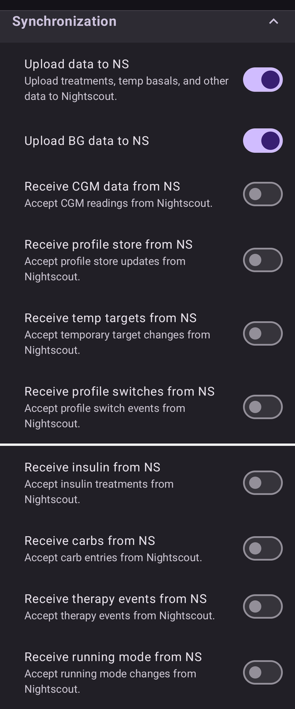
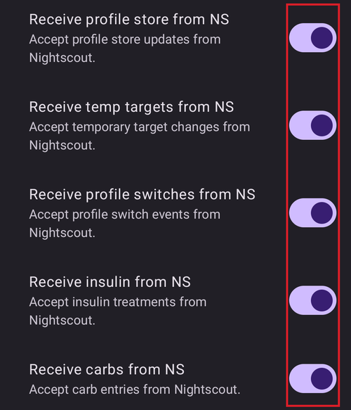
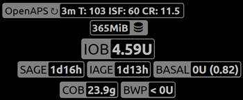

# Nightscout

(Nightscout-security-considerations)=

## Sigurnosna razmatranja

Nightscout je poslužitelj za izvješća i nadzor za **AAPS**: **AAPS** u njega prenosi vaše podatke, a vi ili osobe koje se brinu o vama gledate ih na web stranici Nightscouta ili u aplikacijama za praćenje. Na njemu su vaši medicinski podaci, profili i tretmani, zato je dobro razmisliti o zaštiti vaše Nightscout stranice.

U **AAPS**-u 4 daljinsko upravljanje ne ide preko web stranice Nightscouta. Dok je upravljanje s klijenta uključeno ([zaštićeni način rada](#client-master-control-hardened-mode)), **AAPS** **ne primjenjuje** tretmane ni ciljeve koji su upisani izravno u Nightscout. Daljinske naredbe umjesto toga dolaze s uparenog **AAPSClienta** – pogledajte [Upravljanje glavni uređaj ↔ klijent](#client-master-control).

Budite iznimno oprezni ako Nightscout koristite kao izvor podataka o GUK-u za AAPS.

### Postavke Nightscouta

Možete zabraniti javni pristup svojoj Nightscout stranici pomoću [uloga za autentifikaciju](https://nightscout.github.io/nightscout/security): svoj URL dijelite samo s tokenom `readable`, nikada s tokenom `admin`.

Nightscout `API_SECRET` je glavna lozinka vaše stranice: nemojte je javno dijeliti.

(Nightscout-aaps-settings)=

### Postavke AAPS-a

Prihvaćanje podataka iz Nightscouta (promjene profila, tretmani, ...) nije obavezno i zadano je isključeno. Dolje opisani prekidači skriveni su dok je uključeno upravljanje s klijenta (zaštićeni način rada) i u [jednostavnom načinu rada](#preferences-simple-mode).

* Postavkama **Sinkronizacija** dodatka NSClientV3 pristupate na jedan od ovih načina: 1) **Postavke** (ikona zupčanika na glavnom zaslonu) -> **NSClientV3** -> **Sinkronizacija**, ili 2) **Konfiguracija** (izbornik ☰) -> **Komunikacija** -> „**Postavke**“ ispod NSClientV3.
* Uključite „Prenesi podatke u NS“.
* „Prenesi podatke o GUK-u u NS“ nalazi se u postavkama vašeg izvora GUK-a (**Konfiguracija → Izvor GUK-a → Postavke**). Uključite tu opciju, osim ako je vaš izvor podataka o GUK-u za AAPS Nightscout: u tom slučaju je **nemojte** uključiti.
* Nemojte uključiti „Primaj CGM podatke iz NS-a“, osim ako je Nightscout vaš izvor podataka o GUK-u.

#### Bez sinkronizacije iz Nightscouta

Keeping all the "Receive … from NS" options disabled makes sure no Nightscout change will be used by AAPS:

#### Prihvaćanje promjena iz Nightscouta

Ako uključite ove opcije, možete mijenjati postavke AAPS-a putem Nightscouta, npr. mijenjati i zamijeniti profile, postavljati privremene ciljeve i dodavati ugljikohidrate koje će AAPS uzeti u obzir. Prikazuju se samo kada su upravljanje s klijenta i jednostavni način rada isključeni.  
Imajte na umu da će se tretmani inzulinom koristiti samo za izračune, kao „Ne daj bolus, samo zabilježi“.

### Dodatne sigurnosne postavke

Redovito ažurirajte telefon, kako je opisano u odjeljku [Sigurnost na prvom mjestu](#preparing-safety-first).

(Nightscout-manual-nightscout-setup)=

## Ručno postavljanje Nightscouta

Pretpostavlja se da već imate Nightscout stranicu. Ako nemate, posjetite stranicu [Nightscout](http://nightscout.github.io/nightscout/new_user/) za potpune upute o postavljanju. Upute u nastavku su postavke koje također morate dodati na svoju Nightscout stranicu. Vaša Nightscout stranica mora biti barem verzije 15, zato provjerite koristite li [najnoviju verziju](https://nightscout.github.io/update/update/#updating-your-site-to-the-latest-version), inače ćete dobiti poruku o pogrešci u aplikaciji AAPS.

* [Uredite svoje varijable](https://nightscout.github.io/nightscout/setup_variables/#nightscout-configuration)

* Dodajte ili uredite varijable ovako:
  
  * `ENABLE` = `careportal boluscalc food bwp cage sage iage iob cob basal dbsize pushover pump openaps`
  * `DEVICESTATUS_ADVANCED` = `true`
  * `SHOW_FORECAST` = `openaps`
  * `PUMP_FIELDS` = `reservoir battery clock`
  * Možete postaviti razne alarme za [nadzor pumpe](https://github.com/nightscout/cgm-remote-monitor#pump-pump-monitoring), a posebno se preporučuje alarm za postotak baterije: 
    * `PUMP_WARN_BATT_P` = `51`
    * `PUMP_URGENT_BATT_P` = `26` 

* Spremite promjene. Vaša Nightscout stranica sada bi trebala moći prikazati oznake (pills). Prikaz možete zadano uključiti tako da ih dodate u `SHOW_PLUGINS`.
  
  * `SHOW_PLUGINS` = `careportal boluscalc food bwp cage sage iage iob cob basal dbsize pushover pump openaps`
  
  

## Nightscout kao plaćena usluga SaaS (Software as a Service, softver kao usluga)

Varijable postavite u web sučelju pružatelja usluge. Ako je potrebno, obratite se službi za podršku pružatelja usluge.