# Postavke

U **AAPS**-u v4 postavke se nalaze na zaslonu **Postavke**. Do njih vode tri puta – pojedinosti pogledajte na stranici [Promjene konfiguracije AAPS-a](../SettingUpAaps/ChangeAapsConfiguration.md):

1. Dodirnite ikonu **Postavke** (zupčanik) u gornjem desnom kutu glavnog zaslona: sve postavke, grupirane u odjeljke koji se mogu proširiti.
2. U **Konfiguraciji** dodirnite „**Postavke**“ ispod aktivnog dodatka: samo postavke tog dodatka.
3. Koristite **traku za pretraživanje** na vrhu glavnog zaslona: samo počnite upisivati dio teksta koji tražite. Tako pronalazite pojedinačne postavke (čak i one koje nisu vidljive na zaslonu Postavke), dijaloške okvire i dokumentaciju.

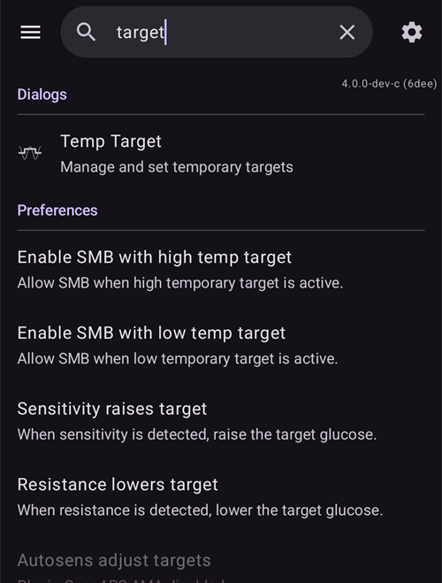

- **Odjeljci** se otvaraju i zatvaraju dodirom. Odjeljci koje vidite ovise o dodacima koje ste omogućili i o [jednostavnom načinu rada](#preferences-simple-mode).


```{contents}
:backlinks: entry
:depth: 2
```

(Preferences-general)=
## Općenito

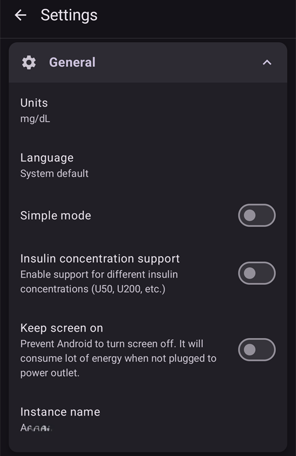

**Jedinice**

- Postavite jedinice na mmol/L ili mg/dL, prema svojim željama.

**Jezik**

- **AAPS** zadano koristi jezik telefona (preporučeno).

- Ako želite **AAPS** na drugom jeziku od jezika telefona, odaberite ga ovdje. Na Androidu 13 i novijim **AAPS** ga u Androidu registrira kao vlastiti jezik aplikacije, pa ga slijede svi njegovi zasloni, glavni zaslon, widgeti i način pisanja brojeva.

- Kada promijenite jezik, tekstovi **AAPS**-a odmah se prebace na novi jezik. Ako su neki tekstovi i dalje na starom jeziku, ponovno pokrenite **AAPS**.
- Na Androidu 12 ova se postavka ne prikazuje: **AAPS** uvijek koristi jezik telefona.
- Postavka je skrivena u [jednostavnom načinu rada](#preferences-simple-mode).

(preferences-simple-mode)= **Jednostavni način rada**

**Jednostavni način rada** zadano je uključen kada prvi put instalirate **AAPS**. U **jednostavnom načinu rada** skriven je velik broj postavki, a postavke su zamijenjene unaprijed zadanim vrijednostima. Jednostavni način rada trebali biste isključiti kada se upoznate s korisničkim sučeljem i postavkama **AAPS**-a.

**Podrška za koncentraciju inzulina**

- Omogućuje podršku za različite koncentracije inzulina (U50, U200, ...). Uključite ovo samo ako stvarno koristite koncentraciju različitu od U100 i pažljivo pročitajte upozorenja.
- Postavka je skrivena u [jednostavnom načinu rada](#preferences-simple-mode).

**Drži zaslon uključenim**

- Prisiljava Android da zaslon stalno drži uključenim. To je korisno za prezentacije i sl. Ali troši mnogo energije baterije. Zato se preporučuje spojiti pametni telefon na kabel punjača.

**Naziv instance**

- Ime osobe koja koristi ovaj telefon. Po njemu se ova instanca **AAPS**-a razlikuje u izvješćima i sinkronizaciji, npr. ako **AAPS** koriste dvoje djece s dijabetesom tipa 1 u vašoj obitelji.
- Koristi se u nazivima datoteka izvezenih postavki.
- Prikazuje se na [Dual Watchfaceu](../WearOS/WearOsSmartwatch.md).

(Preferences-skin)=
### Izgled (skin)

Izbor izgleda (skin) iz **AAPS**-a 3.x (Original, Low resolution, Large display...) više ne postoji u **AAPS**-u 4. Novo sučelje automatski se prilagođava vašem zaslonu, a shemu boja možete promijeniti u odjeljku [Izgled](#preferences-appearance).

(preferences-appearance)=
## Izgled

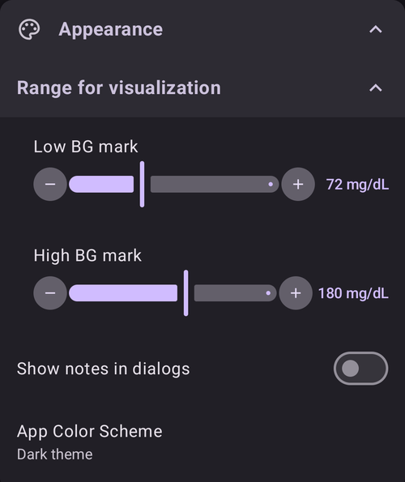

(Preferences-range-for-visualization)=
### Raspon za prikaz

Odaberite gornju i donju granicu za GUK graf na glavnom zaslonu **AAPS**-a i na pametnom satu. To služi samo za prikaz, a nije ciljni raspon za vaš GUK. Primjer: 70 – 180 mg/dL ili 3,9 – 10 mmol/L

(Preferences-show-notes-field-in-treatments-dialogs)=
### Prikaži bilješke u dijaloškim okvirima

Omogućuje dodavanje kratkih bilješki uz tretmane (bolus kalkulator, ugljikohidrati, inzulin...)

Postavka je skrivena u [jednostavnom načinu rada](#preferences-simple-mode).

### Shema boja aplikacije

Odaberite svijetlu temu, tamnu temu ili praćenje postavke sustava telefona.

(Preferences-protection)=
## Zaštita

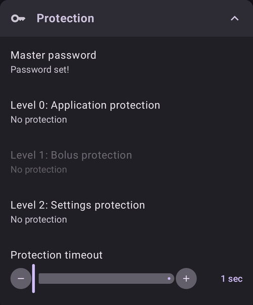

(Preferences-master-password)=
### Glavna lozinka

Obavezno da biste mogli [izvoziti postavke](../Maintenance/ExportImportSettings.md), jer su od verzije 2.7 šifrirane.

Ako ste zaboravili glavnu lozinku, pogledajte [Kako resetirati glavnu lozinku?](#FAQ-reset-master-password)

**Biometrijska zaštita možda neće raditi na telefonima OnePlus. To je poznat problem OnePlusa na nekim telefonima.**

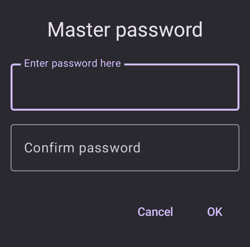

(Preferences-settings-protection)=
### Zaštita postavki

- Zaštitite svoje postavke lozinkom ili biometrijskom provjerom autentičnosti telefona (npr. kada [dijete koristi **AAPS**](../RemoteFeatures/RemoteMonitoring.md)). Ako uključite ovu značajku, svaki put kada želite otvoriti bilo koji prikaz povezan s postavkama, morat ćete potvrditi autentičnost.

- Zasloni za upravljanje (**Profil**, **Postavke inzulina**, **Privremeni cilj**, **Brzi kalkulator**) tada se otvaraju **samo za čitanje**. I dalje možete aktivirati ili koristiti stavku, ali dodavanje, uređivanje, kloniranje i brisanje skriveni su dok ne otključate postavke. Pogledajte [Zaštita postavki sada zaključava i zaslone za upravljanje](#v4changes-read-only-management).

- Prilagođenu lozinku trebate koristiti ako glavnu lozinku želite koristiti samo za zaštitu [izvezenih postavki](../Maintenance/ExportImportSettings.md), a za uređivanje postavki drugu lozinku.

- Ako koristite prilagođenu lozinku, kliknite na redak „Lozinka za postavke“ i postavite lozinku kako je opisano [gore](#Preferences-master-password).

### Zaštita aplikacije

Ako je aplikacija zaštićena, morate unijeti lozinku ili koristiti biometrijsku provjeru autentičnosti telefona da otvorite **AAPS**, i ponovno kada se vratite u aplikaciju nakon [vremena isteka zaštite](#Preferences-password-and-pin-retention).

**AAPS** će se odmah zatvoriti ako se unese pogrešna lozinka – ali će i dalje raditi u pozadini ako je prije bio uspješno otvoren.

### Zaštita bolusa

- Zaštita bolusa može biti korisna ako **AAPS** koristi malo dijete, a vi [dajete bolus putem SMS-a](../RemoteFeatures/SMSCommands.md).

- **Zaštita bolusa** može se odabrati tek kada je postavljena **Zaštita postavki** (razina 2).

- U primjeru ispod zaštita bolusa koristi **Glavnu lozinku**: **AAPS** je traži prije nego što otvori dijaloški okvir za tretman, npr. **Inzulin**. Uz **Biometriju**, ako biometrijska provjera autentičnosti ne radi, umjesto nje možete unijeti glavnu lozinku.

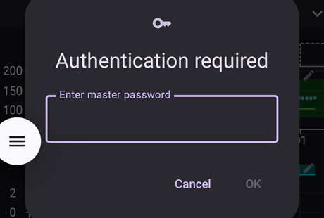

(Preferences-password-and-pin-retention)=
### Zadržavanje lozinke i PIN-a

**Vrijeme isteka zaštite** određuje koliko dugo (u sekundama) postavke ili funkcije bolusa ostaju otključane nakon što uspješno unesete lozinku.

## Sigurnost tretmana

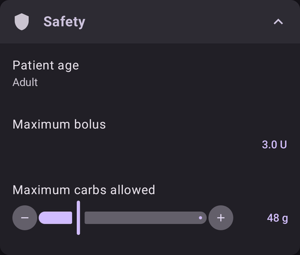

(preferences-patient-type)=
### Dob pacijenta

- Sigurnosne granice postavljaju se prema dobi koju odaberete u ovoj postavci.
- Ako počnete dosezati ove čvrste granice (npr. maksimalni bolus), vrijeme je da se pomaknete jedan korak više.
- Loša je ideja odabrati dob veću od stvarne, jer to može dovesti do predoziranja ako u dijaloški okvir za inzulin unesete pogrešnu vrijednost (npr. ako izostavite decimalni zarez).
- Ako želite znati stvarne brojeve za ove fiksne sigurnosne granice, pomaknite se do značajke algoritma koju koristite na [ovoj stranici](../DailyLifeWithAaps/KeyAapsFeatures.md).

(Preferences-maximum-bolus)=
### Maksimalni bolus

- Određuje najveću količinu inzulina za bolus, u jedinicama inzulina, koju **AAPS** smije isporučiti odjednom.
- Ova postavka postoji kao sigurnosna granica, da se spriječi isporuka golemog bolusa zbog slučajnog unosa ili pogreške korisnika.
- Preporučuje se postaviti razumnu vrijednost koja otprilike odgovara najvećoj količini inzulina za bolus koja vam ikada može zatrebati za obrok ili korekcijsku dozu.
- Ovo ograničenje primjenjuje se i na rezultate bolus kalkulatora.

### Maksimalno dopušteni ugljikohidrati

- Određuje najveću količinu ugljikohidrata, u gramima, za koju bolus kalkulator **AAPS**-a smije izračunati dozu.
- Ova postavka postoji kao sigurnosna granica, da se spriječi isporuka golemog bolusa zbog slučajnog unosa ili pogreške korisnika.
- Preporučuje se postaviti razumnu vrijednost koja otprilike odgovara najvećoj količini ugljikohidrata koja vam ikada može zatrebati za obrok.

## Izvor GUK-a

Postavke vašeg odabranog [izvora GUK-a](#Config-Builder-bg-source) prikazuju se kao zaseban odjeljak. Na primjer, s **xDrip+ BG**:

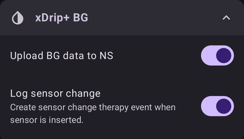

- **Prenesi podatke o GUK-u u NS**: **AAPS** prenosi primljene vrijednosti GUK-a u Nightscout. Uključite ovo samo ako ih sama CGM aplikacija već ne prenosi.
- **Zabilježi promjenu senzora**: automatski stvori događaj terapije „promjena senzora“ kada se umetne senzor.

## Glavni zaslon

U **AAPS**-u 3.x ove su postavke bile grupirane u odjeljku „Pregled“ (Overview). U **AAPS**-u 4 postavljaju se izravno iz elemenata glavnog zaslona kojima pripadaju.

(Preferences-buttons)=
### Gumbi za brzo pokretanje

Odredite koji su gumbi za radnje vidljivi na glavnom zaslonu: dodirnite mali **zupčanik** na dnu glavnog zaslona, u sredini („Postavi brzo pokretanje“) i gumbom **Dodaj** dodajte radnje kojima želite brzo pristupiti (tretmani, CGM radnje, unosi Careportala...).

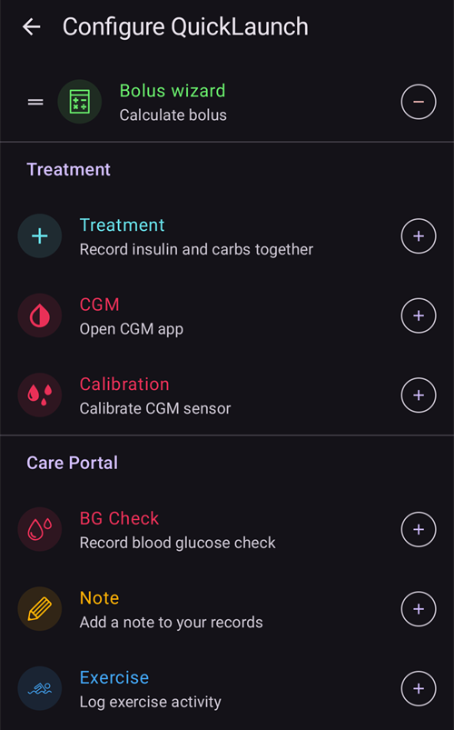

(Preferences-quick-wizard)=
### Brzi kalkulator

Izradite prilagođene gumbe za određene standardne obroke ili međuobroke, koji će se prikazivati na glavnom zaslonu. Korisno za standardne obroke koje često jedete.

Za svaki gumb određujete ugljikohidrate i način izračuna bolusa. Zatim odredite u kojem će vremenskom razdoblju gumb biti vidljiv na glavnom zaslonu – samo jedan gumb po razdoblju. Gumb neće biti vidljiv izvan zadanog vremenskog raspona ili ako imate dovoljno aktivnog inzulina (IOB) da pokrije ugljikohidrate zadane u gumbu brzog kalkulatora. Ako za različite obroke zadate različita vremena, na glavnom zaslonu uvijek ćete imati odgovarajući gumb za standardni obrok, ovisno o dobu dana.

Za upravljanje predlošcima brzog kalkulatora upišite „QuickWizard“ u traku za pretraživanje na glavnom zaslonu i otvorite **Brzi kalkulator – Upravljajte predlošcima brzog kalkulatora**.

Ako kliknete gumb brzog kalkulatora, **AAPS** će izračunati i predložiti bolus za te ugljikohidrate na temelju vaših trenutnih omjera (uzimajući u obzir vrijednost glukoze u krvi ili aktivni inzulin, ako je tako postavljeno).

Prijedlog se mora potvrditi prije nego što se isporuči inzulin.

(Preferences-default-temp-targets)=
### Zadani privremeni ciljevi

[Privremeni ciljevi (TT)](../DailyLifeWithAaps/TempTargets.md) omogućuju vam da na određeno vrijeme promijenite ciljnu vrijednost glukoze u krvi. Uz zadane privremene ciljeve lako možete promijeniti cilj za aktivnost, prije obroka itd.

Dodirnite **ciljni raspon** na glavnom zaslonu da otvorite zaslon **Privremeni cilj**. Listajte kartice predložaka (Prije obroka, Aktivnost, Hipo) i promijenite cilj i trajanje svakog predloška u **Postavkama predložaka**. Zadane vrijednosti su:

* Prije obroka: cilj 90 mg/dL / 5,0 mmol/L, trajanje 45 min
* Aktivnost: cilj 140 mg/dL / 7,8 mmol/L, trajanje 90 min
* Hipo: cilj 160 mg/dL / 8,9 mmol/L, trajanje 60 min

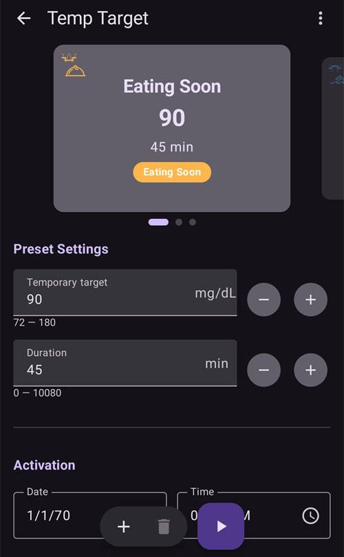

Saznajte kako [ovdje aktivirati privremene ciljeve](#TempTargets-where-can-i-select-a-temp-target).

### Standardne količine inzulina za punjenje

Ako želite napuniti cijev ili kanilu putem **AAPS**-a, to možete učiniti gumbima **Punjenje** na proširenoj ploči statusa na glavnom zaslonu.

Zadane količine za tri gumba za punjenje možete odrediti u postavkama **Punjenje**, ovisno o duljini vašeg katetera. Da ih otvorite, upišite „prime“ u traku za pretraživanje na glavnom zaslonu.

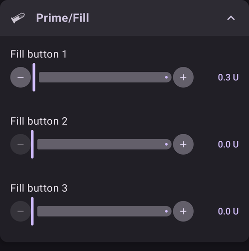

(Preferences-status-lights)=
### Statusna svjetla

Statusna svjetla daju vizualno upozorenje za:

- Starost senzora
- Starost inzulina (koliko dana se spremnik koristi)
- Razina spremnika (jedinice)
- Starost kanile
- Starost baterije pumpe
- Razina baterije pumpe (%)

Ako se prijeđe prag upozorenja, vrijednosti će se prikazati žutom bojom. Ako se prijeđe kritični prag, vrijednosti će se prikazati crvenom bojom.

Da promijenite pragove, proširite ploču statusa na glavnom zaslonu (strelica desno od retka statusa) i dodirnite malu ikonu **Postavke** pokraj „Status“:

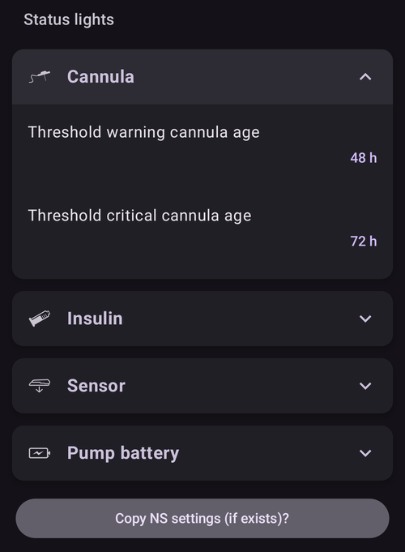

Dodirnite stavku (**Kanila**, **Inzulin**, **Senzor** ili **Baterija pumpe**) da otvorite njezin prag upozorenja i kritični prag:

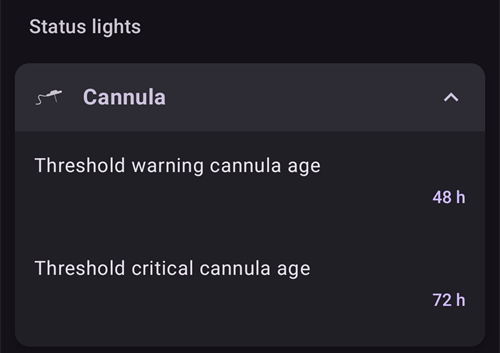

Zadnja opcija omogućuje vam da uvezete te postavke iz Nightscouta, ako su tamo zadane. Više informacija potražite u [dokumentaciji Nightscouta](https://nightscout.github.io/nightscout/setup_variables/#age-pills).

(Preferences-deliver-this-part-of-bolus-wizard-result)=
### Postavke bolus kalkulatora

Upišite „bolus“ u traku za pretraživanje na glavnom zaslonu da otvorite postavke **Bolus kalkulatora**:

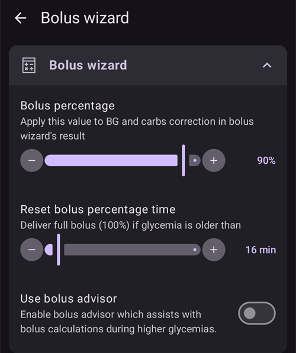

**Postotak bolusa** postavlja [zadani postotak](#AapsScreens-section-j) izračunatog bolusa kada koristite bolus kalkulator.

Zadano je 100 %: bez korekcije. Čak i ako ovdje postavite drugu vrijednost, i dalje je možete promijeniti svaki put kada koristite bolus kalkulator. Ako je ova postavka 75 %, a trebali biste dati bolus od 10 J, bolus kalkulator predložit će bolus za obrok od samo 7,5 jedinica.

Kada koriste [SMB](#objectives-objective9), mnogi ne daju bolus za obrok od 100 % potrebnog inzulina, nego samo dio (npr. 75 %), a ostatak prepuste SMB-u s UAM-om (otkrivanje nenajavljenih obroka). Vrijednost manja od 100 % ovdje može biti korisna:
* za osobe sa sporom probavom: ako se cijeli bolus da unaprijed, može doći do hipoglikemije jer inzulin djeluje brže od probave.
* da se **AAPS**-u ostavi više prostora da sam reagira na **porast GUK-a**. U oba slučaja **AAPS** će nadoknaditi dio bolusa koji nedostaje SMB-ovima, ako i kada to ocijeni prikladnim.

**Koristi savjetnik za bolus**

Kada je ovo uključeno i koristite bolus kalkulator dok ste u hiperglikemiji, dobit ćete upozorenje s pitanjem želite li dati bolus unaprijed i jesti kasnije, kada se vaš **GUK** vrati u raspon.

(Preferences-advanced-settings-overview)=
### Superbolus

Opcija Superbolus iz **AAPS**-a 3.x nije dostupna kao postavka u **AAPS**-u 4.

## Petlja

Za promjenu načina rada petlje sada pogledajte [Zasloni AAPS-a > Glavni zaslon > Status petlje](#AapsScreens-loop-status).

(Preferences-minimal-request-change)=
### Minimalna promjena u otvorenoj petlji

Kada koristite **otvorenu petlju**, dobit ćete obavijest svaki put kada **AAPS** preporuči promjenu bazalne stope. Da smanjite broj obavijesti, možete koristiti [širi ciljni raspon GUK-a](#profile-glucose-targets) ili povećati postotak u postavci „**Minimalna promjena u otvorenoj petlji**“. Ovo određuje relativnu promjenu koja je potrebna da se pokrene obavijest.

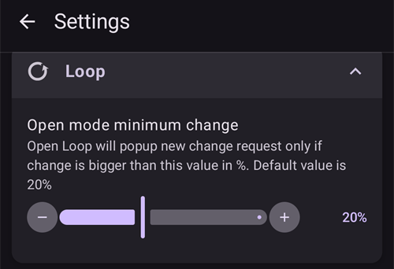

## Advanced Meal Assist (AMA) ili Super Micro Bolus (SMB)

Ovisno o vašim postavkama u [Konfiguracija > APS](../SettingUpAaps/ConfigBuilder.md), možete birati između dva algoritma:

- [Advanced Meal Assist (OpenAPS AMA)](#Open-APS-features-advanced-meal-assist-ama) – stanje algoritma iz 2017.
- [Super Micro Bolus (OpenAPS SMB)](#Open-APS-features-super-micro-bolus-smb) – najnoviji algoritam, preporučen za početnike

Od [**AAPS** verzije 3.3](#version3300) značajka [Dinamički ISF (DynISF)](../DailyLifeWithAaps/DynamicISF.md) premještena je u OpenAPS SMB.

### OpenAPS AMA

Sve postavke za OpenAPS AMA opisane su u posebnom odjeljku [Glavne značajke AAPS-a > Advanced Meal Assist (AMA)](#Open-APS-features-advanced-meal-assist-ama).

(Preferences-openaps-smb-settings)=
### OpenAPS SMB

Sve postavke za OpenAPS SMB opisane su u posebnom odjeljku [Glavne značajke AAPS-a > Super Micro Bolus (SMB)](#Open-APS-features-super-micro-bolus-smb).

Popis postavki koji vidite ovisi o vašem napretku u [ispunjavanju ciljeva](../SettingUpAaps/CompletingTheObjectives.md) i o [jednostavnom načinu rada](#preferences-simple-mode). Na novoj instalaciji prikazuje se samo **Koristi dinamičku osjetljivost**. Kada su ciljevi ispunjeni, odjeljak izgleda ovako:

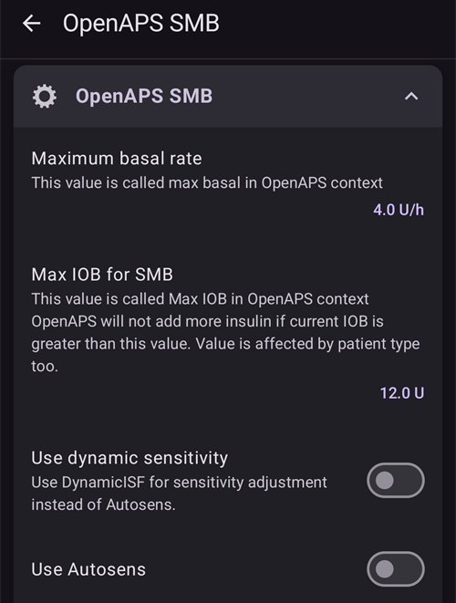

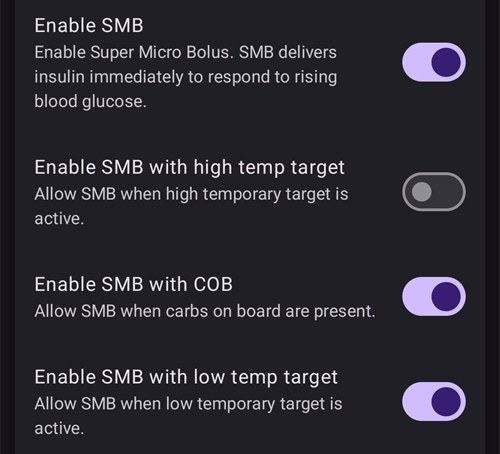

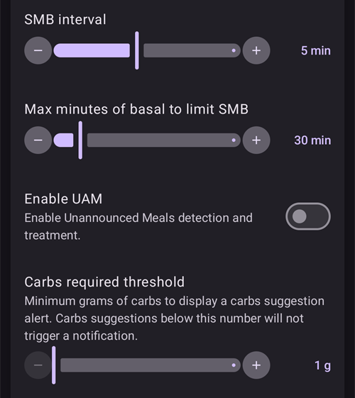

**Napredne postavke** na dnu odjeljka sadrže vrijednosti koje obično ne trebate mijenjati:

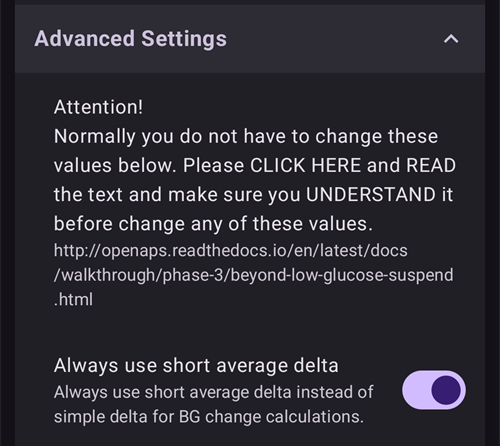

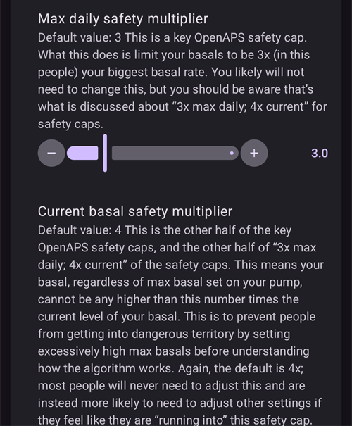

## Postavke apsorpcije

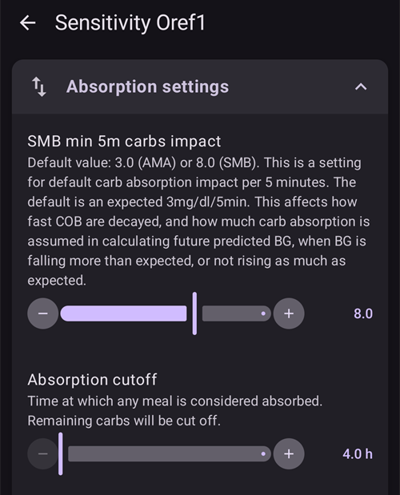

(Preferences-min_5m_carbimpact)=
### SMB min. utjecaj ugljikohidrata u 5 min (min_5m_carbimpact)

Postavka je skrivena u [jednostavnom načinu rada](#preferences-simple-mode).

Algoritam koristi BGI (blood glucose impact, utjecaj na glukozu u krvi) da odredi kada se [ugljikohidrati apsorbiraju](../DailyLifeWithAaps/CobCalculation.md).

Kada se apsorpcija ugljikohidrata ne može dinamički izračunati iz reakcija vaše krvi, **AAPS** za vaše ugljikohidrate koristi zadano opadanje. U osnovi, to je sigurnosna zaštita. Ova vrijednost koristi se samo za vrijeme praznina u očitanjima **CGM**-a ili kada tjelesna aktivnost „potroši“ sav porast glukoze u krvi zbog kojeg bi **AAPS** inače smanjivao aktivne ugljikohidrate (COB).

Jednostavno rečeno: algoritam „zna“ kako bi se vaš GUK *trebao* ponašati pod utjecajem trenutne doze inzulina itd. Kad god postoji pozitivno odstupanje od očekivanog ponašanja, dio ugljikohidrata se apsorbira/smanji. Velika promjena = mnogo ugljikohidrata itd.

Vrijednost min_5m_carbimpact određuje zadani utjecaj apsorpcije ugljikohidrata za svakih 5 minuta. Potpuni opis parametra potražite u [dokumentaciji OpenAPS-a o postavkama i sigurnosnim postavkama](https://openaps.readthedocs.io/en/latest/docs/While%20You%20Wait%20For%20Gear/preferences-and-safety-settings.html?highlight=carbimpact#min-5m-carbimpact).

Standardna vrijednost za AMA je 3, a za SMB 8.

Graf aktivnih ugljikohidrata (COB) na glavnom zaslonu pokazuje kada se koristi min_5m_carbimpact: narančaste točke prikazuju se uz vrh krivulje COB.

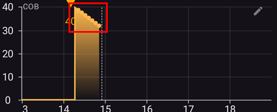

### Granično vrijeme apsorpcije

Vrijeme nakon kojeg se svaki obrok smatra apsorbiranim; preostali ugljikohidrati bit će odbačeni. Ako često jedete obroke s mnogo masti ili proteina, morat ćete povećati vrijeme apsorpcije obroka.

### Napredne postavke – omjer Autosensa


- Odredite min. i maks. omjer [Autosensa](#Open-APS-features-autosens).
- Standardne vrijednosti (maks. 1,2 i min. 0,7) obično ne treba mijenjati.

## Pumpa


### BT Watchdog

Ako je potrebno, uključite BT Watchdog (npr. za pumpe Dana). Isključuje Bluetooth na jednu sekundu ako se ne može uspostaviti veza s pumpom. To može pomoći na nekim telefonima na kojima se Bluetooth sustav zaledi.

## Postavke pumpe

Opcije ovdje ovise o tome koji ste upravljački program pumpe odabrali u [Konfiguracija > Pumpa](#Config-Builder-pump). Uparite i postavite pumpu prema [uputama za svoju pumpu](../Getting-Started/CompatiblePumps.md).

Na primjer, uz **Virtualnu pumpu** odjeljak se zove **Postavke virtualne pumpe**. Odabirete **Vrstu pumpe** koju virtualna pumpa oponaša i hoće li se njezin status prenositi u Nightscout:

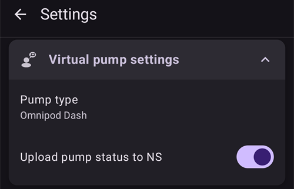

## Tidepool

Više informacija na posebnoj stranici [Tidepool](../SettingUpAaps/Tidepool.md).

(Preferences-nsclient)=
## NSClientV3


Dodatak NSClient (u izborniku konfiguracije prikazan kao **NSClientV3**) sinkronizira vaše podatke s Nightscoutom. Koristi Nightscout API v3.

```{admonition} Data uploaders
:class: warning

Kada koristite NSClientV3, svi programi koji prenose podatke moraju koristiti Nightscout API v3. Ako neki drugi program za prijenos (npr. vaša CGM aplikacija) ne podržava API v3, **pustite AAPS da prenosi sve podatke** (GUK, tretmane, ...) u Nightscout i isključite taj program za prijenos.
```

- Postavite svoj *Nightscout URL* (npr. <https://yoursitename.yourplatform.dom>).
- **Provjerite da URL NEMA /api/v1/ na kraju.**
- U Nightscoutu izradite *[Admin token](https://nightscout.github.io/nightscout/security/#create-a-token)* (za API V3 potreban je [Nightscout 15](https://nightscout.github.io/update/update/)) i unesite ga u **Nightscout pristupni token** (ne vašu API tajnu!). Na **AAPSClientu** umjesto toga možete skenirati QR kod glavnog telefona, čime se postavlja vlastiti token klijenta. Klijent uparen PIN-om dobiva vlastiti token od glavnog telefona nakon uparivanja. Pogledajte [Vlastiti Nightscout token klijenta](#client-master-control-own-token).
- Ovo omogućuje čitanje i pisanje podataka između web stranice Nightscouta i **AAPS**-a.
- Ako ste zapeli na Cilju 1, ovdje dobro provjerite ima li pogrešaka u pisanju.
- Ostavite „Koristi WebSockets“ uključeno (preporučeno). Websocketi su **obavezni** za daljinsko upravljanje iz **AAPSClienta**, na oba telefona.

(Preferences-nsclient-synchronization)=
### Sinkronizacija


Izbor sinkronizacije ovisi o tome kako želite koristiti **AAPS**.

Možete odabrati koje podatke želite [prenositi u Nightscout ili preuzimati iz njega](#Nightscout-aaps-settings).

Dok je upravljanje s klijenta uključeno (uvijek u jednostavnom načinu rada), ove su postavke skrivene: **AAPS** je tada u [zaštićenom načinu rada](#client-master-control-hardened-mode), ne prihvaća promjene napravljene izravno u Nightscoutu i prenosi sve svoje podatke.

### Mogućnosti alarma

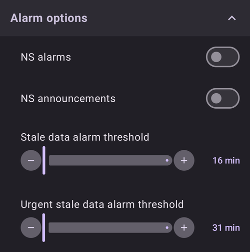

- U mogućnostima alarma možete odabrati koje će Nightscout alarme aplikacija koristiti. **AAPS** će se oglasiti alarmom kada se pokrene alarm u Nightscoutu.
- Da bi se alarmi oglasili, morate postaviti vrijednosti alarma Urgent High, High, Low i Urgent Low u svojim [Nightscout varijablama](https://nightscout.github.io/nightscout/setup_variables/#alarms).
- Radit će samo dok imate vezu s Nightscoutom i namijenjeni su roditeljima / osobama koje se brinu o korisniku.
- Ako imate izvor **CGM**-a na telefonu (npr. xDrip ili BYODA), koristite te alarme umjesto alarma Nightscouta.
- NS najave prikazat će [najave](https://nightscout.github.io/nightscout/discover/#announcement) iz Nightscouta u obavijestima **AAPS**-a.
- Možete promijeniti prag alarma zastarjelih podataka i hitnog alarma zastarjelih podataka, koji se oglase kada se iz Nightscouta neko vrijeme ne prime podaci.

### Daljinsko upravljanje

Prekidač „**Dopusti upravljanje s klijenta**“ više nije u ovim postavkama: nalazi se na vrhu **Upravljanje → Ovlašteni klijenti**, gdje se upravlja uparenim klijentima. Pogledajte posebnu stranicu [Upravljanje glavni uređaj ↔ klijent (potpisano daljinsko upravljanje)](../RemoteFeatures/ClientMasterControl.md), uključujući [zaštićeni način rada](#client-master-control-hardened-mode), koji ovaj prekidač uključuje.

### Postavke veze

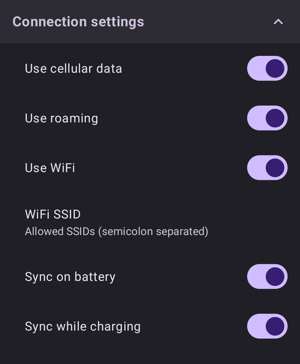

- Postavke veze određuju kada će veza s Nightscoutom biti omogućena.
- Ograničite prijenos u Nightscout samo na Wi-Fi ili čak samo na određene Wi-Fi SSID-ove.
- Ako želite koristiti samo određenu Wi-Fi mrežu, možete upisati njezin Wi-Fi SSID.
- Više SSID-ova možete odvojiti točkom sa zarezom.
- Za brisanje svih SSID-ova upišite razmak u polje.

(Preferences-advanced-settings-nsclient)=
### Napredne postavke (NSClientV3)

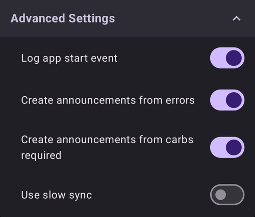

Opcije u naprednim postavkama same su po sebi razumljive.

## SMS Communicator

Više informacija na posebnoj stranici [SMS naredbe](../RemoteFeatures/SMSCommands.md).

(preferences-wear)=
## Wear

Ovaj odjeljak prikazuje se kada je dodatak **Wear** omogućen u [Konfiguracija > Komunikacija](#Config-Builder-wear). Više informacija na posebnim stranicama [Postavljanje AAPS-a na vaš Wear OS sat](../WearOS/WearOsSmartwatch.md) i [Upravljanje AAPS-om putem pametnog sata s Wear OS-om](../RemoteFeatures/RemoteControlWearOS.md).

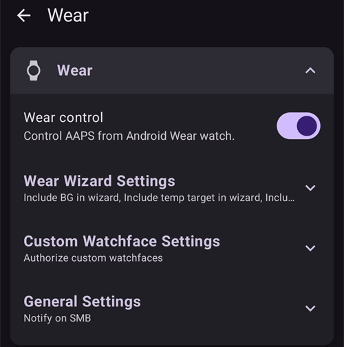

- **Upravljanje sa sata**: dopušta slanje tretmana i drugih radnji sa sata. Bez toga sat samo prikazuje podatke: telefon odbija svaku naredbu sa sata, a dodir na komplikaciju koja bi otvorila zaslon za upravljanje umjesto toga otvara izbornik **AAPS**-a na satu.

**Postavke kalkulatora na satu** određuju koji su izračuni uključeni u rezultat bolus kalkulatora na satu. Na satu unosite samo ugljikohidrate; ovi prekidači zamjenjuju odabire koje biste napravili u bolus kalkulatoru na telefonu:

- **Uključi GUK u kalkulator**: dodaje korekciju za razliku između vaše trenutne glukoze i vašeg cilja.
- **Uključi privremeni cilj u kalkulator**: za ovu korekciju koristi aktivni privremeni cilj umjesto cilja iz profila.
- **Uključi trend u kalkulator**: uzima u obzir trenutni trend glukoze.
- **Uključi aktivne ugljikohidrate (COB) u kalkulator**: dodaje inzulin za ugljikohidrate koji su još aktivni.
- **Uključi aktivni inzulin (IOB) u kalkulator**: oduzima inzulin koji je još aktivan.

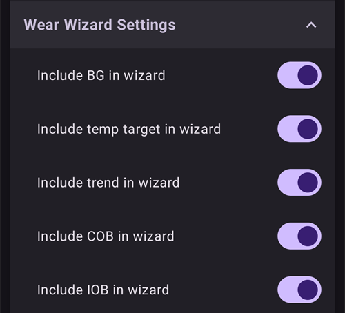

**Postavke prilagođenog Watchfacea** sadrže **Dopusti prilagođene Watchface**. Datoteka prilagođenog Watchfacea može sadržavati vrijednosti za neke postavke sata. Kada je ovaj prekidač uključen, učitavanje takvog Watchfacea smije promijeniti te postavke na satu; kada je isključen, Watchface se učita, ali postavke ostaju kakve jesu:

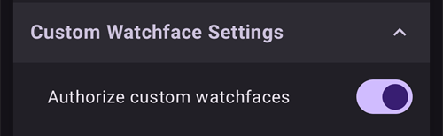

**Opće postavke** sadrže **Obavijesti pri SMB-u**, da na satu dobijete obavijest svaki put kada se isporuči SMB:

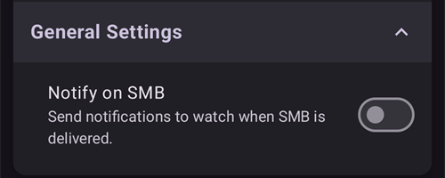

## Autotune

Ovaj odjeljak prikazuje se kada je dodatak **Autotune** omogućen u [Konfiguracija > Općenito](#Config-Builder-autotune). Postavke su opisane na posebnoj stranici [Kako koristiti dodatak Autotune](../AdvancedOptions/Autotune.md).


## Automatizacija

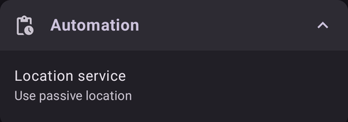

Odaberite koja će se usluga lokacije koristiti:

- Koristi pasivnu lokaciju: **AAPS** uzima lokaciju samo kada je traže druge aplikacije
- Koristi mrežnu lokaciju: lokacija vaše Wi-Fi mreže
- Koristi GPS lokaciju (Pozor! Može jako trošiti bateriju!)

## Lokalna upozorenja


Postavke su same po sebi razumljive.

**Zaobiđi način rada Ne ometaj** (zadano uključeno): alarmi **AAPS**-a zvone čak i kada je telefon utišan ili u načinu rada Ne ometaj. Isključite ovo ako **AAPS** treba poštovati te načine rada: alarmi tada ne zvone, a u načinu rada Ne ometaj samo vibriraju, na telefonu i na satu. Prijedlozi petlje koji stignu za vrijeme načina rada Ne ometaj prikazuju se bez zvuka.

Kada se alarm oglasi, zaslon alarma nudi **Isključi zvuk na 5 minuta**, **Utišaj alarm** (zaslon ostaje otvoren, pa možete pročitati poruku) i **Utišaj i zatvori**. Ako obavijest o alarmu povučete s ploče obavijesti, alarm se utišava. Kada kasnije otvorite **AAPS**, alarm na koji niste odgovorili ponovno se prikazuje.

(preferences-alarm-sound-volume-vibration)=
### Zvuk, glasnoća i vibracija alarma

- **Zvuk**: zvukovi alarma **AAPS**-a ugrađeni su i ne mogu se promijeniti.
- **Glasnoća**: **AAPS** nema vlastitu postavku glasnoće. Kada je **Zaobiđi način rada Ne ometaj** uključeno, alarmi slijede glasnoću alarma telefona. Kada je isključeno, slijede glasnoću obavijesti.
- **Postupno pojačavaj glasnoću obavijesti** (zadano uključeno): alarm počinje tiho i postaje sve glasniji. Isključite ovo da alarm odmah zvoni punom glasnoćom.
- **Vibracija**: u postavkama telefona idite na **Aplikacije** > **AAPS** > **Obavijesti**. Popis **AAPS alarmi** pojavi se ondje nakon prvog alarma. Dodirnite alarm da uključite ili isključite njegovu **Vibraciju**. Ove alarme ostavite uključenima.

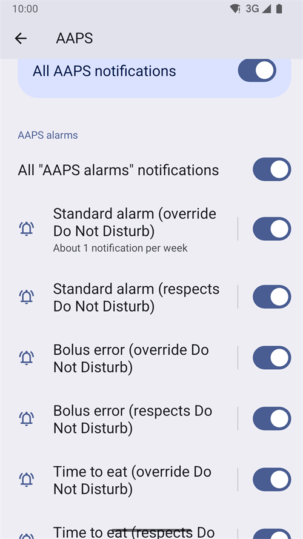 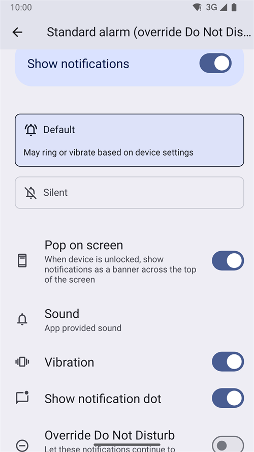

- Alarmi za glukozu (visoka, niska, nema podataka) dolaze iz vaše CGM aplikacije ili Nightscouta: ondje postavite njihov zvuk i vibraciju.

(preferences-maintenance-settings)=
## Postavke održavanja

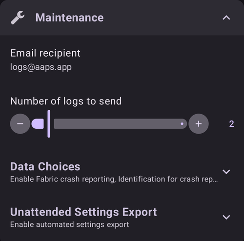

**Primatelj e-pošte**: standardni primatelj dnevnika je <logs@aaps.app>.

**Broj dnevnika za slanje**: koliko se najnovijih datoteka dnevnika priloži kada šaljete dnevnike.

**Postavke podataka**

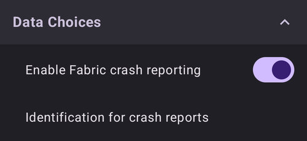

Možete pomoći u daljnjem razvoju **AAPS**-a tako da programerima šaljete izvješća o rušenju.

**Izvoz postavki bez nadzora**<br/> Ako uključite ovu značajku, dopuštate **AAPS**-u da izvozi postavke bez sudjelovanja korisnika. Za to se glavna lozinka sigurno sprema na vaš telefon (samo tamo) pri sljedećem ručnom izvozu. Spremljena lozinka koristit će se najviše 4 tjedna. Nakon 4 tjedna dobit ćete obavijest da lozinka uskoro istječe. Tijekom prijelaznog razdoblja od 1 tjedna lozinku tada možete obnoviti ručnim izvozom postavki iz izbornika održavanja.

Kada prođe prijelazno razdoblje od 1 tjedna, spremljena lozinka istječe i svaki automatski izvoz postavki prekida se uz obavijest korisniku, koja traži da ponovno unese lozinku. [(**Automatski izvozi postavki**)](../DailyLifeWithAaps/Automations.md#automating-preference-settings-export) bilježe se u popise „Careportal“ i „Unos korisnika“ **AAPS**-a pod Tretmanima.

Kada uključite ovu opciju, svakako ručno izvezite postavke; tada ćete morati unijeti lozinku, kako bi je **AAPS** mogao spremiti.

### Datoteke dnevnika

AAPS će spremati dnevnike za rješavanje problema.

Nemojte isključiti ovu značajku: pomoći će da se shvate razlozi ako nešto pođe po zlu.

Ako dnevnike trebate poslati programerima, u e-poruci točno opišite problem. Bolje je dnevnike slati samo kada se to od vas zatraži, nakon [prijave problema na GitHubu](https://github.com/nightscout/AndroidAPS/issues).

Dnevnike AAPS-a pronaći ćete u memoriji telefona -> Android -> data -> info.nightscout.androidaps -> files.

Rad s dnevnicima (postavke dnevnika, slanje i brisanje dnevnika) i upravljanje datotekama nalaze se na zaslonu **Održavanje**, koji se otvara iz **izbornika** (☰) u gornjem lijevom kutu glavnog zaslona:

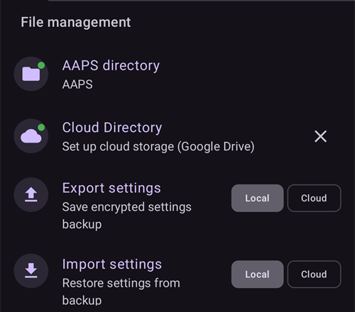

(preferences-maintenance-logdirectory)=

### Postavljanje lokalne mape AAPS-a

Zaslon **Održavanje** sadrži i **AAPS mapu**. Ova postavka omogućuje korisniku da odabere mapu na telefonu u kojoj će **AAPS** spremati postavke, dnevnike i druge datoteke. Kada je mapa odabrana, njezina putanja (npr. `Documents/AAPS`) prikazuje se ispod **AAPS mapa**, pa uvijek možete vidjeti gdje se spremaju vaše datoteke.

Toplo se preporučuje koristiti mapu izravno u glavnoj razini memorije telefona. Zadana je mapa AAPS.

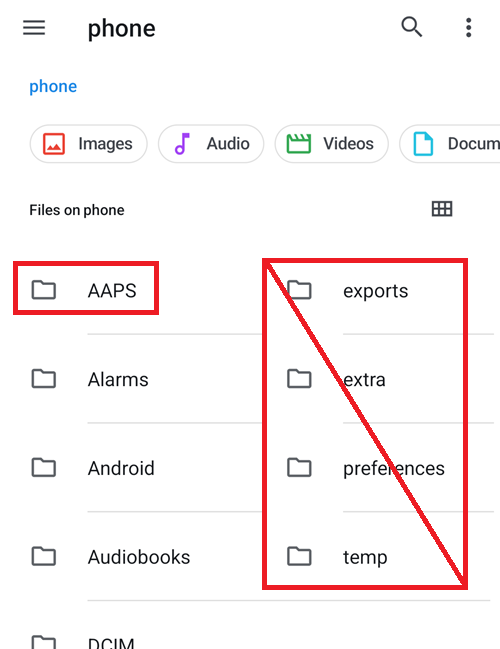

Ako odaberete podmapu mape AAPS, vidjet ćete poruku o pogrešci. Dodirnite „U redu“ i pokušajte ponovno te odaberite ispravnu mapu (jednu razinu više). Nemojte odabrati „Odbaci“ ako ne znate točno što radite.

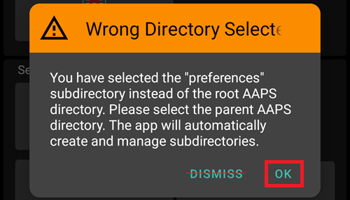

Android može bez upozorenja oduzeti dopuštenje za mapu, npr. nakon što ponovno instalirate **AAPS** ili obrišete njegovu pohranu. Kada se to dogodi, **AAPS** prikazuje trajnu obavijest **Pristup AAPS mapi je izgubljen**, a lokalni izvoz postavki ne radi dok se ne vratite ovdje i ponovno odaberete mapu. Učinite to odmah, inače se vaše sigurnosne kopije na telefonu više ne osvježavaju.

(preferences-maintenance-cloud)=

### Postavljanje mape u oblaku

Svoje postavke, dnevnike i CSV podatke možete izvoziti u uslugu u oblaku.

1. Otvorite **izbornik** (☰), odaberite **Održavanje** i dodirnite **Mapa u oblaku** (pod **Upravljanje datotekama**).

   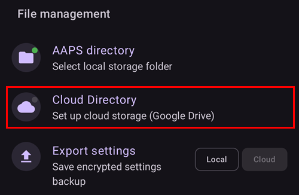

2. U **Odaberi vrstu pohrane** odaberite **Google disk**.

   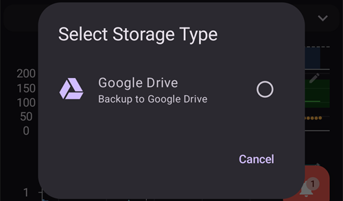

3. Otvara se Googleova stranica za prijavu. Odaberite Google račun na kojem će biti vaše sigurnosne kopije (možete koristiti [zaseban Google račun](../UsefulLinks/DedicatedGoogleAccountForAaps.md)).

   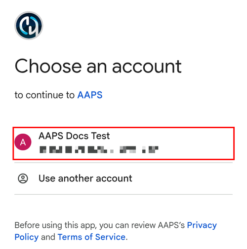

4. Provjerite je li račun ispravan i dodirnite **Continue** da **AAPS**-u date pristup. Ako ste mapu u oblaku već prije postavili, stranica kaže da **AAPS** već ima određeni pristup.

   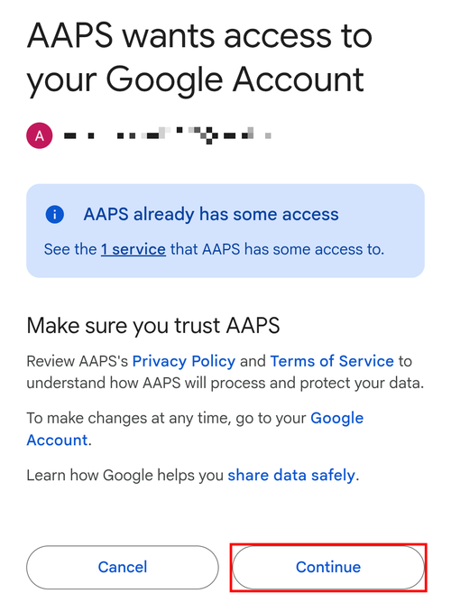

5. Natrag u **AAPS**-u, na dnu glavnog zaslona pojavi se poruka **Prijava u pohranu u oblaku je uspjela**:

   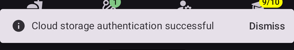

   U izborniku **Održavanje** **Mapa u oblaku** sada ima zelenu točku, a dostupni su gumbi **Oblak** pokraj **Pošalji dnevnike**, **Izvezi postavke**, **Uvezi postavke** i **Izvoz korisničkih unosa u Excel (csv)**.

   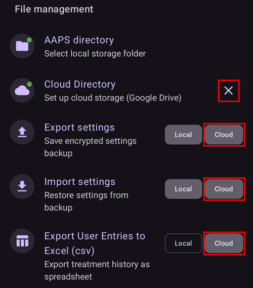

Da prestanete izvoziti u oblak, dodirnite ikonu **✕** (**Obriši postavke**) na kraju retka **Mapa u oblaku** u izborniku **Održavanje** (prikazuje se kada je usluga u oblaku postavljena) i potvrdite **Obriši postavke oblaka**. Time se vraćate na lokalnu pohranu i briše se ovlaštenje.

## Open Humans

Zajednici možete pomoći tako da svoje podatke donirate istraživačkim projektima! Pojedinosti su opisane na stranici [Open Humans Uploader](../SupportingAaps/OpenHumans.md).

U **Postavke → Open Humans** možete odrediti kada će se podaci prenositi
- samo kada je spojen na Wi-Fi
- samo tijekom punjenja
