# Čarobnjak za postavljanje AAPS-a

```{contents} In this page
:backlinks: entry
:depth: 2
```

Kada prvi put pokrenete **AAPS**, vodi vas „**Čarobnjak za postavljanje**“, kako biste brzo i odjednom postavili sve osnovne konfiguracije aplikacije. **Čarobnjak za postavljanje** vas vodi kako ne biste zaboravili nešto važno. Na primjer, **postavke dopuštenja** temeljne su za ispravno postavljanje **AAPS-a**.

Ipak, nije obavezno sve potpuno konfigurirati već pri prvom korištenju **Čarobnjaka za postavljanje**. Čarobnjak možete lako napustiti i kasnije mu se vratiti. Nakon **Čarobnjaka za postavljanje** postoje tri načina za daljnju optimizaciju i promjenu konfiguracije. To će biti objašnjeno u sljedećem odjeljku. Zato nije problem ako u Čarobnjaku za postavljanje preskočite neke točke. Lako ih možete konfigurirati kasnije.

Tijekom korištenja **Čarobnjaka za postavljanje** i odmah nakon njega možda nećete primijetiti veće vidljive promjene u **AAPS-u**. Da biste omogućili petlju **AAPS-a**, morate slijediti **Ciljeve** i omogućavati značajku po značajku. **Cilj 1** započet ćete na kraju Čarobnjaka za postavljanje. Vi upravljate **AAPS-om**, a ne obrnuto.

```{admonition} Preview Objectives
:class: note
Ako želite upoznati strukturu ciljeva, pročitajte [Ispunjavanje ciljeva](../SettingUpAaps/CompletingTheObjectives.md), ali se zatim vratite ovamo i najprije prođite Čarobnjak za postavljanje.

```

Iz iskustva znamo da novi korisnici često sami sebe stavljaju pod pritisak da **AAPS** postave što brže. To može dovesti do frustracije jer treba puno toga naučiti.

Zato si uzmite vremena za konfiguraciju petlje. Koristi od dobro podešene petlje **AAPS-a** su ogromne.

```{admonition} Ask for Help
:class: note
Ako u dokumentaciji postoji pogreška ili imate bolju ideju kako nešto objasniti, možete zatražiti pomoć zajednice kako je opisano u [Povežite se s drugim korisnicima](../GettingHelp/WhereCanIGetHelp.md).
```
## Poruka dobrodošlice

Kada se Čarobnjak za postavljanje otvori, pozdravi vas kratkom porukom dobrodošlice i odmah na dnu zaslona prikaže ploču „**Potrebna dopuštenja**“ (pogledajte sljedeći odjeljak).

Kada odobrite dopuštenja, ploča se zatvori, a na zaslonu dobrodošlice pojavi se gumb „**Sljedeći**“. Pritisnite „**SLJEDEĆI**“ za nastavak:

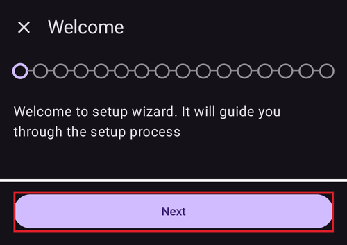

## Potrebna dopuštenja

**AAPS** treba nekoliko dopuštenja da bi ispravno radio. Čarobnjak ih skuplja na jednoj ploči „**Potrebna dopuštenja**“, svako s vlastitim gumbom „**Odobri**“. Odobrite ih jedno po jedno — ikona pokraj svake stavke pretvori se u kvačicu kada je gotovo.

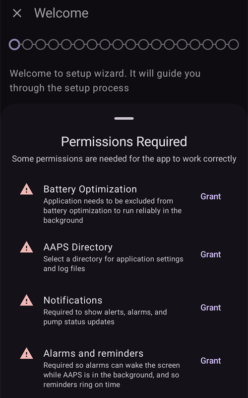

### Optimizacija baterije

Potrošnja baterije na pametnim telefonima važna je jer su mogućnosti baterija još uvijek prilično ograničene. Zato operacijski sustav Android na vašem pametnom telefonu ograničava aplikacijama rad i trošenje procesorskog vremena, a time i energije baterije.

Međutim, **AAPS** mora redovito raditi, _npr._ da svakih nekoliko minuta primi očitanja glukoze i zatim primijeni algoritam kako bi, prema vašim postavkama, odlučio što učiniti s vašim razinama glukoze. Zato mora biti izuzet iz optimizacije baterije.

Pritisnite „**Odobri**“ pokraj „**Optimizacija baterije**“, a zatim u dijalogu „Želite li dopustiti da aplikacija uvijek radi u pozadini?“ (Let app always run in background?) odaberite „**Dopusti**“:

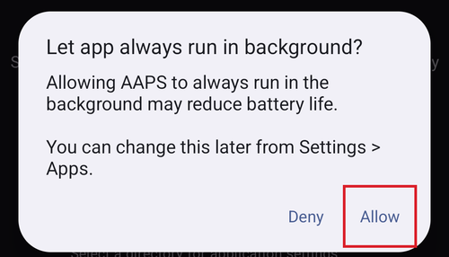

(SetupWizard-StoragePermission)=

### AAPS mapa

**AAPS** mora spremati svoje postavke i podatke dnevnika u trajnu pohranu vašeg pametnog telefona. Trajna pohrana znači da će podaci biti dostupni i nakon ponovnog pokretanja pametnog telefona. Ostali podaci jednostavno se gube jer nisu spremljeni u trajnu pohranu.

Pritisnite „**Odobri**“ pokraj „**AAPS mapa**“. Time se otvara datotečni sustav telefona i možete odabrati gdje **AAPS** sprema svoje podatke.

```{tip}
Preporučuje se odabrati zadanu mapu AAPS.</br>
**Nemojte** odabrati podmapu mape AAPS.
```

Zadana mapa je **AAPS**, ali možete koristiti bilo koju zasebnu mapu po želji. Ako je potrebno, stvorite mapu, uđite u nju i odaberite „**KORISTI OVU MAPU**“:

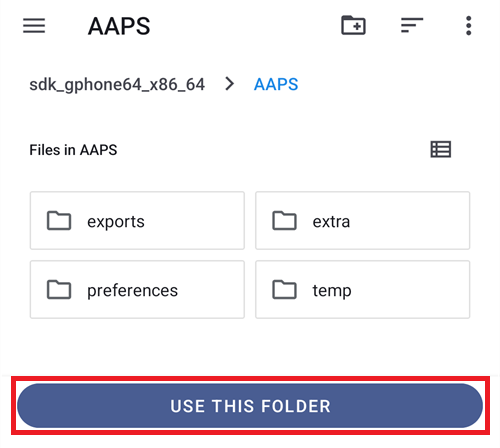

Pritiskom na „**DOPUSTI**“ potvrdite da **AAPS-u** želite dati pristup odabranoj mapi:

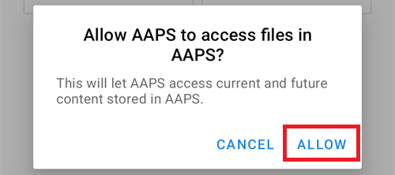

### Obavijesti

Android zahtijeva posebno dopuštenje za aplikacije koje vam žele slati obavijesti.

Isključivanje obavijesti, _npr._ iz aplikacija društvenih mreža, korisna je značajka, ali je nužno da **AAPS-u** dopustite slanje obavijesti.

Pritisnite „**Odobri**“ pokraj „**Obavijesti**“ i u sistemskom upitu odaberite „**Dopusti**“:

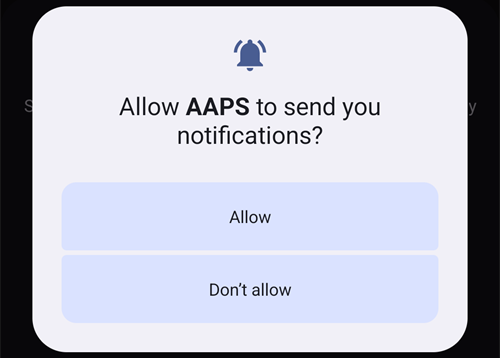

### Alarmi i podsjetnici

Na **Androidu 14 i novijem** **AAPS** treba dopuštenje „**Alarmi i podsjetnici**“ kako bi alarmi mogli probuditi zaslon dok **AAPS** radi u pozadini i kako bi podsjetnici (na primjer iz **Automatizacije**) zazvonili na vrijeme.

Ova se stavka prikazuje samo dok je potrebna. Kada je **AAPS** izuzet iz optimizacije baterije (pogledajte gore), Android automatski dopušta točne alarme i stavka nestaje. Ako je još uvijek na popisu, pritisnite „**Odobri**“ pokraj „**Alarmi i podsjetnici**“. Time se otvara zaslon postavki sustava za **AAPS**. Uključite prekidač i vratite se u **AAPS**. Na Androidu 13 i starijem ova se stavka ne prikazuje i nije potrebno ništa učiniti.

Kada sva dopuštenja prikazuju kvačicu (tri, ili četiri na Androidu 14 i novijem), ploča „**Potrebna dopuštenja**“ sama se zatvori i možete pritisnuti „**SLJEDEĆI**“ na zaslonu dobrodošlice za nastavak.

(setup-wizard-bluetooth-battery-optimisation)=
### Optimizacija baterije za Bluetooth

```{admonition} Extra Android setting, not part of the Wizard
:class: note
Sljedeće je dodatna konfiguracija Androida koja se obavlja izvan Čarobnjaka za postavljanje. Ovo nije jedan od gornjih gumba „Odobri“, ali je važno za pouzdanu vezu s pumpom.
```

Novije verzije Androida dodale su optimizaciju baterije i sistemskoj aplikaciji Bluetooth.

Osim isključivanja optimizacije baterije za **AAPS**, vjerojatno ćete je morati isključiti i za sistemsku aplikaciju Bluetooth. Ako to ne učinite, može doći do prekida veze s pumpom i drugih problema.

***NAPOMENA: Dokumentacija za xDrip opisuje kako to učiniti ovdje: [dokumentacija za xDrip](https://navid200.github.io/xDrip/docs/BluetoothBatteryOpt.html)***

Slijedite ove korake na Androidu 16. Na drugim verzijama izgled će se malo razlikovati od priloženih snimaka zaslona:

1. Otvorite postavke Androida, potražite **Aplikacije** i otvorite postavke aplikacija.

   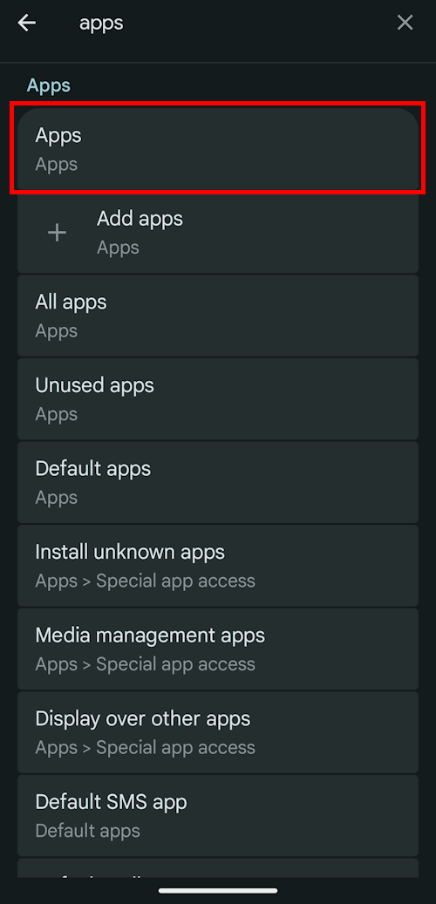

2. Vidjet ćete postavke aplikacija, ali popis treba proširiti kako bi se vidjele sve aplikacije. Za proširenje dodirnite **Prikaži sve aplikacije**.

   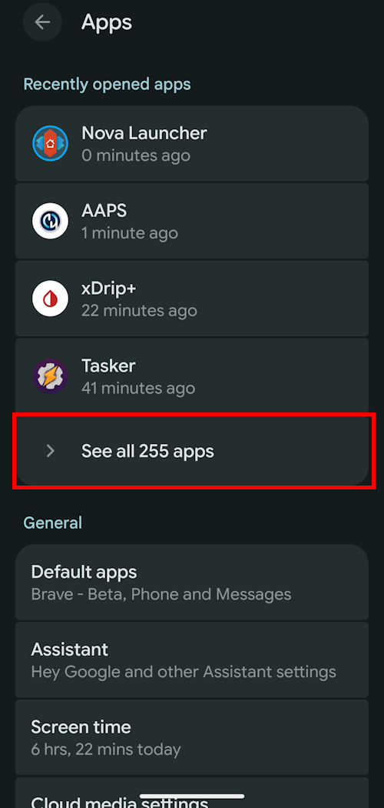

3. Aplikacija Bluetooth je sistemska aplikacija i prema zadanim postavkama je skrivena, pa moramo prikazati sistemske aplikacije. Dodirnite **tri točke** (⋮) gore desno (1). Zatim dodirnite **Prikaži sistemske** (Show system) (2).

   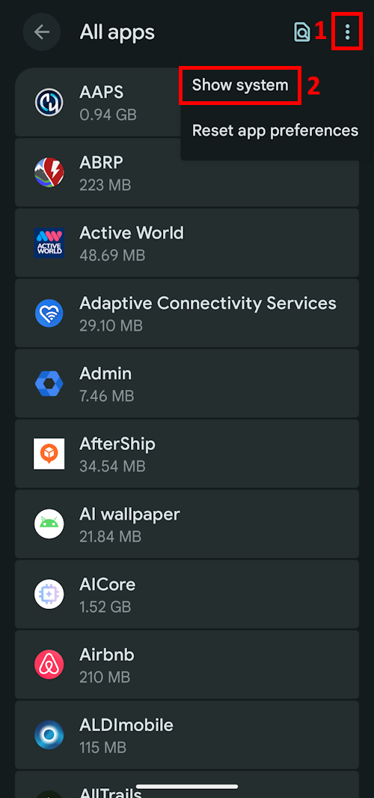

4. Potražite aplikaciju `Bluetooth` i dodirnite `Bluetooth` i/ili `Legacy Bluetooth`. Ako postoje obje, provedite postupak za obje.

   ***NAPOMENA: `Bluetooth MIDI Service` možete slobodno zanemariti jer ga AAPS ne koristi***

   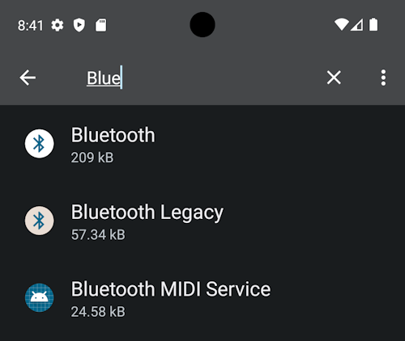    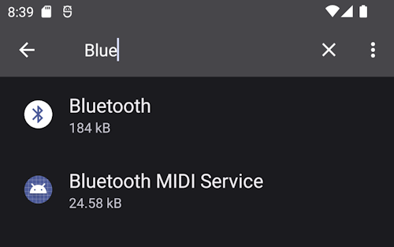    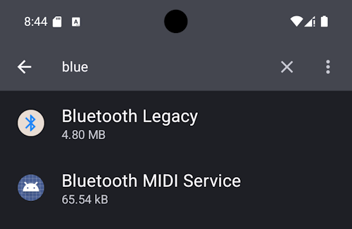

   1. Na Androidu 12 dodirnite `Baterija` (Battery), a na Androidu 13+ dodirnite `Potrošnja baterije aplikacije` (App battery usage).

   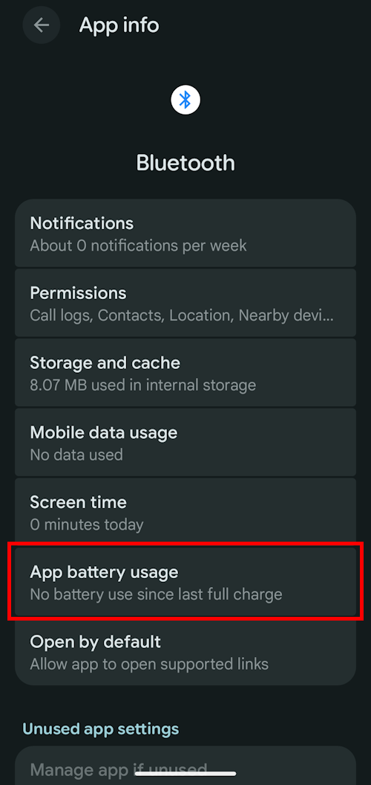   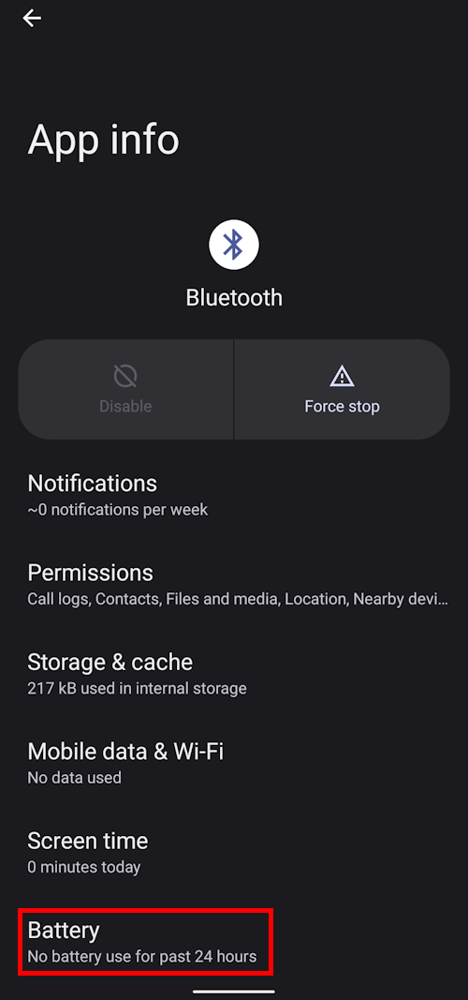

5. Na Androidu 12+ odaberite opciju `Neograničeno` (Unrestricted), a na Androidu 15+ morate proširiti postavku `Dopusti upotrebu u pozadini` (Allow background usage). Za to dodirnite odjeljak označen crvenom bojom, a zatim dovršite korakom 6.

   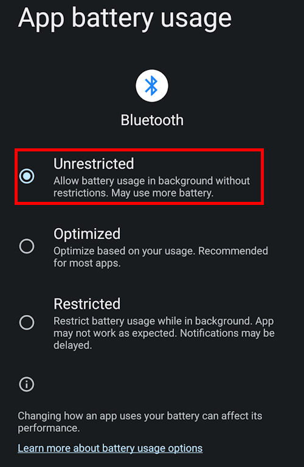    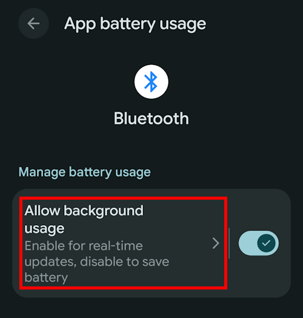

6. Na Androidu 16 odaberite `Neograničeno` (Unrestricted)

   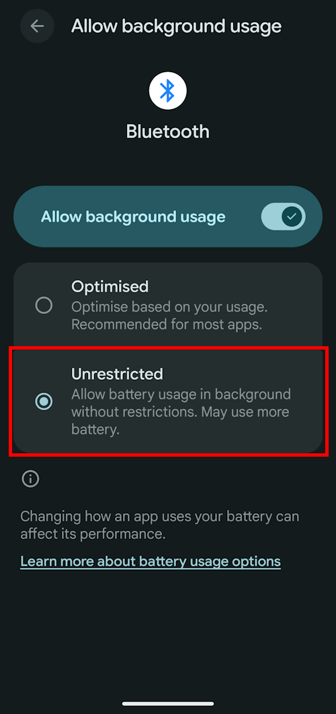

## Licencni ugovor

Licencni ugovor s krajnjim korisnikom sadrži važne informacije o pravnim aspektima korištenja **AAPS-a**. Pažljivo ga pročitajte.

Ako ne razumijete licencni ugovor s krajnjim korisnikom ili se s njim ne možete složiti, nemojte uopće koristiti **AAPS**!

Ako razumijete i slažete se, pritisnite gumb „**RAZUMIJEM I PRIHVAĆAM**“ i slijedite Čarobnjak za postavljanje:

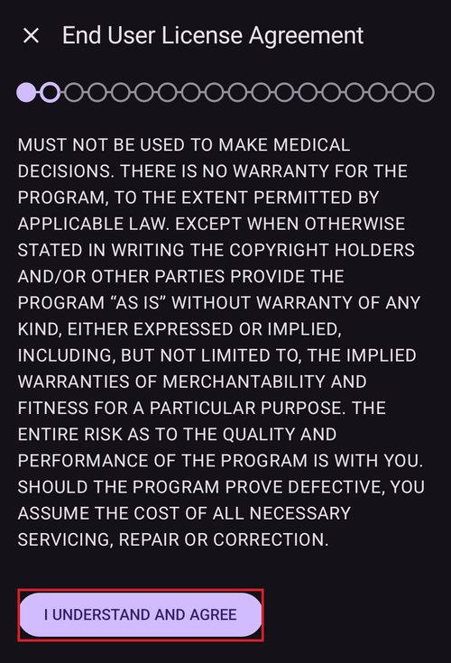

Nakon što prihvatite, pojavi se gumb „**Sljedeći**“. Pritisnite „**SLJEDEĆI**“.

Sljedeći zaslon, „**Dopuštenja**“, ponovno prikazuje popis dopuštenja. Sva bi trebala imati kvačicu jer ste ih odobrili na početku. Ako neko nedostaje, pritisnite „**Odobri**“ pokraj njega. Pritisnite „**SLJEDEĆI**“ za nastavak:

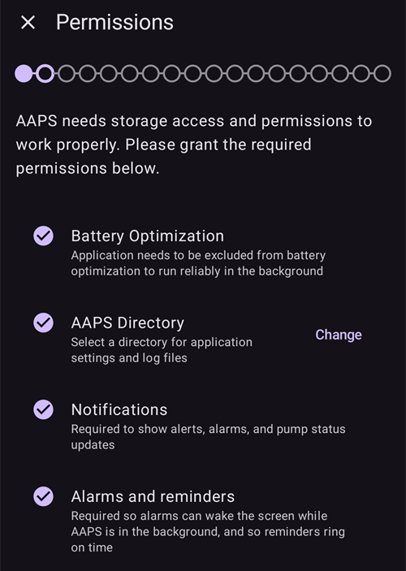

## Glavna lozinka

Budući da konfiguracija **AAPS-a** sadrži neke osjetljive podatke (_npr._ pristupni token za vaš Nightscout poslužitelj), šifrira se lozinkom koju ovdje postavite.

Čarobnjak prikazuje „**Lozinka nije postavljena**“. Pritisnite „**Postavi**“:

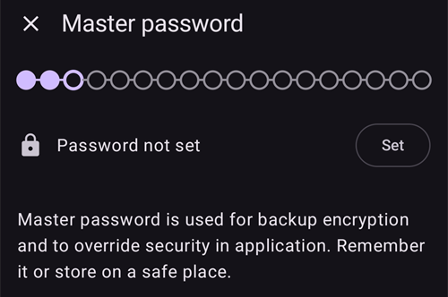

Time se otvara zaslon „**Zaštita**“. Pritisnite „**Glavna lozinka**“ (prikazano kao „Lozinka nije postavljena“):

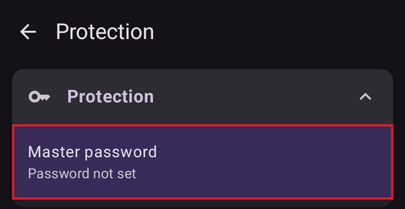

Unesite istu lozinku u oba polja i pritisnite „**U redu**“:

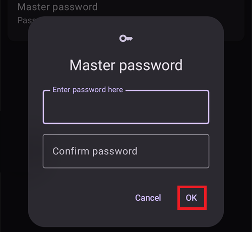

Vratite se strelicom u gornjem lijevom kutu. Čarobnjak sada prikazuje „**Lozinka postavljena!**“:

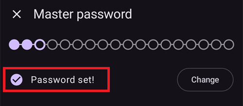

```{admonition} Do not lose your Master Password
:class: danger
**NEMOJTE IZGUBITI GLAVNU LOZINKU**. Zapišite je, _npr._ na Google Drive, koji je dobro mjesto jer Google za vas izrađuje sigurnosne kopije. Vaš pametni telefon ili računalo mogu se pokvariti, a vi možda nemate stvarnu kopiju. Ako zaboravite glavnu lozinku, kasnije će biti teško vratiti konfiguraciju profila i napredak kroz **Ciljeve**. Pogledajte [Kako resetirati glavnu lozinku?](#FAQ-reset-master-password)
```

Kada završite, pritisnite „**SLJEDEĆI**“ za prijelaz na sljedeći zaslon.

(setup-wizard-import-settings)=
## Uvezite postavke

Ovaj se zaslon prikazuje samo kada **AAPS** u mapi **AAPS** pronađe ranije izvezene postavke („Pronađene su spremljene postavke“), na primjer kada ponovno instalirate aplikaciju ili prelazite na novi telefon.

- Za vraćanje prethodne konfiguracije pritisnite „**Uvezi postavke**“ — pogledajte [Izrada i vraćanje sigurnosnih kopija](../Maintenance/ExportImportSettings.md).
- Za početak s novom konfiguracijom pritisnite „**SLJEDEĆI**“ i nastavite s Čarobnjakom.

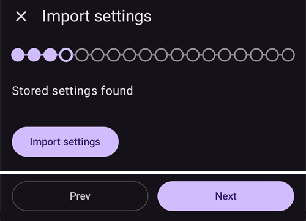

## Jedinice (mg/dL <-> mmol/L)

Odaberite jesu li vaše vrijednosti glukoze u mg/dL ili mmol/L, a zatim pritisnite gumb „**SLJEDEĆI**“:

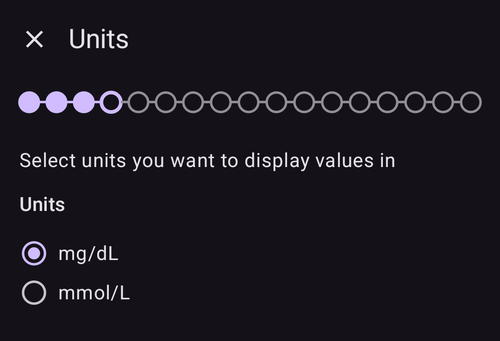

## Postavke prikaza

Ovdje postavljate „**Oznaka NISKO**“ i „**Oznaka VISOKO**“ za prikaz glukoze sa senzora. Vrijednosti glukoze između ove dvije oznake prikazuju se kao „u rasponu“. Zasad možete ostaviti zadane vrijednosti (72 i 180 mg/dL) i urediti ih kasnije.

Vrijednosti koje odaberete utječu samo na grafički prikaz dijagrama i ni na što drugo.

Vaš cilj glukoze, _npr._, konfigurira se zasebno u vašem profilu.

Raspon za analizu TIR-a (vrijeme u rasponu) konfigurira se zasebno na vašem poslužitelju za izvješća.

Ako je potrebno, prilagodite oznake gumbima „−“ / „+“, a zatim pritisnite gumb „**SLJEDEĆI**“:

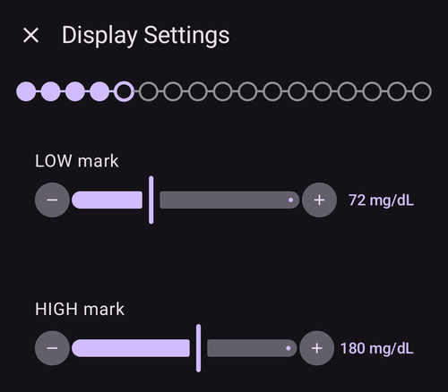

(SetupWizard-synchronization-with-the-reporting-server-and-more)=
## Komunikacija

Zaslon „**Komunikacija**“ prikazuje dodatke koji se koriste za prijenos, sinkronizaciju i odašiljanje vaših podataka:

- **SMS Communicator** – daljinsko upravljanje **AAPS-om** pomoću SMS naredbi
- **NSClientV3** – sinkronizira vaše podatke s Nightscoutom putem API-ja v3
- **Tidepool** – prenosi podatke u Tidepool
- **xDrip** – šalje podatke u xDrip
- **Open Humans** – prenesite i donirajte svoje podatke o dijabetesu znanstvenim projektima
- **Wear** – praćenje i upravljanje **AAPS-om** sa sata s Wear OS-om
- **Vanjske prateće aplikacije** – odašiljanje podataka raznim vanjskim aplikacijama
- **Garmin** – veza s Garmin uređajem

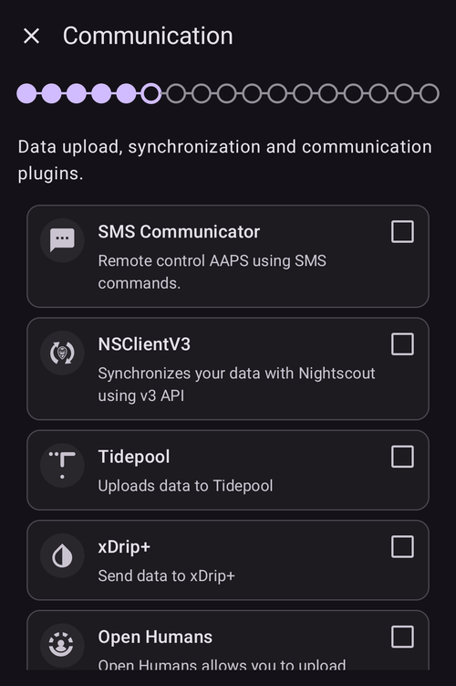

Pomaknite se prema dolje da vidite ostatak popisa:

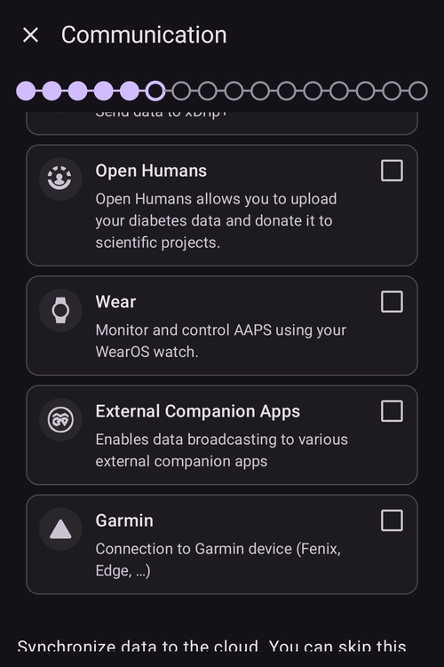

Sada biste mogli konfigurirati nekoliko od njih, ali kod prvog pokretanja usredotočit ćemo se samo na poslužitelj za izvješća. Ako ga trenutno ne možete postaviti, zasad ga preskočite — možete ga konfigurirati kasnije.

U ovom primjeru kao poslužitelj za izvješća koristimo Nightscout. Označite kućicu desno od „**NSClientV3**“ da ga omogućite. Za Tidepool je još jednostavnije jer su vam potrebni samo osobni podaci za prijavu.

Kada je omogućen, pritisnite „**Postavke**“ ispod NSClientV3 da ga konfigurirate:

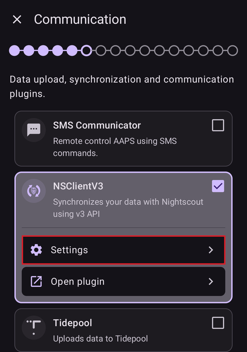

Ovdje konfigurirate Nightscout poslužitelj za izvješća. Postavke NSClientV3 prikazuju se kao jedna stranica koja se može pomicati:

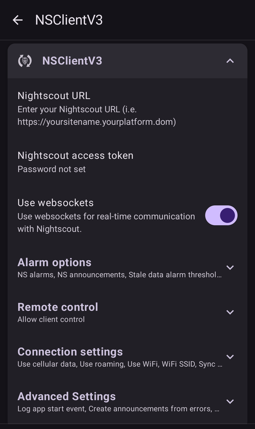

Pritisnite „**Nightscout URL**“ i unesite adresu svog osobnog Nightscout poslužitelja (URL koji ste sami postavili ili koji ste dobili od svog pružatelja usluge). Potvrdite s „**U redu**“.

Pritisnite „**Nightscout pristupni token**“ i unesite pristupni token za svoj Nightscout poslužitelj. Bez ovog tokena pristup neće raditi. Ako ga još nemate, pogledajte dokumentaciju za postavljanje poslužitelja za izvješća.

Ostavite „**Koristi WebSockets**“ omogućeno za komunikaciju s Nightscoutom u stvarnom vremenu. Websocketi su **obavezni** za daljinsko upravljanje iz **AAPSClienta**, na oba telefona.

Ostale odjeljke zasad možete ostaviti na zadanim vrijednostima. Ovdje su opisani kako biste kasnije znali gdje ih pronaći:

**Mogućnosti alarma** — Nightscout alarmi, najave i pragovi za zastarjele podatke. Zasad ostavite prekidače isključene. Otvaramo ih samo da biste znali za te opcije.

**Postavke veze** — odaberite kako se podaci prenose. Njegovatelji moraju omogućiti „**Koristi mobilne podatke**“, inače telefon osobe o kojoj se brinu (_npr._ djeteta) ne može prenositi podatke izvan dometa Wi-Fi mreže, _npr._ na putu do škole. Ostali korisnici mogu onemogućiti prijenos putem mobilne mreže kako bi uštedjeli podatke ili bateriju. Ako niste sigurni, ostavite sve omogućeno.

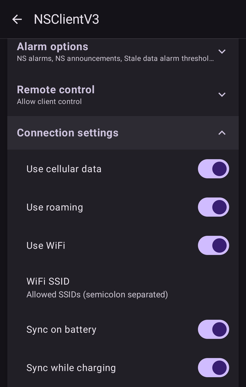

**Napredne postavke** — omogućite „**Zabilježi pokretanje aplikacije**“ ako u Nightscoutu želite vidjeti kada se aplikacija ponovno pokrene (korisno za njegovatelje). Ostavite omogućeno „**Stvori najave iz pogrešaka**“ i „**Stvori najave za potrebne ugljikohidrate**“. Ostavite „**Koristi sporu sinkronizaciju**“ isključeno. Koristili biste je samo ako Nightscout poslužitelj sporo obrađuje veliku količinu podataka.

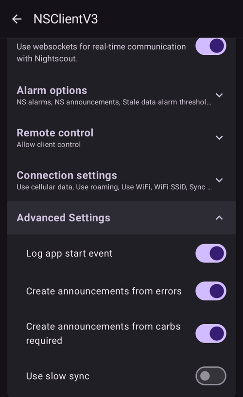

Vratite se na popis dodataka i pritisnite „**SLJEDEĆI**“ za prijelaz na sljedeći zaslon.

## Upravljanje s klijenta

Od verzije 4 **AAPS-a** klijentski uređaji s aplikacijom **AAPSClient** mogu se **upariti** s ovim telefonom (**glavni uređaj**) i upravljati njime potpisanim naredbama koje se šalju putem Nightscouta. To je novi preporučeni način daljinskog upravljanja **AAPS-om** — za potpuno objašnjenje i postavljanje pogledajte [Upravljanje glavni uređaj ↔ klijent](../RemoteFeatures/ClientMasterControl.md).

Na ovom zaslonu sada ne morate ništa konfigurirati. Klijente možete upariti bilo kada kasnije u **Upravljanje → Ovlašteni klijenti**. Tamo dodajete klijenta pomoću **QR koda** (on na klijentu postavlja i Nightscout) ili pomoću **PIN-a** i dodjeljujete mu **ulogu**.

- „**Ovlašteni klijenti**“ — upravljanje uparenim klijentskim uređajima kojima je dopušteno upravljati ovim glavnim uređajem.
- „**Prihvaćanje podataka iz Nightscouta**“ — prihvaćanje tretmana i podataka unesenih izravno u Nightscout (stari, manje siguran način) sada je prema zadanim postavkama isključeno. Ove postavke otvorite samo ako vam to još uvijek treba, _npr._ za unos podataka putem Nightscouta ili aplikacija trećih strana.

Kada je upravljanje s klijenta već uključeno — što je uvijek slučaj u [jednostavnom načinu rada](#preferences-simple-mode) — ovaj je telefon u [zaštićenom načinu rada](#client-master-control-hardened-mode): prihvaća promjene samo od uparenih klijenata, pa zaslon objašnjava zaštićeni način rada umjesto da nudi postavke „**Prihvaćanje podataka iz Nightscouta**“.

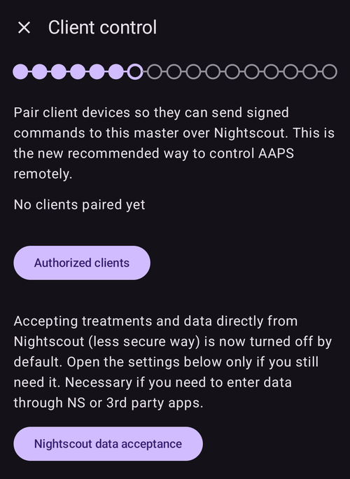

„**Prihvaćanje podataka iz Nightscouta**“ otvara postavke „**Sinkronizacija**“, gdje svaka vrsta podataka primljenih iz Nightscouta ima vlastiti prekidač:

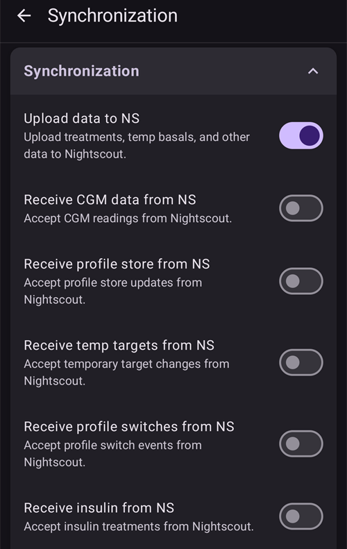

Pritisnite „**SLJEDEĆI**“ za prijelaz na sljedeći zaslon.

(setup-wizard-instance-name)=
## Tko koristi ovaj telefon?

Ovdje unosite ime osobe koja koristi ovaj telefon. Ono razlikuje ovu instancu **AAPS-a** od drugih u izvješćima i pri sinkronizaciji, na primjer ako dvoje djece u vašoj obitelji koristi **AAPS**. Koristi se i u nazivima datoteka izvezenih postavki te se prikazuje na satu.

Može biti bilo što. Kasnije ga možete promijeniti u **Postavke → Općenito → Naziv instance**.

Pritisnite „**SLJEDEĆI**“ za prijelaz na sljedeći zaslon.

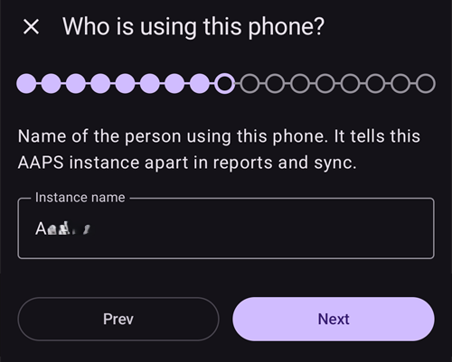

## Vrsta pacijenta

Ovdje odabirete „Vrsta pacijenta“. To je važno jer softver **AAPS** ima različite granice ovisno o dobi pacijenta. To je važno iz sigurnosnih razloga.

Ovdje također konfigurirate **maksimalni dopušteni bolus** za obrok. To je najveći bolus koji trebate dati za svoje uobičajene obroke. To je sigurnosna značajka koja pomaže izbjeći slučajno predoziranje kada dajete bolus za obrok.

Druga granica slična je po zamisli, ali se odnosi na najveći unos ugljikohidrata koji očekujete.

Nakon postavljanja ovih vrijednosti pritisnite „**SLJEDEĆI**“ za prijelaz na sljedeći zaslon:

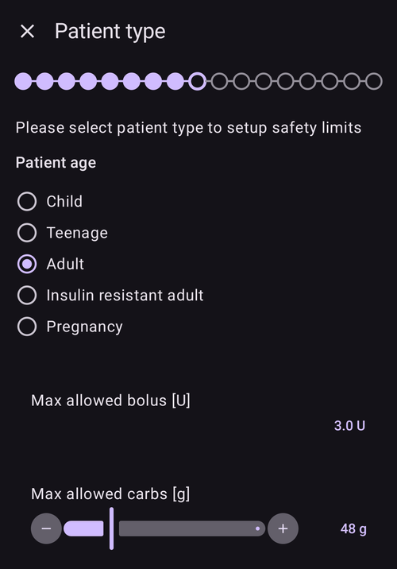

## Inzulin

Ovdje konfigurirate inzulin koji se koristi u vašoj pumpi. Novi profili inzulina zahtijevaju **DIA od najmanje 5 h**.

Pritisnite gumb „**Inzulin**“ da otvorite uređivač inzulina:

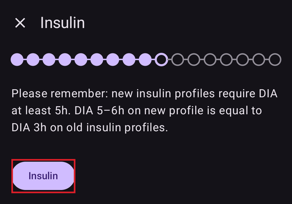

U uređivaču možete inzulinu dati **nadimak** i postaviti njegov **Vrh djelovanja** (u minutama) i **DIA** (u satima). Najbrži način je učitati predložak pomoću „**Učitaj vrh djelovanja iz**“ — odaberite **Novorapid**, **Fiasp** ili **Lyumjev** — i vrh djelovanja upiše se umjesto vas. Graf na dnu prikazuje pregled krivulje djelovanja inzulina koja iz toga proizlazi.

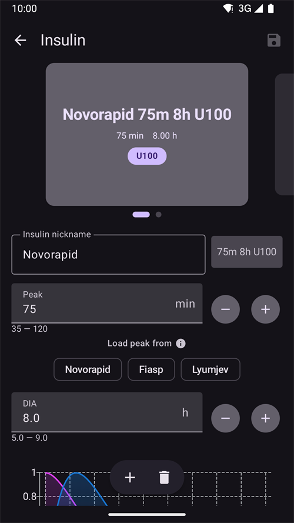

Odaberite predložak koji odgovara vašem inzulinu, na primjer **Fiasp**:

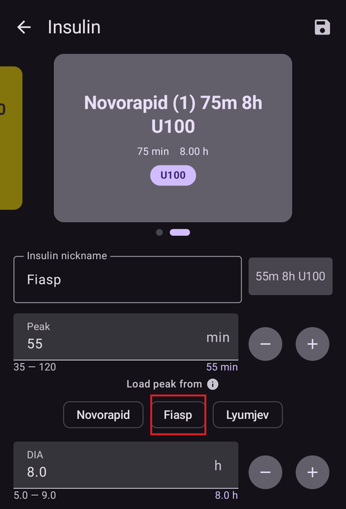

```{admonition} Use your insulin brand's preset peak
:class: danger
Nemojte mijenjati vrh djelovanja ako niste stručnjak — vrijednosti iz predloška obično dobro rade za svaki markirani inzulin.
```

Ako ste novi korisnik **AAPS-a**, postavite **DIA** na 9 sati — pogledajte [Trajanje djelovanja inzulina (DIA) i vrh djelovanja](#Config-Builder-insulin-dia) da biste razumjeli zašto.

```{admonition} "Insulin configuration changed" dialog
:class: note
Ako je upareni klijent (_npr._ drugi telefon) promijenio konfiguraciju inzulina, pojavi se dijalog. Pritisnite **U redu** da učitate njegove promjene ili **Otkaži** da nastavite uređivati (vaše sljedeće spremanje prebrisat će njegove promjene).
```

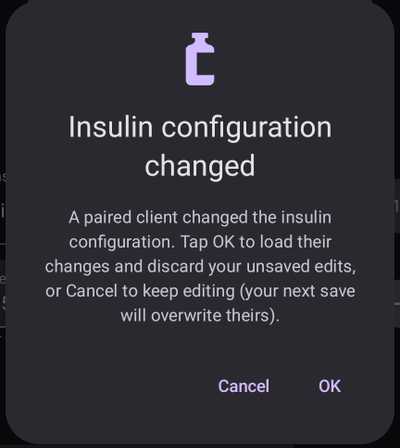

Pritisnite ikonu za spremanje (gore desno), a zatim pritisnite „**SLJEDEĆI**“ za prijelaz na sljedeći zaslon.

## Izvor glukoze u krvi

Ovdje odabirete odakle **AAPS** dobiva podatke o glukozi. Pročitajte dokumentaciju za svoj [izvor GUK-a](../Getting-Started/CompatiblesCgms.md).

Dostupni su mnogi izvori — pomičite se kroz popis i odaberite onaj koji koristite:

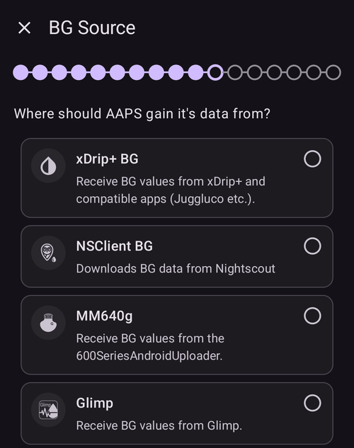

Kada odaberete izvor, njegova se kartica proširi i prikaže dva gumba: „**Postavke**“ za prilagodbu načina primanja podataka i „**Otvori dodatak**“ za otvaranje vlastitog zaslona izvora. U primjeru ispod odabran je **BYODA**. Neki izvori u ovoj fazi nemaju ništa za konfigurirati, pa obično možete odmah prijeći na sljedeći zaslon:

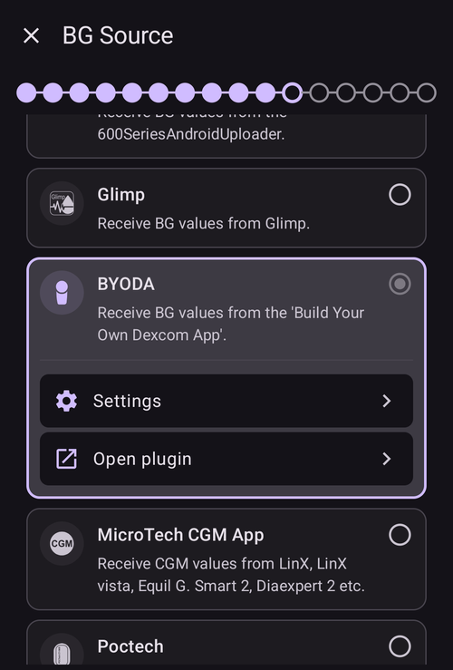

Nakon odabira pritisnite „**SLJEDEĆI**“ za prijelaz na sljedeći zaslon.

(setup-wizard-profile)=
## Profil

Sada dolazimo do vrlo važnog dijela Čarobnjaka za postavljanje.

Prije nego što na sljedećem zaslonu pokušate unijeti podatke svog profila, pročitajte dokumentaciju o [profilima](../SettingUpAaps/YourAapsProfile.md).

```{admonition} Working profile required - no exceptions here !
:class: danger
Točan profil nužan je za sigurno djelovanje **AAPS-a**.

Potrebno je da ste svoj profil odredili i razgovarali o njemu sa svojim liječnikom te da je dokazano da radi uspješnim testiranjem bazalne stope, ISF-a i IC-a!

Ako robot dobije pogrešne ulazne podatke, neće uspjeti - i to svaki put. **AAPS** može raditi samo s informacijama koje dobije. Ako je vaš profil prejak, riskirate hipoglikemiju, a ako je preslab, riskirate hiperglikemiju. 
```

Pritisnite gumb „**Profil**“ da otvorite uređivač profila:

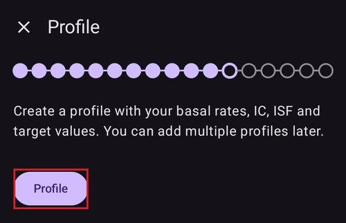

Uređivač se otvara prazan („Nema dostupnih zapisa“). Pritisnite gumb „**+**“ na dnu da stvorite novi profil:

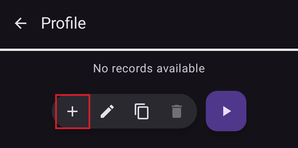

Ako je potrebno, dugoročno možete imati više profila. Ovdje stvaramo samo jedan.

```{admonition} Profile only for tutorial - not for your usage
:class: note
Ovdje prikazani primjer profila služi samo da vam pokaže kako unijeti podatke.

Nije zamišljen kao točan profil ni kao nešto vrlo dobro optimizirano, jer su potrebe svake osobe vrlo različite.

Nemojte ga koristiti za stvarno korištenje petlje!
```

Novi profil (na primjer „**LocalProfile1**“) ima četiri kartice: **IC**, **ISF**, **BAZ** i **CILJ**. Pritisnite olovku pokraj naziva profila da ga preimenujete. Ispunite svaku karticu — kartica ostaje crvena i prikazuje poruku o pogrešci dok ne sadrži valjane vrijednosti:

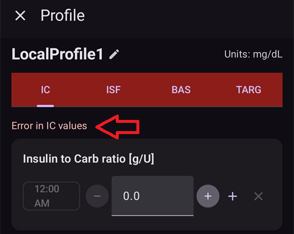

Pritisnite „**IC**“ i unesite svoje vrijednosti [IC](#your-aaps-profile-insulin-to-carbs-ratio). Gumbom „**+**“ dodajte još vremenskih blokova:

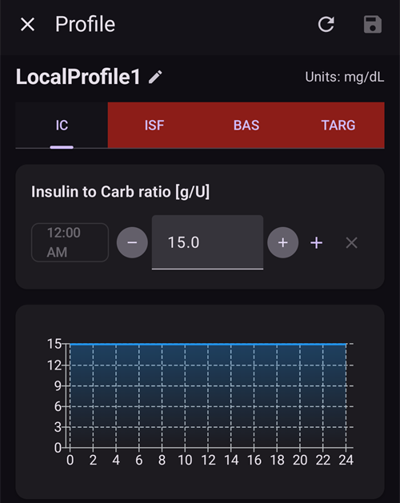

Pritisnite „**ISF**“ i unesite svoje [vrijednosti ISF](#your-aaps-profile-insulin-sensitivity-factor):

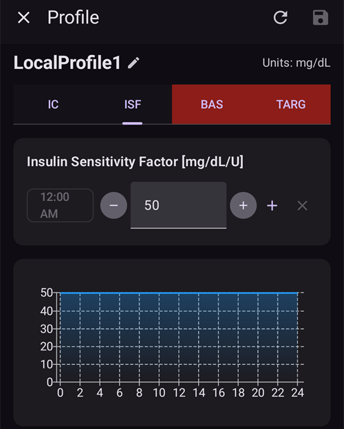

Pritisnite „**BAZ**“ i unesite svoje [bazalne vrijednosti](#your-aaps-profile-basal-rates):

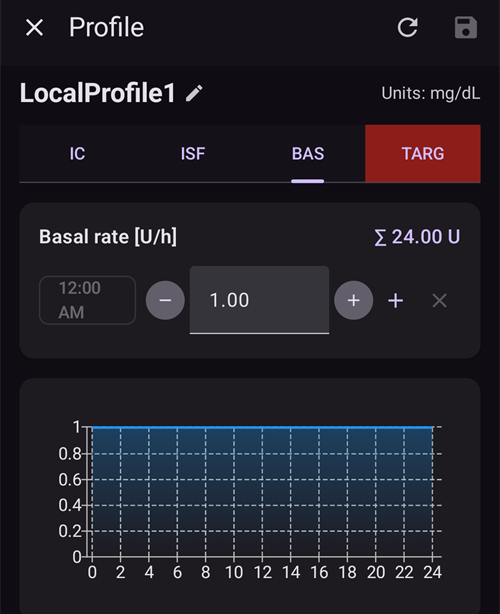

Pritisnite „**CILJ**“ i unesite svoje ciljne vrijednosti glukoze u krvi.

Za otvorenu petlju ovaj cilj može biti širi raspon, jer vas inače **AAPS** stalno obavještava da promijenite privremenu bazalnu stopu ili neku drugu postavku, što može biti iscrpljujuće.

Kasnije, za zatvorenu petlju, obično ćete imati samo jednu vrijednost za gornju i donju granicu. Tako **AAPS** lakše postiže cilj i daje vam bolju ukupnu kontrolu dijabetesa.

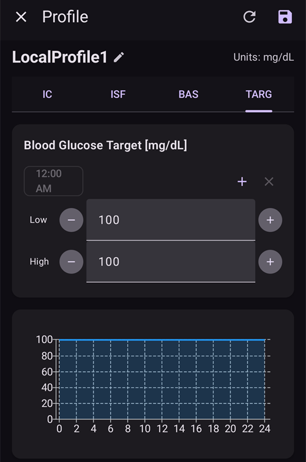

Kada su sve četiri kartice valjane, **ikona za spremanje** (gore desno) postaje aktivna. Pritisnite je da spremite profil:

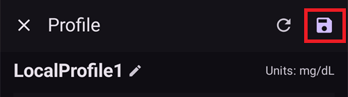

Zatvorite uređivač pomoću „**X**“ u gornjem lijevom kutu. Sažetak profila tada prikazuje njegov naziv, ukupni dnevni bazal (∑), jedinice te vrijednosti IC i ISF s njihovim grafovima:


```{admonition} Several defined but only one active profile
:class: note
Možete imati definirano više profila, ali u bilo kojem trenutku radi samo jedan aktivirani profil.
```

Pritisnite gumb „**▶**“ (aktiviraj) dolje desno. Otvara se zaslon „**Aktiviraj**“. Budući da se još ne koristi nijedan inzulin, najprije traži da odaberete inzulin koji koristite, kako bi ga zamjena profila mogla zabilježiti. Gumb „**Aktiviraj**“ ostaje siv dok to ne učinite:


Pritisnite „**Odaberi inzulin**“ i odaberite inzulin koji ste ranije konfigurirali. Ostavite postotak na 100 % i pritisnite „**Aktiviraj**“:


Pojavi se dijalog zamjene profila. U ovom slučaju ostavite ga kako je unaprijed postavljeno i potvrdite s „**U redu**“:

```{admonition} Profile switch dialog
:class: note
Kasnije ćete naučiti kako ovim općim dijalogom riješiti situacije poput bolesti ili sporta, kada profil morate prilagoditi okolnostima.
```


Vaš je profil sada aktivan. Pritisnite „**SLJEDEĆI**“ za prijelaz na sljedeći zaslon.

## Inzulinska pumpa

Sada odabirete svoju inzulinsku pumpu. Pročitajte dokumentaciju za svoju [inzulinsku pumpu](../Getting-Started/CompatiblePumps.md).

Pomičite se kroz popis i odaberite svoju pumpu. U ovom primjeru koristimo „**Virtualna pumpa**“, što je korisno dok još učite i još niste spojili pravu pumpu:


Podržane su mnoge pumpe — pomaknite se prema dolje da pronađete svoju:


Kada odaberete pravu pumpu, **AAPS** traži potvrdu jer će kopirati bazalne stope iz vašeg profila u pumpu i prebrisati bazalne stope koje su tamo spremljene. Pritisnite „**U redu**“ samo ako su bazalne stope u vašem profilu **AAPS-a** točne. Inače pritisnite „**Otkaži**“ i pumpu promijenite kasnije:


Ako pumpa koju odaberete komunicira putem Bluetootha, **AAPS** traži dopuštenje za povezivanje s uređajima u blizini nakon što završite Čarobnjak (pogledajte [Dopuštenje za Bluetooth](#setup-wizard-bluetooth-permission)).

Ako ste već postavili profil i znate kako spojiti pumpu, slobodno je spojite sada. Inače je zasad ostavite na **Virtualna pumpa** — to možete promijeniti bilo kada. Također možete napustiti Čarobnjak za postavljanje strelicom u gornjem lijevom kutu i pustiti da vam **AAPS** najprije prikaže nekoliko vrijednosti glukoze u krvi.

Pritisnite „**SLJEDEĆI**“ za prijelaz na sljedeći zaslon.

## APS algoritam

Kao APS algoritam koristite algoritam OpenAPS SMB. Unatoč nazivu, značajka SMB algoritma onemogućena je dok se ne upoznate s AAPS-om i ne prođete prve ciljeve. OpenAPS SMB je ionako noviji i općenito bolji od OpenAPS AMA.

SMB je na početku onemogućen jer značajka SMB brže reagira na porast glukoze u krvi tako što koristi super mikro bolus (Super Micro Bolus) umjesto povećanja postotka bazalne stope. Budući da vaš profil na početku obično nije tako dobar kao nakon nešto iskustva, značajka je isprva onemogućena.

```{admonition} Only use the older algorithm **OpenAPS AMA** if you know what you are doing
:class: note
OpenAPS AMA je najosnovniji algoritam koji ne podržava mikro boluse za korekciju visokih vrijednosti. Mogu postojati okolnosti u kojima je bolje koristiti ovaj algoritam, ali to nije preporuka.
```

Odaberite „**OpenAPS SMB**“, a zatim pritisnite „**Postavke**“ da vidite pojedinosti:


Jedina opcija ovdje je „**Koristi dinamičku osjetljivost**“. Ostavite je isključenu i zasad ništa ne mijenjajte — samo pročitajte tekst.

Zbog ograničenja koja nameću **Ciljevi** trenutno ionako ne možete koristiti ni „zatvorenu petlju“ ni „značajke SMB-a“.

Vratite se i pritisnite „**SLJEDEĆI**“ za prijelaz na sljedeći zaslon:


## Detekcija osjetljivosti

Ostavite odabranu „**Osjetljivost Oref1**“ kao standardni dodatak za osjetljivost:


Ako pritisnete „**Postavke**“, možete pregledati postavke apsorpcije. Zadane vrijednosti (_npr._ granica apsorpcije od 6 h) zasad su u redu.


Pritisnite „**SLJEDEĆI**“ za prijelaz na sljedeći zaslon.

## Započnite Cilj 1

Sada ulazite u Ciljeve — kvalifikaciju za pristup daljnjim značajkama **AAPS-a**.

Pritisnite „**Otvori ciljeve**“:


Ovdje započinjemo Cilj 1, iako trenutno naše postavljanje još nije potpuno spremno za uspješno ispunjavanje ovog cilja. Ali ovo je početak.

Pritisnite gumb „**Započni**“ za **Cilj 1**:


Cilj se proširi i prikaže svoje pojedinačne provjere. Vidite da ste već malo napredovali, dok druge stavke tek treba obaviti:


Vratite se, a zatim pritisnite „**ZAVRŠI**“ da dovršite Čarobnjak za postavljanje:


Nakon pritiska na „**ZAVRŠI**“ dolazite na glavni zaslon **AAPS-a**. Može se otvoriti ploča „**Obavijest**“ s informativnim porukama, na primjer o zamjeni profila koju ste upravo napravili — pritisnite „**Odbaci**“ ispod svake poruke da je uklonite.

Ako u bilo kojem trenutku slučajno napustite Čarobnjak za postavljanje, možete ga jednostavno ponovno pokrenuti ili ručno promijeniti [konfiguraciju petlje AAPS-a](../SettingUpAaps/ChangeAapsConfiguration.md).

(setup-wizard-bluetooth-permission)=
## Dopuštenje za Bluetooth

Ako odaberete pumpu koja se spaja putem Bluetootha (na primjer **Omnipod Dash**), natpis vas podsjeća da **AAPS** treba dopuštenje za Bluetooth. Zasad možete pritisnuti „**Odbaci**“ — dopuštenje se odobrava nakon što završite Čarobnjak:


Kada je Čarobnjak za postavljanje završen, glavni zaslon **AAPS-a** prikazuje ploču „**Potrebna dopuštenja**“. Ostala dopuštenja već su odobrena. Pritisnite „**Odobri**“ pokraj „**Bluetooth**“:


Odaberite „**Dopusti**“ kako bi **AAPS** mogao pronaći vašu pumpu i spojiti se na nju:


Ako je vaša petlja **AAPS-a** sada potpuno postavljena, prijeđite na sljedeći odjeljak [„Ispunjavanje ciljeva“](../SettingUpAaps/CompletingTheObjectives.md).
