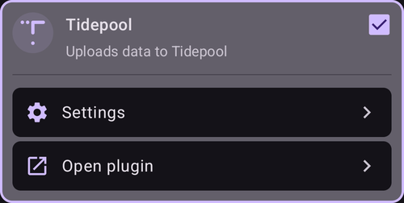
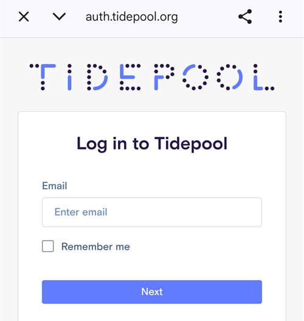
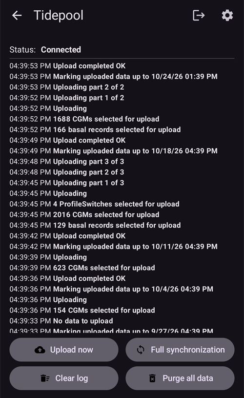
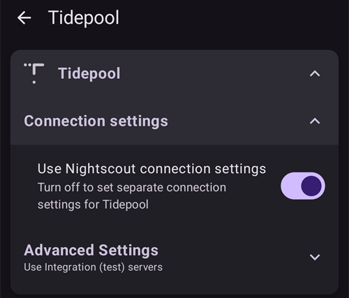
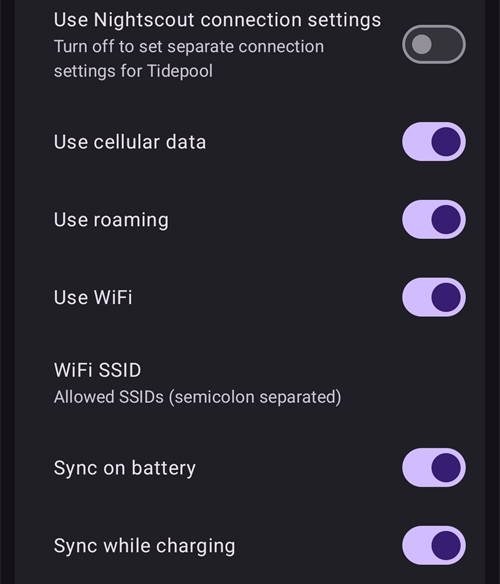
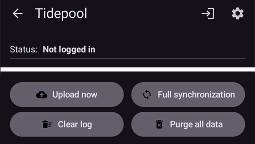

# Tidepool

Tidepool je alat treće strane koji prikuplja podatke o GUK-u, inzulinu i ugljikohidratima (i bilješke koje dodate svojim tretmanima). Pomoću njega te podatke možete analizirati i dijeliti sa svojim kliničkim timom. Od verzije AAPS-a 3.2 može se koristiti umjesto Nightscouta za ispunjavanje dijela Cilja 1. Može se koristiti i zajedno s Nightscoutom, kao druga platforma za izvješća koja se dobro uklapa u kliničku praksu. To može biti dobar izbor za djecu koja koriste AAPS i žele mogućnosti daljinskog nadzora i upravljanja koje nudi Nightscout, ali i platformu za izvješća koja je bliža njihovom kliničkom timu.

Važno je razumjeti da je Tidepool samo za izvješća. To NIJE aplikacija za praćenje u stvarnom vremenu. Ako trebate pratitelje osim glavnog AAPS telefona, morate postaviti i Nightscout.

Napomena: organizacija Tidepool izbacila je na tržište proizvod iOS Loop s odobrenjem FDA. Taj projekt nema nikakve veze s njihovom platformom za izvješća o podacima ni s AAPS-om.

## Korak 1 - Otvorite Tidepool račun

- Idite na [tidepool.org](https://www.tidepool.org/)

- Odaberite „Personal Sign Up“ ili „Sign Up“

- Izradite e-adresu i lozinku i zapišite ih

- Odaberite „Personal Account“ i kliknite „Continue“

- Ispunite odjeljak s podacima o pacijentu i prihvatite uvjete korištenja

- Potvrdite svoju e-adresu prema uputama koje ste primili e-poštom

## Korak 2 - Spojite AAPS s Tidepoolom

- Otvorite **izbornik** (☰) u gornjem lijevom kutu glavnog zaslona i odaberite „**Konfiguracija**“

- Otvorite kategoriju „**Komunikacija**“ i omogućite „**Tidepool**“:

- Dodirnite „**Otvori dodatak**“ ispod Tidepoola, zatim dodirnite ikonu **Prijava** (strelica koja ulazi u vrata) u gornjem desnom kutu

- Otvara se prozor preglednika sa stranicom za prijavu u Tidepool. Prijavite se e-adresom i lozinkom koje ste izradili u koraku 1 gore:

- Nakon uspješne prijave preglednik se zatvara i zaslon Tidepool prikazuje status „**Povezano**“; dnevnik ispod bilježi prijenose podataka. Ako prijava ne uspije, provjerite jesu li vaši podaci za prijavu točni i jeste li potvrdili svoju e-adresu kod Tidepoola.

- U „**Postavkama**“ dodatka Tidepool otvorite „**Postavke veze**“. Prema zadanim postavkama „**Koristi postavke veze Nightscouta**“ je uključeno, pa Tidepool prenosi podatke pod istim uvjetima koje ste postavili za Nightscout. Isključite to ako želite zasebne uvjete za Tidepool, na primjer da se u Tidepool prenosi samo putem Wi-Fi-ja i tijekom punjenja, dok Nightscout koristi i mobilne podatke.

 

Za dodatnu pomoć o tome kako koristiti svoje podatke nakon što su preneseni u Tidepool posjetite: [https://www.tidepool.org/viewing-your-data](https://www.tidepool.org/viewing-your-data)

(tidepool-menu)=
## Gumbi za Tidepool

U gornjem desnom kutu zaslona Tidepool:

- Ikona **Prijava** ili **Odjava** — spajanje na vaš Tidepool račun ili odspajanje s njega. Prikazuje se samo jedna od njih: **Prijava** dok ste odjavljeni, **Odjava** dok ste prijavljeni. **AAPS** traži potvrdu prije nego što vas odjavi.
- Ikona zupčanika — postavke Tidepoola.

Gumbi na dnu zaslona Tidepool:

- „**Pošalji sada**“ — odmah prenosi nove podatke, umjesto čekanja na sljedeći automatski prijenos.
- „**Potpuna sinkronizacija**“ — ponovno prenosi sve podatke spremljene u **AAPS-u**.
- „**Izbriši sve podatke**“ — briše **sve** podatke koje je **AAPS** prenio na vaš Tidepool račun. To se ne može poništiti. Koristite to samo za uklanjanje pogrešnih ili dvostrukih podataka, a zatim pokrenite „**Potpuna sinkronizacija**“ kako biste ponovno prenijeli svoje podatke.
- „**Očisti dnevnik**“ — prazni dnevnik prikazan na zaslonu Tidepool.

U Tidepoolu se podaci koje je prenio **AAPS** 4 prikazuju pod nazivom uređaja **AAPS**. Ako ste Tidepool koristili sa starijom verzijom, pogledajte [Što se promijenilo u AAPS-u v4](#v4changes-tidepool). 
