# Prijenos i instalacija AAPS-a na vaš pametni telefon

U prethodnom odjeljku, [Izrada **AAPS-a**](../SettingUpAaps/BuildingAaps.md), izradili ste aplikaciju **AAPS** (to je .apk datoteka) na računalu.

Sljedeći koraci su **prijenos** APK datoteke **AAPS-a** (i drugih aplikacija koje bi vam mogle trebati, npr. BYODA, xDrip ili druga aplikacija za primanje podataka CGM-a) na vaš Android pametni telefon, a zatim **instalacija** aplikacije (ili aplikacija). Nakon instalacije **AAPS-a** na pametni telefon moći ćete prijeći na [**konfiguraciju petlje AAPS-a**](../SettingUpAaps/SetupWizard.md).

Ova stranica također objašnjava [provjeru Android razvojnih programera](#android-developer-verification), promjenu koju Google uvodi od rujna 2026. i koja utječe na instalaciju aplikacija koje ste sami izradili, te [besplatne načine instalacije](#android-developer-verification-free-methods) koji i nakon te promjene nastavljaju raditi.

```{contents} Table of contents
:depth: 1
:local: true
```

## Instalacija AAPS-a dodirom na APK datoteku

Danas **AAPS** instalirate tako da APK datoteku prenesete na telefon i otvorite je („dodirnete“). Postoji nekoliko načina za prijenos APK datoteke **AAPS-a** s računala na pametni telefon. Ovdje objašnjavamo dva različita načina:

* Opcija 1 – Koristite svoj Google Drive (Gdrive)
* Opcija 2 – Koristite USB kabel

Imajte na umu da prijenos e-poštom može stvarati probleme i ne preporučuje se.

```{admonition} Android developer verification
:class: warning
Google od rujna 2026. postupno uvodi [provjeru Android razvojnih programera](#android-developer-verification) (najprije u Brazilu, Indoneziji, Singapuru i Tajlandu; u cijelom svijetu 2027.). Ondje gdje se provjera primjenjuje, instalacija APK datoteke dodirom na datoteku – kako je opisano u obje opcije ispod – je blokirana. U tom slučaju koristite jedan od [besplatnih načina instalacije](#android-developer-verification-free-methods) niže na ovoj stranici.
```

### Opcija 1. Prijenos datoteka putem Google Drivea

U web pregledniku otvorite [Google.com](https://www.google.com/) i prijavite se na svoj Google račun.

Gore desno u Google izborniku odaberite aplikaciju Drive.

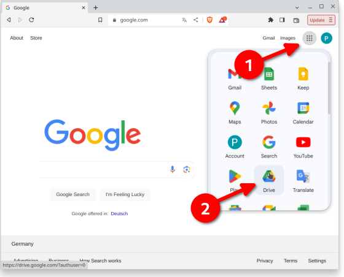

Kliknite **New** (Novo) gore lijevo (ili desnom tipkom miša kliknite prazno mjesto ispod svojih datoteka i mapa) i odaberite **File upload** (Prijenos datoteke).

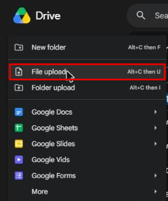

Apk datoteka sada bi trebala biti prenesena na Google Drive.

#### Pokretanje instalacije apk datoteke iz aplikacije Google Drive

Prijeđite na mobitel i pokrenite aplikaciju Google Drive. To je unaprijed instalirana aplikacija. Nalazi se tamo gdje su ostale Google aplikacije, a možete je pronaći i pretraživanjem po nazivu aplikacije.

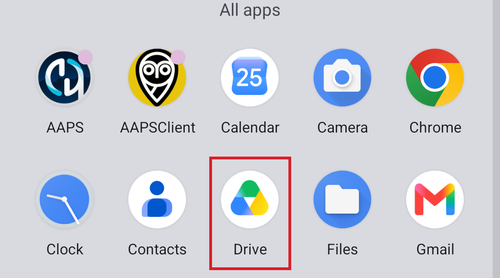

Pokrenite instalaciju apk datoteke tako da na mobitelu u aplikaciji Google Drive dodirnete naziv datoteke.

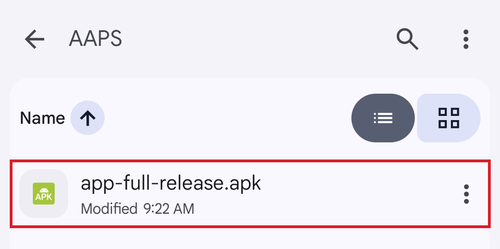

Ako dobijete sigurnosnu obavijest da trenutačno nije dopušteno instalirati aplikacije iz Google Drivea, dodirnite „Postavke“ i dopustite to samo na kratko vrijeme. Nakon toga to ponovno zabranite, jer je stalno uključena opcija sigurnosni rizik.

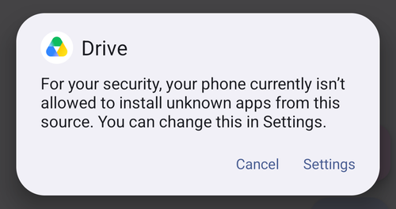

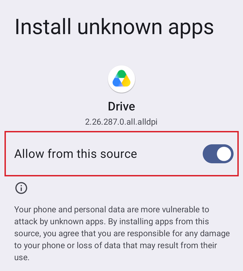

Kada instalacija završi, ovaj je korak gotov.

Trebali biste vidjeti ikonu **AAPS-a** i moći otvoriti aplikaciju.

```{warning}
**VAŽNA SIGURNOSNA NAPOMENA**
Jeste li se sjetili ponovno zabraniti instalaciju iz Google Drivea?
```

Nastavite s [konfiguracijom petlje AAPS-a](../SettingUpAaps/SetupWizard.md).

### Opcija 2. Prijenos datoteka USB kabelom

Drugi način prijenosa apk datoteke AAPS-a je [USB kabelom](https://support.google.com/android/answer/9064445?hl=en).

Prenesite datoteku s njezine lokacije na računalu u mapu „Preuzimanja“ (Downloads) na telefonu.

Na telefonu ćete morati dopustiti instalaciju iz nepoznatih izvora. Upute kako to učiniti možete pronaći na internetu (_npr._ [ovdje](https://www.expressvpn.com/de/support/vpn-setup/enable-apk-installs-android/) ili [ovdje](https://www.androidcentral.com/unknown-sources)).

Kada povlačenjem prenesete datoteku, na telefonu otvorite mapu „Preuzimanja“ (Downloads) i dodirnite apk datoteku AAPS-a:

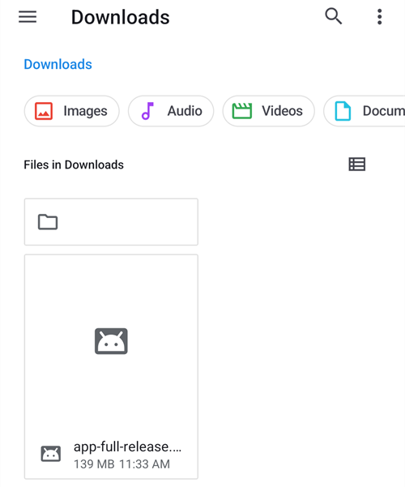

Prvi put će vam Android javiti da telefon ne smije instalirati nepoznate aplikacije iz ovog izvora. Dodirnite „**Postavke**“:

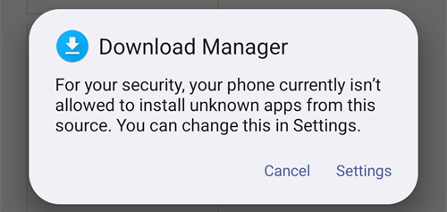

Uključite „**Dopusti iz ovog izvora**“, a zatim se vratite:

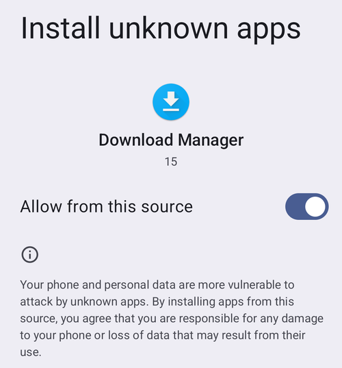

Ponovno dodirnite apk datoteku i odaberite „**Instaliraj**“:

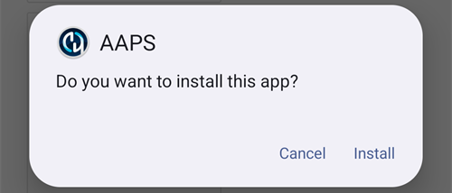

Kada instalacija završi, dodirnite „**Otvori**“ za pokretanje **AAPS-a** ili „**Gotovo**“ ako ga želite otvoriti kasnije:

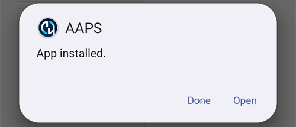

```{warning}
**VAŽNA SIGURNOSNA NAPOMENA**
Nakon instalacije ne zaboravite ponovno isključiti „Dopusti iz ovog izvora“, jer je stalno uključena opcija sigurnosni rizik.
```

Nastavite s [konfiguracijom petlje AAPS-a](../SettingUpAaps/SetupWizard.md).

(transferring-installing-play-protect-warning)=
## Upozorenje Google Play zaštite

Kada instalirate **AAPS**, Google Play zaštita može vas upozoriti da aplikacija nije sigurna, da je izrađena za stariju verziju Androida i da ne sadrži najnovije zaštite privatnosti.

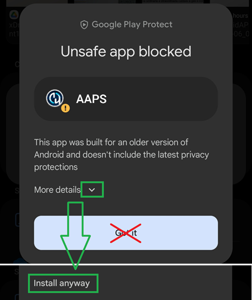

To je očekivano za aplikaciju koju ste sami izradili. Dodirnite **Više pojedinosti** (More details), a zatim **Ipak instaliraj** (Install anyway).

Ako je instalacija **blokirana** s porukom o neprovjerenom razvojnom programeru (a ne samo upozorenjem), pogledajte [Provjera Android razvojnih programera](#android-developer-verification) niže.

(android-developer-verification)=

## Provjera Android razvojnih programera

Google uvodi **provjeru Android razvojnih programera**: na većini Android telefona aplikacije će se moći instalirati samo ako ih je kod Googlea registrirao provjereni razvojni programer. To vrijedi i za aplikacije instalirane iz APK datoteke („sideloading“) – a upravo tako instalirate aplikaciju **AAPS** koju ste sami izradili.

### Što se mijenja

Kada instalirate **AAPS** na telefon s Googleovim uslugama („certificirani“ Android uređaj – gotovo svaki telefon koji se prodaje s Trgovinom Play), Android će provjeriti dolazi li aplikacija od razvojnog programera registriranog kod Googlea. Ako ne dolazi, uobičajena instalacija dodirom na APK datoteku je blokirana.

**Provjera se obavlja kada se aplikacija instalira ili ažurira.** Ona ne uklanja aplikacije koje su već instalirane i rade.

Google ovo uvodi postupno:

| Kada            | Što se događa                                                                                                                                                                   |
| --------------- | ------------------------------------------------------------------------------------------------------------------------------------------------------------------------------- |
| Kolovoz 2026.   | Besplatni računi razvojnih programera za „ograničenu distribuciju“ otvoreni su u cijelom svijetu, a „napredni postupak“ (advanced flow) počinje se postupno uvoditi na telefone |
| 30. rujna 2026. | Provjera se primjenjuje u **Brazilu, Indoneziji, Singapuru i Tajlandu** za aplikacije instalirane iz Google Playa i nekoliko drugih trgovina aplikacija                         |
| 2027.           | Primjena se proširuje na **ostatak svijeta** i na **sve instalacije**, uključujući APK datoteke                                                                                 |

Pojedinosti Google objavljuje na stranicama [Android developer verification](https://developer.android.com/developer-verification), uključujući [česta pitanja (FAQ)](https://developer.android.com/developer-verification/guides/faq). Google još može promijeniti datume i pojedinosti; ova će se stranica ažurirati kako uvođenje bude napredovalo.

### Utječe li ovo na mene?

- **Na izradu AAPS-a ovo uopće ne utječe.** [Izrada u pregledniku](#browser-build), [izrada s Android Studiom](ComputerBuild.md) i [izrada iz naredbenog retka](CLIBuild.md) rade točno kao i prije, a vaše se spremište ključeva ne mijenja.
- **Vaš trenutačni AAPS nastavlja raditi.** Provjera se obavlja samo pri instalaciji ili ažuriranju aplikacije.
- **Ako živite u Brazilu, Indoneziji, Singapuru ili Tajlandu:** od 30. rujna 2026. provjera se primjenjuje na aplikacije instalirane iz Google Playa i nekoliko drugih trgovina aplikacija. Google navodi da izravna instalacija APK datoteke nije obuhvaćena ovim prvim korakom, pa bi se **AAPS** i dalje trebao instalirati kao i obično. Ipak, već sada pripremite jedan od [besplatnih načina instalacije](#android-developer-verification-free-methods) opisanih ispod, kako vas ne bi iznenadilo ako se to promijeni.
- **Ako živite bilo gdje drugdje:** za vas se do 2027. ništa ne mijenja, i da zasad ne poduzmete ništa, sasvim je opravdan izbor. Ipak, postavite jedan od [besplatnih načina instalacije](#android-developer-verification-free-methods) opisanih ispod dok još sve radi: dan kada je ažuriranje odbijeno, a pred vama je 24-satno čekanje [naprednog postupka](#android-developer-verification-advanced-flow), pogrešan je trenutak da otkrijete blokadu.
- **Stari telefoni:** provjera se primjenjuje na telefone s Androidom 7 ili novijim, a to znači na svaki telefon na kojem može raditi **AAPS**.

(android-developer-verification-free-methods)=

## Besplatni načini instalacije AAPS-a

**Ne** morate Googleu ništa platiti da biste nastavili koristiti **AAPS**. Postoji nekoliko besplatnih načina; odaberite onaj koji odgovara vašoj situaciji.

```{admonition} Which method should I use?
:class: tip
- Imate **računalo** (bez obzira na to kako ste izradili **AAPS**): koristite [ADB](#android-developer-verification-adb) ili, ako želite izbjeći naredbeni redak, [web instalacijski program](#android-developer-verification-web). Oba načina izuzeta su od provjere, nemaju ograničenja i ne trebaju Google račun.
- **Uopće nemate računalo**: koristite [napredni postupak](#android-developer-verification-advanced-flow) na svom telefonu.
- Želite se registrirati kod Googlea kako bi uobičajena instalacija „dodirom na APK“ i dalje radila: postoji [besplatni račun za ograničenu distribuciju](#android-developer-verification-limited-account), ali s **AAPS-om** još nije testiran.
```

(android-developer-verification-adb)=

### Opcija 1: Instalacija pomoću ADB-a (potrebno je računalo)

ADB (Android Debug Bridge) je Googleov službeni alat za instalaciju aplikacija s računala na telefon putem USB kabela. Google je potvrdio da **aplikacije instalirane pomoću ADB-a ne trebaju provjeru** – nema razdoblja čekanja, nema ograničenja broja uređaja i nema registracije.

Jednokratna priprema:

1. Na telefonu omogućite skrivene opcije za razvojne programere: idite na **Postavke** > **O telefonu** (na nekim telefonima **Informacije o softveru**) i sedam puta dodirnite **Broj međuverzije**, dok telefon ne potvrdi da ste razvojni programer.
1. Vratite se u glavne **Postavke**, otvorite novu stavku **Opcije za razvojne programere** i uključite **Otklanjanje pogrešaka putem USB-a**.
1. Na računalu provjerite je li ADB dostupan:
   - Ako koristite **Android Studio**, ADB je već instaliran s njim.
   - Inače preuzmite Googleove besplatne [SDK Platform Tools](https://developer.android.com/tools/releases/platform-tools) i raspakirajte mapu. Instalacija nije potrebna; ADB je program `adb` u toj mapi.

Instalacija (i kasnije ažuriranje) **AAPS-a**:

1. Spojite telefon s računalom USB kabelom. APK datoteku ne morate najprije prenijeti na telefon: ADB je šalje izravno s računala.
1. Na telefonu prihvatite upit **Dopustiti otklanjanje pogrešaka putem USB-a?** (samo prvi put).
1. Na računalu otvorite terminal (naredbeni redak) u mapi u kojoj su ADB i APK datoteka **AAPS-a** i pokrenite:

   ```
   adb install -r app-full-release.apk
   ```

   Zamijenite `app-full-release.apk` stvarnim nazivom svoje APK datoteke. Opcija `-r` ažurira već instalirani **AAPS** i zadržava sve njegove podatke i postavke.

1. Pričekajte dok se ne prikaže `Success`. **AAPS** je sada instaliran na vašem telefonu.

Ista se naredba koristi za svako buduće ažuriranje. [Stranice o Wear OS-u](../WearOS/WearOsSmartwatch.md) već na isti način koriste ADB za instalaciju aplikacije za sat.

Ako ne želite koristiti kabel: na Androidu 11 i novijem **bežično otklanjanje pogrešaka** (također u **Opcijama za razvojne programere**) može isto obaviti putem Wi-Fi-ja, nakon jednokratnog uparivanja s kodom koji se prikaže na telefonu.

(android-developer-verification-web)=

### Opcija 2: Instalacija s web stranice (računalo, bez naredbenog retka)

Ako naredbeni redak nije za vas, web stranica može učiniti točno ono što radi ADB, izravno iz vašeg preglednika. Budući da s telefonom komunicira istim mehanizmom kao ADB, ima **isto izuzeće od provjere** – ali ništa ne trebate preuzimati, nema mape za raspakiravanje ni naredbe za upisivanje.

To je najlakši put ako ste koristili [izradu u pregledniku](#browser-build) i nikada niste otvorili naredbeni redak.

1. Na telefonu uključite **Otklanjanje pogrešaka putem USB-a** (koraci 1 i 2 [načina s ADB-om](#android-developer-verification-adb) iznad – jednokratno postavljanje).
1. U pregledniku otvorite **[web instalacijski program za AAPS](#web-installer)**.
1. Spojite telefon USB kabelom i slijedite upute na stranici: spojite se, odaberite svoju APK datoteku i instalirajte.

Tri stvari koje trebate znati:

- Radi samo u preglednicima **Chrome, Edge ili Opera**. Firefox i Safari ne mogu komunicirati s USB uređajima.
- ADB vezu telefona u jednom trenutku može koristiti samo jedan program, zato prije spajanja **zatvorite Android Studio** (ili bilo što drugo što koristi ADB).
- Web stranica spojena na ovaj način dobiva potpunu kontrolu nad vašim telefonom. **Koristite samo gore navedenu adresu** iz dokumentacije **AAPS-a** – nikada stranicu za instalaciju pronađenu putem tražilice. Web instalacijski program za **AAPS** radi u potpunosti u vašem pregledniku: vaša se APK datoteka nikamo ne prenosi.

```{admonition} No computer? A second phone works too
:class: tip
Web instalacijski program radi i iz **Chromea na drugom Android telefonu** s kabelom USB-C na USB-C – tako roditelj može instalirati **AAPS** na djetetov telefon i kada u kući nema računala.
```

(android-developer-verification-advanced-flow)=

### Opcija 3: „Napredni postupak“ na vašem telefonu (nije potrebno računalo)

Google nudi izlaz za iskusne korisnike koji razumiju rizike instalacije neprovjerenih aplikacija. Zove se **napredni postupak** (advanced flow). Google ga je počeo uvoditi na telefone u kolovozu 2026., prije početka primjene provjere, pa ga možete postaviti već sada. To je jednokratno postavljanje na samom telefonu, a za dovršetak **treba 24 sata**:

1. Omogućite skrivene opcije za razvojne programere (pogledajte korak 1 načina s ADB-om iznad), a zatim otvorite **Postavke** > **Opcije za razvojne programere** > **Aplikacije neprovjerenih razvojnih programera** (Apps from unverified developers).
1. Uključite **Dopusti aplikacije neprovjerenih razvojnih programera** (Allow apps from unverified developers). Telefon traži vaše zaključavanje zaslona kako bi potvrdio da ste to vi.
1. Telefon pita traži li vas netko da uključite ovu postavku i objašnjava da banke, državne agencije ili policija to od vas nikada ne bi tražili. Pročitajte upozorenje i potvrdite da vas nitko ne pritišće niti vas vodi (to je zaštita od prevaranata).
1. **Ponovno pokrenite telefon.** Time počinje jednokratno **razdoblje čekanja od 24 sata**.
1. Nakon 24 sata vratite se na **Postavke** > **Opcije za razvojne programere** > **Aplikacije neprovjerenih razvojnih programera** kako biste dovršili postavljanje.
1. Odaberite želite li dopustiti neprovjerene aplikacije na **7 dana** ili **neograničeno**. Za **AAPS** odaberite **neograničeno**, inače će vaše sljedeće ažuriranje biti blokirano kada prođe 7 dana.

Nakon ovog postavljanja instalacija ili ažuriranje APK datoteke **AAPS-a** radi kao danas, uz jedno dodatno upozorenje da je aplikacija od neprovjerenog razvojnog programera – dodirnite **Ipak instaliraj**.

Dobro je znati:

- **Opcije za razvojne programere** poslije možete ponovno isključiti: napredni postupak ostaje omogućen. Google aplikacijama (npr. bankovnim aplikacijama) ne daje nikakav način da otkriju je li napredni postupak omogućen.
- Ako isključite napredni postupak, instalacija **ili ažuriranje** **AAPS-a** ponovno je blokirano (vaš instalirani **AAPS** nastavlja raditi). Imate 10 minuta da ga ponovno uključite; nakon toga razdoblje čekanja od 24 sata počinje ispočetka.
- Promjena sata na telefonu ne skraćuje razdoblje čekanja, a ADB ga ne može preskočiti.
- Google navodi da vaš izbor prati vaš Google račun i na drugim uređajima, pa novi telefon ne bi trebao značiti novo čekanje od 24 sata.
- Ako u opcijama za razvojne programere ne možete pronaći **Aplikacije neprovjerenih razvojnih programera**, vaš telefon još nije dobio ovu značajku. Isporučuje je sistemska komponenta **Android Developer Verifier**, koju Google postupno uvodi putem Trgovine Play. Možete to ubrzati tako da u Trgovini Play otvorite **Android Developer Verifier**.

```{note}
Google ovo opisuje kao prvu verziju i još može promijeniti zaslone i korake; ovaj će se odjeljak ažurirati sa snimkama zaslona kada konačna verzija bude dostupna.
```

(android-developer-verification-limited-account)=

### Opcija 4: Registracija kod Googlea (besplatni račun za ograničenu distribuciju)

Google nudi **besplatnu** vrstu računa razvojnog programera za hobiste i osobnu upotrebu, koja se zove **račun za ograničenu distribuciju** (limited distribution account) i otvorena je za sve od kolovoza 2026.:

- **Bez službene identifikacijske isprave** i **bez naknade** (za razliku od plaćenog računa razvojnog programera, koji nije potreban za osobnu upotrebu **AAPS-a**). Trebate Google račun s potvrdom u dva koraka, Google profil za plaćanja s vašim službenim imenom i adresom te adresu e-pošte za kontakt.
- Naziv paketa svoje aplikacije registrirate u Googleovoj konzoli Android Developer Console i autorizirate telefone na koje se smije instalirati, do **20 uređaja**, putem povezivanja QR kodom ili poveznicom između telefona i konzole.
- Nakon registracije uobičajena instalacija (dodirom na APK datoteku) ponovno radi na autoriziranim telefonima, bez ADB-a i bez naprednog postupka.
- Račun za ograničenu distribuciju kasnije se može nadograditi u puni račun, ali ne i obrnuto.

```{warning}
Google nije objasnio kako registracija radi kada mnogo ljudi izrađuje istu aplikaciju otvorenog koda: svaki **AAPS** koji je netko sam izradio koristi isti naziv paketa (`info.nightscout.androidaps`) s drugim ključem za potpisivanje, a Googleova česta pitanja navode da se naziv paketa koji već koriste drugi ne može jednostavno preuzeti i da zahtijeva dodatnu provjeru. Ishod takve provjere nije poznat, a plaćeni račun razvojnog programera (25 USD i službena identifikacijska isprava) ovdje ne pomaže: plaćanje uklanja samo ograničenje od 20 uređaja, a ne provjeru naziva paketa.

Zbog toga se upute korak po korak još ne mogu napisati. Ovaj će se odjeljak dovršiti kada se registracija testira s **AAPS-om**. U međuvremenu su ADB, web instalacijski program i napredni postupak opisani iznad pouzdane alternative.
```

## Što se ne mijenja

- Samostalna izrada **AAPS-a** bilo kojim od tri [načina izrade](BuildingAaps.md).
- Vaš GitHub račun, vaš repozitorij za izradu (AAPS Builder) ili fork te vaše spremište ključeva.
- Vaša instalirana aplikacija **AAPS**, vaše postavke i vaši [ciljevi](CompletingTheObjectives.md).
- Telefoni bez Googleovih usluga i [instalacije pomoću ADB-a](#android-developer-verification-adb) općenito.

## Gdje dobiti pomoć

1. **Pročitajte** Googleova [česta pitanja o provjeri razvojnih programera](https://developer.android.com/developer-verification/guides/faq) za pitanja o samoj provjeri.
2. **Pitajte** na kanalu *#AAPS* na [Discordu](https://discord.gg/4fQUWHZ4Mw) ili na nekom od drugih [kanala zajednice](../GettingHelp/WhereCanIGetHelp.md) ako je instalacija blokirana.
3. Kada tražite pomoć, navedite proizvođača i model telefona, verziju Androida, svoju zemlju i točnu poruku koja se prikaže kada instalacija ne uspije.

```{toctree}
:hidden:

Web instalacijski program za AAPS <WebInstaller.md>
```
