# Vaš AAPS profil

Vaš **AAPS profil** skup je četiriju ključnih parametara koji određuju kako **AAPS** treba isporučivati inzulin prema razini glukoze iz senzora. To su glavni parametri na kojima se temelji **AAPS**. Kako napredujete kroz **Ciljeve**, otključat ćete dodatne parametre koje možete mijenjati (npr. postavke SMB-a), ali učinak tih funkcija ovisi o tome je li vaš osnovni **Profil** ispravan. **Profil** sadrži:
* [ciljne vrijednosti glukoze](#profile-glucose-targets),
* [bazalne stope](#your-aaps-profile-basal-rates) (BR),
* [faktore osjetljivosti na inzulin](#your-aaps-profile-insulin-sensitivity-factor) (ISF) i
* [omjere inzulina i ugljikohidrata](#your-aaps-profile-insulin-to-carbs-ratio) (IC ili ICR).

```{admonition} Where did DIA go?
:class: note
**Trajanje djelovanja inzulina (DIA)** više nije dio vašeg **Profila**. Umjesto toga postavlja se za svaki inzulin – pogledajte [Upravljanje → Postavke inzulina](#Config-Builder-insulin-dia).
```

Kao dio upravljanja **AAPS-om**, korisnici trebaju stalno procjenjivati i pažljivo provjeravati točnost postavki svog **Profila**. Preporučuje se podešavati postavke redoslijedom kojim su ovdje navedene. Nastojte ispraviti jednu postavku prije nego promijenite drugu. Radite u malim koracima umjesto velikih promjena odjednom. Ne zaboravite aktivirati novi profil nakon svake promjene. Redovito [radite sigurnosnu kopiju postavki svog **Profila**](#YourAapsProfile_Profile-backup) izvozom postavki.

Postavke vašeg **Profila** međusobno djeluju – možete imati „pogrešne“ postavke koje u nekim okolnostima dobro rade zajedno, a u drugima ne. Na primjer, ako se previsok bazal slučajno poklopi s previsokim **CR**. To znači da postavke trebate razmatrati pojedinačno i provjeriti da dobro rade zajedno u različitim okolnostima.

Za smjernice možete koristiti [Autotune](https://autotuneweb.azurewebsites.net/), ali ga ne slijedite slijepo: možda neće dobro raditi za vas ili u svim okolnostima.

```{admonition} Your diabetes may vary
:class: note
**Profili** se jako razlikuju od osobe do osobe.

Za bazalne stope (BR), faktore osjetljivosti na inzulin (ISF) i omjere inzulina i ugljikohidrata (IC ili ICR) apsolutne vrijednosti i trendovi potrebe za inzulinom jako se razlikuju od osobe do osobe, ovisno o vašoj biologiji, spolu, dobi, tjelesnoj kondiciji itd., kao i o kratkoročnim čimbenicima poput bolesti i nedavne tjelovježbe. Za više savjeta o tome izvrsno je štivo knjiga [“Bright Spots and Landmines”](https://diatribe.org/bright-spots-and-landmines/) autora Adama Browna.

```

Zadnja četiri parametra (ciljne vrijednosti glukoze, bazalne stope, faktori osjetljivosti na inzulin i omjeri inzulina i ugljikohidrata) mogu se postaviti na različite vrijednosti, po potrebi svaki sat, tijekom 24 sata.


Ispod su prikazane snimke zaslona **AAPS-a** s _primjerom_ profila. Imajte na umu da primjer profila ispod ima mnogo vremenskih točaka. Kada počnete koristiti **AAPS**, vaš će profil vjerojatno biti mnogo jednostavniji.

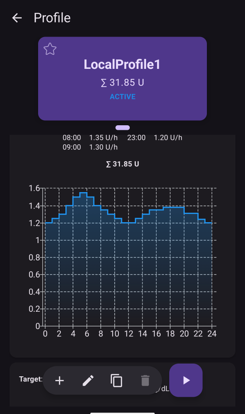

(profile-glucose-targets)=
## Ciljne vrijednosti glukoze

### Opis

Vaša **ciljna vrijednost GUK-a** osnovna je vrijednost i svi izračuni **AAPS-a** temelje se na njoj. Razlikuje se od ciljnog raspona u kojem obično želite držati vrijednosti GUK-a. Ciljna vrijednost koristi se u izračunima **AAPS-a**: ako **AAPS** predvidi da će vaš **GUK** završiti izvan ciljnog raspona, poduzet će radnju da vas vrati u taj raspon.

Ciljne vrijednosti mogu se postaviti unutar ovih granica:

|          | _Niski_ cilj            | _Visoki_ cilj             |
| -------- | ----------------------- | ------------------------- |
| Minimum  | 4,4 mmol/L ili 80 mg/dL | 5 mmol/L ili 90 mg/dL     |
| Maksimum | 10 mmol/L ili 180 mg/dL | 11,1 mmol/L ili 200 mg/dL |

### Učinak

Ako je ciljna vrijednost u vašem **Profilu** vrlo široka (recimo 3 ili više mmol/L [50 mg/dL ili više]), **AAPS** će često malo djelovati. Razlog je to što se predviđa da će razina **GUK-a** biti negdje u tom širokom rasponu, pa **AAPS** vjerojatno neće postavljati privremene bazale.

### Kako postaviti

**Slika ispod** pokazuje primjer kako se ciljna vrijednost može postaviti u profilu **AAPS-a**.

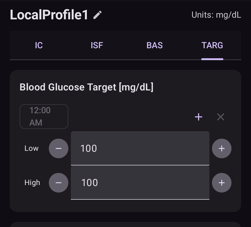

Ciljne vrijednosti **GUK-a** postavljaju se prema vašim osobnim željama i potrebama. Na primjer, ako se brinete zbog hipoglikemija noću, možete postaviti malo višu ciljnu vrijednost od 117 mg/dL (6,5 mmol/L) od 21 do 7 sati. Ako želite biti sigurni da ujutro imate dovoljno aktivnog inzulina (IOB) prije bolusa za doručak, možete postaviti nižu ciljnu vrijednost od 81 mg/dL (4,5 mmol/L) od 7 do 8 sati.

U [otvorenoj petlji](#KeyAapsFeatures-OpenLoop), posebno dok prolazite kroz [prve ciljeve](../SettingUpAaps/CompletingTheObjectives.md), širok ciljni raspon može biti dobar izbor dok učite kako se **AAPS** ponaša i podešavate svoj **Profil**.<br/> U [zatvorenoj petlji](#KeyAapsFeatures-ClosedLoop) (od **[Cilja 6](#objectives-objective6)**) preporučuje se smanjivati raspon dok ne dobijete jednu ciljnu vrijednost za svako doba dana (_niski_ cilj = _visoki_ cilj), kako bi **AAPS** brzo reagirao na promjene **GUK-a**.

(your-aaps-profile-basal-rates)=

## Bazalne stope

### Opis

Vaša bazalna stopa inzulina (jedinice/sat) daje pozadinski inzulin i održava razinu glukoze stabilnom kada nema hrane ni tjelesne aktivnosti.

Inzulinska pumpa svakih nekoliko minuta isporučuje male količine brzodjelujućeg inzulina, kako jetra ne bi otpuštala previše glukoze i kako bi glukoza ušla u stanice tijela. Bazalni inzulin obično čini između 40 i 50 % vaše ukupne dnevne doze (TDD), ovisno o prehrani, i obično prati cirkadijalni ritam, s jednim vrhom i jednim padom potrebe za inzulinom tijekom 24 sata. Za više informacija vrlo je korisno 6. poglavlje knjige [“Think like a Pancreas”](https://amzn.eu/d/iVU0RGe) autora Garyja Scheinera.

Većina edukatora za dijabetes tipa 1 (i osoba s dijabetesom tipa 1!) slaže se da najprije trebate ispraviti bazalne stope, a tek onda pokušati optimizirati ISF i ICR.

### Učinak

Točne bazalne stope omogućuju vam da se probudite u rasponu i da preskočite obroke – ili jedete – ranije ili kasnije tijekom dana, bez visokih ili niskih vrijednosti.

Previsoka bazalna stopa može dovesti do niskih vrijednosti GUK-a. I obrnuto.

**AAPS** se „ravna“ prema zadanoj bazalnoj stopi. Ako je bazalna stopa previsoka, „nulti privremeni bazal“ računat će se kao veći negativni aktivni inzulin (IOB) nego što bi trebao. Zbog toga će **AAPS** poslije davati više korekcija nego što bi trebao, kako bi IOB na kraju vratio na nulu.

Dakle, previsoka bazalna stopa stvorit će niske vrijednosti **GUK-a** i uz zadanu stopu, ali i nekoliko sati kasnije, dok **AAPS** korigira prema cilju.

Suprotno tome, preniska bazalna stopa može dovesti do visokih vrijednosti GUK-a i do toga da se razina ne spusti do cilja.

### Kako postaviti

**Slika ispod** pokazuje primjer kako se bazalne stope mogu postaviti u profilu **AAPS-a**.

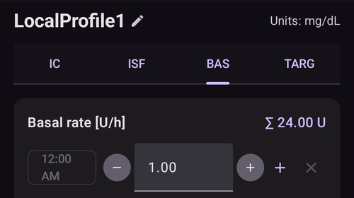

Ispravne bazalne stope postavljaju se metodom pokušaja i pogrešaka, i to treba raditi uz savjet vašeg dijabetološkog tima.

Postoje metode testiranja bazala koje obično uključuju praćenje bazalnih stopa i potrebe za inzulinom tijekom <u>povremenog</u> posta u razdoblju od 24 sata. Iako bazalne stope trebate testirati za cijeli dan, ne preporučuje se postiti 24 sata zaredom. Razlog je to što tijelo tada pokreće mehanizme, npr. hormone, kako bi to nadoknadilo. Preporučeni način je postiti 3 različita dana po 8 sati.

Preporučena metoda je suspendirati petlju (radi sigurnosti možete AAPS postaviti na [**LGS**](#KeyAapsFeatures-LGS) kako biste izbjegli niske vrijednosti, kao kod ispunjavanja [cilja 6](#objectives-objective6)), čime se vraća vaša zadana pozadinska bazalna stopa. Pratite kako se mijenja vaš **GUK**: ako pada, bazalna stopa je previsoka. I obrnuto.<br/> Druga metoda (može biti zahtjevnija) je ostaviti petlju da radi i pratiti kako se mijenja **IOB**. Ako je **IOB** negativan, vaša je bazalna stopa previsoka. I obrnuto. Imajte na umu da se ova metoda oslanja na **ISF** za korekciju **GUK-a**, pa za uspjeh ovisi o tome jesu li i druge varijable postavljene razumno dobro.<br/> Drugi način podešavanja bazalnih stopa je praćenje rada petlje tijekom noći, kada su svi aktivni ugljikohidrati (COB) apsorbirani. Ova je metoda posebno korisna za djecu, kada je post težak ili se potreba za inzulinom često mijenja. [Dr. Saleh Adi iz Tidepoola](https://www.youtube.com/watch?v=-fpWnGRhLSo) pokazuje korisne načine analize noćnih linija GUK-a kako biste optimizirali bazalne stope.

Pogledajte [ovdje](../GettingHelp/ProfileTuning.md) kako podesiti bazalni profil analizom obrazaca u zatvorenoj petlji.

Kada mijenjate postavke na temelju rezultata testa bazala, promjene u **Profilu** treba napraviti 1 do 2 sata (ovisno o vrsti inzulina) prije porasta/pada. Ponavljajte test po potrebi dok ne budete zadovoljni postavkama **bazalnih stopa**.

(your-aaps-profile-basal-not-compatible)=
#### Poruka: „Bazalna stopa nije kompatibilna s trenutnom pumpom“

Svaka pumpa ima granice: najnižu i najvišu bazalnu stopu koju može isporučiti, a kod nekih pumpi (na primjer Dana, Accu-Chek Combo, Medtronic i Diaconn G8) bazalne stope mogu se mijenjati samo na puni sat. **AAPS** provjerava vaš profil prema pumpi koju koristite, i to **nakon** primjene postotka koji odaberete.

Ako je neka bazalna stopa izvan tih granica, zaslon **Aktiviraj** prikazuje ovu poruku, a gumb **Aktiviraj** ostaje siv:

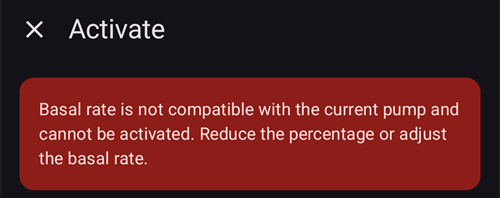

Na primjer, uz bazalnu stopu od 0,10 J/h noću i postotak profila od 35 %, **AAPS** bi morao isporučiti 0,035 J/h. To je manje nego što pumpa Dana može isporučiti (0,04 J/h).

Rješenje je jedno od ovoga:

* odaberite drugi postotak: **viši** ako bazalna stopa postane preniska, **niži** ako bazalna stopa postane previsoka, ili
* [uredite profil](#your-aaps-profile-create-and-edit-profiles) i promijenite bazalnu stopu.

Uređivač profila dopušta početak bazalnih stopa samo na puni sat. Bazalna stopa koja počinje npr. u 06:30 može doći samo iz starijeg profila, na primjer nakon prelaska na pumpu koja to ne podržava.

(your-aaps-profile-insulin-sensitivity-factor)=

## Faktor osjetljivosti na inzulin (ISF)

### Opis

Faktor osjetljivosti na inzulin (ponekad se zove korekcijski faktor) pokazuje koliko će 1 jedinica inzulina sniziti vašu razinu glukoze u krvi.

**U jedinicama mg/dL:** Ako imate **ISF** 40, svaka jedinica inzulina snizit će vaš GUK za oko 40 mg/dL (na primjer, GUK će pasti sa 140 mg/dL na 100 mg/dL).

**U jedinicama mmol/L:** Ako imate **ISF** 1,5, svaka jedinica inzulina snizit će vaš GUK za oko 1,5 mmol/L (na primjer s 8 mmol/L na 6,5 mmol/L).

Iz ovih primjera vidite da što je vrijednost **ISF** _manja_, to ste manje osjetljivi na inzulin. Dakle, ako smanjite ISF s 40 na 35 (mg/dL) ili s 1,5 na 1,3 (mmol/L), to se često zove jačanje vašeg **ISF-a**. Suprotno tome, povećanje vrijednosti **ISF** s 40 na 45 (mg/dL) ili s 1,5 na 1,8 (mmol/L) slabi vaš **ISF**.

### Učinak

**Niži / jači ISF** (npr. 40 umjesto 50) znači da inzulin po jedinici manje snižava vaš **GUK**. To dovodi do agresivnije / jače korekcije petlje s **više inzulina**. Ako je vaš **ISF** prejak (mala vrijednost), to može dovesti do niskog **GUK-a**.

**Viši / slabiji ISF** (npr. 45 umjesto 35) znači da inzulin po jedinici više snižava vaš **GUK**. To dovodi do manje agresivne / slabije korekcije petlje s **manje inzulina**. Ako je vaš **ISF** preslab (velika vrijednost), to može dovesti do visokog **GUK-a**.

**Primjer:**
* **GUK** je 190 mg/dL (10,5 mmol/L), a ciljna vrijednost 100 mg/dL (5,6 mmol/L).
* Dakle, trebate korekciju od `190 - 100 = 90 mg/dL` ili `10.5 - 5.6 = 4.9 mmol/L`
* Ako je `ISF = 30` -> `90 / 30 = 3` ili `ISF = 1.63` -> `4.9 / 1.63 = 3`: 3 jedinice inzulina
* Ako je `ISF = 45` -> `90 / 45 = 2` ili `ISF = 2.45` -> `4.9 / 2.45 = 2`: 2 jedinice inzulina

Prenizak **ISF** (dakle agresivniji, što nije rijetko) može dovesti do „prekomjernih korekcija“, jer **AAPS** izračuna da korisniku za korekciju visokog **GUK-a** treba više inzulina nego što je stvarno potrebno. To može dovesti do vrijednosti GUK-a poput „tobogana“ (posebno natašte), kao na slici ispod. U tom slučaju vrijednost **ISF** treba povećati kako bi **AAPS** bio manje agresivan. Tako će **AAPS** isporučivati manje korekcijske doze i izbjeći prekomjernu korekciju visokog **GUK-a** koja završava niskim **GUK-om**.

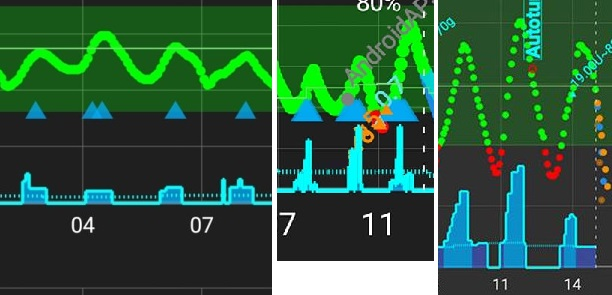

Suprotno tome, previsoko postavljen **ISF** može dovesti do nedovoljnih korekcija, pa vaš **GUK** ostaje iznad cilja – to se posebno vidi tijekom noći.

### Kako postaviti

Na **slici ispod** pogledajte primjer kako se vrijednosti ISF-a mogu postaviti u profilu **AAPS-a**.

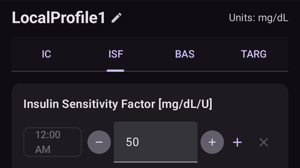

Osnovna polazna točka za određivanje dnevnog ISF-a je vaša ukupna dnevna doza (TDD), uz pravilo 1700 (94). Više detalja nalazi se u 7. poglavlju knjige [“Think like a Pancreas”](https://amzn.eu/d/iVU0RGe) autora Garyja Scheinera.

| 1700 (ako mjerite u mg/dL) ili 94 (mmol/L) / TDD = približni ISF.<br/><br/>Primjer: TDD = 40 J<br/>Približni ISF (mg/dL) = 1700/40 = 43<br/>Približni ISF (mmol/L) = 94/40 = 2,4 |
| -------------------------------------------------------------------------------------------------------------------------------------------------------------------------------------------------------- |
|                                                                                                                                                                                                          |

Ako su vaše bazalne stope ispravne, to možete testirati tako da suspendirate petlju, provjerite je li **IOB** nula i uzmete nekoliko tableta glukoze kako biste došli do stabilne „visoke“ razine.

Zatim uzmite procijenjenu količinu inzulina (prema trenutnom 1/ISF) kako biste došli do ciljne vrijednosti GUK-a.

Budite oprezni jer je ova vrijednost vrlo često postavljena prenisko. Prenisko znači da će 1 J sniziti GUK brže nego što se očekuje.

(your-aaps-profile-insulin-to-carbs-ratio)=

## Omjer inzulina i ugljikohidrata (ICR)

### Opis

**ICR** pokazuje koliko grama ugljikohidrata pokriva jedna jedinica inzulina.

Neki umjesto **ICR** koriste i kraticu **I:C** ili govore o omjeru ugljikohidrata: **CR**.

Na primjer, omjer inzulina i ugljikohidrata 1 prema 10 (1:10) znači da uzimate 1 J inzulina za svakih 10 grama pojedenih ugljikohidrata. Za obrok od 25 g ugljikohidrata trebalo bi 2,5 J inzulina.

Ako je vaš **ICR** slabiji (viša vrijednost), recimo 1:20, za pokrivanje 10 g ugljikohidrata trebali biste samo 0,5 J inzulina. Za obrok od 25 g ugljikohidrata trebalo bi 25/20 = 1,25 J inzulina.

Uobičajeno je imati različit **ICR** u različito doba dana zbog razine hormona i tjelesne aktivnosti. Mnogi imaju najniži/najjači **ICR** oko doručka, jer su tada obično otporniji na inzulin. Tako, na primjer, **ICR** jednog odraslog korisnika može biti 1:8 za doručak, 1:10 za ručak i 1:10 za večeru, ali ti obrasci nisu univerzalni, a neki su ljudi otporniji na inzulin u vrijeme večere pa im tada treba jači/manji **ICR**.

> **NAPOMENA:**
> 
> U nekim europskim zemljama koristile su se krušne jedinice za određivanje koliko je inzulina potrebno za hranu. Na početku je 1 krušna jedinica bila jednaka 12 g ugljikohidrata, a kasnije su neki prešli na 10 g ugljikohidrata.
> 
> U tom modelu količina ugljikohidrata bila je fiksna, a količina inzulina promjenjiva. („Koliko je inzulina potrebno za jednu krušnu jedinicu?“)
> 
> Kod korištenja **ICR** količina inzulina je fiksna, a količina ugljikohidrata promjenjiva. („Koliko grama ugljikohidrata pokriva jedna jedinica inzulina?“)
> 
> Primjer:
> 
> Faktor krušne jedinice (KJ = 12 g ugljikohidrata): 2,4 J/KJ -> Trebate 2,4 jedinice inzulina kada pojedete jednu krušnu jedinicu.
> 
> Odgovarajući **ICR**: 12 g / 2,4 J = 5,0 g/J -> 5,0 g ugljikohidrata može se pokriti jednom jedinicom inzulina.
> 
> Faktor KJ 2,4 J / 12 g   ===>   IC = 12 g / 2,4 J = 5,0 g/J
> 
> Tablice za pretvorbu dostupne su na internetu, npr. [ovdje](https://www.mylife-diabetescare.com/files/media/03_Documents/11_Software/FAS/SOF_FAS_App_KI-Verha%CC%88ltnis_MSTR-DE-AT-CH.pdf).

### Učinak

**Niži / jači ICR** znači manje hrane po jedinici, tj. za fiksnu količinu ugljikohidrata dobivate više inzulina. Može se zvati i „agresivniji“. Ako je vaš IC prejak, dobivate previše inzulina, a to može dovesti do niskih vrijednosti **GUK-a**.

**Viši / slabiji ICR** = više hrane po jedinici, tj. za fiksnu količinu ugljikohidrata dobivate manje inzulina. Može se zvati i „manje agresivan“. Ako je vaš IC preslab, dobivate manje inzulina nego što vam treba, a to može dovesti do visokih vrijednosti **GUK-a**.

### Kako postaviti

**Slika ispod** pokazuje primjer korisnikovog **ICR** i kako se može postaviti u **profilu AAPS-a**. Kod unosa ovih vrijednosti unosimo zadnji dio omjera, pa se omjer inzulina i ugljikohidrata 1:3,5 unosi jednostavno kao „3,5“.

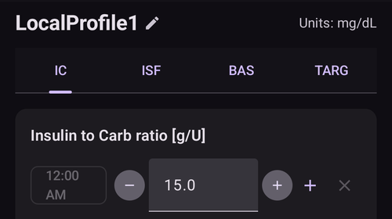

Ako nakon što je obrok probavljen i **IOB** se vratio na nulu, vaš **GUK** ostane viši nego prije jela, vjerojatno je vaš **ICR** preslab (_tj._ broj je previsok i treba ga postupno smanjivati). Suprotno tome, ako je vaš **GUK** niži nego prije jela, **ICR** je prejak (_tj._ broj je premalen i treba ga postupno povećavati).

Ako su vaše bazalne stope ispravne, možete testirati tako da provjerite je li **IOB** nula i jeste li u rasponu, pojedete točno poznatu količinu ugljikohidrata i uzmete procijenjenu količinu inzulina prema trenutnom omjeru inzulina i ugljikohidrata. Najbolje je jesti hranu koju inače jedete u to doba dana i precizno izbrojati njezine ugljikohidrate.

## Česta pitanja o profilu

```{contents} Common questions related to the Profile
:depth: 1
:local: true
```

### Zašto je važno dobro postaviti profil

**Zašto je važno dobro postaviti postavke profila? Zar se petlja ne može jednostavno pobrinuti za to?**

Hibridna zatvorena petlja _može_ pokušati prilagoditi isporuku inzulina kako bi smanjila lošu kontrolu glikemije koja nastaje zbog netočnih vrijednosti **Profila**. To može učiniti, na primjer, tako da zadrži isporuku inzulina ako vam prijeti hipo. Ipak, možete postići mnogo bolju kontrolu glikemije ako su postavke vašeg **Profila** već što bliže onome što vašem tijelu treba. To je jedan od razloga zašto **AAPS** koristi ciljeve u koracima za prijelaz s otvorene petlje na hibridnu zatvorenu petlju. Osim toga, bit će trenutaka kada morate otvoriti petlju (zagrijavanje senzora, kvar senzora _itd._), ponekad usred noći, i tada želite da su vam postavke ispravne.

Ako s **AAPS-om** počinjete nakon korištenja drugog sustava pumpe s otvorenom ili zatvorenom petljom, već ćete imati razumnu predodžbu o vrijednostima za bazalne stope (**BR**), faktore osjetljivosti na inzulin (**ISF**) i omjere inzulina i ugljikohidrata (**ICR**).

Ako s injekcija (MDI) prelazite na **AAPS**, dobro je najprije pročitati kako prijeći s MDI na pumpu te prijelaz pažljivo planirati i provesti uz savjet vašeg dijabetološkog tima. Vrlo su korisne knjige ["Pumping insulin"](https://amzn.eu/d/iaCsFa2) autora Johna Walsha & Ruth Roberts i [“Think like a Pancreas”](https://amzn.eu/d/iVU0RGe) autora Garyja Scheinera.

### Što uzrokuje visoke vrhove nakon obroka u zatvorenoj petlji?
Prije svega provjerite bazalnu stopu i napravite test bazalne stope bez ugljikohidrata. Ako je ispravan, a vaš **GUK** pada do ciljne vrijednosti nakon što su ugljikohidrati potpuno apsorbirani, pokušajte u **AAPS-u** neko vrijeme prije obroka postaviti privremeni cilj „Prije obroka“ ili sa svojim endokrinologom razmislite o odgovarajućem vremenu za bolus prije obroka. <br/> Ako je vaš **GUK** previsok nakon obroka i još uvijek previsok nakon što su ugljikohidrati potpuno apsorbirani, sa svojim endokrinologom razmislite o smanjenju **ICR**. Ako je vaš **GUK** previsok dok ima **COB**, a prenizak nakon što su ugljikohidrati potpuno apsorbirani, sa svojim endokrinologom razmislite o povećanju **ICR** i o odgovarajućem vremenu za bolus prije obroka.

### GUK mi ostaje visok i petlja ga ne spušta
Mogući razlozi zašto **AAPS** ne daje dovoljno inzulina su:
* **ISF** nije dovoljno jak
* Bazalna stopa možda nije dovoljno jaka
* Možda se uključila sigurnosna postavka, npr. **maxIOB**. Ili je **SMB** u ovo vrijeme onemogućen, ovisno o vašim postavkama.
* Postavljena je automatizacija koja je nadjačala **AAPS**.

Pogledajte i [Podešavanje profila u AAPS-u](../GettingHelp/ProfileTuning.md).

### Imam negativan IOB, je li to problem?
Negativan **IOB** znači da je apsolutna količina inzulina (bazal + bolus) u vašem tijelu manja od bazala. Zbog toga će **AAPS** poslati više inzulina čim **GUK** počne rasti, jer smatra da inzulina nedostaje, što poslije može dovesti do niskog **GUK-a**.

Evo nekih razloga zašto možete imati negativan IOB i što učiniti:
* prejak bazal: podesite svoj **Profil**
* previše bolusa za prethodni obrok: podesite svoj **Profil** ili provjerite dajete li bolus u pravo vrijeme.
* DIA za vašu vrstu inzulina postavljen je prekratko, pa se inzulin gomila: podesite ga u [Upravljanje → Postavke inzulina](#Config-Builder-insulin-dia)
* tjelesna aktivnost: sljedeći put tijekom aktivnosti razmislite o nižem [postotku profila](../DailyLifeWithAaps/ProfileSwitch-ProfilePercentage.md), zbog veće osjetljivosti.

## Upravljanje profilima

```{contents} Operations that you can perform on your **Profiles** in **AAPS**
:depth: 1
:local: true
```
(your-aaps-profile-create-and-edit-profiles)=
### Izrada i uređivanje profila

U **AAPS-u** v4 vaši se profili nalaze na zaslonu **Upravljanje** (donja navigacija) → **Profil**, prikazani kao vrtuljak kartica koje se listaju povlačenjem, s trakom radnji (**➕ Dodaj**, **✏️ Uredi**, **⧉ Kloniraj**, **🗑️ Izbriši**, **▶ Aktiviraj**). Za upravljanje profilom i njegovo aktiviranje pogledajte [Upravljanje profilima i njihovo aktiviranje](#ProfileSwitch-manage-v4). Dolazite iz **AAPS-a** v3, gdje su profili imali svoju karticu? Pogledajte [Što se promijenilo u AAPS-u v4](#v4changes-manage).

Dodirom na **✏️ Uredi** otvara se uređivač. Postavite **naziv** i **jedinice** profila, a zatim pomoću kartica ispunite četiri rasporeda:

- **IC** — omjer inzulina i ugljikohidrata (g/J)
- **ISF** — faktor osjetljivosti na inzulin
- **BAZ** — bazalne stope
- **CILJ** — ciljni raspon


Svaki raspored je popis **vremenskih blokova**: dodajte blok, postavite vrijeme početka i vrijednost, a zatim dodirnite **Spremi**.

Ako mijenjate svoj **Profil**, provjerite uređujete li ispravan **Profil**: kartica profila koji se koristi označena je s **AKTIVAN**, ali kartica odabrana na zaslonu može biti neka druga.

(your-aaps-profile-profile-from-scratch-for-a-kid)=
### Izrada profila od početka za dijete

[Pomoćnik profila](#aaps-screens-profile-helper) (izbornik ☰ → **Pomoćnik profila**) može vam pomoći izraditi profil za dijete (do 18 godina).

**Važna napomena:**

**Pomoćnik profila namijenjen je kao pomoć pri pronalaženju početnog profila za vaše dijete. Iako se temelji na skupovima podataka dviju različitih bolnica, uvijek se posavjetujte sa svojim medicinskim timom prije korištenja novog profila!**

Pomoćnik profila nudi skupove podataka dviju različitih bolnica za djecu, kako biste pronašli početni profil za svoje dijete do 18 godina.

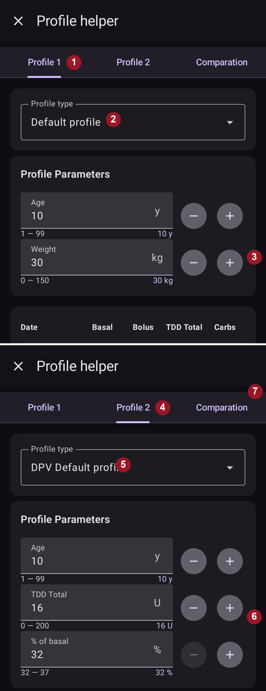

1. Provjerite jeste li na kartici **Profil 1**.
2. U **Vrsta profila** provjerite je li odabran „Zadani profil“.
3. Prilagodite zadani profil (temeljen na skupu podataka bolnice) unosom dobi djeteta i ukupnog TDD-a **ili** težine.
4. Prijeđite na karticu **Profil 2**.
5. Pritisnite **Vrsta profila** i odaberite „DPV zadani profil“.
6. Prilagodite DPV zadani profil (temeljen na skupu podataka druge bolnice) unosom dobi djeteta, ukupnog TDD-a i postotka bazala. Imajte na umu da skup podataka DPV daje samo **bazalne stope**, pa su IC i ISF za ovaj profil prikazani kao nula.
7. Otvorite karticu **Usporedba**. Prikazat će se usporedba dvaju prilagođenih profila (pogledajte snimku zaslona ispod).
8. Ako želite početi podešavati svoj profil na temelju jednog od ovih prijedloga, koristite gumb **Kloniraj** na dnu usporedbe.

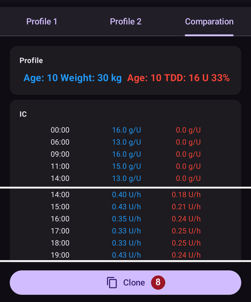

### Zamjena profila

Pogledajte [Zamjena profila i postotak profila](../DailyLifeWithAaps/ProfileSwitch-ProfilePercentage.md).

(your-aaps-profile-clone-profile-switch)=
### Kloniranje zamjene profila u novi profil


[Povijest tretmana](#aaps-screens-treatments) prikazuje sve prošle **Zamjene profila**. Na kartici **Zamjena profila** možete koristiti prošlu **Zamjenu profila** kao osnovu za izradu novog **Profila**. U tom slučaju vremenski pomak i postotak primijenit će se na novi lokalni profil. Koristite gumb **Kloniraj** prikazan u retku **2**.

Sada možete otići na [zaslon Profil](#your-aaps-profile-create-and-edit-profiles) (**Upravljanje → Profil**) i urediti novo izrađeni Profil.

(YourAapsProfile_Profile-backup)=
### Sigurnosna kopija profila

Budući da su osnovna postavka vašeg sustava petlje, vaši su **Profili** vrlo osjetljivi i nešto što zaista ne želite izgubiti.

* Vaši **Profili** spremljeni su u bazi podataka **AAPS-a**.
* Kada je postavljen **NSClientV3** (pogledajte [Sinkronizacija](#SetupWizard-synchronization-with-the-reporting-server-and-more)), vaši se **Profili** također automatski prenose u Nightscout.
* Također su dio [izvezenih postavki](../Maintenance/ExportImportSettings.md). Zato sigurnosnu kopiju čuvajte na sigurnom mjestu.

### Uređivanje profila iz Nightscouta

Ako je omogućeno, promjene **Profila** napravljene izravno u Nightscoutu mogu se primiti u **AAPS-u**. Postavka se zove „**Primaj spremište profila iz NS-a**“ i dio je opcija **Prihvaćanje podataka iz Nightscouta** (prihvaćanje podataka iz Nightscouta prema zadanim je postavkama isključeno, pogledajte [korak Upravljanje s klijenta u čarobnjaku za postavljanje](../SettingUpAaps/SetupWizard.md)); brzo je možete pronaći pomoću **trake za pretraživanje** na glavnom zaslonu. Dok je upravljanje s klijenta uključeno, ta je postavka skrivena i **AAPS** ne prima promjene profila iz Nightscouta ([zaštićeni način rada](#client-master-control-hardened-mode)); umjesto toga uredite profil na uparenom klijentu ili ga jednom učitajte pomoću **Potpuna sinkronizacija**.

To može biti korisno kada namjeravate napraviti velike promjene opsežnijeg **Profila**. Lakše ih je unijeti putem web sučelja, _npr._ za ručno kopiranje podataka iz tablice.

Za to je, međutim, važno u uređivaču Nightscouta klonirati cijeli **zapis u bazi podataka** koji se sastoji od nekoliko profila (plava strelica na snimci zaslona ispod). Novi zapisi u bazi podataka tada nose trenutni datum. Nakon spremanja promijenjeni/novi **Profil** može se aktivirati u **AAPS-u** uobičajenom [zamjenom profila](../DailyLifeWithAaps/ProfileSwitch-ProfilePercentage.md).

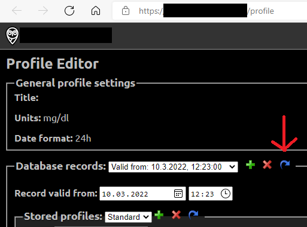

(your-aaps-profile-compare-profiles)=
### Usporedba dvaju profila

[Pomoćnik profila](#aaps-screens-profile-helper) (izbornik ☰ → **Pomoćnik profila**) možete koristiti i za usporedbu dvaju različitih profila ili zamjena profila (postotak jednog od vaših profila koji je ranije korišten u [zamjeni profila](../DailyLifeWithAaps/ProfileSwitch-ProfilePercentage.md)).

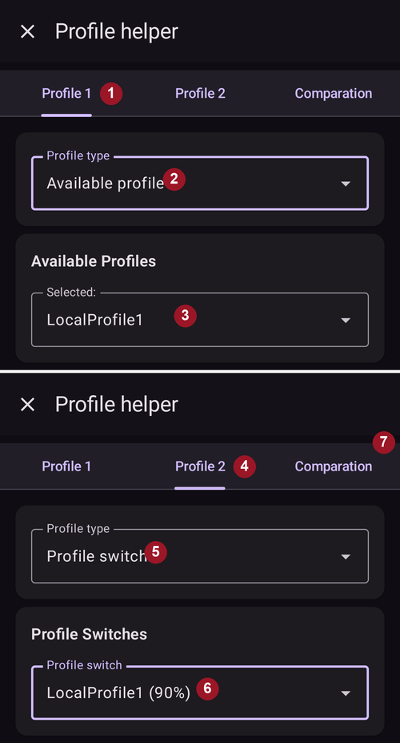

1. Provjerite jeste li na kartici **Profil 1**.
2. U **Vrsta profila** odaberite „Dostupan profil“ kako biste birali između svih spremljenih **Profila**.
3. Odaberite **Profil** iz kojeg želite usporediti.
4. Prijeđite na karticu **Profil 2**.
5. U **Vrsta profila** odaberite „Zamjena profila“ kako biste birali iz povijesti svih svojih **Zamjena profila**.
6. Odaberite **Zamjenu profila** s kojom želite usporediti.
7. Otvorite karticu **Usporedba**. Prikazat će se usporedba dvaju profila (pogledajte snimku zaslona ispod).

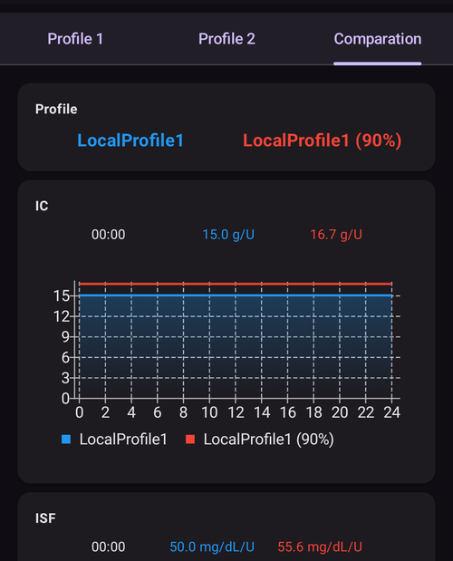
