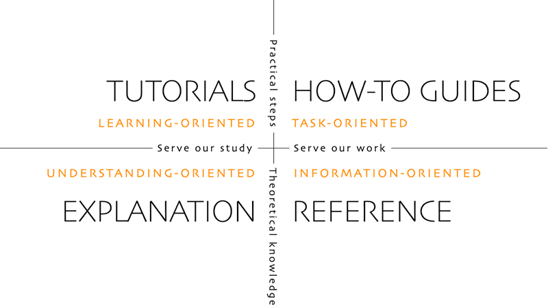

# Kako uređivati dokumentaciju

**Ovaj opis odnosi se samo na uređivanje dokumentacije na engleskom jeziku. Sve nove informacije moraju se najprije dodati na engleskom jeziku. Ako želite prevoditi na druge jezike (hvala vam), koristite [Crowdin](https://crowdin.com/project/androidapsdocs).**

Savjete o oblikovanju teksta (naslov, podebljano...) i postavljanju poveznica potražite u odjeljku [„Sintaksa koda“](#edit-the-docs-code-syntax) na ovoj stranici.

## Općenito

Za sva pitanja, povratne informacije ili nove ideje možete se javiti timu za dokumentaciju putem [Discorda](https://discord.gg/4fQUWHZ4Mw).

U nekom trenutku netko će vam predložiti da napravite pull request (PR). Tako se vaše izmjene u dokumentaciji stvarno prenose na web stranice AAPS-a, koje se čuvaju na GitHubu. Napraviti PR zapravo nije teško, a to je odličan način da doprinesete. Ovu dokumentaciju sada čitate zato što su ljudi poput vas radili PR-ove. Ne brinite da ćete pogriješiti ili nekako urediti pogrešne dokumente. Vaše izmjene pregledavaju se prije nego što se spoje u „službeni“ repozitorij dokumentacije AAPS-a. Nikakvom slučajnom pogreškom u ovom postupku ne možete pokvariti izvorne dokumente. Opći postupak je:

- Uredite postojeći sadržaj kako biste promijenili ili poboljšali kod ili dokumentaciju.
- Još jednom provjerite izgledaju li vaše izmjene dobro.
- Zapišite nekoliko bilješki o tome što ste promijenili, kako bi drugi razumjeli izmjene.
- Napravite pull request kojim tražite od administratora da prihvate vaše izmjene.
- Oni će ih pregledati i zatim (1) spojiti vaše izmjene, (2) odgovoriti vam komentarom o vašim izmjenama ili (3) započeti novi dokument s vašim izmjenama.

(Napomena: ako lakše učite gledajući, [ovdje](https://youtu.be/4b6tsL0_kzg) postoji YouTube video koji prikazuje postupak izrade PR-a.)

U našem primjeru napravit ćemo izmjenu u AndroidAPSdocs. To možete učiniti na bilo kojem Windows računalu, Macu itd. (na bilo kojem računalu s pristupom internetu).

1. Otvorite <https://github.com/openaps/AndroidAPSdocs> i kliknite Fork u gornjem desnom kutu kako biste napravili vlastitu kopiju repozitorija.


2. Otvorite bilo koju stranicu i dođite do stranice koju želite urediti. Možete kliknuti poveznicu „Edit in GitHub“ u gornjem desnom kutu. To je moguće samo za stranice na engleskom jeziku. 


Ili kliknite ikonu olovke koja se pojavljuje u gornjoj traci sadržaja stranice koju želite urediti. Za to morate već biti prijavljeni u svoj GitHub račun (ako ga nemate, lako ga je otvoriti).


3. Bilo koja od opcija u koraku 2 stvorit će novu granu u VAŠEM repozitoriju, u kojoj će se spremiti vaše izmjene. Napravite izmjene u datoteci.

Za stranice dokumentacije koristimo Markdown. Datoteke imaju nastavak „.md“. Specifikacija Markdowna nije utvrđena, a za naše Markdown datoteke trenutačno koristimo myst_parser. Pazite da koristite ispravnu sintaksu, kako je [opisano niže](#edit-the-docs-code-syntax).


4. Radili ste na kartici „<>Edit file“. Odaberite karticu „Preview changes“ da svježim okom provjerite izgleda li sve što ste promijenili onako kako ste htjeli (provjerite i tipfelere). Ako vidite da je potrebno još nešto poboljšati, vratite se na karticu za uređivanje i napravite dodatne izmjene. 


5. Kada završite s izmjenama, pomaknite se na dno stranice. U okviru na dnu upišite svoje komentare u tekstno polje „Add an optional extended description...“. Zadani naslov sadrži naziv datoteke. Pokušajte dodati rečenicu koja objašnjava **razlog** izmjene. Kada navedete razlog, recenzenti lakše razumiju što želite postići tim PR-om.


6. Kliknite zeleni gumb „Propose file changes“ ili „Commit changes“. Na stranici koja se pojavi kliknite „Create Pull Request“, a zatim na sljedećoj stranici ponovno kliknite „Create Pull Request“.


7. Time je otvaranje pull requesta (PR-a) završeno. GitHub dodjeljuje PR-u broj, koji se nalazi iza naslova i znaka #. Vratite se na ovu stranicu kako biste provjerili povratne informacije (ili, ako vam GitHub šalje obavijesti e-poštom, dobit ćete e-poruke o svakoj aktivnosti na PR-u). Izmjena će sada biti na popisu PR-ova koje će tim pregledati i možda dati povratne informacije prije nego što je doda u glavnu dokumentaciju AAPS-a! Ako želite pratiti napredak PR-a, kliknite ikonu zvona u gornjem desnom kutu svog GitHub računa i vidjet ćete sve svoje PR-ove.


P.S.: Vaš fork i grana i dalje će ostati na vašem osobnom GitHub računu. Kada dobijete obavijest da je vaš PR spojen, možete izbrisati svoju granu ako vam više ne treba (u području obavijesti iz koraka 7 bit će poveznica za brisanje grane kada se PR zatvori ili spoji). Ako za buduće izmjene slijedite ovaj postupak, izmjene će uvijek započeti od ažurirane verzije repozitorija AndroidAPSdocs. Ako PR odlučite započeti na drugi način (npr. uređivanjem od grane master u svom forku), najprije morate provjeriti je li vaš repozitorij ažuran tako da napravite „compare“ (usporedbu) i spojite sve promjene koje su se dogodile otkad ste zadnji put ažurirali svoj fork. Budući da ljudi često zaborave ažurirati svoje repozitorije, preporučujemo da koristite gore opisani postupak za PR dok se ne naviknete na izvođenje „compare“ (usporedbe).

(edit-the-docs-code-syntax)=

## Sintaksa koda

Za stranice dokumentacije koristimo Markdown. Datoteke imaju nastavak „.md“.

Markdown je vrlo jednostavan jezik za oblikovanje teksta koji odvaja sadržaj teksta od njegova oblikovanja.

Autor samo, npr., označi naslov kao naslov razine 1, a Markdown procesor tijekom obrade izradi potreban HTML kod kako bi se naslov prikazao u HTML-u.

Ideja iza toga je da

- autor najprije treba razmišljati o tekstu, a ne o oblikovanju,
- Markdown tekst može se razmjenjivati između različitih Markdown alata, umjesto da ovisi npr. o vlasničkim alatima poput Microsoft Worda, i
- iz jedne Markdown datoteke možete izraditi nekoliko izlaznih formata.

Markdown nije 100 % utvrđen standard, a mi se trudimo ostati što bliže standardu kako bismo

- ostanemo fleksibilni i možemo promijeniti Markdown alate kada je potrebno ili kada nas na to prisili daljnji razvoj Markdown alata i Markdown SaaS usluga te
- mogli koristiti usluge prevođenja za prijevod s engleskog na ciljni jezik, poput francuskog ili njemačkog. One mogu raditi s Markdownom, ali ne i sa složenim kodovima za oblikovanje, jer ne mogu odvojiti sadržaj od izgleda, što bi moglo biti kobno.

### Naslovi

- Naslov 1: `# headline`
- Naslov 2: `## headline`
- Naslov 3: `### headline`
- Naslov 4: `#### headline`

Pokušavamo izbjeći daljnje razine naslova.

### Oblikovanje teksta

- **podebljano**: `**text**`
- *kurziv*: `*text*`
- ***podebljani kurziv***: `***text***`

### Numerirani popis

    1. prvi
    1. drugi
    1. treći
    

1. prvi
2. drugi
3. treći

### Nenumerirani popis

    - jedan element
    - drugi element
    - i još jedan element
    

- jedan element
- drugi element
- i još jedan element

### Popis s više razina

Popise možete umetati u popise tako da sljedeću razinu uvučete za 4 razmaka više udesno od prethodne.

    1. prvi
    1. drugi
    1. treći
      1. jedan element
      1. drugi element
      1. i još jedan element
    1. četiri
    1. pet
    1. šest
    

1. prvi
2. drugi
3. treći 
    1. jedan element
    2. drugi element
    3. i još jedan element
4. četiri
5. pet
6. šest

### Slike

Za umetanje slika koristite ovu Markdown sintaksu.

- slike: ``

Slika treba biti u formatu PNG ili JPEG.

Nazivi slika trebaju slijediti jedno od sljedećih pravila imenovanja. U primjeru koristim png kao nastavak. Ako koristite JPEG, umjesto toga koristite jpeg kao nastavak.

- `filename-image-xx.png` gdje je xx jedinstveni dvoznamenkasti broj za slike u ovoj datoteci.
- `filename-image-xx.png` gdje je xx smislen naziv koji odabere autor md datoteke.

Slike se nalaze u mapi images za engleski jezik, a Crowdin ih automatski prenosi u ostale jezike. Za to ne morate ništa učiniti!

Slike trenutačno ne prevodimo: slike trebaju sadržavati **što manje teksta** kako bi bile razumljive i čitateljima koji ne govore engleski.

(make-a-PR-image-size)= Koristite razumnu veličinu slika, koje moraju biti čitljive na računalu, tabletu i mobitelu.

- Snimke zaslona web stranica trebaju biti široke najviše **1050 piksela**.
- Dijagrami tijeka procesa trebaju biti široki najviše **1050 piksela**.
- Snimke zaslona iz aplikacije trebaju biti široke najviše **500 piksela**. Ne stavljajte ih jednu pokraj druge ako nije potrebno.
- Snimke zaslona sa sata (**Wear OS**) trebaju biti široke najviše **360 piksela**. Nikada ne povećavajte manju snimku zaslona.

### Poveznice

#### Vanjske poveznice

Vanjske poveznice su poveznice na vanjske web stranice.

- vanjska poveznica: `[alt text](www.url.tld)`

#### Unutarnje poveznice na početak md datoteke

Unutarnje poveznice na stranice su poveznice na početak md datoteke koja se nalazi na našem poslužitelju.

- unutarnja poveznica na .md stranicu: `[alt text](../folder/file.md)`

#### Unutarnje poveznice na imenovane reference u tekstu

Unutarnje poveznice na imenovane reference u tekstu su poveznice na bilo koje mjesto u md datoteci koja se nalazi na našem poslužitelju, a na kojem je postavljena referenca na koju se povezuje.

Dodajte imenovanu referencu na mjestu u ciljnoj md datoteci na koje želite skočiti.

`(name-of-my-md-file-this-is-my-fancy-named-reference)=`

Imenovana referenca mora biti jedinstvena u svim md datotekama AndroidAPSDocs, a ne samo u md datoteci u kojoj se nalazi!

Zato je dobra praksa započeti nazivom datoteke, a zatim dodati naziv reference koji odaberete.

Koristite samo mala slova i riječi spajajte crticom.

Zatim tu referencu povežite u tekstu koji pišete pomoću sljedeće vrste poveznice.

- Unutarnje poveznice na imenovane reference u tekstu: `[alt text](name-of-my-md-file-this-is-my-fancy-named-reference)`

### Napomene, upozorenja, sklopive napomene

U dokumentaciju možete dodati okvire s napomenama i upozorenjima.

Osim toga, možete dodati sklopive napomene s detaljnim informacijama, tako da korisnike koje detalji ne zanimaju to ne odbije od čitanja teksta. Koristite ih pažljivo, jer dokumentacija treba biti što lakša za čitanje.

#### Napomene

    ```{admonition} Naslov napomene
    :class: note
    Ovo je napomena.
    ```
    

```{admonition} Naslov napomene :class: note Ovo je napomena.

    <br />#### Upozorenja
    
    ````
    ```{admonition} Upozorenje
    :class: warning
    Ovo je upozorenje.
    

    ```{admonition} Naslov upozorenja
    :class: warning
    Ovo je upozorenje.
    ```
    
    #### Sklopive napomene
    
    

    {admonition} dodatno detaljno štivo za zainteresirane čitatelje
    :class: dropdown
    
    Ova napomena je sklopljena,
    što znači da ovdje možete dodati dulji sadržaj,
    a da on ne zauzima previše mjesta na stranici.
    

````

```{admonition} dodatno detaljno štivo za zainteresirane čitatelje :class: dropdown Ova napomena je sklopljena, što znači da ovdje možete dodati dulji sadržaj, a da on ne zauzima previše mjesta na stranici.

```

## Tablice

Izbjegavajte tablice s dugim tekstovima, jer je sadržaj teško postaviti u Markdownu, obično ne stanu u širinu zaslona mobitela i vjerojatno se nakon prijevoda neće jednako prikazivati.

## Vodič za stil

### Sadržaj

1. Savjeti za pisanje na engleskom jeziku

2. Napomene o pisanju specifične za AAPS

3. Korisni izvori

###  1\. Savjeti za pisanje na engleskom jeziku

#### Koristite jezik prilagođen čitatelju

Gdje god je moguće, koristite jednostavan engleski jezik. To pomaže čitateljima kojima engleski nije materinji jezik, a olakšava i prevođenje dokumenata AAPS-a na druge jezike. Pišite kao da razgovarate s korisnikom; zamislite da sjedite za stolom nasuprot osobe za koju pišete. Zapamtite: većina korisnika AAPS-a nema iskustva s programiranjem. I sam dijabetes ima puno stručnih izraza i kratica. Imajte na umu da je nekim ljudima dijabetes možda tek nedavno dijagnosticiran, da možda nemaju toliko iskustva s dijabetesom kao vi ili da su prošli drukčiju edukaciju o dijabetesu. Ako koristite skraćenicu ili kraticu, kod prvog korištenja napišite je u cijelosti, a odmah iza toga u zagradi navedite kraticu, npr. „super mikro bolus (SMB)“. Također dodajte poveznicu na pojmovnik. Stručni izrazi koje čitatelj možda ne poznaje također se mogu dodati u zagradama.

Umjesto: *„Što uzrokuje visoke postprandijalne vrhove GUK-a u zatvorenoj petlji?“*

Koristite: *„Što uzrokuje visok vrh GUK-a **nakon ručka** (postprandijalno) u zatvorenoj petlji?“*

##### Koristite jednostavne riječi koje svi razumiju

Abecedni popis zamjenskih riječi (A–Ž) koji vam pomaže da pišete razumljivije pronaći ćete ovdje:

<https://www.plainenglish.co.uk/the-a-z-of-alternative-words.html>

#### Privatnost i licence:

Posebno kada snimate video ili snimke zaslona, pazite da ne otkrijete svoje privatne podatke (API ključ, lozinke). Pazite da YouTube sadržaj nije javno naveden (neka bude „unlisted“), tako da se može pogledati samo putem poveznice iz dokumentacije. Ne skrećite pozornost na materijale koji krše autorska prava (BYODA itd.).

#### Pišite kratke rečenice i prijeđite na stvar

- Jasan tekst treba imati prosječnu duljinu rečenice od 15 do 20 riječi.

- To ne znači da sve rečenice trebaju biti iste duljine. Budite sažeti. Unesite raznolikost u tekst tako da kombinirate kratke rečenice (poput prethodne) s duljima (poput ove).

- Držite se jedne glavne misli u rečenici, uz možda još jednu povezanu misao.

- Možda ćete i dalje ponekad napisati dugu rečenicu, posebno kada objašnjavate nešto složeno. Ali većina dugih rečenica može se na neki način podijeliti.

- Uklonite slabe riječi: „you can“, „there is/are/were“, „in order to“.

- Ključne riječi stavite blizu početka naslova, rečenica i odlomaka.

- Budite slikoviti! Gdje god je moguće, dodajte kratak dijagram, snimku zaslona ili video.

#### Ne bojte se davati upute

Naredbe su najbrži način davanja uputa, ali autori se ponekad boje davati naredbe pa pišu „trebali biste to učiniti“ umjesto samo „učinite to“. Možda se ljudi boje da naredbe zvuče previše grubo. To često možete riješiti tako da ispred stavite riječ „molimo“. Ipak, ako se nešto mora učiniti, bolje je ne pisati „molimo“, jer to čitatelju daje mogućnost da odbije.

Umjesto: *„Trebali biste to jednostavno shvatiti kao potpunu tvrdnju.“*

Koristite: *„Shvatite to kao potpunu tvrdnju.“*

#### Uglavnom koristite glagole u aktivu, a ne u pasivu

Primjer **glagola u aktivu**:

- *„Pumpa (subjekt) isporučuje (glagol) inzulin (objekt).“*

„isporučuje“ je ovdje glagol u aktivu. Rečenica kaže tko isporučuje prije nego što kaže što se isporučuje.

Primjer **glagola u pasivu**:

- *„Inzulin (subjekt) je isporučen (glagol) od pumpe (objekt).“*

*„isporučen“* je ovdje glagol u pasivu. Subjekt i objekt zamijenili su mjesta u usporedbi s rečenicom u aktivu. Rečenicu smo morali produljiti tako da smo dodali „je“ i „od“. Razmislite i o tome da rečenicu započnete glagolom u aktivu.

Umjesto: *„Svoju pumpu možete povezati s telefonom putem izbornika pumpe u AAPS-u, a dostupan vam je i niz pumpi s kojima se možete povezati.“*

Koristite: *„Povežite željenu pumpu s telefonom putem izbornika pumpe u AAPS-u.“*

Glagoli u pasivu mogu stvoriti probleme:

- Mogu zbunjivati.

- Tekst često čine razvučenijim.

- Tekst čine manje živim.

##### Kada je pasiv dobar izbor

Ponekad je pasiv prikladan.

- Da nešto zvuči manje neprijateljski – „ovaj račun nije plaćen“ (pasiv) zvuči blaže od „niste platili ovaj račun“ (aktiv).

- Da izbjegnete okrivljavanje – „pogreška je napravljena“ (pasiv) umjesto „Vi ste pogriješili“ (aktiv).

- Kada ne znate tko ili što je izvršitelj radnje – „engleska reprezentacija je izabrana“.

- Ako jednostavno bolje zvuči.

#### Izbjegavajte nominalizacije

Nominalizacija je naziv za nešto što nije fizički predmet, npr. proces, tehniku ili osjećaj. Nominalizacije nastaju od glagola.

Na primjer:

| Glagol     | Nominalizacija |
| ---------- | -------------- |
| dovršiti   | dovršenje      |
| uvesti     | uvođenje       |
| osigurati  | osiguravanje   |
| ne uspjeti | neuspjeh       |

Često se koriste **umjesto** glagola od kojih su nastale, ali mogu zvučati kao da se zapravo ništa ne događa. Previše nominalizacija može tekst učiniti vrlo dosadnim i teškim za čitanje.

Umjesto: *„Implementacija metode izvršena je od strane tima.“*

Koristite: *„Tim je implementirao metodu.“*

#### Koristite popise gdje je to prikladno

Popisi su odlični za podjelu informacija. Postoje dvije glavne vrste popisa:

- Neprekinuta rečenica u kojoj je nekoliko navedenih točaka istaknuto na početku, u sredini ili na kraju.

- Zasebne grafičke oznake s uvodnom rečenicom.

U gornjem popisu s grafičkim oznakama svaka točka je potpuna rečenica, pa svaka počinje velikim slovom i završava točkom. Koristite grafičke oznake umjesto brojeva ili slova, jer one usmjeravaju pozornost na svaku točku, a ne daju dodatne informacije koje treba upamtiti.

#### Razbijanje mitova

- Rečenicu možete započeti s **and, but, because, so ili however**.

- Infinitiv možete razdvojiti (split infinitive). Dakle, možete reći **„to boldly go“**.

- Rečenicu možete završiti prijedlogom. Zapravo, to je nešto **we should stand up for**.

- I **vi** možete upotrijebiti istu **riječ** dvaput u rečenici ako **vi** ne možete pronaći bolju **riječ**.

#### Prilagodba stila pisanja svrsi

Kako bi dokumentacija bila jasna i kratka, različite dijelove dokumentacije pišemo različitim stilovima.

Stil „objašnjenja“ koristi se za dijelove s uvodom, pozadinom i razvojem znanja.

Stil „vodiča s uputama“ (s minimalnim objašnjenjima) koristi se za izradu i konfiguraciju AAPS-a te za neke dijelove o rješavanju problema.

Tutorial pomaže učeniku da stekne osnovne vještine. Korisnik će **učiti kroz rad**.



#####  Tutoriali (npr. kako naučiti dijete da istuče snijeg od bjelanjaka)

- pripovjedač se izravno obraća čitatelju: U ovom tutorialu **vi** ćete (mi) se u rijetkim slučajevima može koristiti za osjećaj „u ovome smo zajedno“

- Futur -> za prikaz konačnog cilja

- Imperativ -> za izvođenje zadataka -> Konkretni koraci – izbjegavajte apstraktne pojmove

- Prošlo vrijeme -> za prikaz izvršenih zadataka -> Brzi i odmah vidljivi rezultati

- Minimalna objašnjenja -> samo ono što je nužno za izvršenje zadatka – **što i zašto**

- Zanemarite opcije/alternative/…. Bez dvosmislenosti

- Prijelazi između koraka: završite korak rečenicom koja logično vodi do sljedećeg koraka. Primjer: *Sada ste instalirali klijent Let’s Encrypt, ali prije dobivanja certifikata morate provjeriti jesu li otvoreni svi potrebni portovi. Za to ćete u sljedećem koraku ažurirati postavke vatrozida.*

- Naslov **tutoriala** (naslov razine 1)

- Uvod (bez naslova)

- Preduvjeti (naslov razine 2)

- Koraci:

- Korak 1 – Izvođenje prve stvari (naslov razine 2)

- Korak 2 – Izvođenje sljedeće stvari (naslov razine 2)

- Korak n – Izvođenje posljednje stvari (naslov razine 2)

- Zaključak (naslov razine 2)
    
    - **Jezik tutoriala**
        
        *U ovom tutorialu vi ćete…*
        
        Opišite što će učenik postići (napomena – ne: „naučit ćete…“).
        
        *Najprije učinite x. Sada učinite y. Sada kada ste učinili y, učinite z.*
        
        Bez mjesta za dvosmislenost ili sumnju.
        
        *Uvijek moramo učiniti x prije y jer… (više detalja potražite u Objašnjenju).*
        
        Dajte minimalno objašnjenje radnji što jednostavnijim jezikom. Dodajte poveznicu na detaljnije objašnjenje.
        
        *Rezultat bi trebao izgledati otprilike ovako…*
        
        Dajte učeniku jasna očekivanja.
        
        *Primijetite da… Zapamtite da…*
        
        Dajte učeniku puno znakova koji mu pomažu potvrditi da je na pravom putu i snaći se.
        
        *Izgradili ste siguran, troslojni hilomorfni stazni motor…*
        
        Opišite (i umjereno pohvalite) ono što je učenik postigao (napomena – ne: „naučili ste…“)

#####  Vodiči s uputama (npr. recept)

Svrha vodiča s uputama je pomoći korisniku koji već ima znanje da ispravno izvede određeni zadatak.

- KAKO

- pripovjedač se izravno obraća čitatelju: U ovom vodiču **vi** ćete

- Futur -> za prikaz konačnog cilja

- Uvjetni imperativ -> da dobijete X, učinite Y -> Konkretni koraci – izbjegavajte apstraktne pojmove

- Minimalna objašnjenja -> samo ono što je nužno za izvršenje zadatka -> **što i zašto**

- Zanemarite opcije/alternative/…. Bez dvosmislenosti, ali možete dodati poveznicu na referentni unos ili objašnjenje

- **Kako**: naslov (naslov razine 1)

- Uvodni odlomak

- Neobavezni preduvjeti (odlomak ili naslov razine 2 ako ih je više od 1)

- Koraci:

- Korak 1 – Izvođenje prve stvari (naslov razine 2)

- Korak 2 – Izvođenje sljedeće stvari (naslov razine 2)

- Korak n – Izvođenje posljednje stvari (naslov razine 2)

- Zaključni odlomak
    
    - **Jezik vodiča s uputama**
        
        *Ovaj vodič pokazuje vam kako…*
        
        Jasno opišite problem ili zadatak za koji vodič pokazuje korisniku kako ga riješiti.
        
        *Ako želite x, učinite y. Da biste postigli w, učinite z.*
        
        Koristite uvjetni imperativ.
        
        *Potpuni popis opcija potražite u referentnom vodiču za x.*
        
        Ne zatrpavajte svoj praktični vodič svim mogućim stvarima koje korisnik može učiniti u vezi s x.

#####  Objašnjenje (npr. znanstveni razlog zašto se bjelanjci stvrdnu kada ih tučete)

Objašnjenje pojašnjava, produbljuje i proširuje čitateljevo razumijevanje teme.

- ZAŠTO

- Započnite s **O temi**

- Dajte kontekst, dodajte poveznice na SVE važne izvore

- Raspravite o opcijama/alternativama

- Ne dajte upute i ne pišite referentni sadržaj (dodajte poveznicu na njih)

- Navedite nepoznanice/ciljeve koji se mijenjaju itd.…

- **O temi**: naslov (naslov razine 1)

- Uvod (bez naslova)

- Neobavezni preduvjeti (naslov razine 2)

- Podtema 1 (naslov razine 2)

- Zaključak (naslov razine 2)
    
    - **Jezik objašnjenja**
    
    *Razlog za x je to što je povijesno y…*
    
    Objasnite.
    
    *W je bolji od z jer…*
    
    Gdje je prikladno, iznesite procjene, pa čak i mišljenja.
    
    *X u sustavu y analogan je w u sustavu z. Međutim…*
    
    Dajte kontekst koji pomaže čitatelju.
    
    *Neki korisnici više vole w (jer z). To može biti dobar pristup, ali…*
    
    Usporedite alternative.
    
    *X djeluje s y na sljedeći način:…*
    
    Otkrijte unutarnje tajne mehanizma kako biste pomogli razumjeti zašto nešto radi to što radi.

### 2\. Napomene o pisanju i ažuriranju specifične za AAPS

#### Autor i urednik

Pisanje ili ažuriranje dokumentacije AAPS-a zamislite kao postupak od dvije faze. Može ih izvesti ista osoba u različito vrijeme ili više osoba.

**Autor (npr. vi!)** piše ili uređuje dio dokumentacije sažetim, razgovornim tonom, a zatim ga predaje uredniku.

**Urednik (npr. drugi korisnik AAPS-a ili osoba koja primi pull request)** provjerava poštuje li se vodič za stil, uređuje dio da bude jasan i pristupačan te uklanja što više riječi (posebno u dijelovima s tutorialima i uputama). Može pomoći da tekst pročitate naglas.

#### Općenito o AAPS-u

- Za vrijednosti glukoze svaki put navedite i mg/dL i mmol/L (razmislite o tome i za snimke zaslona, ako je moguće).

- Radi dosljednosti pišite „AAPS“, a ne „Android APS“.

- Jasno navedite verziju Android Studija/AAPS-a za koju pišete ili iz koje su snimke zaslona.

### 3\. Korisni izvori

<https://dev.readthedocs.io/en/latest/style-guide.html>

[Diátaxis (diataxis.fr)](https://diataxis.fr/)

[Technical Writer Style Guide Examples | Technical Writer HQ](https://technicalwriterhq.com/writing/technical-writing/technical-writer-style-guide/)

[DigitalOcean's Technical Writing Guidelines | DigitalOcean](https://www.digitalocean.com/community/tutorials/digitalocean-s-technical-writing-guidelines)

[Top 10 tips for Microsoft style and voice - Microsoft Style Guide | Microsoft Learn](https://learn.microsoft.com/en-us/style-guide/top-10-tips-style-voice?source=recommendations)

<https://www.plainenglish.co.uk/how-to-write-in-plain-english.html>

<https://developers.google.com/style>

<https://www.mongodb.com/docs/meta/style-guide/screenshots/screenshot-guidelines/>