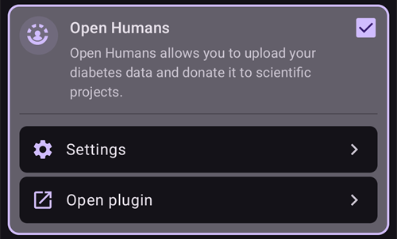
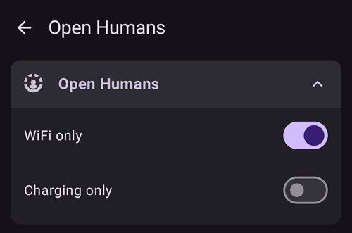
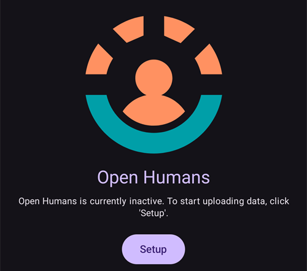
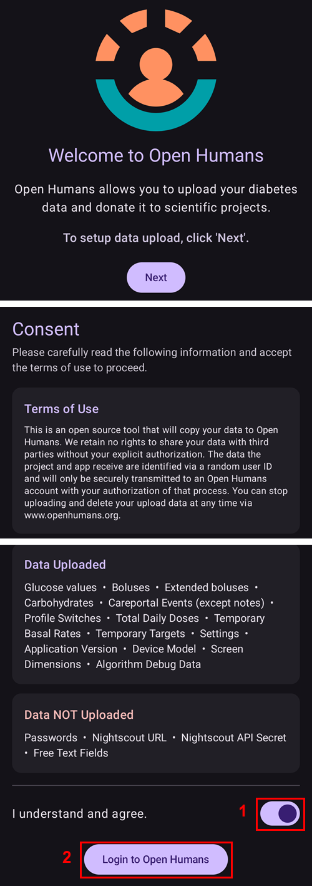
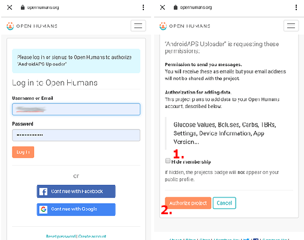
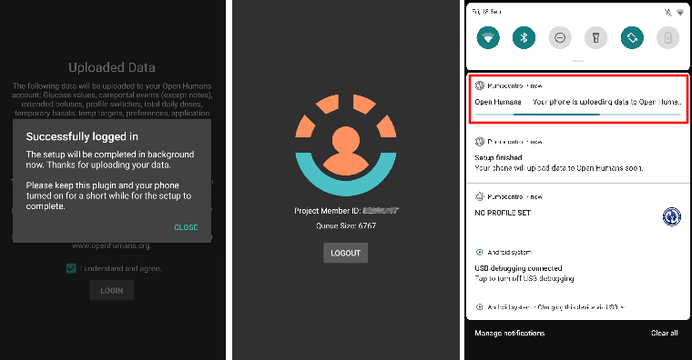
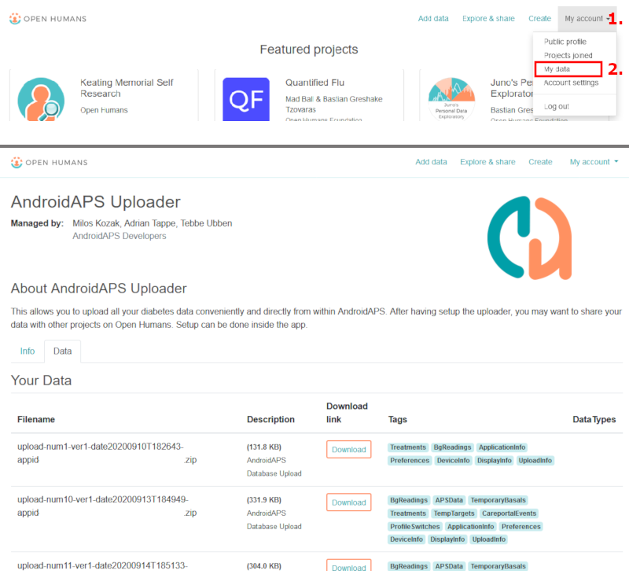

# Open Humans Uploader

## Donirajte svoje podatke znanosti

Zajednici možete pomoći tako da svoje podatke donirate istraživačkim projektima! To pomaže znanstvenicima da pomoć prenesu dalje, razviju nove znanstvene ideje i učine sustave zatvorene petlje otvorenog koda poznatijima. AAPS je spreman sinkronizirati vaše podatke s [Open Humans](https://www.openhumans.org), platformom koja vam omogućuje prijenos, povezivanje i pohranu osobnih podataka – kao što su genetski podaci, podaci o aktivnosti i zdravstveni podaci.

Zadržavate potpunu kontrolu nad time što se događa s vašim podacima i koje projekte želite podržati tako da im date pristup svojim podacima. Ovisno o projektu kojem ste se pridružili, projekt podatke procjenjuje i koristi na različite načine i u različitoj mjeri.

Na vaš Open Humans račun prenijet će se sljedeći podaci:

- Vrijednosti glukoze
- Careportal događaji (osim bilješki)
- Produženi bolusi
- Zamjene profila
- Ukupne dnevne doze
- Privremeni bazali
- Privremeni ciljevi
- Postavke
- Verzija aplikacije
- Model uređaja
- Dimenzije zaslona

Tajni ili privatni podaci, kao što su vaš Nightscout URL ili API tajna, neće se prenijeti.

## Postavljanje

1. Ako ga još nemate, izradite račun na [Open Humans](https://www.openhumans.org). Ako želite, možete koristiti svoj postojeći Google ili Facebook račun.
2. Omogućite dodatak **Open Humans** u [**Konfiguracija** > **Komunikacija**](../SettingUpAaps/ConfigBuilder.md).



3. Dodirnite **Postavke** na kartici **Open Humans**. Prijenos možete ograničiti na vrijeme kada telefon koristi Wi-Fi (**Samo WiFi**) i/ili kada se puni (**Samo tijekom punjenja**).



4. Dodirnite **Otvori dodatak** na kartici **Open Humans**, a zatim dodirnite **Postavljanje**.



5. Na zaslonu **Dobrodošli u Open Humans** dodirnite **Sljedeći**. Pažljivo pročitajte zaslon **Pristanak**: on prikazuje uvjete korištenja i koji se podaci prenose, a koji ne.
6. Uključite **Razumijem i slažem se.** (1) i dodirnite **Prijavite se na Open Humans** (2).



7. Otvorit će se web-stranica Open Humans. Prijavite se svojim podacima za prijavu.
8. Odlučite želite li sakriti svoje članstvo u AAPS Uploaderu u svom javnom profilu na Open Humans (1).
9. Kliknite **Authorize project** (2).



```{admonition} Older screenshot
:class: note
Snimke zaslona iznad prikazuju stariju verziju web-stranice Open Humans i još koriste stari naziv projekta **AndroidAPS Uploader**. Koraci su isti.
```

10. Natrag u **AAPS-u**, zaslon **Završni detalji** pita želite li nastaviti. Dodirnite **Nastavi**.
11. Pričekajte da se pojavi **Gotovi smo!**, a zatim dodirnite **Zatvori**. Od sada će vaš telefon s vremena na vrijeme prenositi podatke u pozadini.
12. Zaslon dodatka **Open Humans** sada prikazuje vaš **ID člana projekta**. Dodirnite **Pošalji sada** ako želite odmah pokrenuti prijenos.
13. Dodirnite **Odjava** ako želite prestati prenositi podatke na Open Humans.
14. Android obavijest obavijestit će vas o prijenosu koji je u tijeku.



```{admonition} Older screenshot
:class: note
Snimka zaslona iznad je iz starije verzije **AAPS-a**. U **AAPS-u** 4 zasloni potvrde su **Završni detalji** i **Gotovi smo!**, nema veličine reda čekanja, a gumbi su **Pošalji sada** i **Odjava**.
```

15. Svojim podacima možete upravljati tako da se prijavite na [web-stranicu Open Humans](https://www.openhumans.org).



## Mogućnosti dijeljenja

### [Projekt „OPEN“](https://www.open-diabetes.eu/)

Projekt „OPEN“ okuplja međunarodni i međusektorski konzorcij pacijenata inovatora, liječnika, društvenih znanstvenika, računalnih znanstvenika i udruga za zaštitu prava pacijenata. Cilj je istražiti različite aspekte sustava umjetne gušterače „uradi sam“ (DIY APS), koje koristi sve više osoba s dijabetesom. Više detalja potražite na njihovoj [web-stranici](https://www.open-diabetes.eu/).

U rujnu 2020. projekt „OPEN“ pokrenuo je [anketu](https://survey.open-diabetes.eu/) koja uključuje i mogućnost doniranja podataka koje ste prenijeli na Open Humans. [Upute](https://open-diabetes.eu/en/open-survey/survey-tutorials/) o tome kako donirati podatke projektu „OPEN“ dostupne su na njihovoj stranici i u samoj anketi.

### [OpenAPS Data Commons](https://www.openhumans.org/activity/openaps-data-commons/)

OpenAPS Data Commons napravljen je kako bi se na jednostavan način omogućilo dijeljenje skupova podataka iz zajednice DIYAPS za istraživanje. Podaci se dijele i s klasičnim istraživačima koji provode klasične istraživačke studije, i sa skupinama ili pojedincima iz zajednice koji žele pregledati podatke u sklopu vlastitih istraživačkih projekata. OpenAPS Data Commons koristi platformu „Open Humans“ kako bi ljudi mogli jednostavno prenijeti i dijeliti svoje podatke iz sustava DIYAPS, uključujući AAPS, Loop i OpenAPS.

Svoje podatke u Open Humans možete prenijeti na jedan od tri načina:

1. koristite opciju AAPS uploader za prijenos podataka u Open Humans
2. koristite Nightscout Data Transfer za prijenos podataka u Open Humans
3. ručno prenesite datoteke s podacima u Open Humans.

Kada ste izradili račun i vaši podaci počnu stizati u Open Humans, pridružite se i projektu OpenAPS Data Commons kako biste, ako to želite, donirali svoje podatke za istraživanje.

## Uvjeti korištenja

Ovo je alat otvorenog koda koji će kopirati vaše podatke u [Open Humans](https://www.openhumans.org). Ne zadržavamo nikakva prava dijeljenja vaših podataka s trećim stranama bez vašeg izričitog dopuštenja. Podaci koje primaju projekt i aplikacija označeni su slučajnim korisničkim ID-om i sigurno će se prenijeti na Open Humans račun samo ako vi odobrite taj postupak. Prijenos možete zaustaviti i prenesene podatke izbrisati u bilo kojem trenutku putem [www.openhumans.org](https://www.openhumans.org). Imajte na umu da neki projekti koji primaju podatke to možda ne podržavaju.

Pogledajte i [Uvjete korištenja Open Humans](https://www.openhumans.org/terms/).

## Privatnost podataka

Open Humans štiti vašu privatnost tako da vam za svaki projekt dodijeli brojčani ID. Tako vas projekti mogu prepoznati, ali ne i identificirati. ID aplikacije koji prenosi AAPS je sličan i služi samo za upravljanje podacima. Više informacija možete pronaći ovdje:

- [Pravila korištenja podataka Open Humans (Data Use Policy)](https://www.openhumans.org/data-use/)
- [Open Humans GDPR](https://www.openhumans.org/gdpr/)
