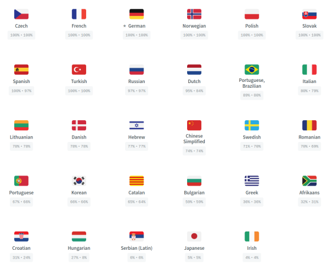
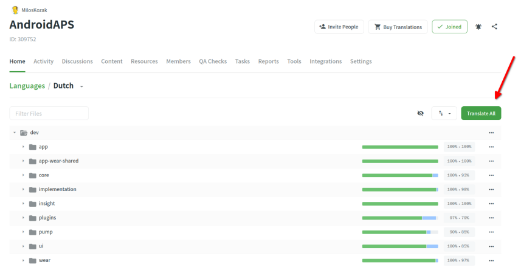
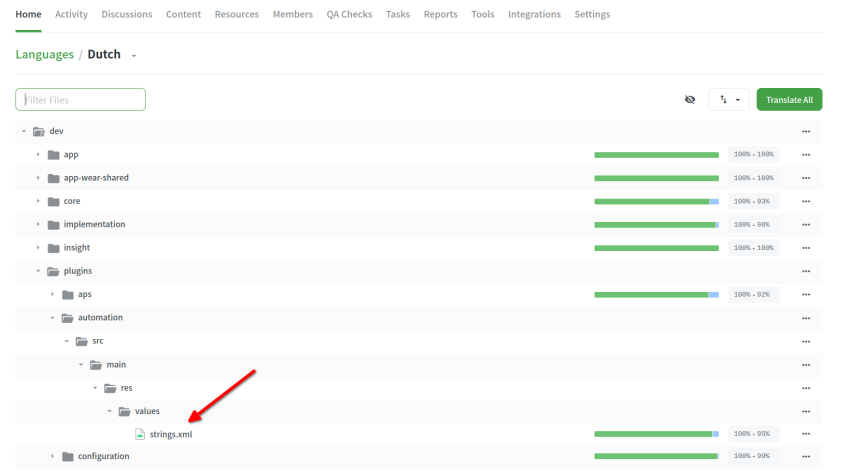
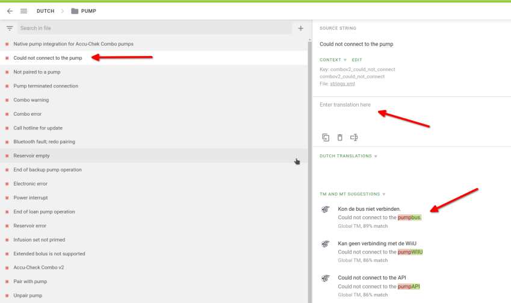
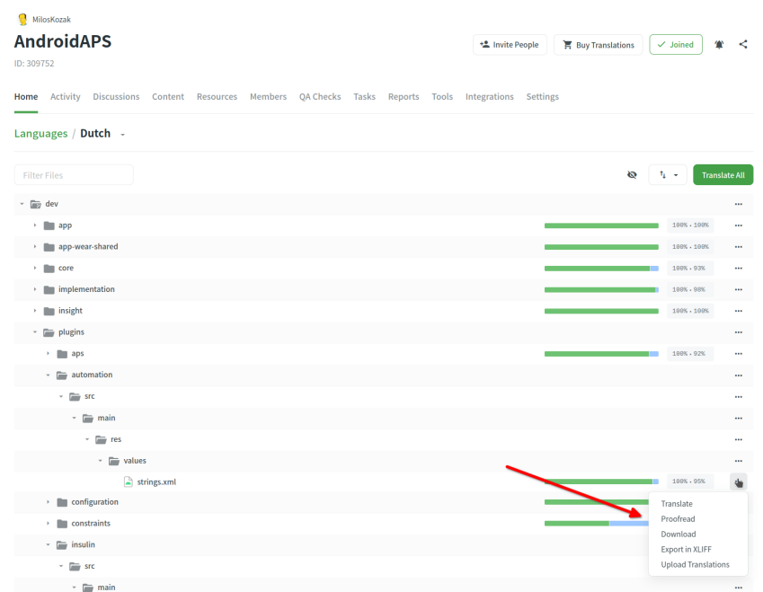
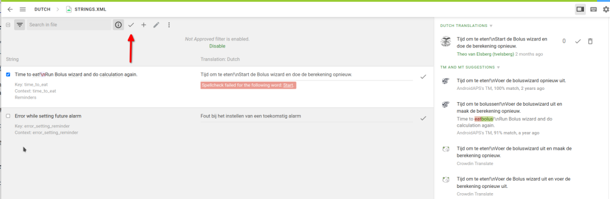
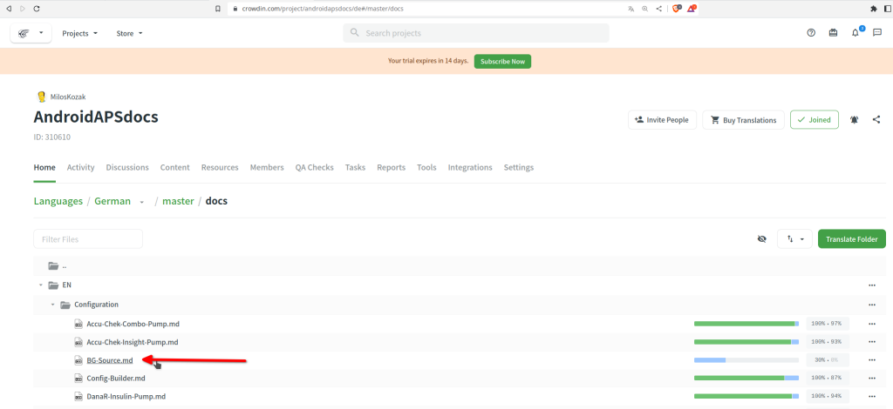
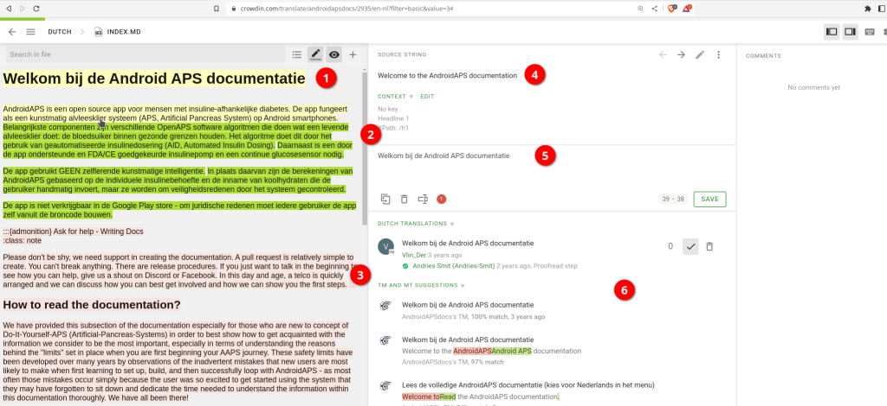
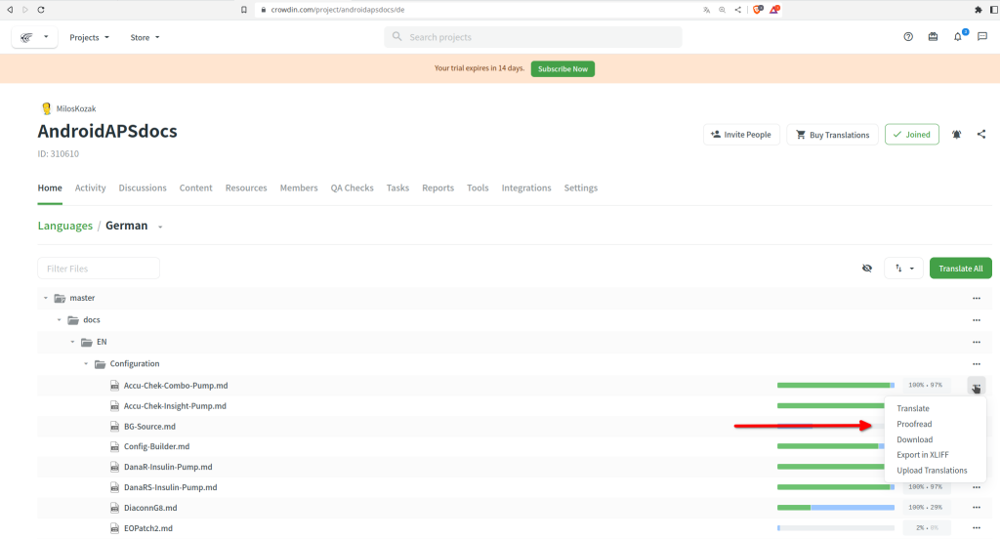

# Kako prevesti tekstove aplikacije AAPS ili dokumentacije

* For the strings used in the app go to <https://crowdin.com/project/androidaps> and login using your GitHub account
* Za dokumentaciju posjetite <https://crowdin.com/project/androidapsdocs> i prijavite se svojim GitHub računom

* Pošaljite zahtjev za pridruživanje timu za dokumentaciju. Za to kliknite zastavu željenog jezika, a zatim gumb „Join“ u gornjem desnom kutu sljedeće stranice. Navedite jezik, napišite nešto o sebi i svom iskustvu s AAPS-om te želite li biti prevoditelj ili lektor (samo osobe vješte u prevođenju + napredni korisnici AAPS-a).

```{admonition} Vrijeme za odobrenje :class: note

Odobrenje se radi ručno. Kao neprofitna organizacija ne jamčimo rokove (SLA), ali odobrenje je obično gotovo za manje od 1 dana. Ako nije, javite se timu za dokumentaciju putem Facebooka ili Discorda.

    <br />* Kada vas odobrimo, kliknite zastavu
       
    
    ## Prijevod aplikacije
    
    (translations-translate-strings-for-AAPS-app)=
    ### Prevođenje tekstova aplikacije AAPS
    
    * Ako nemate posebnu želju koje tekstove prevodite, samo odaberite gumb „Translate All“ za početak. Prikazat će vam tekstove koje treba prevesti.
    
       
    
    * Ako želite prevesti pojedinu datoteku, potražite je putem dijaloga za pretraživanje ili stabla mapa i kliknite naziv datoteke kako biste počeli prevoditi tekstove u toj datoteci.
    
       
    
    * Prevodite rečenice na lijevoj strani tako da dodate novi prevedeni tekst ili upotrijebite i uredite prijedlog
    
       
    
    
    ### Lektoriranje tekstova aplikacije AAPS
    
    * Lektori počinju odabirom „Proofread“ na početnom zaslonu jezika.
    
       
    
    
      i odobrite prevedene tekstove
    
       
    
    Kada lektor odobri prijevod, on će biti dodan u sljedeću verziju AAPS-a.
    
    (translations-translation-of-the-documentation)=
    ## Prijevod dokumentacije
    
    * Kliknite naziv stranice dokumentacije koju želite prevesti
    
    
    
    
    * Prevodite rečenicu po rečenicu
    
        1. Žuti tekst je tekst na kojem trenutno radite.
    
        1. Zeleni tekst je već preveden. Ne morate ga ponovno prevoditi.
    
        1. Crveni tekst je preostali tekst koji treba prevesti.
    
        1. Ovo je izvorni tekst na kojem trenutno radite
    
        1. Ovo je prijevod koji pripremate. Možete kopirati tekst odozgo ili odabrati jedan od prijedloga ispod.
    
        1. These are the suggestions for a translation. Especially you can see how much Crowdin rates this as a fit, or whether it was already translated in the past and only came back because the text was moved, not changed.
        1. Pritisnite gumb „save“ kako biste spremili prijedlog prijevoda. It will then be passed to a proofreader for final check.
    
    
    
    * Prevedena stranica neće biti objavljena u dokumentaciji prije nego što
    
        1. prijevod je lektoriran
    
        1. the sync run between Crowdin and Github finished (once an hour) which creates a PR for GitHub.
    
        1. PR na GitHubu je odobren.
    
    Obično to traje 1 – 3 dana, ali tijekom praznika može potrajati malo duže.
    
    ### Prevođenje poveznica
    
    ```{admonition} Poveznice se više ne prevode
    :class: note
    
    Poveznice se više ne prevode. In the past we had a topic here but this is gone as through migration to Markdown and the myst_parser we explicitly create labels in the english text and propagate these labels under the hood to the languages.
    
    

Prevodite tekst koji predstavlja poveznicu. Please be careful **not** to remove the link, which is represented by a pair of `<0></0>` tags (or other numbers, if there are more links in one paragraph).

Lektori na to moraju posebno paziti!

### Lektoriranje

* Lektori se moraju prebaciti u način lektoriranja (Proofreading)
    
    
    
    i odobriti prevedene tekstove
    
    

* When a proofreader approves a translation it will be added to the next docs build which happens in no fixed schedule on demand but around once a week except during holidays. Kako biste ubrzali postupak, možete obavijestiti tim za dokumentaciju o novim prijevodima.