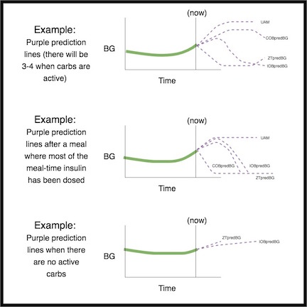
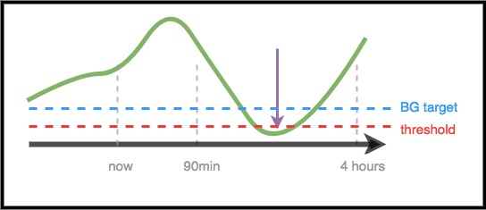
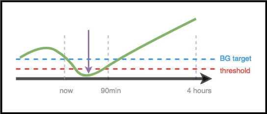
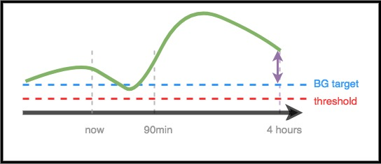
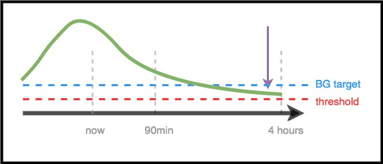

# Za zdravstvene djelatnike – Opći uvod i vodič za AAPS

```{note}
Ova je stranica opći uvod za zdravstvene djelatnike. Zadnji put je pregledana u lipnju 2026. AAPS se stalno razvija, zato za najtočnije i najnovije pojedinosti uvijek pogledajte [glavnu dokumentaciju AAPS-a](../index.md).
```

Ova je stranica namijenjena zdravstvenim djelatnicima koji su pokazali zanimanje za tehnologiju umjetne gušterače otvorenog koda, kao što je AAPS, ili pacijentima koji takve informacije žele podijeliti sa svojim liječnicima.

Ovaj vodič sadrži opće informacije o DIY zatvorenoj petlji, a posebno o tome kako radi AAPS. Za više pojedinosti o svim tim temama pogledajte [cjelovitu dokumentaciju AAPS-a na internetu](../index.md). Ako imate pitanja, zamolite pacijenta za više pojedinosti ili se slobodno obratite zajednici sa svojim pitanjem. (Ako niste na društvenim mrežama (npr. [Twitter](https://twitter.com/kozakmilos) ili Facebook), slobodno pošaljite e-poruku na developers@aaps.app). [Ovdje možete pronaći i neke od najnovijih studija i podataka o rezultatima](https://openaps.org/outcomes/).

## Koraci za izradu DIY zatvorene petlje:

Za početak korištenja AAPS-a potrebno je napraviti sljedeće korake:

* Nabavite [kompatibilnu pumpu](../Getting-Started/CompatiblePumps.md), [kompatibilan Android uređaj](../Getting-Started/Phones.md) i [kompatibilan izvor CGM-a](../Getting-Started/CompatiblesCgms.md).
* [Preuzmite izvorni kod AAPS-a i izradite softver](../SettingUpAaps/BuildingAaps.md).
* [Konfigurirajte softver tako da komunicira s uređajima za dijabetes te odredite postavke i sigurnosne opcije](../SettingUpAaps/SetupWizard.md).

## Kako radi DIY zatvorena petlja

Bez sustava zatvorene petlje osoba s dijabetesom prikuplja podatke s pumpe i CGM-a, odlučuje što učiniti i poduzima radnju.

Kod automatske isporuke inzulina sustav radi isto: prikuplja podatke s pumpe, CGM-a i sa svih drugih mjesta gdje se bilježe podaci (npr. Nightscout), koristi te podatke za izračun i odlučuje koliko je inzulina potrebno više ili manje (iznad ili ispod osnovne bazalne stope) te koristi privremene bazalne stope za potrebne prilagodbe kako bi GUK zadržao u ciljnom rasponu ili ga u njega na kraju vratio.

If the device running AAPS breaks or goes out of range of the pump, once the latest temporary basal rate ends, the pump falls back to being a standard pump with the preprogrammed basal rates running.

## Kako se prikupljaju podaci:

Kod AAPS-a Android uređaj pokreće posebnu aplikaciju koja radi izračune, a uređaj putem Bluetootha komunicira s podržanom pumpom. AAPS može komunicirati s drugim uređajima i s oblakom putem Wi-Fi-ja ili mobilnih podataka kako bi prikupio dodatne informacije i izvijestio pacijenta, njegovatelje i bližnje o tome što radi i zašto.

Android uređaj mora:

* komunicirati s pumpom i čitati povijest – koliko je inzulina isporučeno
* komunicirati s CGM-om (izravno ili preko oblaka) – da vidi kako se GUK kreće i kako se kretao

Kada uređaj prikupi te podatke, pokreće se algoritam i donosi odluke na temelju postavki (ISF, omjer ugljikohidrata, DIA, cilj itd.). Ako je potrebno, zatim šalje naredbe pumpi da promijeni brzinu isporuke inzulina.

Također prikuplja sve podatke o bolusima, unosu ugljikohidrata i privremenim ciljevima s pumpe ili iz Nightscouta te ih koristi za izračun brzine isporuke inzulina.

## Kako zna što treba učiniti?

Softver otvorenog koda dizajniran je tako da uređaj lako obavlja posao koji su ljudi prije radili sami (u ručnom načinu) kako bi izračunali kako treba prilagoditi isporuku inzulina. It first collects data from all the supporting devices and from the cloud, prepares the data and runs the calculations, makes predictions of what BG levels are expected to do during the next hours in different scenarios, and calculates the needed adjustments to keep or bring BG back into target range. Zatim šalje pumpi sve potrebne prilagodbe. Potom ponovno čita podatke i to radi iznova i iznova.

Budući da je najvažniji ulazni parametar razina glukoze u krvi s CGM-a, važno je imati kvalitetne podatke CGM-a.

AAPS je dizajniran tako da transparentno bilježi sve ulazne podatke koje prikuplja, preporuku koja iz njih proizlazi i svaku poduzetu radnju. Zato je uvijek lako odgovoriti na pitanje „zašto radi X?“ pregledom dnevnika.

## Primjeri odlučivanja algoritma AAPS-a:

AAPS koristi isti osnovni algoritam i iste značajke kao OpenAPS. Algoritam izrađuje više predviđanja (na temelju postavki i situacije) koja predstavljaju različite scenarije onoga što bi se moglo dogoditi u budućnosti. U Nightscoutu se prikazuju kao „ljubičaste linije“. AAPS koristi različite boje da razlikuje te [linije predviđanja](#aaps-screens-prediction-lines). U dnevnicima se opisuje koje od tih predviđanja i koji vremenski okvir određuju potrebne radnje.

### Evo primjera ljubičastih linija predviđanja i kako se mogu razlikovati:



(clinicianguide-dosing-scenarios)=

### Evo primjera različitih vremenskih okvira koji utječu na potrebne prilagodbe isporuke inzulina:

### Scenarij 1 – Nulti privremeni bazal radi sigurnosti

U ovom primjeru GUK raste u kratkoročnom vremenskom okviru, ali se predviđa da će u duljem vremenskom okviru biti nizak. Zapravo se predviđa da će pasti ispod cilja *i* ispod sigurnosnog praga. Radi sigurnosti, da spriječi nisku vrijednost, AAPS će postaviti nulti privremeni bazal (privremenu bazalnu stopu od 0 %) sve dok konačni GUK (u bilo kojem vremenskom okviru) ne bude iznad praga.



### Scenarij 2 – Nulti privremeni bazal radi sigurnosti

U ovom primjeru predviđa se da će GUK kratkoročno pasti nisko, ali da će na kraju biti iznad cilja. Međutim, budući da je kratkoročna niska vrijednost zapravo ispod sigurnosnog praga, AAPS će postaviti nulti privremeni bazal sve dok nijedna točka linije predviđanja više ne bude ispod praga.



### Scenarij 3 – Potrebno je više inzulina

U ovom primjeru kratkoročno predviđanje pokazuje kratak pad ispod cilja. Međutim, ne predviđa se da će pasti ispod sigurnosnog praga. Konačni GUK je iznad cilja. Therefore, AAPS will refrain from adding any insulin that would contribute to a near-term low (by adding insulin that would make the prediction go below threshold). Zatim će procijeniti dodavanje inzulina kako bi najnižu razinu konačnog predviđenog GUK-a spustio na cilj, čim to bude sigurno. *(Depending on settings and the amount and timing of insulin required, this insulin may be delivered via temp basals or SMBs (super micro boluses)).*



### Scenarij 4 – Niski privremeni bazal radi sigurnosti

U ovom primjeru AAPS vidi da GUK naglo raste daleko iznad cilja. Međutim, zbog vremena djelovanja inzulina u tijelu već ima dovoljno inzulina da GUK na kraju dovede u raspon. Zapravo se predviđa da će GUK na kraju biti ispod cilja. Zato AAPS neće dati dodatni inzulin, kako ne bi pridonio niskoj vrijednosti u duljem vremenskom okviru. Iako je GUK visok ili raste, ovdje je vjerojatan niski privremeni bazal.



## Optimizacija postavki i promjene

Kao zdravstvenom djelatniku koji možda nema iskustva s AAPS-om ili DIY zatvorenim petljama, može vam biti teško pomoći pacijentu da optimizira postavke ili napravi promjene za bolje rezultate. U zajednici imamo više alata i [vodiča](https://openaps.readthedocs.io/en/latest/docs/Customize-Iterate/optimize-your-settings.html) koji pacijentima pomažu da naprave male, provjerene prilagodbe i poboljšaju svoje postavke.

Najvažnije je da pacijenti mijenjaju jednu stvar odjednom i promatraju učinak 2–3 dana prije nego što promijene ili prilagode drugu postavku (osim ako je promjena očito loša i pogoršava stanje; tada se trebaju odmah vratiti na prethodnu postavku). Ljudi su skloni okretati sve gumbe i mijenjati sve odjednom; ali tko to učini, može u budućnosti završiti s još lošijim postavkama i teško se vratiti na poznato dobro stanje.

Jedan od najmoćnijih alata za promjenu postavki je alat za automatski izračun bazalnih stopa, ISF-a i omjera ugljikohidrata. To se zove „[Autotune](#autotune-how-autotune-calculates-adjustments)“. It is designed to allow the data to guide you or your patient in making incremental changes to settings. U zajednici je dobra praksa najprije pokrenuti (ili pregledati) izvješća Autotunea, prije nego što se postavke pokušaju ručno prilagoditi. Autotune je ugrađen u AAPS kao dodatak (**Konfiguracija** → **Općenito** → **Autotune**); pogledajte [Kako koristiti dodatak Autotune](../AdvancedOptions/Autotune.md). Može se pokrenuti na zahtjev ili automatski. Budući da su ti parametri preduvjet i za standardnu isporuku inzulina pumpom i za isporuku inzulina u zatvorenoj petlji, razgovor o rezultatima Autotunea i prilagodba tih parametara prirodna su poveznica sa zdravstvenim djelatnikom.

Osim toga, ljudsko ponašanje (naučeno u ručnom liječenju dijabetesa) često utječe na rezultate, čak i kod DIY zatvorene petlje. Na primjer, ako se predviđa da će GUK pasti nisko, a AAPS na putu prema dolje smanji inzulin, možda je potrebna samo mala količina ugljikohidrata (npr. 3–4 g) da se GUK podigne sa 70 mg/dL (3,9 mmol/L). Međutim, u mnogim slučajevima osoba može hipoglikemiju liječiti s puno više ugljikohidrata (npr. držeći se pravila 15), što uzrokuje brži skok, i zbog dodatne glukoze i zato što je inzulin bio smanjen u razdoblju prije niske vrijednosti.

## OpenAPS

**This guide was adapted from [The clinician's guide to OpenAPS](https://openaps.readthedocs.io/en/latest/docs/Resources/clinician-guide-to-OpenAPS.html).** OpenAPS is a system developed to be run on a small portable computer (generally referred to as the "rig"). AAPS koristi mnoge tehnike iz OpenAPS-a i dijeli velik dio logike i algoritama, zato je ovaj vodič vrlo sličan izvornom vodiču. Velik dio informacija o OpenAPS-u lako se može primijeniti na AAPS; glavna je razlika hardverska platforma na kojoj se pojedini softver pokreće.

## Sažetak

Ovo je zamišljeno kao opći pregled načina rada AAPS-a. Za više pojedinosti pitajte pacijenta, obratite se zajednici ili pročitajte cjelovitu dokumentaciju AAPS-a dostupnu na internetu.

Dodatno preporučeno čitanje:

* [Cjelovita dokumentacija AAPS-a](../index.md)
* [Referentni dizajn OpenAPS-a](https://OpenAPS.org/reference-design/), koji objašnjava kako je OpenAPS dizajniran za sigurnost: https://openaps.org/reference-design/
* [Cjelovita dokumentacija OpenAPS-a](https://openaps.readthedocs.io/en/latest/index.html) 
  * Pogledajte [kako AAPS pretvara predviđanja u odluku o doziranju](#aaps-screens-how-predictions-become-a-dosing-decision) u ovoj dokumentaciji ili [dokumentaciju OpenAPS-a o determine-basal](https://openaps.readthedocs.io/en/latest/docs/While%20You%20Wait%20For%20Gear/Understand-determine-basal.html#understanding-the-determine-basal-logic) za temeljni algoritam sa svim tehničkim pojedinostima