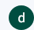
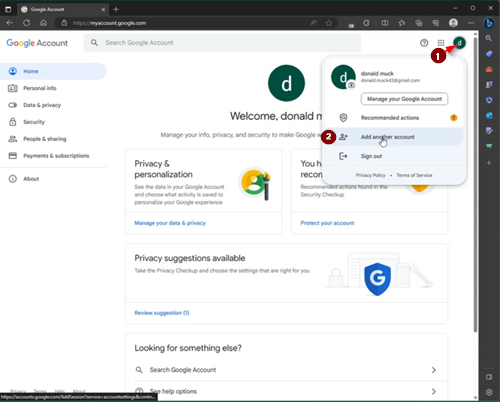
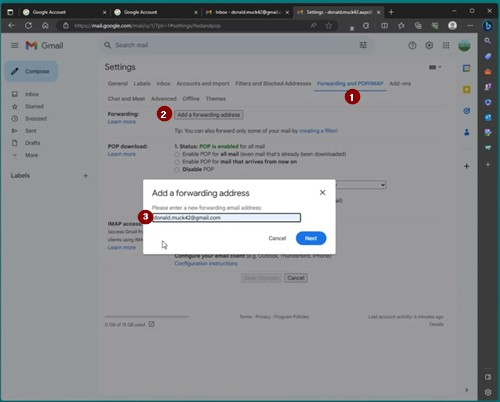

# Zaseban Google račun za AAPS (neobavezno)

Neki korisnici **AAPS-a** radije koriste svoj glavni račun e-pošte i za **AAPS**. Drugi korisnici **AAPS-a** (ili njihovi njegovatelji) postave zaseban račun e-pošte za **AAPS** – to nije obavezno, a niže dajemo primjer kako to učiniti.

Ako ne želite postaviti zaseban Gmail račun za **AAPS**, možete odmah prijeći na sljedeći odjeljak, [Izrada AAPS-a](../SettingUpAaps/BuildingAaps.md).

```{admonition} Advantages of a dedicated Google account for AAPS
:class: dropdown

- Dedicated Google Drive space means you will not risk filling up your personal Google Drive limit with **Export settings**.
- Svaka verzija **AAPS-a** (i pomoćnih aplikacija kao što su xDrip, BYODA itd.) bit će spremljena na jednom mjestu koje ne ovisi o hardveru vašeg računala. Ako vam računalo ili telefon bude ukraden, izgubljen ili pokvaren, i dalje ćete imati pristup.
- Ujednačeno postavljanje olakšava podršku na internetu među korisnicima sa sličnom strukturom mapa.
- Ovisno o postavljanju (pogledajte niže), imat ćete zaseban identitet kao pseudonim za komunikaciju unutar zajednice, što može zaštititi vašu privatnost. 
- Djeca s dijabetesom tipa 1 kao maloljetnici mogu zadržati svoj „svakodnevni“ račun e-pošte, a koristiti **AAPS** i povezane značajke za koje je potreban račun odrasle osobe.
- Gmail vam dopušta registraciju do 4 računa s istim brojem telefona.
```

## Kako postaviti zaseban Google račun za AAPS

(⌛Oko 10 minuta)


Preduvjeti:

* Imate računalo s Windowsima (Windows 10 ili noviji) i Android telefon (Android 12 ili noviji) na kojem će biti aplikacija **AAPS**. Oba uređaja imaju sva najnovija sigurnosna ažuriranja, pristup internetu i administratorska prava, jer neki koraci zahtijevaju preuzimanje i instalaciju programa.
* Android telefon je već postavljen s vašom osobnom „svakodnevnom“ adresom e-pošte, na primjer Gmail računom.

```{admonition} Things to consider when setting up your new account
:class: dropdown
- Iz razloga privatnosti možete koristiti ime koje se razlikuje od vašeg, a povezano je s računom (npr. t1dsuperstar). Tada ga možete koristiti na javnim forumima **AAPS-a**, a vaš pravi identitet ostaje privatan. Budući da Google traži e-poštu i broj telefona za oporavak, račun se ipak može povezati s vama.
- Novi račun za **AAPS** koristit će za provjeru isti broj telefona kao vaš „_svakodnevni_“ račun. Za provjeru će koristiti „svakodnevnu“ adresu e-pošte;
- Postavit ćemo prosljeđivanje e-pošte tako da se sva e-pošta poslana na novi zasebni AAPS račun prosljeđuje na glavni račun (pa ne morate provjeravati dva različita sandučića);
- Koristite različite lozinke za svoj _svakodnevni_ Gmail račun i Gmail račun za AAPS
- Ako za jedan Gmail račun koristite Googleovu „provjeru u 2 koraka“ (tzv. višefaktorsku autentifikaciju), možete je uključiti i za oba Gmail računa.
- Ako planirate koristiti Googleove „pristupne ključeve“ (Passkeys), registrirajte više uređaja. Tako se nećete zaključati izvan računa. To radite samo na uređajima kojima nitko drugi nema pristup (_tj._ ne na računalu sa zajedničkim računom koji mogu otključati i drugi ljudi).
```


```{admonition} Video Walkthrough!
:class: note
Kliknite [ovdje](<https://drive.google.com/file/d/1dMZTIolO-kd2eB0soP7boEVtHeCDEQBF/view?usp=drive_link>) za videozapis koji pokazuje kako postaviti zaseban Google račun.
```

 Ovo su koraci prikazani u videozapisu:

U ovom primjeru: 
- Your existing “_Everyday_” Google account is <donald.muck42@gmail.com>; 
- Vaš novi „_AAPS_“ Gmail račun bit će: <donald.muck42.aaps@gmail.com>; 


### Go to <https://myaccount.google.com> 

 Ako ste već prijavljeni u Google, ovo će vas odvesti na stranicu **My Account** (moj račun) vašeg „svakodnevnog“ računa. (1) Click on the top right of the page on your profile picture (in this case, a simple ) (2) select “_add another account_”.




### Unesite podatke svog NOVOG zasebnog računa: 

- Unesite novi račun: 
- Create Account (izrada računa)
- for my personal use (za osobnu upotrebu). 


### Unesite svoje osobne podatke:
 - Unesite ime
 - prezime
 - datum rođenja (morate biti punoljetni)

### Odaberite svoju NOVU adresu e-pošte i lozinku

U ovom primjeru postojećem računu Donalda Mucka dodaje se „.AAPS“…\
Postavite lozinku

### Unesite broj telefona koji može primiti SMS za provjeru

Gmail će vam sada poslati jedinstveni kôd koji trebate unijeti za provjeru.

### Unesite adresu e-pošte za oporavak

U ovom slučaju to će biti vaša postojeća „_svakodnevna_“ e-pošta…

### Dovršite postavljanje računa

Gmail će prikazati naziv računa. Tražit će od vas da prihvatite Gmailove uvjete korištenja i potvrdite postavke personalizacije.

### Prilagodite prikaz novog profila

Sada biste trebali biti na Gmailovoj stranici MyAccount koja prikazuje vaš novi račun e-pošte za **AAPS**. Slika profila prema zadanim postavkama bit će prvo slovo vašeg imena. Change it to something unique to avoid confusion… in this example, Donald.Muck.AAPS has replaced  with .

\


### Otvorite web-stranicu Gmaila u oba prozora da postavite novi račun

Da ne morate pratiti zaseban račun e-pošte, proslijedite svu e-poštu s novog računa za **AAPS** na svoj svakodnevni račun\
Ovaj dio može biti malo zbunjujući, jer ćete se morati prebacivati između oba računa. Da bude lakše, otvorite 2 odvojena prozora preglednika jedan iznad drugoga:

1. Pomaknite postojeći preglednik na vrh zaslona i promijenite mu veličinu tako da zauzima samo otprilike gornju polovicu zaslona…
2. Desnom tipkom miša kliknite logotip preglednika na programskoj traci
3. U izborniku odaberite „New Window“ (novi prozor)... i podesite ga tako da zauzima samo donju polovicu zaslona.

U svakom prozoru preglednika otvorite <https://gmail.com>. Neka vaš osobni račun bude gore, a novi zasebni račun za **AAPS** dolje; lako ga prepoznate po slici profila u gornjem desnom kutu. If needed, you can always switch accounts by clicking on the profile picture and selecting the correct one.


Vaše Gmail početne stranice trebale bi izgledati ovako:\


 ### U novom Gmail računu (donji prozor) otvorite postavke Gmaila…

- Kliknite zupčanik lijevo od slike profila
- zatim odaberite „**See all Settings**“ (prikaži sve postavke)


### Postavite prosljeđivanje…

- Kliknite karticu postavki „Forwarding and POP/IMAP“ (prosljeđivanje i POP/IMAP)
- Kliknite „add a forwarding address“ (dodaj adresu za prosljeđivanje)
- Dodajte svoju „svakodnevnu“ adresu e-pošte
- Gmail će poslati kôd za provjeru na vašu „svakodnevnu“ adresu e-pošte.
- Vratit ćete se na svoj svakodnevni profil i kliknuti poveznicu da potvrdite da prihvaćate prosljeđivanje (ili uzmite kôd iz Gmailove e-pošte za provjeru u „svakodnevnom“ Gmail prozoru, pa ga izrežite i zalijepite u „novi AAPS“ Gmail prozor).

Prilično ćete se prebacivati između prozora, ali tako ćete, kada provjeravate e-poštu „svakodnevnog“ računa, vidjeti i e-poštu proslijeđenu s računa za AAPS, na primjer Gmail upozorenja.



### Potvrdite proslijeđenu adresu e-pošte

- U „svakodnevnom“ Gmailu (gornji prozor) dobit ćete e-poštu „Gmail forwarding Confirmation“ (potvrda prosljeđivanja).
- Otvorite je i „click the link to confirm the request“ (kliknite poveznicu da potvrdite zahtjev)

### Arhivirajte proslijeđenu e-poštu u novom zasebnom Gmail računu (donji prozor)

<!---->

1. Osvježite donji prozor
2. Označite „forward incoming email“ (prosljeđivanje dolazne e-pošte)
3. I arhivirajte Gmailovu kopiju (da vaš novi zasebni sandučić ostane uredan)
4. Pomaknite se sasvim do dna da spremite promjene\
   


Čestitamo! Sada ste izradili zaseban Google račun za AAPS. Sljedeći korak je [Izrada AAPS-a](../SettingUpAaps/BuildingAaps.md).