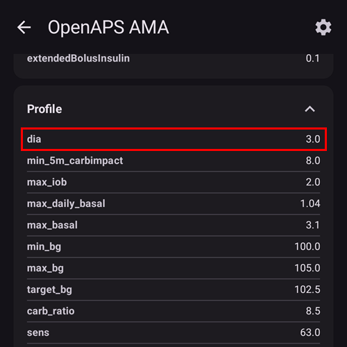

# Česta pitanja korisnika petlje

Kako dodati pitanja u Česta pitanja: slijedite ove [upute](../SupportingAaps/HowToEditTheDocs.md)

## Općenito

### Mogu li jednostavno preuzeti instalacijsku datoteku AAPS-a?

Ne. Za AAPS ne postoji APK datoteka za preuzimanje. Morate ga sami [izraditi](../SettingUpAaps/BuildingAaps.md). Evo zašto:

AAPS se koristi za upravljanje pumpom i davanje inzulina. Prema važećim propisima u Europi, svi sustavi klase IIa ili IIb su medicinski uređaji kojima je potrebno regulatorno odobrenje (oznaka CE), a za njega su potrebne razne studije i odobrenja. Distribucija nereguliranog uređaja je nezakonita. Slični propisi postoje i u drugim dijelovima svijeta.

Ovaj propis ne odnosi se samo na prodaju (u smislu dobivanja novca za nešto), nego na svaku distribuciju (čak i besplatno davanje). Izrada medicinskog uređaja za sebe jedini je način da koristite aplikaciju u skladu s ovim propisima.

Zato APK datoteke nisu dostupne.

(FAQ-how-to-begin)=

### Kako početi?

Počnite sa stranicom [Priprema za početak s AAPS-om](../Getting-Started/PreparingForAaps.md): ona vas detaljnije vodi kroz sve što je navedeno niže.

Prije svega, morate **nabaviti hardverske komponente koje podržavaju petlju**:

* [podržanu inzulinsku pumpu](../Getting-Started/CompatiblePumps.md), 
* [Android pametni telefon](../Getting-Started/Phones.md) (AAPS ne podržava Apple iOS – možete pogledati [iOS Loop](https://loopkit.github.io/loopdocs/)) i
* [sustav za kontinuirano mjerenje glukoze](../Getting-Started/CompatiblesCgms.md). 

Drugo, morate **postaviti svoje softverske komponente**: [AAPS](../SettingUpAaps/BuildingAaps.md), [izvor CGM/FGM](../Getting-Started/CompatiblesCgms.md) i [poslužitelj za izvješća](../SettingUpAaps/SettingUpTheReportingServer.md).

Treće, morate naučiti i **razumjeti OpenAPS referentni dizajn kako biste provjerili svoje postavke liječenja**. Temeljno načelo zatvorene petlje je da su vaša [bazalna stopa i omjer ugljikohidrata](../SettingUpAaps/YourAapsProfile.md) točni. Sve preporuke pretpostavljaju da su vaše bazalne potrebe pokrivene i da su skokovi ili padovi koje vidite posljedica drugih čimbenika, koji zato traže jednokratne prilagodbe (tjelovježba, stres itd.). Prilagodbe koje zatvorena petlja smije napraviti ograničene su radi sigurnosti (vidi najveću dopuštenu privremenu bazalnu stopu u [OpenAPS Reference Design](https://openaps.org/reference-design/)), što znači da dopuštenu dozu ne želite trošiti na ispravljanje pogrešnog osnovnog bazala. Ako na primjer često dobivate niski privremeni bazal pred obrok, vjerojatno vaš bazal treba prilagoditi. Možete koristiti [Autotune](#autotune-how-autotune-calculates-adjustments), koji uzima u obzir veliku količinu podataka i predlaže treba li i kako prilagoditi bazal i/ili ISF te treba li promijeniti omjer ugljikohidrata. Ili možete testirati i postaviti bazal na [stari način](https://integrateddiabetes.com/basal-testing/).

### Na koje praktične stvari trebam paziti kod korištenja petlje?

#### Zaštita lozinkom

Ako ne želite da se vaše postavke lako mijenjaju, možete ih zaštititi lozinkom, PIN-om ili biometrijskom autentifikacijom telefona (otisak prsta, lice). Otvorite **Postavke** > **Zaštita** > **Zaštita postavki** i odaberite vrstu zaštite. Na istom mjestu možete zaštititi i cijelu aplikaciju ili samo boluse. Pojedinosti potražite u [Zaštita postavki](#Preferences-settings-protection).

#### Pametni satovi s Android Wear

Ako aplikaciju AAPS na satu koristite za bolus ili promjenu postavki, svaki zahtjev mora se potvrditi na satu: nakon slanja sat prikazuje sažetak s gumbom **POTVRDI**. Vidi [Upravljanje AAPS-om putem pametnog sata s Wear OS-om](../RemoteFeatures/RemoteControlWearOS.md).

(FAQ-disconnect-pump)=

#### Odspoji pumpu

Ako skinete pumpu zbog tuširanja, kupanja, plivanja, sporta ili drugih aktivnosti, morate reći AAPS-u da se inzulin ne isporučuje kako bi aktivni inzulin (IOB) bio točan.

Pumpu možete odspojiti pomoću [ikone petlje](#AapsScreens-loop-status) na glavnom zaslonu AAPS-a: pritisnite je i odaberite **Odspoji pumpu** s trajanjem koje vam treba. Ako aktivnost traje dulje nego što ste planirali, ponovno pritisnite ikonu i odaberite novo trajanje: ne morate prije toga ponovno spojiti pumpu. Kako izbjeći nedostatak inzulina tijekom dugog odspajanja, pročitajte u [Odspajanje pumpe zbog tuširanja ili aktivnosti](#pumps-cannulas-disconnecting).

#### Preporuke se ne temelje samo na jednom očitanju CGM-a

Radi sigurnosti, preporuke se ne temelje na jednom očitanju CGM-a, nego na prosječnoj delti. Zato, ako propustite neka očitanja, može proći neko vrijeme nakon što podaci ponovno stignu prije nego što AAPS ponovno pokrene petlju.

#### Dodatno čitanje

Postoji nekoliko blogova s dobrim savjetima koji vam pomažu razumjeti praktične stvari kod korištenja petlje. Neki od njih više nisu na internetu: poveznice niže označene s „arhivirana kopija“ otvaraju spremljenu kopiju u Internet Archiveu.

    * [Fino podešavanje postavki](https://web.archive.org/web/20171029031305/http://seemycgm.com/2017/10/29/fine-tuning-settings/) See my CGM (arhivirana kopija)
    * [Zašto je DIA važan](https://web.archive.org/web/20231130035027/http://seemycgm.com/2017/08/09/why-dia-matters/) See my CGM (arhivirana kopija)
    * [Ograničavanje skokova nakon obroka](https://diyps.org/2016/07/11/picture-this-how-to-do-eating-soon-mode/) #DIYPS
    * [Hormoni i Autosens](https://web.archive.org/web/20170902081839/http://seemycgm.com/2017/06/06/hormones-2/) See my CGM (arhivirana kopija)
    

(what-emergency-equipment-is-recommended-to-take-with-me)= (FAQ-emergency-equipment)=

### Koju opremu za hitne slučajeve se preporučuje imati sa sobom?

Morate sa sobom imati istu opremu za hitne slučajeve kao i svaka druga osoba s T1D koja koristi terapiju inzulinskom pumpom. Kada koristite petlju s AAPS-om, snažno se preporučuje da sa sobom ili u blizini imate sljedeću dodatnu opremu:

* Prijenosna baterija i kabeli za punjenje pametnog telefona, sata i (ako je potrebno) BT čitača ili uređaja Link
* Baterije za pumpu
* Pristup sigurnosnim kopijama, i na telefonu i u oblaku (npr. Google Drive, Dropbox), kako biste mogli ponovno postaviti AAPS na drugom telefonu (vidi [Izrada i vraćanje sigurnosnih kopija](../Maintenance/ExportImportSettings.md)): 
  * trenutni [APK](../SettingUpAaps/BuildingAaps.md) AAPS-a i svih drugih aplikacija koje koristite (npr. xDrip, Juggluco, BYODA).
  * datoteka spremišta ključeva (iz izrade APK-a) i njezina lozinka,
  * najnovije datoteke izvoza postavki iz AAPS-a i drugih aplikacija,
  * glavna lozinka za **AAPS**: bez nje ne možete uvesti datoteku postavki. Ako ste je zaboravili, vidi [Kako resetirati glavnu lozinku?](#FAQ-reset-master-password)

(FAQ-organize-backups)=

#### Kako organizirati sigurnosne kopije?

Postavke izvozite vrlo redovito: nakon svake zamjene Pod-a ili spremnika, nakon promjene profila, kada ispunite cilj, ako promijenite pumpu… Čak i ako se ništa ne mijenja, izvezite jednom mjesečno. Čuvajte nekoliko starih datoteka izvoza.

**AAPS** to može raditi umjesto vas: može automatski izvoziti postavke (na primjer [automatizacijom](#ExportImportSettings-Automating-Settings-Export) nakon svake zamjene Pod-a) i spremiti izvoz izravno u mapu u oblaku (Google Drive). Vidi [Izrada i vraćanje sigurnosnih kopija](../Maintenance/ExportImportSettings.md).

### Kako sigurno i pouzdano pričvrstiti CGM/FGM?

Možete ga zalijepiti. Za uobičajene CGM sustave postoje unaprijed izrezani 'overpatch' flasteri (potražite na Googleu, eBayu ili Amazonu). Neki korisnici petlje koriste jeftiniju običnu kineziološku traku ili rocktape.

Možete ga učvrstiti. Možete kupiti i narukvice za nadlakticu koje učvršćuju CGM/FGM trakom (potražite na Googleu, eBayu ili Amazonu).

## APS algoritam

### Zašto OpenAPS AMA prikazuje "dia: 3" iako u profilu imam drugačiji DIA?

Kada je u **Konfiguracija** > **APS** odabran **OpenAPS AMA**, **Otvori dodatak** prikazuje podatke koji se šalju algoritmu. U njegovom dijelu **Profil** `dia` je uvijek 3.0 ili manje:

U AMA algoritmu DIA zapravo ne znači 'trajanje djelovanja inzulina'. To je parametar koji je nekad bio povezan s DIA. Sada znači 'za koje vrijeme korekcija treba biti završena'. Nema nikakve veze s izračunom aktivnog inzulina (IOB). U OpenAPS SMB ovaj parametar više nije potreban.

## Ostale postavke

### Postavke Nightscouta

(FAQ-nsclient-blocked)=

#### AAPSClient (ili AAPS) ne šalje podatke: „Blokirano…“. Što mogu učiniti?

Status NSClienta pokazuje zašto se podaci ne šalju:

* **Blokirano opcijama povezivanja**: postavke veze ne dopuštaju trenutnu vezu. Na primjer, koristite mobilne podatke, a dopušten je samo Wi-Fi, ili niste spojeni na neku od dopuštenih Wi-Fi mreža (SSID).
* **Blokirano opcijama punjenja**: postavke veze dopuštaju sinkronizaciju samo dok se telefon puni (ili samo na bateriji), a to sada nije slučaj.
* **Nema veze**: telefon nema internetsku vezu.

Provjerite [postavke veze NSClienta](#Preferences-nsclient): **Koristi mobilne podatke**, **Koristi roaming**, **Koristi WiFi**, **WiFi SSID**, **Sinkroniziraj pri radu na bateriji** i **Sinkroniziraj tijekom punjenja**.

### Postavke CGM-a

(FAQ-advanced-filtering)=

#### Zašto AAPS kaže 'SMB uvijek i SMB nakon ugljikohidrata onemogućeni su jer aktivni izvor GUK-a ne podržava napredno filtriranje'?

**Uvijek omogući SMB** i **Omogući SMB nakon ugljikohidrata** mogu se koristiti samo s [pouzdanim izvorom podataka GUK-a](#GettingStarted-TrustedBGSource): senzorom i CGM aplikacijom koja može reći **AAPS-u** s kojeg senzora dolaze očitanja. S bilo kojim drugim izvorom GUK-a **AAPS** isključuje ove dvije opcije i prikazuje ovu poruku. Provjerite popis pouzdanih izvora i, ako je vaš senzor na popisu, provjerite koristite li jednu od CGM aplikacija koje su za njega navedene. Vidi i [Zaglađivanje podataka GUK-a](../CompatibleCgms/SmoothingBloodGlucoseData.md).

### Pumpa

#### Baterije

Petlja može brže trošiti bateriju pumpe nego obično korištenje, jer sustav komunicira preko Bluetootha mnogo češće nego korisnik koji pumpu koristi ručno. Najbolje je zamijeniti bateriju na 25 %, jer tada komunikacija postaje teška. Upozorenja za bateriju pumpe možete postaviti varijablom PUMP_WARN_BATT_P na svojoj Nightscout stranici. Trikovi za dulje trajanje baterije su:

* skratite vrijeme koliko LCD zaslon ostaje uključen (u izborniku postavki pumpe)
* skratite vrijeme koliko pozadinsko osvjetljenje ostaje uključeno (u izborniku postavki pumpe)
* u postavkama obavijesti odaberite zvučni signal umjesto vibracije (u izborniku postavki pumpe)
* tipke na pumpi pritišćite samo za ponovno punjenje, a za pregled cijele povijesti, razine baterije i količine u spremniku koristite AAPS.
* Na nekim telefonima aplikacija AAPS se može često zatvarati radi uštede energije ili oslobađanja RAM-a. Kada se AAPS ponovno pokreće pri svakom startu, uspostavlja Bluetooth vezu s pumpom i ponovno čita trenutnu bazalnu stopu i povijest bolusa. To troši bateriju. Da biste vidjeli događa li se to, uključite **Zabilježi pokretanje aplikacije** u **Naprednim postavkama** NSClienta: Nightscout će dobiti događaj pri svakom ponovnom pokretanju AAPS-a, pa je problem lako pratiti. Da biste to smanjili, isključite optimizaciju baterije za AAPS kako ga telefon ne bi zatvarao: vidi [ušteda baterije](#FAQ-battery-savings) niže.
* očistite kontakte baterije alkoholnom maramicom kako ne bi ostao vosak ili mast iz proizvodnje.
* kod [pumpi Dana R/RS](../CompatiblePumps/DanaRS-Insulin-Pump.md) postupak pokretanja namjerno povlači jaku struju iz baterije kako bi probio pasivacijski sloj (sprječava gubitak energije tijekom skladištenja), ali ga ne uspije uvijek probiti 100 %. Izvadite i ponovno umetnite bateriju 2–3 puta dok zaslon ne pokaže 100 %, ili prije umetanja nakratko kratko spojite bateriju ključem za bateriju tako da ga na djelić sekunde prislonite na oba kontakta.
* vidi i više savjeta za [pojedine vrste baterija](#Accu-Chek-Combo-Tips-for-Basic-usage-battery-type-and-causes-of-short-battery-life)

#### Zamjena spremnika i kanila

Spremnik se mora zamijeniti izravno na pumpi, a zatim se zamjena zabilježi u **AAPS-u**. Slijedite [upute korak po korak za zamjenu spremnika i kanile pumpe](#pumps-cannulas-changing-reservoir-and-cannula).

### Pozadina zaslona

Pozadinu zaslona AAPS za svoj telefon možete pronaći na stranici [Telefoni](#Phones-phone-wallpaper).

### Svakodnevna upotreba

Mnoge od situacija niže možete jednom pripremiti kao [scenu](#scenes): predložak koji jednim dodirom mijenja profil, privremeni cilj i druge postavke. **AAPS** nudi gotove predloške, na primjer *Tjelovježba*, *Spavanje*, *Alkohol* ili *Kupanje*.

#### Higijena

(what-to-do-when-taking-a-shower-or-bath)=

##### Što učiniti kod tuširanja ili kupanja?

Pumpu možete skinuti dok se tuširate ili kupate. Za to kratko vrijeme možda vam nije potrebna, ali trebate reći AAPS-u da ste odspojeni kako bi izračun aktivnog inzulina (IOB) bio točan. Vidi [opis iznad](#FAQ-disconnect-pump). Predložak [scene](#scenes) *Kupanje* to radi umjesto vas.

#### Posao

Ovisno o poslu, radnim danima možete koristiti druge postavke liječenja. Kao korisnik petlje trebali biste razmisliti o [zamjeni profila](../DailyLifeWithAaps/ProfileSwitch-ProfilePercentage.md) za svoj tipični radni dan. Na primjer, možete prijeći na profil veći od 100 % ako imate manje zahtjevan posao (npr. sjedite za stolom) ili manji od 100 % ako ste aktivni i cijeli dan na nogama. Možete razmisliti i o visokom ili niskom privremenom cilju ili o [vremenskom pomaku profila](#ProfileSwitch-ProfilePercentage-time-shift-of-the-circadian-percentage-profile) kada radite mnogo ranije ili kasnije nego obično ili ako radite u smjenama. Možete izraditi i drugi profil (npr. 'kuća' i 'radni dan') i svaki dan napraviti zamjenu profila na onaj koji vam zaista treba, ili spremiti postavke za radni dan kao [scenu](#scenes).

### Slobodno vrijeme

(FAQ-sports)=

#### Sport

Morate promijeniti svoje stare sportske navike iz vremena prije petlje. Ako jednostavno pojedete jednu ili više sportskih porcija ugljikohidrata kao prije, sustav zatvorene petlje će ih prepoznati i ispraviti u skladu s tim.

Tako biste imali više aktivnih ugljikohidrata, ali bi petlja u isto vrijeme djelovala suprotno i isporučivala inzulin.

Kada koristite petlju, isprobajte ove korake:

* Napravite [zamjenu profila](#ProfileSwitch-change-percentage) ispod 100 %: dodirnite ime profila na glavnom zaslonu, dodirnite okrugli gumb **▶**, zatim postavite **Postotak** i **Trajanje**.
* Postavite [privremeni cilj za aktivnost](#TempTargets-activity-temp-target) iznad svojeg uobičajenog cilja. S postotkom ispod 100 % i trajanjem, isti zaslon **Aktiviraj** nudi prekidač **Privremeni cilj / Aktivnost** koji pokreće oboje odjednom.
* Ako koristite SMB, provjerite jesu li [„Omogući SMB s visokim privremenim ciljem“](#Open-APS-features-enable-smb-with-high-temp-targets) i [„Uvijek omogući SMB“](#Open-APS-features-enable-smb-always) isključeni.

Važno je pripremiti ove postavke prije i prilagoditi ih poslije. Promjene napravite na vrijeme prije sporta i uzmite u obzir učinak punjenja mišića.

Predlošci [scena](#scenes) *Tjelovježba* i *Noć nakon tjelovježbe* objedinjuju ove postavke, pa ih možete pokrenuti jednim dodirom. Ako se redovito bavite sportom u isto vrijeme (npr. trening u teretani), možete razmisliti o korištenju [automatizacije](../DailyLifeWithAaps/Automations.md) za pokretanje zamjene profila i privremenog cilja ili scene. Automatizacija na temelju lokacije također može biti ideja, ali otežava pripremu.

Postotak zamjene profila, vrijednost vašeg privremenog cilja za aktivnost i najbolje vrijeme za promjene su individualni. Kada tražite pravu vrijednost za sebe, počnite oprezno (počnite s nižim postotkom i višim privremenim ciljem).

#### Seks

Pumpu možete skinuti da budete 'slobodni', ali trebate reći AAPS-u kako bi izračun aktivnog inzulina (IOB) bio točan. Vidi [opis iznad](#FAQ-disconnect-pump).

#### Pijenje alkohola

Pijenje alkohola u zatvorenoj petlji je rizično, jer algoritam ne može točno predvidjeti GUK pod utjecajem alkohola. Vlastiti način rješavanja ovoga morate isprobati pomoću sljedećih funkcija u AAPS-u:

* isključivanjem zatvorene petlje i ručnim liječenjem dijabetesa ili
* postavljanjem visokih privremenih ciljeva i isključivanjem UAM-a, kako petlja ne bi povećavala aktivni inzulin zbog nenajavljenog obroka, ili
* napravite [zamjenu profila](#ProfileSwitch-change-percentage) na znatno manje od 100 % 

Predložak [scene](#scenes) *Alkohol* je početna točka koju možete prilagoditi svojem načinu.

Kada pijete alkohol, uvijek morate pratiti svoj CGM kako biste ručno spriječili hipoglikemiju jedenjem ugljikohidrata.

#### Spavanje

##### Kako koristiti petlju noću bez zračenja mobilne mreže i Wi-Fi-ja?

Mnogi korisnici noću prebace telefon u način rada u zrakoplovu. Ako želite da vam petlja pomaže dok spavate, postupite ovako (to radi samo ako vaša CGM aplikacija radi na istom telefonu kao AAPS, npr. xDrip, Juggluco ili BYODA; NEĆE raditi ako vrijednosti GUK-a dobivate preko Nightscouta):

1. Uključite način rada u zrakoplovu na mobitelu.
2. Pričekajte da se način rada u zrakoplovu uključi.
3. Uključite Bluetooth.

Sada ne primate pozive i niste spojeni na internet. Ali petlja i dalje radi.

Neki ljudi su otkrili probleme s lokalnim emitiranjem (AAPS ne prima vrijednosti GUK-a iz xDripa) kada je telefon u načinu rada u zrakoplovu. U xDripu idite na Settings > Inter-app settings > Identify receiver i upišite `info.nightscout.androidaps`.

Ako noću želite drugačije postavke (na primjer viši cilj), predložak [scene](#scenes) *Spavanje* je dobra početna točka.

#### Putovanja

##### Kako postupiti kod promjene vremenske zone?

S Dana R i Dana R Korean ne morate ništa raditi. Za druge pumpe više pojedinosti pročitajte na stranici [Promjena vremenske zone i ljetno računanje vremena](../DailyLifeWithAaps/TimezoneTraveling-DaylightSavingTime.md).

### Medicinske teme

#### Boravak u bolnici

Ako želite podijeliti neke informacije o AAPS-u i DIY petlji sa svojim liječnicima, možete ispisati [vodič za AAPS za zdravstvene djelatnike](../UsefulLinks/ClinicianGuideToAaps.md).

#### Pregled kod endokrinologa

##### Izvješća

Možete pokazati svoja Nightscout izvješća (https://YOUR-NS-SITE.com/report) ili pogledati [Nightscout Reporter](https://nightscout-reporter.zreptil.de/).

## Česta pitanja na Discordu i odgovori na njih...

### Mojeg problema nema na ovom popisu.

Vidi [Gdje mogu dobiti pomoć?](../GettingHelp/WhereCanIGetHelp.md) Ako ste rješenje pronašli sami, **podsjetite nas da ga dodamo na ovaj popis!**

### Izrada i instalacija

(FAQ-build-errors)=

#### Imam probleme ili pogreške pri izradi aplikacije.

Provjerite stranicu za rješavanje problema za način na koji izrađujete **AAPS** (vidi [Izrada AAPS-a](../SettingUpAaps/BuildingAaps.md)):

* izrada u pregledniku: [Izrada u pregledniku: rješavanje problema](#aaps-ci-troubleshooting),
* izrada s Android Studiom: [Rješavanje problema s Android Studiom](../GettingHelp/TroubleshootingAndroidStudio.md).

(FAQ-build-error-file-name-too-long)=

#### Pogreška pri izradi: file name too long (predugo ime datoteke)

Ova pogreška se može pojaviti kod izrade s Android Studiom: izrada se zaustavi s pogreškom da je ime datoteke predugo. Moguća rješenja: Premjestite izvorni kod u mapu bližu korijenskoj mapi diska (npr. "C:\src\AndroidAPS").

U Android Studiju: Nakon otvaranja projekta i povlačenja s GitHuba provjerite je li "Gradle" završio sinkronizaciju i indeksiranje. Izvršite Build->Clean Project prije Rebuild Project. Izvršite File->Invalidate Caches and Restart Android Studio.

(FAQ-running-dev-version)=

#### Upozorenje: Koristi se razvojna (dev) verzija. Zatvorena petlja je onemogućena

**AAPS** prikazuje ovu poruku kada koristite razvojnu (dev) verziju bez inženjerskog načina rada: u razvojnoj verziji zatvorena petlja radi samo u inženjerskom načinu rada.

Razvojna verzija je namijenjena testiranju, a ne stvarnom korištenju petlje: prije nego što nastavite, pročitajte [Razvojna grana](../AdvancedOptions/DevBranch.md).

Da biste uključili inženjerski način rada:

1. Stavite datoteku s imenom `engineering_mode` u podmapu `extra` svoje mape AAPS (mapa koju ste odabrali u čarobnjaku za postavljanje, obično `AAPS/extra`). Bilo koja datoteka je dobra, samo ako ima ispravno ime.
2. Ponovno pokrenite **AAPS** kako bi pronašao datoteku.

Savjet: napravite kopiju postojeće datoteke dnevnika i preimenujte je u "engineering_mode" (napomena: bez nastavka datoteke!).

### Ciljevi

#### Zapeo sam na jednom cilju i trebam pomoć.

Najprije pročitajte [Ispunjavanje ciljeva](../SettingUpAaps/CompletingTheObjectives.md). Ako i dalje ne znate dalje, napravite snimku zaslona s pitanjem i odgovorima i objavite je na AAPS kanalu na Discordu. Ne zaboravite navesti koje ste opcije odabrali (ili niste) i zašto. Dobit ćete savjete i pomoć, ali odgovore ćete morati pronaći sami.

### Postavke, lozinke i sigurnosne kopije

(FAQ-reset-master-password)=

#### Kako resetirati glavnu lozinku?

Ako ste zaboravili glavnu lozinku, možete je resetirati na serijski broj svoje pumpe:

1. Izradite praznu datoteku s imenom `PasswordReset` (bez nastavka) u podmapi `extra` svoje mape AAPS (obično `AAPS/extra`).
2. Ponovno pokrenite **AAPS**. Pumpa mora biti spojena: **AAPS** prikazuje „Čekanje pumpe…“ i mora pročitati serijski broj pumpe u roku od 30 sekundi.
  
  Za ponovno pokretanje zatvorite **AAPS** preko **izbornik** (☰) > **Izlaz**, a zatim ga ponovno otvorite. **AAPS** traži datoteku samo kada se pokreće iz početka. Zatvaranje zaslona ili povlačenje aplikacije s popisa nije dovoljno, jer **AAPS** nastavlja raditi u pozadini. Ako se „Čekanje pumpe…“ ne pojavi, koristite **Prisilno zaustavi** u Androidovim **Informacijama o aplikaciji** za **AAPS** ili ponovno pokrenite telefon. Ponovna instalacija trenutnog APK-a **AAPS-a** preko instalirane aplikacije također radi: zadržava vaše postavke.

3. **AAPS** prikazuje „Lozinka postavljena!“: vaša glavna lozinka sada je **serijski broj pumpe**. Datoteka `PasswordReset` se automatski briše.

4. Otvorite **Postavke** > **Zaštita** > **Glavna lozinka** i postavite novu lozinku.

Ako se pumpa ne dosegne na vrijeme, ništa se ne mijenja: provjerite vezu s pumpom i pokušajte ponovno.

Ovo resetira samo glavnu lozinku. Lozinka ili PIN za postavke, aplikaciju ili bolus ne resetira se, ali umjesto njih uvijek možete koristiti glavnu lozinku.

    {admonition} Stare datoteke postavki
    :class: warning
    Datoteke postavki izvezene sa starom glavnom lozinkom mogu se uvesti samo s tom starom lozinkom.

(FAQ-where-are-settings-files)=

#### Gdje mogu pronaći datoteke postavki?

Datoteke postavki spremaju se u podmapu `preferences` mape AAPS koju ste odabrali u [čarobnjaku za postavljanje](#SetupWizard-StoragePermission) (na primjer `/internal storage/AAPS/preferences`). Ako ste postavili mapu u oblaku (Google Drive), izvozi se mogu spremati i tamo. Vidi [Izrada i vraćanje sigurnosnih kopija](../Maintenance/ExportImportSettings.md).

UPOZORENJE: pazite da ne izgubite lozinku, jer bez nje nećete moći uvesti šifriranu datoteku postavki!

(FAQ-import-settings-earlier-versions)=

#### Kako uvesti postavke iz ranijih verzija AAPS-a u AAPS v3 ili v4?

U AAPS v3 ili v4 možete uvesti samo postavke koje su izvezene s AAPS-om v2.8x ili novijim. Ako ste koristili verziju AAPS-a stariju od v2.8x ili trebate koristiti izvoze postavki starije od v2.8x, najprije morate instalirati AAPS v2.8. Uvezite starije postavke iz v2.x u v2.8. Kada provjerite da je sve u redu, možete izvesti postavke iz v2.8. Instalirajte trenutnu verziju AAPS-a i u nju uvezite postavke iz v2.8.

Ako za izradu stare i nove verzije koristite isti ključ, nećete morati ni uvoziti postavke. Novu verziju možete instalirati preko stare.

Dodani su neki novi ciljevi. Morat ćete ih potvrditi.

(FAQ-delete-treatments)=

#### Gdje mogu izbrisati tretmane?

Otvorite **izbornik** (☰) i odaberite **Povijest tretmana**. Dugo pritisnite unos da ga odaberete, po potrebi dodirnite još unosa, zatim dodirnite ikonu **koša za smeće** i potvrdite. Vidi [Povijest tretmana](#aaps-screens-treatments).

### Problemi s telefonom i vezom

(FAQ-aaps-stops)=

#### AAPS se svaki dan zaustavi otprilike u isto vrijeme.

* Na nekim telefonima Google Play zaštita može svako jutro ugasiti **AAPS**. Ako se to događa, idite u opcije Google Playa i isključite **Google Play zaštitu**.
* Provjerite postoje li aplikacije za "čišćenje" (npr. CCleaner i sl.) i deinstalirajte ih.
* Isključite svu optimizaciju baterije za **AAPS** (vidi [ušteda baterije](#FAQ-battery-savings) niže).

(FAQ-battery-savings)=

#### Kako postaviti uštedu baterije?

Telefon može uspavati **AAPS** i povezane aplikacije (CGM aplikaciju, Bluetooth) kada ih ne koristite. **AAPS** tada ne može raditi svoj posao, a Bluetooth veze sa senzorom i pumpom (ili RileyLinkom) mogu se prekinuti, što uzrokuje upozorenja „Pumpa nedostupna“ i pogreške u komunikaciji.

Isključite optimizaciju baterije za **AAPS**, svoju CGM aplikaciju (npr. xDrip) i sistemsku aplikaciju Bluetooth. Način ovisi o marki, modelu i verziji Androida telefona:

* vidi [Optimizacija baterije](#generaltroubleshooting-android-related-issues) za telefone Pixel, Samsung i Huawei,
* u **AAPS-u** otvorite **izbornik** (☰) > **O aplikaciji** i dodirnite **Don't kill my app?**, ili za druge marke posjetite [Don't kill my app](https://dontkillmyapp.com/).

Ako niste sigurni uzrokuje li ušteda baterije vaš problem, možete privremeno isključiti svu uštedu baterije na telefonu: baterija će se brže prazniti, ali ćete brzo vidjeti nestaje li problem.

(FAQ-pump-unreachable-alerts)=

#### Upozorenja „Pumpa nedostupna“ nekoliko puta dnevno ili noću.

Telefon možda uspavljuje **AAPS** ili čak Bluetooth, pa se gubi veza s pumpom ili RileyLinkom (vidi [ušteda baterije](#FAQ-battery-savings) iznad).

Možete promijeniti i kada se upozorenje javlja: pritisnite ikonu **Postavke** (zupčanik) gore desno na glavnom zaslonu, zatim odaberite **Lokalna upozorenja** > **Prag nedostupnosti pumpe** (30 do 300 minuta). Pogledajte stranicu svoje pumpe: neke preporučuju vrijednost, npr. 120 minuta za [Omnipod DASH](../CompatiblePumps/OmnipodDASH.md).

(FAQ-link-unresponsive)=

#### Moj link/pumpa/Pod ne odgovara (RL/OL/EmaLink…)

Kod nekih telefona dolazi do prekida Bluetooth veze s Linkovima (RL/OL/EmaLink).

Kod nekih Linkovi ne odgovaraju (AAPS kaže da su spojeni, ali Linkovi ne mogu doći do pumpe ili joj slati naredbe).

Najprije pokušajte gumb **Resetiraj RileyLink** na zaslonu pumpe (vidi stranicu svoje pumpe: [Medtronic](#MedtronicPump-what-to-do-if-i-loose-connection-to-rileylink-and-or-pump), [Omnipod Eros](#OmnipodEros-reset-rileylink-config-notes)). Ako to ne pomogne, najlakši način da svi ovi dijelovi ponovno rade zajedno je:

1. Isključite Link.
2. Zatvorite **AAPS** (**izbornik** (☰) > **Izlaz**).
3. Dugo pritisnite ikonu **AAPS**, otvorite Androidove **Informacije o aplikaciji**, dodirnite **Prisilno zaustavi**, zatim **Pohrana** > **Očisti predmemoriju** (NEMOJTE brisati pohranu/podatke!).
4. Rijetko je nekim telefonima ovdje potrebno ponovno pokretanje. Možete pokušati bez ponovnog pokretanja.
5. Uključite Link.
6. Pokrenite **AAPS**.
7. Na zaslonu pumpe dodirnite **Upari RileyLink** i ponovno odaberite svoj Link.

### Daljinsko upravljanje

(FAQ-aapsclient)=

#### Postavljanje i korištenje aplikacije AAPSClient za daljinski pristup

**AAPSClient** je zasebna aplikacija s kojom njegovatelj može na daljinu pratiti **AAPS** i upravljati njime. Od **AAPS-a** v4 upravljanje **AAPS-om** iz AAPSClienta zahtijeva jednokratno uparivanje dviju aplikacija. Vidi:

* [Aplikacija AAPSClient](#aapsclient-app): instalacija, prvo pokretanje i uparivanje,
* [Upravljanje glavni uređaj ↔ klijent](#client-master-control): čime se može upravljati i kako radi uparivanje,
* [AAPSClient na pametnom satu](#remotecontrol-smartwatches).

(FAQ-hardened-mode)=

#### Tretmani koje unesem na web stranici Nightscouta ne primjenjuju se

To je [zaštićeni način rada](#client-master-control-hardened-mode). Dok je upravljanje s klijenta uključeno – uvijek u jednostavnom načinu rada – **AAPS** prihvaća promjene samo od uparenih klijenata, a ne s web stranice Nightscouta ili iz drugih aplikacija. Umjesto toga unesite ih na uparenom **AAPSClientu**.

### Alarmi i upozorenja

#### Imam crvenu oznaku upozorenja (crveni trokut) / AAPS ne želi uključiti zatvorenu petlju / petlja ostaje u LGS / imao sam žuti trokut

Crvena oznaka upozorenja na prečacu izvora GUK-a je sigurnosna značajka AAPS-a. Potpuno objašnjenje pročitajte u [Znak upozorenja za GUK](#aaps-screens-bg-warning-sign).

Crvena oznaka upozorenja na prečacu izvora GUK-a u donjoj traci (crveni trokut iz starijih verzija) znači da imate dvostruke vrijednosti GUK-a i AAPS ne može točno izračunati delte. Zatvorena petlja prelazi u način **Zaštita od niske razine glukoze**: i dalje smanjuje ili zaustavlja bazal da vas zaštiti od niskog GUK-a, ali ne daje korekcijski inzulin. Da biste uklonili upozorenje, morate izbrisati po jednu vrijednost GUK-a od svake dvostruke vrijednosti. Dodirnite prečac da otvorite [zaslon izvora GUK-a](#aaps-screens-bg-source): dvostruka vrijednost je označena crveno. Dugo pritisnite jedan redak koji želite izbrisati, označite po jedan od svakih dvostrukih redaka i dodirnite ikonu koša za smeće. Možda ćete morati resetirati baze podataka AAPS-a ako ima previše dvostrukih vrijednosti GUK-a. U tom slučaju izgubit ćete i statistiku, aktivni inzulin (IOB), aktivne ugljikohidrate (COB) i odabrani profil.

Kada upozorenje nestane, AAPS se ne vraća sam u **Zatvorena petlja**. Pritisnite ikonu petlje na glavnom zaslonu i ponovno odaberite **Zatvorena petlja**.

Mogući uzrok problema: xDrip i/ili NS naknadno popunjavaju vrijednosti GUK-a (backfill).

Žuti trokut iz starijih verzija značio je nestabilan razmak između očitanja GUK-a (vrijednosti GUK-a ne stižu redovito svakih 5 min ili nedostaju), što se često događa s Libreom ili nakon zamjene odašiljača G6. **AAPS** 4 ga više ne prikazuje: vrijednosti ponovno izračunava u pozadini i petlja radi ispravno.

### Omnipod DASH

(FAQ-move-dash-pod)=

#### Mogu li aktivni DASH Pod premjestiti na drugi telefon?

Stanje Pod-a uključeno je u izvezene postavke, pa se aktivni Pod može premjestiti na drugi telefon tako da izvezete postavke neposredno prije premještanja i uvezete ih na drugom telefonu. To nije službeno podržano i postoji rizik da izgubite Pod: ako je moguće, pokušajte to kada vašem Pod-u uskoro ističe rok.

Najprije pročitajte ove odjeljke:

* [Izvoz i uvoz postavki](#omnipod-dash-export-import) na stranici Omnipod DASH i [Pumpe bez katetera](#ExportImportSettings-tubeless-pumps): na novom telefonu označite **Zamijeni i postavke pumpe** i koristite datoteku izvezenu dok ste nosili svoj trenutni Pod,
* [Odbacivanje Pod-a](#omnipod-dash-discard-pod), kako biste nakon toga uklonili Pod sa starog telefona. Stari telefon držite u načinu rada u zrakoplovu dok se Pod ne odbaci, kako dva telefona nikada ne bi istovremeno komunicirala s Pod-om.