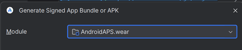
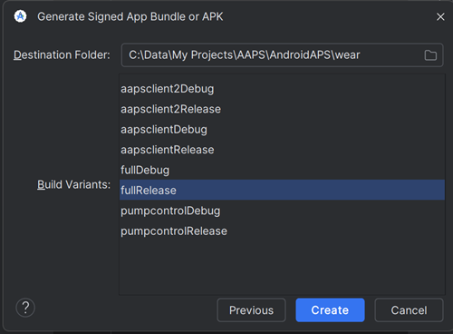

# Izrada aplikacije AAPS za Wear OS

**AAPS** aplikacija za pametni sat s Wear OS-om (**Wear apk**, `aaps-wear-….apk`) je posebna instalacijska datoteka, odvojena od **AAPS** aplikacije za telefon. Trebate obje: aplikacija na telefonu pokreće petlju, a aplikacija na satu prikazuje njezine podatke i može joj slati naredbe. Aplikacija za sat instalira se s telefona, pogledajte [Postavljanje AAPS-a na vaš Wear OS sat](WearOsSmartwatch.md).

Dvije aplikacije rade zajedno samo ako se podudaraju:

- **Ista verzija AAPS-a** na telefonu i na satu.
- **Isto spremište ključeva** korišteno za potpisivanje obje aplikacije.

Najjednostavniji način da to osigurate je izraditi obje aplikacije **u isto vrijeme**, u istoj izradi. Izrada u pregledniku to radi za vas: svaka izrada daje apk za telefon i Wear apk zajedno. S Android Studiom ili iz naredbenog retka Wear apk izrađujete kao drugi korak, odmah nakon apk-a za telefon.

```{note}
Već koristite **AAPS** na telefonu, ali nemate Wear apk iz iste izrade? Ponovno izradite obje aplikacije s istim spremištem ključeva i ponovno instalirajte i aplikaciju za telefon. Wear apk izrađen mjesecima kasnije ili s drugom verzijom Android Studija vjerojatno neće biti kompatibilan s aplikacijom za telefon.
```

## Podržane verzije Wear OS-a

**AAPS** radi na satovima s **Wear OS-om 3.0, 3.2 ili 3.5** (Android 11, razina API-ja 30) **ili novijim** (Wear OS 4, 5 i 6). Satovi s Wear OS-om 2 nisu podržani.

```{warning}
AAPS Watchfaceovi dostupni su za pametne satove s Wear OS-om s razinom API-ja od 30 do 33 (Wear OS 3.0, 3.2, 3.5 i 4).<br>
Novije verzije Wear OS-a postupno onemogućuju AAPS Watchfaceove – pogledajte [Promjene Watchfaceova u Wear OS-u](#wearos-watchface-changes) i [Ograničenja Wear OS-a 5](#BuildingAapsWearOs-WearOS5).
```

(building-aaps-wear-os-method)=

## Nabavite Wear apk svojim načinom izrade

Slijedite odjeljak za način koji koristite za [izradu AAPS-a](../SettingUpAaps/BuildingAaps.md).

(building-aaps-wear-os-browser)=

### Izrada u pregledniku (preporučeno)

**Ne trebate ništa dodatno raditi.** Svaka izrada u pregledniku daje dvije datoteke iz istog izvornog koda i s istim spremištem ključeva:

- `aaps-….apk`: aplikacija za telefon.
- `aaps-wear-….apk`: aplikacija za sat.

Wear apk odgovara [varijanti](#browserbuild-variant) koju ste odabrali za izradu: `fullRelease` daje aplikaciju **AAPS Wear**, `aapsclientRelease` aplikaciju **AAPSClient Wear**, a `pumpcontrolRelease` aplikaciju **PumpControl Wear**. Svaka Wear aplikacija komunicira samo s odgovarajućom aplikacijom na telefonu.

Gdje pronaći Wear apk:

- **AAPS Builder**: on the build page, scroll down to **Artifacts** and download `aaps-wear-….apk` next to the phone app, as shown in [Step 5 – Install the app on your phone](#aaps-builder-step5). Preuzmite ga na telefon na kojem radi **AAPS** ako aplikaciju za sat instalirate s telefona (Wear Installer 2 ili Easy Fire Tools), ili na računalo ako koristite ADB.

  

- **Fork s Google Driveom**: otvorite svoj Google Drive, mapu `AAPS`, a zatim mapu verzije koju ste izradili. U njoj su apk za telefon i Wear apk, pogledajte [Korak 4 – Izradite APK](#github-build-apk).

  

Wear apk čuvajte zajedno s apk-om za telefon u svojim sigurnosnim kopijama. S **AAPS Builderom** datoteke ostaju na stranici izrade samo 14 dana.

Sljedeće: instalirajte Wear apk na sat, pogledajte [Postavljanje AAPS-a na vaš Wear OS sat](WearOsSmartwatch.md).

(building-aaps-wear-os-android-studio)=

### Android Studio

Wear apk izrađuje se kao i apk za telefon, kao druga potpisana izrada. Napravite to odmah nakon apk-a za telefon, s istom verzijom Android Studija i istim spremištem ključeva.

- Slijedite upute za [Izradu s Android Studiom](../SettingUpAaps/ComputerBuild.md).
- Kada dođete do [odabira modula](#Building-APK-wearapk) u koraku „Izradite potpisani AAPS apk“, obavezno odaberite **`AndroidAPS.wear`**.



Odaberite „**fullRelease**“ da biste izradili **AAPS** Wear apk datoteku.



Ako želite, umjesto toga možete u padajućem izborniku odabrati **„pumpcontrolRelease“**. Tada možete samo daljinski upravljati pumpom, ali bez petlje.

Sljedeće: instalirajte Wear apk na sat, pogledajte [Postavljanje AAPS-a na vaš Wear OS sat](WearOsSmartwatch.md).

(building-aaps-wear-os-troubleshooting)=

#### Rješavanje problema s izradom u Android Studiju

Tijekom izrade pune aplikacije **AAPS** (i zapravo svake potpisane aplikacije) Android Studio izradi .json datoteku u istoj mapi. To zatim uzrokuje greške zbog [nepotvrđenih promjena (uncommitted changes)](#troubleshooting_androidstudio-uncommitted-changes) kada pokušate izraditi sljedeću potpisanu aplikaciju, na primjer **AAPS** Wear aplikaciju. Najbrže rješenje je otići u mapu u kojoj je izrađena puna aplikacija AAPS. Vaša mapa je vjerojatno nešto poput:

`C:\Users\Your Name\AndroidStudioProjects\AndroidAPS\app\full\release.`

Izbrišite nepotrebnu .json datoteku ili je premjestite iz mape. Zatim ponovno pokušajte izraditi **AAPS** Wear aplikaciju. Ako to ne pomogne, detaljniji [vodič za rješavanje problema](../GettingHelp/TroubleshootingAndroidStudio.md) pomoći će vam pronaći datoteku koja uzrokuje problem. To može biti i vaša datoteka spremišta ključeva.

(building-aaps-wear-os-cli)=

### Naredbeni redak

Slijedite [Upute za izradu iz naredbenog retka](../SettingUpAaps/CLIBuild.md) i ponovite korake prevođenja i potpisivanja za modul `wear`, s istim spremištem ključeva:

```sh
./gradlew :wear:assembleFullRelease
```

Nepotpisani Wear apk sprema se u `wear/build/outputs/apk/full/release/`. Potpišite ga s `apksigner` točno kao apk za telefon, a zatim ga instalirajte na sat, pogledajte [Postavljanje AAPS-a na vaš Wear OS sat](WearOsSmartwatch.md).
