# Postavljanje AAPS-a na vaš Wear OS sat

Upute u nastavku odnose se na **AAPS Wear** apk koji trebate izraditi. Ako ga još niste izradili, pogledajte povezane upute [ovdje](../WearOS/BuildingAapsWearOS.md). Pri izradi obavezno koristite istu datoteku spremišta ključeva koju ste koristili za **AAPS** apk na telefonu.

Dio ovih informacija možete koristiti i za **AAPSClient** i **PumpControl** **Wear** apk. Each **Wear** app will communicate with its matching phone app. Na primjer: aplikacija **AAPSClient Wear** može se koristiti za prikaz podataka **AAPSClienta**, a ne podataka **AAPS-a**. Kada je instalirano nekoliko inačica klijenta (**AAPSClient**, **AAPSClient2**, **AAPSClient3**) jedna uz drugu, pločice svake od njih imaju malo zaglavlje u boji te inačice, pa ih možete razlikovati dok listate.

## Verzije Wear OS-a i kompatibilnost

(wearos-watchface-changes)=

### Promjene Watchfaceova u Wear OS-u (utjecaj na AAPS Watchfaceove)

```{admonition} Why newer Wear OS watches break AAPS watchfaces
:class: warning

U lipnju 2025. Google je [najavio promjene](https://android-developers.googleblog.com/2025/06/upcoming-changes-to-wear-os-watch-faces.html) kojima se postupno ukida stari pogon za Watchfaceove (AndroidX / Wearable Support Library, ili „WSL“) u korist novijeg deklarativnog formata **Watch Face Format**. Prilagođeni Watchfaceovi **AAPS-a** izrađeni su na starom pogonu, pa što je verzija Wear OS-a novija, to je vjerojatnije da AAPS Watchface neće raditi ispravno ili će prestati raditi.

To se odnosi posebno na **Watchfaceove** – **komplikacije**, pločice i funkcije daljinskog upravljanja AAPS-a nisu pogođene. To je i razlog zašto **ažuriranje firmwarea/sustava na Wear OS satu može pokvariti AAPS Watchfaceove**, a sat se nakon toga ne može vratiti na stariju verziju Wear OS-a. Ako vaš AAPS Watchface trenutačno radi, **isključite automatska ažuriranja sata**.
```

Tablica u nastavku sažima kako Googleova promjena utječe na AAPS Watchfaceove (stari pogon) po verziji Wear OS-a:

| Verzija Wear OS-a       | Osnovni Android | Razina API-ja | Utjecaj na AAPS (stare) Watchfaceove                                                                                                                                                                         |
| ----------------------- | --------------- | ------------- | ------------------------------------------------------------------------------------------------------------------------------------------------------------------------------------------------------------ |
| Wear OS 6               | Android 16      | 36            | **Stari Watchfaceovi više nisu dostupni** – AAPS umjesto njih instalira [Watchface u formatu Watch Face Format](#wearos-aaps-v4-watchface): vaš prilagođeni Watchface ili Watchface s komplikacijama AAPS V4 |
| Wear OS 5               | Android 14      | 34            | **Ozbiljan** – aktivni (interaktivni) način rada često ne radi, komplikacije se zamrzavaju, animacije se zaustavljaju                                                                                        |
| Wear OS 4               | Android 13      | 33            | **Umjeren** – usporavanje, propuštena ažuriranja, djelomični kvarovi                                                                                                                                         |
| Wear OS 3.0 / 3.2 / 3.5 | Android 11      | 30            | **Nizak** – stari pogon je još podržan                                                                                                                                                                       |

Ako vaš sat ima verziju na kojoj AAPS Watchfaceovi nisu pouzdani, podatke AAPS-a možete umjesto toga prikazati pomoću **komplikacija** na kompatibilnom Watchfaceu ili koristiti [GlucoDataHandler](https://play.google.com/store/apps/details?id=de.michelinside.glucodatahandler) s komplikacijom, koji dobiva podatke od dodatka [Vanjske prateće aplikacije](#external-companion-apps) u **AAPS-u**. Na **Wear OS 6 i novijem** AAPS instalira zamjenski Watchface izrađen u novom formatu – pogledajte niže.

(wearos-aaps-v4-watchface)=

### Wear OS 6 i noviji – Watchface koji instalira AAPS

Satovi s **Wear OS 6 ili novijim** ne mogu pokretati klasične AAPS Watchfaceove kao Watchfaceove. Za te satove aplikacija AAPS na satu donosi dva Watchfacea izrađena u Googleovom novom formatu **Watch Face Format**. Wear OS dopušta aplikaciji da instalira samo **jedan** Watchface, pa birate koji će od ta dva biti na satu:

- **Prilagođeni Watchface** (zadano): prikazuje prilagođeni Watchface koji ste učitali s telefona pomoću **Učitaj Watchface** (pogledajte [Odabir AAPS Watchfacea](#WearOS_changing-to-AAPS-watchface)). Sat crta vaš dizajn kao sliku, pa radi svaki postojeći prilagođeni Watchface. Mjesta za komplikacije koja prilagođeni Watchface može definirati **nisu dostupna** na toj slici, jer Wear OS šalje podatke komplikacija samo pravom Watchfaceu. Dugo pritisnite Watchface kako biste došli do njegove jedine postavke: prikazuje li uvijek uključen zaslon običan sat ili vaš dizajn, zatamnjen.
- **Watchface s komplikacijama** (Watchface **AAPS V4**): njegovih **sedam mjesta za komplikacije** dolazi **unaprijed postavljeno s podacima AAPS-a**: vrijednost GUK-a, aktivni inzulin (IOB), aktivni ugljikohidrati (COB), [komplikacija GUK graf](#Watchfaces-complications), bazalna stopa / privremeni cilj i ikona **Način rada** u gornjem lijevom mjestu (dodirnite je kako biste sa sata promijenili način rada petlje). Dodirnite vrijeme na vrhu kako biste otvorili aplikaciju za alarme na satu. U uređivaču Watchfacea možete promijeniti što prikazuje svako mjesto.

Birate na telefonu: otvorite dodatak **Wear** i pod **Watchface instaliran na satu** odaberite jedan od ta dva. Ova kartica prikazuje se samo dok je spojen sat s Wear OS 6 ili novijim. **AAPS** traži da potvrdite, jer sat odmah mijenja Watchface. Prelazak s **Watchface s komplikacijama** na drugi Watchface također vraća komplikacije koje ste promijenili u uređivaču Watchfacea na zadane, i potvrda to navodi. Dok je odabran **Watchface s komplikacijama**, gumbi za prilagođeni Watchface su skriveni, a umjesto njih prikazuje se pregled Watchfacea. Ako učitate prilagođeni Watchface dok je odabran **Watchface s komplikacijama**, **AAPS** vas podsjeća da prijeđete na **Prilagođeni Watchface** kako biste ga vidjeli na satu.

- Odabrani Watchface **instalira se i aktivira automatski** kada se aplikacija AAPS prvi put pokrene na takvom satu, a **ažurira se automatski** zajedno s aplikacijom na satu.
- Ako ste uklonili Watchface, na dnu **glavnog izbornika** AAPS-a na satu pojavljuje se stavka **Instaliraj watchface** – dodirnite je za ponovnu instalaciju.

Dok je spojen sat s Wear OS 5 ili starijim, kartica **Watchface instaliran na satu** uopće se ne prikazuje (mehanizam na kojem se temelji zahtijeva Wear OS 6); klasični Watchfaceovi tamo rade kao i prije.

(wearos-complications-watchface-setup)=

### Watchface s komplikacijama – preporučene postavke

**Watchface s komplikacijama** ima sedam mjesta za komplikacije. Dugo pritisnite Watchface, dodirnite **Prilagodi** i odaberite izvor podataka za svako mjesto. Mjesta su numerirana kao u uređivaču Watchfacea: **1** lijevo, **2** sredina, **3** desno, **4** graf, **5** dolje, **6** gore lijevo i **7** gore desno.

| Zadane postavke                                                                                      | Druge postavke                                                                                          |
| ---------------------------------------------------------------------------------------------------- | ------------------------------------------------------------------------------------------------------- |
|  | 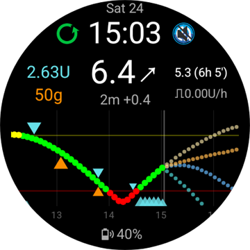 |

| Mjesto | Položaj     | Zadano                                                                          | Drugo                                           |
| ------ | ----------- | ------------------------------------------------------------------------------- | ----------------------------------------------- |
| 1      | Lijevo      | Ikona IOB                                                                       | COB & IOB                                       |
| 2      | Sredina     | Glukoza u krvi                                                                  | Glukoza u krvi                                  |
| 3      | Desno       | Ikona COB                                                                       | BR & cilj                                       |
| 4      | Graf        | GUK graf                                                                        | GUK graf                                        |
| 5      | Dolje       | BR & cilj                                                                       | Baterija uploadera/telefona                     |
| 6      | Gore lijevo | Način rada                                                                      | Način rada                                      |
| 7      | Gore desno  | Baterija uploadera/telefona ili prečac aplikacije za **AAPS odgoda upozorenja** | Prečac aplikacije za **AAPS odgoda upozorenja** |

Prečac **AAPS odgoda upozorenja** odabire se među komplikacijama sata **Prečac aplikacije** (App shortcut). Dodirom na njega odgađa se alarm koji zvoni na telefonu.

```{tip}
Uključite **Uvijek uključen zaslon** (Always-on display) na satu (**Postavke** > **Zaslon**). Watchface tada i dalje prikazuje vašu glukozu kada je ruka spuštena, umjesto praznog zaslona ili običnog sata.
```

```{admonition} No complication data while the watch is locked
:class: note
Ako je postavljena **Vrsta zaključavanja** pod **Postavke** > **Sigurnost i privatnost**, sat skriva podatke komplikacija dok je zaključan, a Watchface prikazuje prazna mjesta dok ga ne otključate. Kako bi podaci ostali vidljivi, isključite **Sakrij informacije** (Hide information) u istom izborniku.
```

### Wear OS 3

Instalirajte **AAPS Wear** apk pomoću [Wear Installera 2](https://youtu.be/abgN4jQqHb0?si=5L7WUeYMSd_8IdPV), Easy Fire Tools (opisano niže) ili ADB-a.  
Nema ograničenja u radu **AAPS Weara**.

(BuildingAapsWearOs-WearOS5)=

### Wear OS 4 i Wear OS 5

Primjer: Galaxy Watch 4, 5, 6, 7 i Ultra ili Pixel Watch koji još **nisu** ažurirani na Wear OS 6. Provjerite verziju pod **Postavke** > **O satu** > **Softver**.

Instalirajte **AAPS Wear** apk pomoću [Wear Installera 2](https://youtu.be/abgN4jQqHb0?si=5L7WUeYMSd_8IdPV) (za Wear OS 5 slijedite [ovaj videozapis](https://www.youtube.com/watch?v=yef_qGvcCnk)). Sve funkcije **AAPS Weara** rade, ali klasični Watchfaceovi **AAPS-a** ograničeni su kako je opisano u tablici iznad: usporeni na Wear OS 4, a na Wear OS 5 često ne rade.

```{admonition} Wear OS 5
:class: warning
Na Wear OS 5 AAPS Watchface mora se odabrati u Wear Installeru 2 odmah nakon instalacije aplikacije Wear: na kraju instalacije program nudi Watchface **AAPS (Custom)**. Ako slučajno prijeđete na drugi Watchface, ponovite instalaciju. Changing the watchface settings (Dark, Matching divider, etc.) may not be possible.

Ako vam klasični Watchface trenutačno radi, **isključite automatska ažuriranja sata**: sljedeće ažuriranje firmwarea vjerojatno će ga pokvariti. Ako ipak ažurirate na Wear OS 6, pročitajte odjeljak iznad: **AAPS** tada instalira vlastiti Watchface u novom formatu.
```

Ako je Watchface previše nepouzdan, razmislite o korištenju aplikacije [GlucoDataHandler](https://play.google.com/store/apps/details?id=de.michelinside.glucodatahandler) s komplikacijom. Za to mora biti omogućen dodatak [Vanjske prateće aplikacije](#external-companion-apps) u **AAPS-u**.

### Wear OS 6 i noviji

Primjer: Galaxy Watch 4 i noviji s One UI 8 Watch, Pixel Watch nakon ažuriranja iz 2025. Većina satova Galaxy i Pixel dobila je ovo ažuriranje.

Instalirajte **AAPS Wear** apk pomoću [Wear Installera 2](https://youtu.be/abgN4jQqHb0?si=5L7WUeYMSd_8IdPV). Klasični Watchfaceovi nisu dostupni; **AAPS** automatski instalira Watchface odabran na telefonu, pogledajte [Watchface koji instalira AAPS](#wearos-aaps-v4-watchface). Nema ograničenja u radu **AAPS Weara**.

## How to set up a Samsung Galaxy Watch 4 smartwatch with **AAPS**

Ovaj odjeljak pretpostavlja da ste potpuni početnik s pametnim satovima. Daje osnovno snalaženje na jednom popularnom satu, **Galaxy Watch 4**, a zatim upute korak po korak za postavljanje **AAPS-a** na sat.

_Ove upute napisane su za Galaxy Watch s Wear OS 3._ Na Wear OS 4 i novijem sat traži **kod za uparivanje** kada se telefon ili računalo spaja preko ADB-a. Wear Installer 2 i postupak s terminalom [niže](#BuildingAapsWearOs-WearOS5-TShoot) oba to podržavaju.

Ovdje su osnovne upute za postavljanje za [Galaxy Watch 5](https://www.youtube.com/watch?v=Y5upzOIxwTU) i [Galaxy Watch 6](https://www.youtube.com/watch?v=D6bq20KzPW0)

## Osnovno upoznavanje s pametnim satom

After basic setup of your watch according to the video above, go to the playstore on the phone and download the following apps: "Galaxy Wearable", “Samsung” and either “Easy Fire tools” or "Wear Installer 2".

Postoji mnogo YouTube videozapisa drugih autora koji vam mogu pomoći da upoznate svoj novi pametni sat, na primjer:

[https://www.youtube.com/watch?v=tSVkqWNmO2c](https://www.youtube.com/watch?v=tSVkqWNmO2c)

Aplikacija „Galaxy Wearable“ ima i odjeljak s uputama za korištenje. Otvorite Galaxy Wearable na telefonu, potražite sat i pokušajte upariti sat s telefonom. Depending on your version, this may prompt you to install one more app, “galaxy watch 4 plugin”, from the playstore (takes a while to download). Instalirajte to na telefon, a zatim ponovno pokušajte upariti sat i telefon u aplikaciji Wearable. Prođite kroz niz izbornika i označite razne postavke.

## Postavljanje Samsung računa

Provjerite da e-mail račun kojim postavljate Samsung račun ima datum rođenja prema kojem korisnik ima 13 ili više godina, jer je inače Samsungove dozvole vrlo teško odobriti. Ako ste djetetu mlađem od 13 godina dali Gmail račun i koristite tu e-mail adresu, ne možete ga jednostavno promijeniti u račun za odrasle. One way around this is to modify the current date-of-birth to make the current age 12 years and 364 days old. Sljedeći dan račun će biti pretvoren u račun za odrasle i možete nastaviti s postavljanjem Samsung računa.

(remote-control-transferring-the-aaps-wear-app-onto-your-aaps-phone)=

## Prijenos aplikacije **AAPS** Wear na vaš **AAPS** telefon

Wear.apk iz Android Studija možete prenijeti na telefon na jedan od ovih načina:

a)  pomoću USB kabela prenesite **AAPS** Wear apk datoteku na telefon, a zatim je „ručno instalirajte“ (side-load) na sat. Prenesite Wear.apk na telefon putem USB-a u mapu za preuzimanja; ili

b)  izrežite i zalijepite Wear.apk iz Android Studija na svoj Google Drive.


Za ručnu instalaciju AAPS-a na sat možete koristiti: 1) Wear Installer 2 2) Easy Fire tools 3) Android Debug Bridge (ADB) Ovdje preporučujemo Wear Installer 2, jer su upute i postupak u videozapisu vrlo jasni i dobro objašnjeni. Ako vam Wear Installer 2 ne radi, pokušajte s Easy Fire Tools ili ADB-om, oba su opisana niže.

### Korištenje Wear Installera 2 za ručnu instalaciju **AAPS** Weara s telefona na sat

 

Wear Installer 2, koji je razvio [Malcolm Bryant](https://www.youtube.com/@Freepoc), možete preuzeti s Google Playa na telefon i pomoću njega ručno instalirati aplikaciju AAPS Wear na sat. Aplikacija sadrži koristan [videozapis](https://youtu.be/abgN4jQqHb0?si=5L7WUeYMSd_8IdPV) „kako ručno instalirati“.

```{tip}
Za satove s Wear OS 5 slijedite [ovaj videozapis](https://www.youtube.com/watch?v=yef_qGvcCnk).
Pogledajte savjete za rješavanje problema [niže](#BuildingAapsWearOs-WearOS5-TShoot).
```

Ovdje su svi potrebni detalji (najbolje je otvoriti videozapis na drugom uređaju kako biste ga mogli gledati dok postavljate telefon).

Kao što je rečeno u videozapisu, kada završite, isključite ADB otklanjanje pogrešaka na satu kako se baterija pametnog sata ne bi praznila.

Ili, ali ne za Wear OS 5, možete:

### Korištenje Easy Fire tools za ručnu instalaciju **AAPS** Weara na sat

1)   Preuzmite _[Easy Fire Tools](https://play.google.com/store/apps/details?id=de.agondev.easyfiretools&hl=en)_ iz Trgovine Play na telefon


2)  Uključite način za razvojne programere na satu (nakon što je sat postavljen i spojen s telefonom):

Idite na **Postavke** > **Sustav** > **O satu** > **Verzije** (nazivi izbornika razlikuju se ovisno o proizvođaču sata – na nekim satovima to je **O satu** > **Informacije o softveru** > **Verzija softvera**).

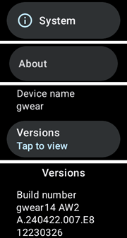

Brzo dodirnite nekoliko puta **Broj međuverzije** (ili **Verzija softvera**) dok vam poruka ne kaže da ste sada razvojni programer.

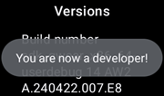

Vratite se na **Postavke** > **Sustav**: sada se prikazuje novi izbornik **Opcije za razvojne programere**.

U **Opcijama za razvojne programere** uključite **ADB otklanjanje pogrešaka** i **Bežično otklanjanje pogrešaka** te potvrdite upite. Bežično otklanjanje pogrešaka zatim prikazuje **IP adresu i port** sata, nešto poput: **192.168.1.214** : 5555. Trebate samo IP adresu (ovdje **192.168.1.214**), ne i broj porta nakon dvotočke. Imajte na umu da se IP adresa može promijeniti, na primjer svaki put kada za AAPS prijeđete na novi telefon.

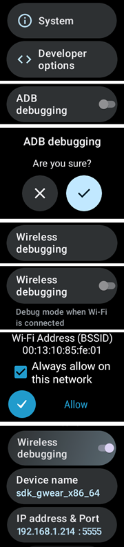

KORAK 3)     Unesite IP adresu, _npr._ **192.168.1.214**, u Easy Fire tools na telefonu (otvorite izbornik s tri crtice lijevo, postavke i unesite IP adresu).

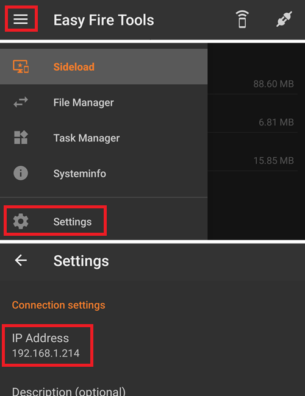

Zatim kliknite ikonu utičnice gore desno. Kada se poveže, postat će zeleno.

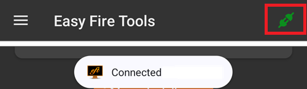


KORAK 4) Slijedite upute [ovdje](https://wearablestouse.com/blog/2022/01/04/install-apps-apk-samsung-galaxy-watch-4/?utm_content=cmp-true) kako biste ručno instalirali (tj. prenijeli) aaps-wear.apk na pametni sat pomoću Easy Fire tools


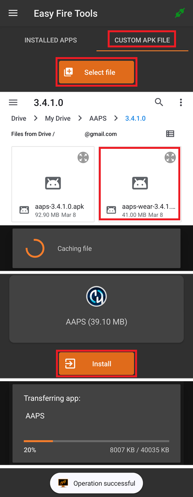


(BuildingAapsWearOs-WearOS5-TShoot)=

### Korištenje terminala
Spojite pametni sat i računalo na istu Wi-Fi mrežu.

- Za instalaciju ADB-a preuzmite ga s: https://developer.android.com/tools/releases/platform-tools
- Otvorite terminal.
- Na Windowsima napravite novu mapu pod nazivom `adb` na disku `C:`. Otvorite datoteku `platform-tools-latest-windows.zip` koju ste gore preuzeli. Kopirajte sve datoteke iz `platform-tools` u `C:\adb` i otvorite tu mapu u naredbenom retku (desni klik i „Otvori u terminalu“). Upišite naredbu u nastavku kako biste postavili putanju do mape u kojoj je ADB: `setx PATH "%PATH%;C:\adb"`
- Na Macu umjesto ručne instalacije možete koristiti homebrew: `brew install android-platform-tools`

Na satu:
- Idite na Postavke → O satu → **Informacije o softveru**
- Dodirnite Verzija softvera 7 puta dok ne vidite poruku da je način za razvojne programere uključen.
- Idite na Postavke → Opcije za razvojne programere. Uključite **ADB otklanjanje pogrešaka**
- Idite na Postavke → Opcije za razvojne programere → Bežično otklanjanje pogrešaka → **Upari novi uređaj** (Pair new device)

Pojavit će se kod za uparivanje putem Wi-Fi-ja te IP adresa i port:


- U terminalu: `adb pair ipaddress:port` Npr. `adb pair 10.10.1.125:36299`
- Bit ćete upitani za kod za uparivanje. Unesite ga.
- Vidjet ćete odgovor:<br> `Successfully paired to 10.10.1.125:36299 [guid=adb-RXXXW20LMKJY-eh5zBj]`<br>
- U terminal upišite: <br>`adb devices`.<br> Trebali biste vidjeti nešto poput:<br> `List of devices attached`<br> `10.10.1.125:36299  offline`<br> `adb-RFAW20LMKJY-eh5zBj._adb-tls-connect._tcp   device`<br>

- Now go to the folder on your computer where the Wear apk is and type<br> `adb install wear-full.apk` <br>with wear-full.apk replaced by the name of your apk file.
- Vidjet ćete:<br> `Performing Streamed Install`<br> `Success`


(wear-os-5-troubleshooting)=

### Opće preporuke za rješavanje problema za Wear OS 5

- Nemojte koristiti dijeljenje veze putem Wi-Fi-ja (Wi-Fi Tethering). To neće raditi.
- Ne morate uključiti ADB otklanjanje pogrešaka na telefonu (samo na satu). Isključite ADB otklanjanje pogrešaka na telefonu.
- Provjerite da se spajate na svoju lokalnu mrežu u kojoj se telefon i sat mogu vidjeti (nemojte se spajati na Wi-Fi mrežu za goste).
- Provjerite jesu li sat i telefon na istoj mreži i na istom Wi-Fi uređaju. Posebno Wi-Fi pojačivači (repeateri) ili pristupne točke mogu stvarati probleme.
- Budite blizu glavnog usmjerivača (routera), a zatim ponovno pokrenite i telefon i sat.

**Uparivanje:**

- Sat: Bežično otklanjanje pogrešaka: zapišite IP adresu.
- Wear Installer: Enter the IP in the Wear Installer app.
- Odaberite uparivanje novog uređaja (Pair new) i zapišite prikazani kod za uparivanje i broj porta.
- Wear Installer: unesite kod za uparivanje + razmak + broj porta.
- Wear Installer bi trebao javiti da je uparivanje uspjelo. Ako ne javi, zatvorite Wear Installer i pokušajte ponovno.

Nakon uparivanja trebali biste moći instalirati AAPS Wear apk:

- Izađite / zatvorite, zatim ponovno pokrenite Wear Installer.
- U bežičnom otklanjanju pogrešaka zapišite IP adresu i broj porta te ih provjerite / unesite u Wear Installer.
- Napomena: broj porta razlikuje se od onoga koji je korišten za uparivanje!

## Postavljanje veze između sata i telefona iz **AAPS-a**

Zadnji korak je postaviti **AAPS** na telefonu da radi s **Wear.apk** na satu. Za to omogućite dodatak Wear:

* Otvorite aplikaciju **AAPS** na telefonu

* Otvorite **izbornik** (☰) u gornjem lijevom kutu i idite na **Konfiguracija** > **Komunikacija**

* Označite okvir **Wear**


Za bolus ili druge radnje sa sata uključite i **Upravljanje sa sata** u [Postavke > Wear](#preferences-wear).

To change to a different **AAPS**  watchface, long-press the watchface on the home screen of the watch and tap **Customize**. Zatim povlačite udesno dok ne dođete do svih Watchfaceova **AAPS**.

Ako je **AAPS** Wear.apk uspješno ručno instaliran na pametni sat, to će izgledati ovako:


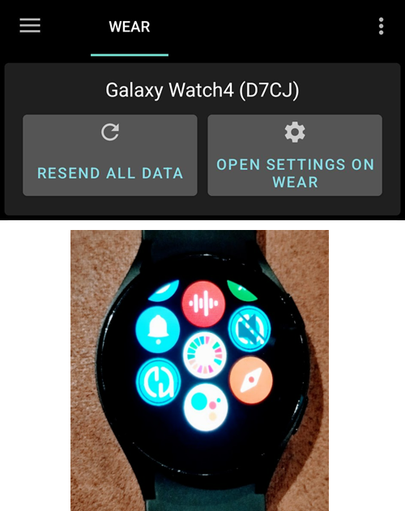


Kod nekih pametnih satova, poput Samsung Galaxyja, opcija „Daljinska veza“ (Remote Connection) pod Naprednim značajkama Samsung Galaxyja mora biti **uključena** kako biste **Wear.apk** i **AAPS** koristili na daljinu putem Wi-Fi-ja.


(wear-os-watch-phone-communication)=

### Rješavanje problema u komunikaciji između **AAPS** sata i **AAPS** telefona

1.  Ako se EasyFire tools ne poveže ili dobivate poruku „authorisation failed“ > provjerite je li IP adresa točno unesena.
2.  Provjerite je li pametni sat spojen na internet (a ne samo spojen s telefonom preko Bluetootha).
3.  Provjerite jesu li **AAPS** telefon i pametni sat upareni ili povezani u aplikaciji Samsung.
4.  Može pomoći i potpuno ponovno pokretanje telefona i pametnog sata (tj. isključivanje i uključivanje telefona)
5.  Ako ste uspjeli preuzeti Wear.apk na telefon, ali ne primate nikakve podatke GUK-a, _provjerite_ jeste li na sat ručno instalirali ispravan **AAPS** Wear apk: aplikacija za sat iz izrade u pregledniku je datoteka `aaps-wear-….apk`, pogledajte [Izrada aplikacije AAPS za Wear OS](../WearOS/BuildingAapsWearOS.md). Ako je datoteka koju ste instalirali jedna od sljedećih: a) **AAPSClient** Wear apk (dok na telefonu radi **AAPS**); b) datoteka `.aab`; ili c) datoteka s riječju ‘debug’ u nazivu, tada pri izradi niste odabrali ispravan Wear OS apk.
6.  Provjerite da vaš usmjerivač (router) ne odvaja uređaje jedan od drugoga.

Više savjeta za rješavanje problema možete pronaći [ovdje](https://freepoc.org/wear-installer-help-page/#:~:text=If%20you%20are%20having%20problems,your%20phone%20and%20your%20watch.)

(WearOS_changing-to-AAPS-watchface)=

## Odabir AAPS Watchfacea na vašem Wear OS satu

U standardnoj izradi AAPS Wear OS APK-a dostupno je nekoliko Watchfaceova. Bit će dostupni kada instalirate AAPS Wear APK na sat. Ovo su koraci za odabir jednog od njih:

1. Na satu (pretpostavljamo Wear OS) dugo pritisnite trenutačni Watchface kako biste otvorili zaslon za odabir Watchfacea, pomaknite se skroz udesno dok ne vidite gumb „Dodaj brojčanik“ (Add Watch Face) i odaberite ga

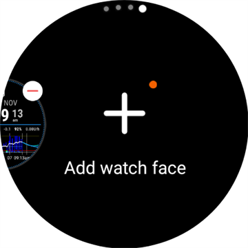

2. Pomičite se kroz popis dok ne pronađete „AAPS (Custom)“ (ovisno o satu, Watchfaceovi instaliranih aplikacija navedeni su u odjeljku „Preuzeto“ (Downloaded) ili grupirani po aplikaciji) i kliknite sredinu slike kako biste ga dodali na svoj kratki popis trenutačnih Watchfaceova. Ne brinite zbog trenutačnog izgleda Watchfacea „AAPS (Custom)“; željeni izgled odabrat ćemo u sljedećem koraku.

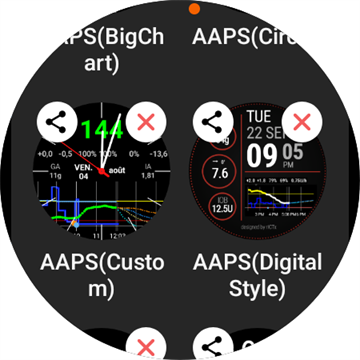

3. Sada otvorite AAPS na telefonu i otvorite dodatak Wear: **Konfiguracija** > **Komunikacija** > **Wear** > **Otvori dodatak** (najprije označite **Wear** ako nije omogućen).

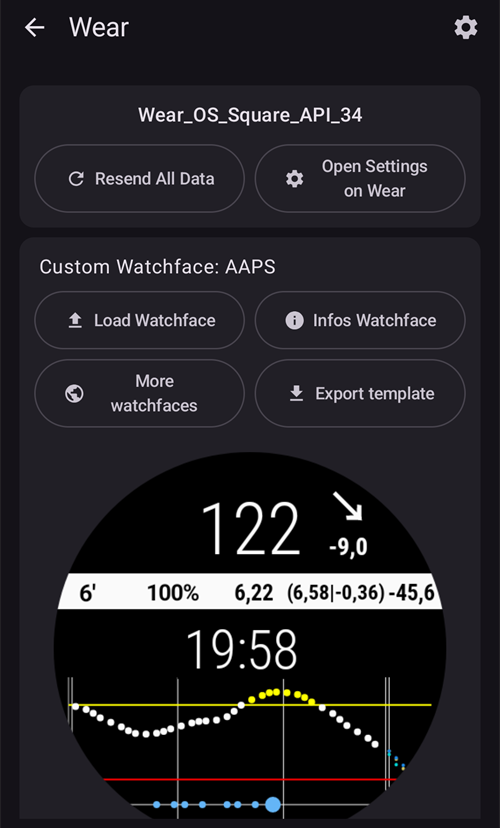

4. Kliknite gumb „Učitaj Watchface“ i odaberite Watchface koji vam se sviđa

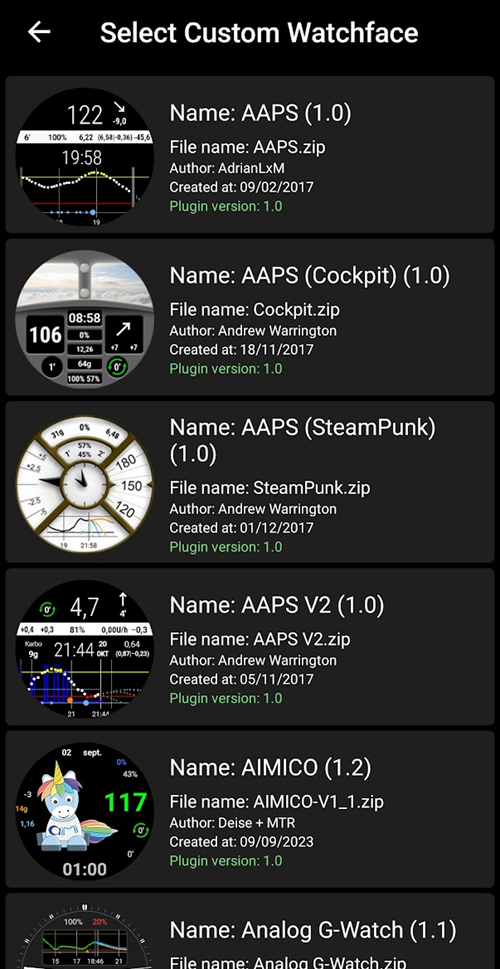

5. Pogledajte sat: Watchface „AAPS (Custom)“ sada bi trebao prikazivati izgled koji ste odabrali. Pričekajte nekoliko sekundi da se osvježi. Zaslon **Wear** na telefonu sada prikazuje naziv učitanog Watchfacea i njegov pregled. **Info Watchface** navodi njegove detalje i polja koja sadrži, a **Više Watchfaceova** otvara [stranicu za razmjenu](../ExchangeSiteCustomWatchfaces/index.md) na kojoj možete preuzeti druge prilagođene Watchfaceove. Sada možete prilagoditi komplikacije itd. tako da dugo pritisnete Watchface, a zatim pritisnete gumb „Prilagodi“ (Customize) na slici Watchfacea.

```{admonition} Complications on a custom watchface
:class: note
Prilagođeni Watchfaceovi izrađeni s verzijom 3.0 ili novijom formata prilagođenih Watchfaceova mogu imati do pet mjesta za komplikacije, čiji položaj i veličinu određuje Watchface (**Raspored komplikacija**). Na satu dugo pritisnite Watchface, dodirnite **Prilagodi** i dodirnite od **Komplikacija 1** do **Komplikacija 5** kako biste odabrali izvor podataka koji se prikazuje na svakom mjestu. Isti redovi navedeni su u aplikaciji AAPS na satu pod **Postavke** > **AAPS(Custom)**; dodir na jedan od njih ondje otvara isti izbornik za odabir. **Prioritet vrste komplikacije** određuje daje li mjesto prednost vrijednosti ili mjeraču, tekstu ili ikoni kada izvor podataka nudi više vrsta. Promijenjeni prioritet primjenjuje se tek kada sljedeći put odaberete izvor podataka za to mjesto.

Ova mjesta rade samo na satovima s **Wear OS 5 ili starijim**, gdje prilagođeni Watchface radi kao pravi Watchface. Na **Wear OS 6 i novijem** prilagođeni Watchface prikazuje se kao slika bez mjesta za komplikacije, a koraci 1 i 2 iznad nisu potrebni: provjerite je li odabran **Prilagođeni Watchface** pod **Watchface instaliran na satu** u dodatku **Wear** na telefonu (pogledajte [Watchface koji instalira AAPS](#wearos-aaps-v4-watchface)).
```

## Watchface AAPSv2 – legenda

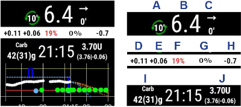

A – vrijeme od zadnjeg pokretanja petlje

B – očitanje CGM-a

C – minute od zadnjeg očitanja CGM-a

D – promjena u odnosu na zadnje očitanje CGM-a (u mmol ili mg/dL)

E – prosječna promjena očitanja CGM-a u zadnjih 15 minuta

F – baterija telefona

G – bazalna stopa (prikazana u J/h kod standardne stope i u % kod privremenog bazala (TBR))

H - BGI (blood glucose impact) -> the degree to which BG “should” be rising or falling based on insulin activity alone.

I – ugljikohidrati (aktivni ugljikohidrati | e-ugljikohidrati u budućnosti)

J – aktivni inzulin (iz bolusa | iz bazala)
