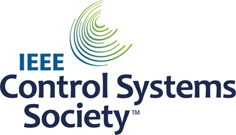
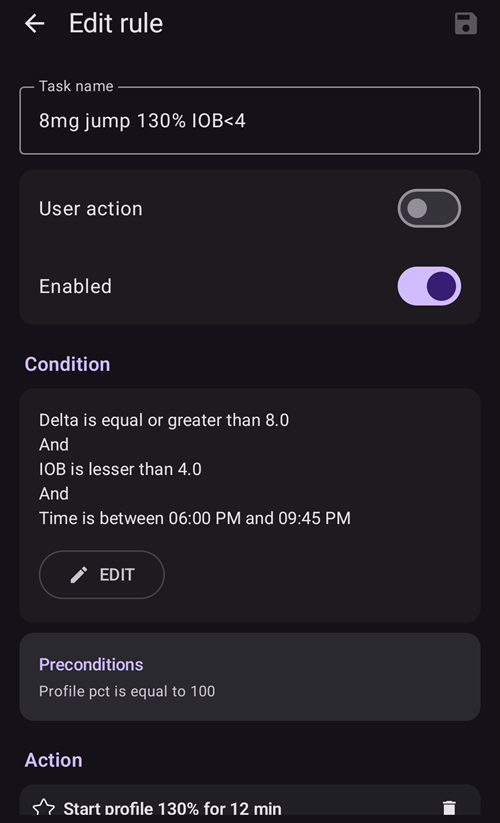
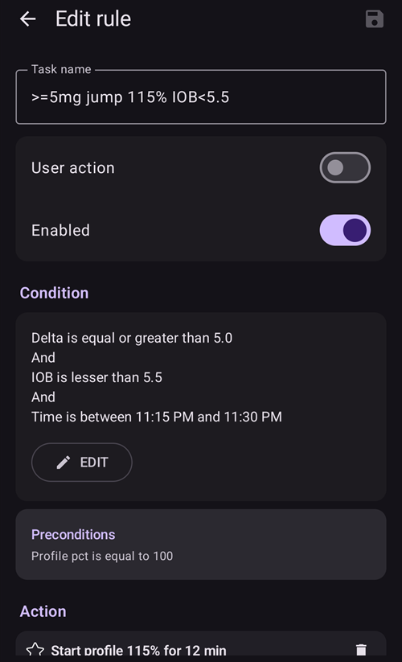
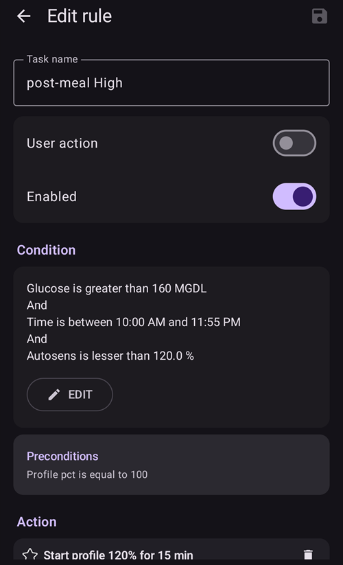
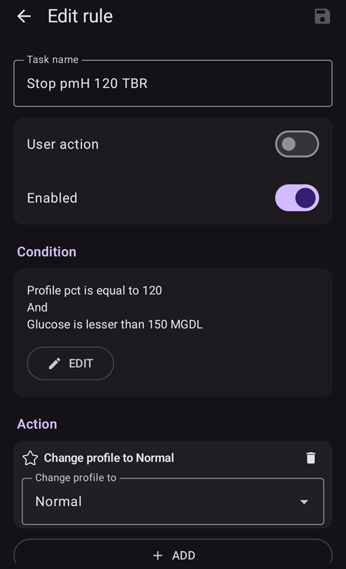

# Full Closed Loop

```{contents} In this page
:backlinks: entry
:depth: 2
```

The main attraction of Full Closed Looping **FCL** is that it has the potential to mimic an artificial pancreas and make daily management easier without having the need to bolus for meals.

Whilst **hybrid closed loop** ('HCL') is algorithm based, it still requires the user to manually deliver boluses prior to meals. As a result, the loop may go into a temporary shut-off (temporary zero basal) to prevent over delivery of insulin.

In **FCL** mealsize-related bolus are no longer required: leave it to the algorithm!  **AAPS** can handle meals without the user giving any bolus, and without making carb inputs, in a mode called ‘un-announced meals’ **(‘UAM’)**. **UAM** allows **AAPS** to better tolerate incorrect carb inputs by being more aggressive.

## Cosa aspettarsi?

There are many published studies on the favourable results **FCL** can achieve. For further reading refer to the following:

1)   National Library of Medicine, PubMed [First Use of Open-Source Automated Insulin Delivery AndroidAPS in Full Closed-Loop Scenario: Pancreas4ALL Randomized Pilot Study](https://pubmed.ncbi.nlm.nih.gov/36826996/);

2)  ClinicalTrials.gov National Library of Medicine, Clinical Trial [Feasibility and Safety Study of the Automated Insulin Delivery Closed Loop System Pancreas4ALL (ASAP)](https://www.clinicaltrials.gov/study/NCT04835350?term=Feasibility%20and%20Safety%20Study%20of%20the%20Automated%20Insulin%20Delivery%20Closed%20Loop%20System%20Pancreas4ALL%20(ASAP)&rank=1)

Per avere successo con il **FCL** l'utente deve:

- check whether they met the **FCL** requisites;
- creare **Automazioni** adatte alle esigenze della propria gestione quotidiana; e
- fine tune and adjust the **AAPS** settings (notably **Automations**).


## Considerazioni generali sul perché passare (o non passare) da HCL a FCL

Il **FCL** non è per tutti:

- Some **FCL** users achieve TIR (70-180) around 90% and HbA1c under 6%, however other users prefer tighter control. Notably, minimizing values over 140 mg/dL at diets with rapid carbs probably requires pre-bolusing.
- **AAPS** tuning can be challenging. It is not for those users who feel overwhelmed by AAPS.  You will need to dedicate a few weeks in order to adjust and fine tune your **FCL**. Investing such time can yield better results and **BG** control.
- Meal management may become easier, however exercise can still be challenging in **FCL**. Most of us like to limit sports snacks in an attempt to control body weight.
- Difficulties still remain to establish a **FCL** for kids (discussed below).


## Well-tuned hybrid closed loop

It is advisable to first establish a well-tuned **HCL** before considering the transition to **FCL**.  Success with **FCL** requires a highly personalised individualised tuning of the user’s setting so that **AAPS** can give insulin to closely mimic YOUR successful hybrid closed loop mode.

**FCL** requires the user to set up and tune their **Automations**. However the user must have a confident understanding of their insulin management needs before embarking on **FCL**. Errors can be masked with counter-errors. This can create an unstable **FCL** system, and make it hard to later correct. You should expect to reach a comparable %TIR with your FCL as you see today in your **HCL**.

**FCL is a DIY set up of Automations determined by the user by analyzing their data from both their successful HCL and  initial FCL experience when tuning your settings.**

## Insulina rapida (Lyumjev, Fiasp)

Il **FCL** richiede un'insulina rapida.  This is so that at the start of meal-related **BG** rise, **FCL** is able to keep **BG** in range (by common definition, under 180 mg/dL (10 mmol/L)).

A modelling study (details see LINK FullLoop V2/March2023; there section 2.2) can show in quantitative terms that *faster insulins*

Fonte:

 


IEEE Control Systems Magazine, ResearchGate [The Artificial Pancreas and Meal Control: An Overview of Postprandial Glucose Regulation in Type 1 Diabetes](https://www.researchgate.net/publication/322866519_The_Artificial_Pancreas_and_Meal_Control_An_Overview_of_Postprandial_Glucose_Regulation_in_Type_1_Diabetes);

- will result in significantly lower **BG** peaks than slower insulins;
- tolerate a couple of minutes delayed first meal bolus while not incurring unacceptable height of peaks; and
- minimize the effect on **BG** peak from different carb loads (meal sizes).

**FCL** is unlikely to be effective with insulin other than Lyumjev or Fiasp, unless the user is on a very moderate to low carb diet.

However, Fiasp or Lyumjev can result in frequent pump occlusions, even after optimizing things like needle length. It is important to have an eye on the cannula or pod time. Many users find 48 hours to be the efficacy insulin limit before resulting in cannula/pod failure.

## Prerequisites

**BG** values and stable Bluetooth connectivity are required to ensure **AAPS** can optimally perform without losing valuable time. Il **FCL** richiede un sistema tecnicamente stabile 24 ore su 24, 7 giorni su 7:

- le **prestazioni del tuo CGM**. Your CGM should not produce jumpy **BG** values that could be misinterpreted by **FCL** as a sign of a starting meal. Similarly, **CGM** calibrations can produce jumpy results.
- how and where any **CGM** smoothing is done, and what this might imply for your tuning. Notably how delta is defined, and AAPS recognizing this as being sign of a starting meal.
- Bluetooth stability for the pump and CGM;
- avoiding (or at least early recognition of) pump occlusion;
- data flow and your phone's apps used and difference between days of sensor usage;
- keeping all **AAPS** components well charged and in spare parts close proximity; and
- actioning cannula (or pod) changes always early enough to lower the risk of occlusion;

The above will vary depending on your **AAPS** component system and your lifestyle.

## Limiti legati ai pasti

- Setting up a **FCL** may be easier for people whose diets do not consist of food components with a rapid high effect on **BG**, and meal patterns that do not wildly vary day-to-day. This does not necessarily mean low carb.

- Fat or protein rich diets, or slow digestion/gastroparesis, make things easier rather than harder for **FCL**  because late carbs nicely cover for inevitable “tails” of late action from bolus needed around peak time.

### Indice glicemico ed effetto sulla glicemia

La difficoltà per la modalità **UAM** cresce con l'aumentare dell'effetto sulla glicemia ('Effect on Blood Glucose', 'EBG')

- Start moderate/low, and tune your **Profile's** settings. Only then, "test" meals with high **EBG**.
- Consider a < 50% initial bolus if consuming very high **EBG**.

1) **Nessun EBG**: ad es. carne fresca, pesce, uova, pancetta, oli, formaggio. 2) **Low EBG**: e.g. fresh vegetables and berries, mushrooms, nuts, milk, yoghurt, cottage cheese. 3) **Moderate EBG**: e.g. whole grain bread/noodles, potatoes, wild rice, oats, dried fruits. 4) **EBG alto**: ad es. pane di frumento, baguette, pane tostato, waffle, biscotti, purè di patate, pasta, riso. 5) **Very High EBG**: e.g. sugar, sweet drinks, fruit juices, cornflakes, candy, sweets, potato chips, salty pretzel sticks.


The most difficult meals for **FCL** are those foods exclusively very high and high **EBG** components (see red in the picture): Not only does **BG** shoot up rapidly, but also there is little fat/protein/fibre component to balance the inevitable “tail” of insulin activity that would come with attempts to control the high glucose earlier on.

Erratic consumption of snacks and sweet drinks that are loaded with fast absorbing carbs is problematic for **FCL**.


## Preparing for activity/sports

When exercising or being active, with a pump or hybrid closed loop it is recommended that the user reduces **IOB** prior to exercise.

With **FCL**, the algorithm is tuned to detect **UAM** and automatically deliver insulin to counter **BG** rises.  A high **Temp Target** and lower **Profile Percentage** (effective already around meal start) should be set well in advance of any activity.

Unusual or erratic exercise activity levels present difficulties for **FCL**. Planning ahead is required for exercise (especially if you want to reduce the need for rescue carbs/snacks during sports low). Dopo una giornata attiva si consiglia di impostare per la notte una **Percentuale profilo** più bassa, dopo che la cena è stata digerita del tutto: imposta nelle **Automazioni** un target di **BG** elevato (>100 mg/dL), con **Abilita SMB con target temporanei "alti"** disattivato nelle **Impostazioni** di **AAPS**.

## Ostacoli per i bambini

**FCL** can present extra challenges for children and these include:

- Lyumjev or Fiasp may not be available or well tolerated.
- Hourly basal rate may be very low, providing a poor basis for big **SMBs**.
- Diet may be rich in sweet components. With the typical low blood volume of a small body, strong tendency towards very high **BG** spikes.
- Growth hormones and going through marked changes of insulin sensitivity makes it difficult to keep the **FCL** accurately tuned.


## Enabling boosted SMBs: safety

In **HCL** safety restrictions are implemented regarding bolus sizes that can be automatically given by the loop.

**FCL** loopers no longer need to give a sizable bolus around meal start. The impact of this means that restrictions in size limits for **SMBs** must be widened to make the loop capable of delivering large enough **SMBs**.

If you are operating with **AAPS** in the Master release, it is suggested **AAPS**' **Settings** are set up with the maximum allowed **SMB** size so that **FCL** can give (maxUAMSMBBasalMinutes=120, i.e. 2 hours worth of basal at that daytime).

If your basal rate is very low, the resulting **SMB** limits might be too low to allow sufficient control to tackle postprandial **BG** rises. One possible solution is to avoid diets that cause strong **BG** spikes. The [Auto ISF](#Open-APS-features-auto-isf) algorithm (only available in a dev build with engineering mode) has a **SMB max range extension** setting that expands the standard maximum of 2 hours worth of basal by a factor of >1, and lets you raise the default 50% **SMB delivery ratio**.

**Follow the instructions to enable AAPS to mimic your bolussing via a couple of SMBs**.

Check the **APS** plugin screen (**Configuration → APS → Open plugin**) periodically to see whether your **SMBs** are allowed to be sufficient enough to deliver the required insulin needed for the loop around meal starts.

If not, your tuning efforts will sometimes come to nothing!


```{admonition} Boosting **ISF** can become dangerous
:class: danger

Osserva e analizza con attenzione le dimensioni degli **SMB** subito dopo l'inizio del pasto. Tune in steps, and do not vary more than 1 or 2 parameters at a time.

Your **AAPS'** setting must be sufficiently set up to cope with your (!) variety of meals.
```

## Meal detection/your Automations for boosting

For successful **FCL**, **ISF** is the key tuning parameter. When utilising **AAPS** Master + **Automations**, a **> 100% profile change must automatically be triggered upon meal recognition** (via glucose deltas), and provide the sharpened **ISF**.

**AAPS** Master allows up to 130% temporary **Profile** in **HCL** mode. Boosting the **ISF** is done in 3 steps:

- Passo 1 - controlla l'**ISF** valido per l'ora di questo pasto nel **Profilo**, e guarda se ad esempio Autosens suggerisce una modifica che tiene conto dello stato attuale (ultime ore) della sensibilità all'insulina del corpo.
- Step 2 - apply a factor (1/Profile%, as set in **Automation**) to boost **ISF**.
- Step 3 - check that the suggested **ISF** falls within set safety limits.

### Modelli di Automazione per il FCL

Caselle da spuntare in alto. You have the option:

- In your **Automation** list, you can tick the check-mark (to the left of each field) OFF => This de-activates that **Automation**. For instance you can do this for all breakfast related **FCL** **Automations** to go to **HCL** for breakfast(s).

- For each **Automation** rule you can tick the box for User action => then the defined Actions will not automatically be executed when Conditions apply. Rather, the **AAPS** main screen will alert you whenever your **FCL** would automatically give a **SMB**. You have the opportunity then to say ‘yes’ or ‘no’. This is extremely useful in your tuning phase.

This feature can be useful for certain situations like “foot to floor” syndrome where there is a sudden rise in **BG** when getting up in the morning, but the user wants to prevent a fully automatic “breakfast started” response.

The section below provides guidance how to bundle **Automation’s** Conditions and how to tackle situations in which the **AAPS** should increase (or decrease) insulin delivery. As **ISF** cannot directly be tuned, raising **Profile Percentage** over 100% will do the same for our purposes.

### Automated big SMBs at bg rise

La chiave per un **FCL** di successo: **all'inizio delle salite della BG dovute ai pasti, il loop deve dare SMB automatici molto grandi il più presto possibile**, “per recuperare” lo **IOB** necessario (confronta con il bolo che dai di solito per un pasto simile in **HCL**!)

Per farlo, analizza i dati del tuo **HCL** per capire quali **delta** probabilmente non sono legati ai pasti e quali invece possono esserlo.

- As you can define the **Automation** within a pre-defined time-window, you need only to analyze there.
- If you do very different kinds of meals (e.g. a rather high carb breakfast, but low carb lunch) you can choose to do two different (sets of) **Automations** for each of the time slots.
- Escludi le notti se vedi salti occasionali dovuti a ipoglicemie da compressione
- Di solito basta usare il delta degli ultimi 5 minuti.
- But you can also make use one of the average deltas. By comparing the deltas in the conditions of your **Automations** you could even define actions of different aggressiveness depending on whether the **BG** rises in an accelerated way or not.

> ( delta – short avg delta )>n   is a term that could be used for acceleration detection , to trigger first **SMB** at earliest sign of rising **BG**. -                                                                             
> Caution: not possible to use with poor or highly smoothened **CGM** values!

A **CGM** with patchy data puts the user in a bad spot because, to be on the safe side,  you need to „sandbag“ your definition which delta is surely a sign of a started meal. Questo significa:

- **FCL** loses additional time, resulting in higher **BG** peaks and lower %**TIR**;
- you cannot use an earlier or smaller delta which could trigger, also without a meal, the **SMBs** that are supposed to make up for a user bolus in **FCL**.

Furthermore, first rises after a meal are characterized by **low iob** present. With that in mind, an Automation(#1) for a dinner might look like this:



Automazione #1

If Conditions apply, **AAPS** would give 1 or 2 **SMBs** in the next 12 minutes, using a boosted **ISF** according to the set elevated **Profile Percentage** (in the example, a 30% boost of insulinReq). As long as these Conditions apply, the **Automation**  rule extends by another 12 minutes. A low carb meal might have slower **BG** rise characteristics. It would benefit from another Automation (#2) that kicks in at lower delta, and gives a weaker insulin boost.



The same **Automation** probably will kick in also in higher carb meals, once the steep rise as defined in Automation#1 is over.

You need to “stage” these two (+ maybe a third) **Automations** to fit with what you see in your meal (variety) => Setting appropriate jump sizes, **iob** criteria, and amplifications will be an iterative tuning process.  Also, if you include appropriate time slots in the Conditions, you can easy do different Automations for your different daily meals times (breakfast, lunch, dinner).

Note that, still in the rise phase (!), the "overflow" of **iob** must be blocked so that the late effects of the **insulin** (the "**tail**" after 3-5 hours) will not exceed the braking capacity of the loop through zero-temping (“taking away” basal, to reduce hypo risk).

With large meals there is **sometimes a second increase**. By then, usually also the iob has dropped a bit, and the more aggressive Automations take effect again. (Check that your iob condition in Automation #2 is not set too low for this to happen).

Soon after a few initial **SMBs** are given comes a **balanced phase** where moderate delivery of insulin should cover the additional carbs absorbed. (Except in low carb meals, where the loop might see too weak of a **BG** rise, and go into zero-temping right away already now).

The **AAPS** main screen (where you see cob=0 in **UAM** full loop) might in this phase ask for more carbs required. In **UAM** mode that simply means, you could make a very rough plausibility check: Is that amount of carbs likely in your body, un-absorbed from your meal just about an hour ago (about which you gave your loop no info)?


### iob threshold

Often, **Automations** #1 and/or #2 make iob rise to heights that typically are enough for **your** meals. For personalised tuning, look in your **HCL** data at the max iob values that occur with well-managed meals (often: your meal bolus), and above which magnitude a hypo (or requirement for extra carbs) occurred at the end.

Sensible **iob thresholds** at which you should reduce aggressiveness of your loop, might not be the same for every meal. But especially in the first hour after the start of a meal, which is very crucial in the **UAM** mode. Sarà diverso per ogni utente. For some users just about 30g/hour get absorbed, and to define a meaningful **iob** independent of the exact meal can be possible.

For exceptional meals, or to lower it if sports follow, the **iob** threshold can rapidly be set differently in your **Automation**.

L'Automazione (#3), "iobTH reached => **SMBs** off”, serve a terminare (o mettere in pausa, finché non arriva un'altra salita dovuta ai carboidrati) il rinforzo aggressivo degli **SMB**.


Automazione #3

It tells the loop that above your set **iob threshold** it's better not to use any more **SMBs**

- The given example does that by setting TT=111 (which is kind of arbitrary; pick a number>100 that you easy recognize as your automated **SMB** shut-off)
- In **AAPS**' [Settings → OpenAPS SMB](#Preferences-openaps-smb-settings), generally do not allow **SMB** at elevated target.                                                                                                                   
  The insulin required will then have to be delivered with much more caution through the bottleneck of **TBRs**

**Caution: Automation #3 only works when there is no active TT.** So, in case you worked with EatingSoonTT, it must be ended by that time, which usually should be 30-40 minutes after meal start.

One way to do this is to set up an **Automation** Condition that ends an eventually running EatingSoonTT under the Condition **iob**>65% * iobTH.
> Ways to work with EatingSoonTT Some loopers set (by pressing the TT button, or automated via a lowered **Profile** **BG** target if eating time slots are fairly fixed) an EatingSoonTT roughly an hour or more before meal start, just to guarantee a low starting **BG** and slightly increased  **iob**. Ma se il **FCL** è sempre in cammino verso il target, questo può servire a poco, e puoi preferire definire un'**Automazione** che imposta un EatingSoonTT quando riconosce l'inizio del pasto (delta della glicemia, o accelerazione = delta > delta medio). A low **TT** is important in this stage because any **SMB** is calculated by your loop using (predicted glucose minus TT)/sens, so a small TT makes the resulting insulinReq bigger.

After the first boosted **SMB**s were given, your set iobTH and **Automation** #3 should strike a good balance of limiting the glucose peak, but also not leading to a hypo after the meal.

If your breakfast substantially deviates in carb content from your average dinner, you may benefit from defining **Automations** that apply in the respective times of day, and have different **iobTH** (possibly also different deltas, and different **Percentage Profile** set). Both, you with defining your meal spectrum and settings (notably, **iobTH**), and the loop managing the unfolding **BG** curve, must accept certain peak heights for reducing hypo danger towards the end of the **DIAs** from **SMBs**.

### Stagnation at high bg values

In case, after a “rich” meal, a long-lasting stagnation with **high BG** value is seen, **Automation** #4 (below), “post-meal High”, helps deal with fatty acid resistance: After multi-course meals, large greasy pizza, raclette evening, the glucose curve can form two humps or, very often, an elongated high plateau.



Automazione #4



Automazione #5

Automation #4, “post-meal High”, is also suitable in hybrid closed loop.

In addition, a termination-Automation #5, “Stop pmH”, is needed, so that the aggressiveness of the insulin administration is reduced, as soon as the glucose value is falling. (However, often the loop will limit more insulin anyways for hypo prevention because predicted glucose runs low already).

## Prevenzione dell'ipoglicemia

The core problem is that the **UAM** **FCL** (without carb inputs) can have **no idea how many g of carbs are still available** for absorption, and might use up that “tail” insulin, without you going into a hypo from it.

Using boosted **SMBs**, the **FCL** “caught up” with what we formerly did with a meal bolus. But, **at the “tail” end of insulin activity, hypo prevention can become a serious topic**.

In preparation for **FCL**, the user must take a closer look at the **time course of iob** for typical meals, and judge **when it becomes too much, and how you can catch that by tuning your Automations**. That is possible because we have several adjusting screws. It can be a challenge to get this right

In generale non ha senso continuare a ottimizzare le impostazioni per un solo tipo di pasto. Once you have a good-enough setting e.g. for one kind of lunch you frequently have, test how this works with other kinds, and how you would “compromise”.

In order to prevent hypo in post-meal hours 3 – 5, reduce the aggressiveness before too much iob comes together. Approcci specifici:

- Become milder and milder with the **ISF** already during the glucose rise, as in Automation examples #1 and #2 given.
- Define the iob threshold, from which **AAPS** is made significantly more cautious (Automation #3, above). Note this **iob** can be exceeded, by the last **SMB** before it went into effect; and then further by TBRs if the loop sees insulinReq. Carbs getting absorbed will provide a counter-movement towards lower iob.
- The iob threshold could be differentiated according to meals: By cloning the automations, you could easily differentiate for breakfast, lunch, and dinner time slots (or even for geo-locations, like company cafeteria, or at mother-in-law etc)
> You could differentiate within these time slots even further by setting different TTs for low carb vs. fast carb, etc., and thus be able to “code for” different meal classes that may occur at this time of day, and call them up with **Automations** specially tuned for them. This is probably not necessary, unless your diet habits do vary a lot.

Before a special meal challenge, you can raise your **iob** threshold, or make another change in any of your Automations within under 5 seconds, right on your AAPS phone (**Manage → Automation**).

The hypo danger some hours after the meal is essentially a question of whether your meal composition was such, that the **insulin tails from fighting the bulk of carbs** will be **consumed by “extended carbs”** (excessive/delayed carb absorption/protein/fat/fibre).

Over time you will learn patterns, tune your Automations – maybe even adjust your eating habits a bit, e.g. just enjoy the occasional late little(!) snack that may help maintain a good **balance of insulin activity and carb absorption** for the **entire** meal (digestion, absorption) time, and thus make life for your loop (and for yourself) easier.

### Ordine delle Automazioni programmate

Problems can arise with overlapping definitions in **Automations**. Example: The problem is that delta >8 is also delta >5, i.e. there may be two competing **Automations** What does the loop do then? It always decides according to the sequence in which your **Automations** appear in **Manage → Automation**.  Example: The delta > +8 rule must come first (and launch the strongest boost if all conditions apply); then comes the check for delta >5 (and a milder response). If done the other way round, the delta>8 rule would never come into effect because the delta>5 already applies, case closed.
> Consiglio per le Automazioni: cambiare l'ordine è molto facile. In **Gestisci → Automazione**, tieni premuta la maniglia **=** a destra di una regola e trascinala in un'altra posizione.

Also it is very easy and quick to adjust any conditions or actions at any time, within seconds, just on your AAPS smartphone; for instance if you head into a very special eating event. (But don’t forget to set it back to normal on/for the next day).

(full-closed-loop-troubleshooting)=

## Troubleshooting

### How to get back into Hybrid Closed Loop

You can untick the checkboxes of the **Automations** related to your **FCL**, and go back to bolusing for meals and make carb inputs again. If you had removed the **Insulin** or **Calculator** buttons from your main screen, add them back in the [QuickLaunch toolbar](#quicklaunch) configuration (they always remain available under **Treatments** in the bottom navigation). Be aware that now it is again up to you to bolus for meals.

It may be wise to do **FCL** only for meals (time slots) where **Automations** are fully defined and clicked on, and un-click only those for the other meal times when you like to do **HCL** (or have none defined yet, in your transition period).

For instance, it is perfectly possible, without any extra steps after **Automations** for dinner time slots are defined, to do **FCL** only for dinners, while breakfast and lunch are done in a **HCL** as you are used to.


### Are the pre-conditions for FCL still given?

- Il **Profilo** di base è ancora corretto?
- La qualità del **CGM** è peggiorata?
- Refer to pre-requisites (above).

### La glicemia sale troppo

- Meals are not recognized asap
    - Check regarding Bluetooth (in)stability
    - Controlla se puoi impostare delta più piccoli per attivare il primo **SMB**
    - Experiment with an aperitif, soup a couple of minutes before meal start
- Gli SMB sono troppo deboli
    - Controlla l'ordine delle **Automazioni** (ad es.: delta grande prima del delta piccolo)
    - Check (real-time) in the **APS** plugin screen whether hourly profile basal and set minutes (max 120) limit allowed SMB size
    - Check (real-time) in the **APS** plugin screen whether %profile must  be set bigger
- If all your settings are at the limit, you may have to live with the temporary high, or adjust your diet.
> If you are ready to test a dev build, [Auto ISF](#Open-APS-features-auto-isf) also allows further expanded SMB sizes. Some users also resort to using a small pre-bolus in their “FCL”. However, this interferes with how glucose curve and hence detection of rises and triggered **SMBs** behave, and is therefore not easy to implement with convincing overall benefit.
- An important observation by pilot users was, that how your glucose and iob curves approach meal start matters a lot regarding how you peak from carbs: Going down (e.g. towards a set EatingSoonTT), building some iob, and curving already towards strong positive acceleration seems very helpful to keep peaks low.

### La glicemia scende troppo

- I pasti vengono riconosciuti per errore
    - Controlla se puoi impostare delta più grandi per attivare il primo **SMB**
    - Click “User action” in the related Automation, so in the future you can ad hoc decide to block execution of the Automation if not meal-related
    - To prevent snacks from triggering **SMBs** as for a meal, set a TT>100 when snacking (as you would do in sports and for anti-hypo snacks, anyways)
- SMBs deliver overall too much insulin
    - Check (real-time) in the **APS** plugin screen whether **SMB max range extension** must be set smaller
    - Check (real-time) in the **APS** plugin screen whether **Percentage Profile** must  be set smaller
    - SMB delivery ratio probably can be set smaller. Note in this case, it works across the board for all **SMBs** (all time slots),
- Problems with insulin “tail” after meals
    - You may need to take a snack (seeing hypo prediction) or glucose tablets (if already in hypo zone). But note that the carbs required the loop might tell you at some point are very likely exaggerated as the loop has absolutely zero info on your carb intake (while you may be able to guess how much more, incl. from fats and proteins) is still waiting to be absorbed.
    - A valuable information would be whether the problem originates mostly in the bg rise phase already. Then setting a lower iobTH might be an easy remedy.
    - If the need for additional carbs happens frequently, note down how many grams were needed (not counting what you eventually took too much and required extra insulin again).  Then use your profile IC value to estimate how much insulin less the **SMB** should have delivered, and go with this info into your tuning (regarding the **Percentage Profile** in **Automations**, or maybe also your set iobTH). Questo può riguardare gli **SMB** dati quando la glicemia era alta, o anche gli **SMB** dati durante la salita della **BG**.
    - It could well be that you simply have to accept higher **BG** peaks for not going low. Oppure cambia dieta, con meno carboidrati e più proteine e grassi.


### Altre informazioni

Make sure you stay in touch with other **FCL** users.

Discussion Full Closed Loop using Automations:

- Inglese:   [Canale Discord](https://discord.gg/ChXj8BaKwA)

- German:  [German Looper Community](https://de.loopercommunity.org/t/ueber-die-kategorie-full-loop/10107)
