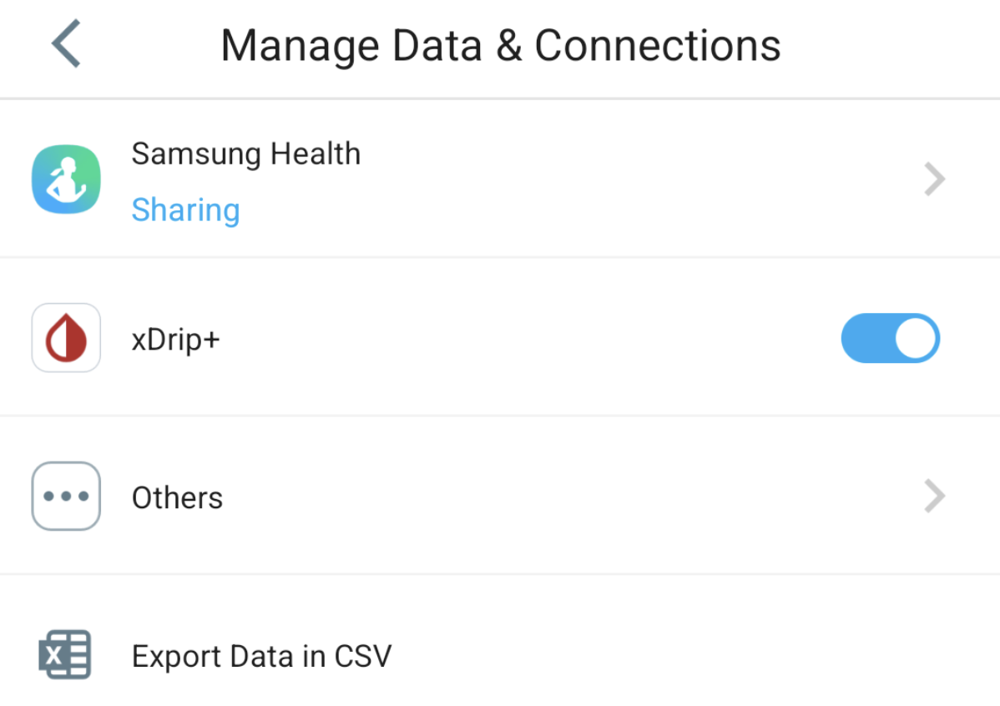

# CareSens

Ci sono diversi modi per usare i dati di CareSens con **AAPS**:

- xDrip
- Juggluco

**Note:** You do not need the Sens365 follower app to connect to AAPS.

## 1. xDrip

1. Installa e configura l'app ufficiale CareSens.
2. In CareSens app, go to settings -> Manage Data and Connections -> turn on xDrip switch. If preferred, turn off the data connections to CareLevo, DIA:CONN, CloudLoop, etc. in "others".

2. Installa xDrip: [xDrip](https://github.com/NightscoutFoundation/xDrip).
3. In xDrip, go to settings -> hardware data source, select `Companion App` as data source.
4. In **AAPS**, select xDrip in [**Configuration → BG Source**](#Config-Builder-bg-source).

## 2. Juggluco

1. Installa l'app Juggluco.
2. In Juggluco, open the left menu and select `Photo`
3. Scansiona il codice QR sulla confezione del sensore.
4. In left menu -> settings -> exchange data make sure xDrip broadcast is turned on.
5. In **AAPS**, select xDrip in [**Configuration → BG Source**](#Config-Builder-bg-source).
