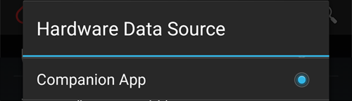

# Dexcom G7, ONE+ e Stelo


## Fundamental in advance

Noteworthy is the fact that the G7, ONE+ and Stelo systems, compared to the G6, do not smooth the values, neither in the app, nor in the reader. More details about this [here](https://www.dexcom.com/en-us/faqs/why-does-past-cgm-data-look-different-from-past-data-on-receiver-and-follow-app).

```{admonition} Smoothing method 
Read [Smoothing method](../CompatibleCgms/SmoothingBloodGlucoseData.md) suggestions to use for Dexcom G7/ONE+/Stelo
```

## 1. xDrip (direct connection to G7, ONE+ or Stelo)

- xDrip connects to the sensor itself: uninstall the Dexcom app, as only one app can connect to the sensor. To keep the Dexcom app, use [xDrip Companion App](#DexcomG7-xdrip-companion-app) instead.
- Segui le istruzioni qui: [xDrip G7, ONE+ e Stelo](https://navid200.github.io/xDrip/docs/Dexcom/G7.html). A recent xDrip release is required — see the linked page for the minimum version.
- Seleziona xDrip in [**Configurazione → Sorgente Glicemia**](#Config-Builder-bg-source).

- Adjust the xDrip settings according to the explanations on the xDrip settings page [xDrip settings](../CompatibleCgms/xDrip.md).

## 2. Build Your Own Dexcom App (solo G7)

```{admonition} Old app version
:class: warning
Dexcom BYODA is now a very old version of the app and cannot be updated. Non disponibile per ONE+ o Stelo.
```

-   [Build Your Own Dexcom App](https://docs.google.com/forms/d/e/1FAIpQLScD76G0Y-BlL4tZljaFkjlwuqhT83QlFM5v6ZEfO7gCU98iJQ/viewform?fbzx=2196386787609383750) (BYODA) supports local broadcast to AAPS

-   Questa app ti permette di usare il tuo Dexcom G7 con qualsiasi smartphone Android.
-   Disinstalla l'app Dexcom originale
-   Installa l'apk scaricato
-   Inserisci il codice del sensore nell'app modificata
-   Dopo poco tempo BYODA dovrebbe ricevere il segnale del sensore.

(DexcomG7-xdrip-companion-app)=

## 3. xDrip Companion App (G7, ONE+ e Stelo)

The official Dexcom app stays connected to the sensor. xDrip reads the glucose values from the notifications of the Dexcom app and sends them to **AAPS**.

```{admonition} Not a trusted data source
:class: note
**AAPS** does not consider xDrip in Companion App mode a [trusted BG data source](#GettingStarted-TrustedBGSource): SMBs are not allowed all the time.
```

### Leggere le notifiche dell'app Dexcom

- Tieni l'app Dexcom installata e collegata al sensore. Le sue notifiche devono restare visibili: non silenziarle e non nasconderle.
- Scarica e installa [xDrip](https://github.com/NightscoutFoundation/xDrip). Use the same glucose units in xDrip as in the Dexcom app.
- In xDrip vai su **Settings** > **Hardware Data Source** e seleziona **Companion App**.

  

- xDrip chiede l'autorizzazione a leggere le notifiche. Tap **OK**, then select **xDrip** in the list and turn on **Allow notification access**.

  

- If **Allow notification access** is greyed out (*Controlled by Restricted Setting*), Android blocks it because xDrip was not installed from the Play Store:

  

  Open the xDrip app info (long press the xDrip icon > **App info**), tap the three dots menu at the top right and select **Allow restricted settings**. Poi torna alla schermata dell'accesso alle notifiche e consentilo.

  

  

- Le letture compaiono in xDrip quando l'app Dexcom mostra un nuovo valore. Se non compare nulla, potresti dover avviare un sensore in xDrip: questo non ha effetto sul sensore reale. In questa modalità Stelo dà una lettura ogni 15 minuti.

### Companion Bluetooth (G7)

When the Dexcom app is connected to a G7 sensor, xDrip can also listen to the readings the sensor sends to the Dexcom app over Bluetooth. xDrip does not pair with the sensor and you do not need to enter the sensor code: the Dexcom app stays in control.

With **Companion Bluetooth**, xDrip gets the exact time and trend of each reading from the sensor, instead of the time the notification appeared, and fills gaps when the phone was out of range (backfill).

- In xDrip vai su **Settings** > **Less common settings** > **Bluetooth Settings** e attiva **Companion Bluetooth**.

  

- This does not work on all phones and Android versions. Disable it if you see problems.
- If an old Dexcom sensor is still in the phone's Bluetooth list, xDrip might listen to the wrong one: in Android **Settings** > **Connected devices**, forget sensors you no longer use.
- Companion Bluetooth is made for the G7. With ONE+ and Stelo, rely on notifications.

### Configurazione in AAPS

- Seleziona xDrip in [**Configurazione → Sorgente Glicemia**](#Config-Builder-bg-source).
- Adjust the xDrip settings according to the explanations on the xDrip settings page [xDrip settings](../CompatibleCgms/xDrip.md).

## 4. Juggluco (G7 e ONE+)

Version 9.0+ required

- Disable the app previously connected to the sensor: Uninstall the app or use "Force Stop." Disattiva l'autorizzazione "Dispositivi nelle vicinanze" nelle impostazioni dell'app. Restrict the app's battery usage.

- Forget the sensor in Bluetooth settings: In Android settings, find the sensor in bonded devices and select "Forget." I nomi dei sensori Dexcom G7 iniziano con DXCM.

- Avoid interference from other sensors: Keep old Dexcom sensors out of Bluetooth range.

- Collega il sensore G7 a Juggluco: apri Juggluco → menu a sinistra → Photo. Scan the data matrix on the G7 sensor's applicator. Wait up to 5 minutes for Juggluco to find the sensor.

- Pairing requirements: Agree to pair the sensor with Juggluco. Ensure the screen isn’t locked during pairing. If pairing fails, wait 5 minutes before trying again.

- Exception: Wear OS watches can bond without pressing an agree button.
