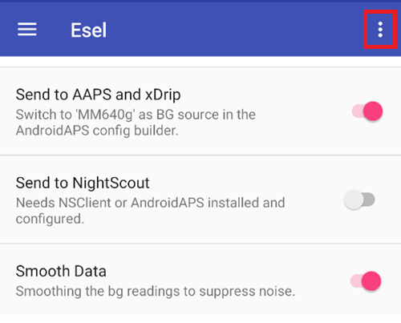

# Eversense

There are four different methods to access the readings from Eversense:

- ESEL companion mode
- ESEL patched mode
- xDrip companion app
- Lettore Notifiche (integrato in **AAPS**)

## ESEL

Scarica e installa l'[app ESEL](https://github.com/BernhardRo/Esel/tree/master/apk), seguendo queste [istruzioni](https://github.com/BernhardRo/Esel?tab=readme-ov-file#esel).

- In ESEL apri il menu con i tre puntini (⋮) in alto a destra e seleziona **Settings** (disponibile anche dal menu ☰). Nelle impostazioni:
  - Attiva "Send to AAPS and xDrip"
  - **Disattiva** "Send to Nightscout"
  - As the BG data from Eversense can be noisy, it is recommended to enable "Smooth Data" in ESEL.



### Companion Mode

Reads the data from the Eversense app notifications (works with the standard Eversense App, available since ESEL version 3.0.1).

1. Use the official Eversense App from the Google Play Store
   - Optional, but required for backfilling: Login to your Eversense account
   - In Sync, enable Auto synchronization
2. Configurazione di ESEL:
   - Disattiva l'impostazione "Get data from patched Eversense App"
   - For backfilling: Enable "Fill missing data from eversensedms.com"
   - Provide as Email address and password your Eversense login data
3. Set "MM640g" as BG source in [**Configuration → BG Source**](#Config-Builder-bg-source).

### Patched Eversense App

 Requires a patched version of the Eversense App (works completely offline, including backfilling).

1. Uninstall the Eversense App (Warning: your local historical data (older than 1 week) will be lost!)

2. Install the [patched Eversense app](https://cr4ck3d3v3r53n53.club) and use it as described by the vendor

   - Start the Eversense App, login, connect to your transmitter and use it just like the normal app.

3. Configurazione di ESEL:

   - Attiva l'impostazione "Get data from patched Eversense App"


If you run ESEL with a fresh installation of Eversense for the first time, it can take up to 15min until your first values appear in xDrip!

4. Set "MM640g" as BG source in [**Configuration → BG Source**](#Config-Builder-bg-source).

## xDrip

xDrip can read notifications from the vendor app, like ESEL does. No backfilling available.

- Scarica e installa xDrip: [xDrip](https://github.com/NightscoutFoundation/xDrip)
- As data source in xDrip “Companion App” must be selected.
- Seleziona xDrip in [**Configurazione → Sorgente Glicemia**](#Config-Builder-bg-source).
- Adjust the xDrip settings according to the explanations on the xDrip settings page [xDrip settings](../CompatibleCgms/xDrip.md).
- Enable [Exponential Smoothing](../CompatibleCgms/SmoothingBloodGlucoseData.md) in AAPS.

## Lettore Notifiche

**AAPS** can read the glucose values directly from the notifications posted by the official Eversense app, without any other app in between. No backfilling available.

- Select **Notification Reader** in [**Configuration → BG Source**](#Config-Builder-bg-source) and grant **AAPS** access to notifications when asked.
- Make sure the Eversense app shows the current glucose value in its notification.

```{warning}
BG values reading frequency is not always 5 minutes and duplicates can occur.
```