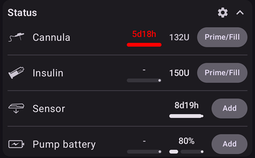

# General CGM recommendations

## Igiene del CGM

Whichever CGM system you are using, if you are going to use blood based calibration, then there are some very clear rules you should apply, whether or not you are using DIY CGM software or the official apps.

-   Assicurati che le mani e il kit siano puliti.
-   Try to calibrate when you have a series of dots with a flat arrow (15-30 minutes is usually enough)
-   Evita di calibrare quando la glicemia sta salendo o scendendo.
-   Do “enough” calibrations – on official apps, you will be prompted for once or twice per day checks. On DIY systems you may not be, and should be careful about continuing without calibrations.
-   For sensors not requiring or not allowing calibration, check at least daily real blood sugar. AAPS will be as safe as your sensor readings are reliable.
-   Se possibile, calibra con alcune letture in un intervallo più basso (4-5 mmol/l o 72-90 mg/dl) e alcune a un livello un po' più alto (7-9 mmol/l o 126-160 mg/dl), perché questo dà un intervallo migliore per la calibrazione punto/pendenza.

## Setting sensor (G6)

When setting sensor, it is recommended not to press the inserter too firmly in order to avoid bleeding. The sensor contacts should not come into contact with blood.

After setting the sensor, the transmitter can be clicked into the sensor holder. Attenzione! First click in the square side and then press down the round side.

(general-cgm-troubleshooting)=
## Troubleshooting

### Problemi di connessione

Bluetooth connection may be disturbed by other nearby Bluetooth devices such as blood glucose meters, headsets, tablets or kitchen devices such as microwave ovens or ceramic hobs. In this case xDrip does not display any BG values. When Bluetooth connection is re-established the data is backfilled.

### Errori del sensore

If recurring sensor errors occur try selecting a different body site to set your sensor. The sensor contacts should not come into contact with blood.

Often a "Sensor Error" can be corrected by immediate drinking and massage around the sensor!

### Valori instabili

You might try to change settings for noise blocking in xDrip (Settings - Inter-App Settings - Noise Blocking) i.e. "Block Very High noise and worse". See also [Smoothing BG data](../CompatibleCgms/SmoothingBloodGlucoseData.md).

### Età del sensore negativa

The sensor age is shown on the **Sensor** row of the status panel on the main screen (tap the chevron to expand it). A negative age occurs if there is either a double "Sensor Insert" [careportal entry](#aaps-screens-careportal) or a sensor insert with wrong date. Open **Treatments history** (menu ☰), select the **Careportal** tab and delete the wrong entry.
