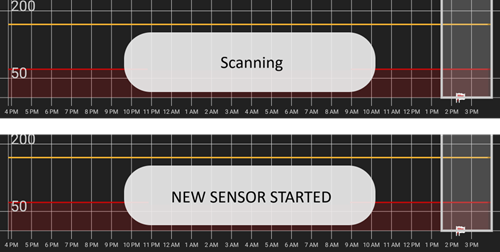
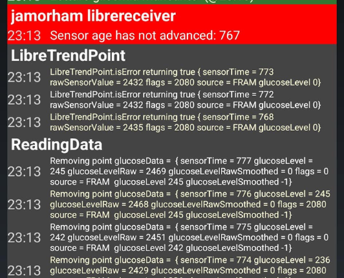

# Come configurare FSL 2 e OOP2 per usare una connessione Bluetooth nativa in xDrip

Trasferito da [MinimalL00per](https://www.minimallooper.com/post/how-to-setup-freestyle-libre-2-and-oop2-to-use-a-native-Bluetooth-connection-in-xdrip) in markdown e **rivisto/aggiornato**: 25 agosto 2025, psonnera

In fondo a questo documento c'è un elenco di definizioni. Se non conosci qualche termine o abbreviazione, puoi *[andare in fondo](#minimallooper-definitions)* per una spiegazione.

 

## Configurazione

### Hardware

- *FSL2 e 2+* **NOTA: le versioni US, CAN, NZ, AUS NON sono supportate**

**(OPZIONALE) Lettore** (non compatibile con FSL2+)

- Lettore 1 (con firmware aggiornato)

- Lettore 2

*NOTA: se vuoi usare il lettore in questa soluzione, DEVI AVVIARE il sensore PRIMA con il LETTORE. Se non lo fai, non potrai usare il lettore per leggere i valori dal sensore attivato. Dopo il riscaldamento del sensore, puoi fare le letture dall'applicazione LL o da xDrip.*

### Software

**OOP** - Out of Process Algorithm (algoritmo esterno), un'applicazione Android APK esterna che aiuta a leggere i dati raw del sensore per ottenere i valori della glicemia. xDrip invia a OOP i dati raw BT del FSL2 raccolti, e i valori della glicemia tornano a xDrip.

- **OOP2**

  - **Funziona solo con i sensori FSL2/2+ europei**

  - Codice chiuso (non disponibile su GitHub)

  - Lo scopo è decifrare i valori raw cifrati del sensore e restituirli a xDrip. Poi xDrip può usare i dati raw, che richiedono calibrazione, oppure fornire valori della glicemia simili a quelli del Lettore 1.

[***xDrip***](https://jamorham.github.io/)

- [*Nightly*](https://github.com/NightscoutFoundation/xDrip/releases): ultimo codice sorgente, compilato ogni notte. Non testato a fondo

- [*Stable*](https://xdrip-plus-updates.appspot.com/stable/xdrip-plus-latest.apk): ultima versione stabile e testata.

- **NOTA: i nuovi sensori richiedono un'app OOP2 aggiornata; per questo ti consigliamo di usare almeno l'ultima versione stabile (Stable) di xDrip, compatibile con l'ultima OOP2.**

 

## Procedura

- *Prima scarica e installa le app qui sotto*
- *Disinstallare le app che possono creare conflitti*
- *Come avviare un sensore FSL2 in modalità Bluetooth nativa con LL e xDrip
  - [*Passo 1: Installazione e configurazione delle applicazioni*](#minimallooper-step1)
  - [*Passo 2: Configurazione delle impostazioni di xDrip*](#minimallooper-step2)
  - [*Passo 3: Inserire fisicamente il sensore*](#minimallooper-step3)
  - [*Passo 4: Aprire l'app LL e avviare il sensore con la primissima scansione NFC*](#minimallooper-step4)
  - [*Passo 5: Aprire xDrip e fare la SCANSIONE NFC del sensore FSL2*](#minimallooper-step5)
  - [*Passo 6: Avviare il nuovo sensore in xDrip*](#minimallooper-step6)
  - [*Passo 7: Aspettare 60 secondi e scansionare di nuovo il sensore con NFC*](#minimallooper-step7)
  - [*Passo 8: Raccolta dei dati tra 3 e 15 minuti*](#minimallooper-step8)
  - [*Passo 9: Verificare che il sensore sia connesso e invii dati*](#minimallooper-step9)

- *[Note](#minimallooper-notes)*
- *[Vantaggi](#minimallooper-advantages)*
- *[Svantaggi](#minimallooper-disadvantages)*
- <u>*\[Risoluzione dei problemi\](#minimallooper-troubleshooting)*</u>

## Prima di iniziare

Ti consigliamo vivamente di seguire questa procedura con un **sensore nuovo**. Alcuni utenti hanno riferito che la connessione è possibile anche con un sensore già in funzione (***vedi [sotto](#minimallooper-started-sensor)***), ma è molto probabile che l'app LL o il lettore creino una nuova chiave privata condivisa per la comunicazione durante la connessione. Questo vuol dire che dopo il bonding xDrip non conosce la nuova chiave e non potrà comunicare con il sensore. Prova la connessione con un sensore già in funzione a tuo rischio, meglio verso la fine della vita del sensore.

### Prima scarica e installa le app qui sotto

(Libre2_OOP2)=

- **OOP2** - Le versioni di oop2 si trovano qui:

  (*Nota: per aprire il link devi aver fatto l'accesso a Google.*)

*[oop2.apk](https://drive.google.com/file/d/1106h2s12b3Ev9gKCTU2G75q8h9ChHjcz/view?usp=sharing)* - OOP2_21_09_25 (05d1989) **2025.09.21** (ultima versione)

- **xDrip** - la **<u>versione più recente</u>** (versione minima 2025.09.26) si trova qui:

[*xDrip.apk*](https://github.com/NightscoutFoundation/xDrip/releases)

(minimallooper-started-sensor)=

### E se il mio sensore è già avviato? Posso ancora ricevere le letture in xDrip? SÌ!

Molte persone hanno chiesto se questo metodo si può usare con un sensore già attivo, e posso rispondere con un deciso **SÌ**: puoi avviare un sensore già in funzione.

1.  **PRIMA** assicurati di aver fatto le modifiche di configurazione e le impostazioni in xDrip e di aver installato e configurato OOP2 come mostrato sotto.

2.  **POI** vai al *Passo 5* e **ASSICURATI** di aver forzato la chiusura di LL prima di iniziare. Poi segui la procedura fino alla fine.

*NOTA: non potrai usare il tuo sensore FSL2 attivato con l'FSLReader SE NON è stato avviato prima con l'FSLReader. Se È stato avviato prima con l'FSLReader, potrai **scansionare** il sensore e ricevere letture SIA dal sensore SIA da app come LL e xDrip.*

## Come avviare un sensore FSL2 in modalità Bluetooth nativa con LL e xDrip

*NOTA: se negli screenshot ci sono impostazioni non evidenziate con un RIQUADRO e NON SPUNTATE (cioè disattivate), LASCIALE DISATTIVATE. Gli screenshot mostrano una configurazione funzionante per TUTTE le impostazioni visibili. Se vuoi provare ad attivare/disattivare altre funzioni dopo che il sensore funziona, puoi farlo a tuo rischio.*

(minimallooper-step1)=

### Passo 1: Installazione e configurazione delle applicazioni

**Installa e configura OOP2** e verifica che funzioni semplicemente aprendo l'app.


**Settings**

- *Use service* **on**

- *Use foreground service* **on**

- *Timer Duration* **5 minutes**

  - Cambia in **1 sec** se non ottieni risultati abbastanza in fretta (lo screenshot qui sotto mostra questa impostazione).

**Versione 2: 93e5cac-2020.12.08 (ultima versione)**


**Installa xDrip**, versione minima: ultima release. Altra documentazione sull'installazione e la configurazione di xDrip si trova [*qui*](../CompatibleCgms/xDrip.md).

(minimallooper-step2)=

### Passo 2: Configurazione delle impostazioni di xDrip

**Hardware Data Source**: Libre Bluetooth


**NFC Scan features**: *le impostazioni non citate si considerano disattivate.*

- *Use NFC feature*: **on**
- *Sensor Age or Expiry*: **on**
- *Scan when not in xDrip*: **on**
- *Use Any-tag optimized reading method*: **off**, ma prova **on** se hai difficoltà a scansionare


- *Starting Bluetooth connection with FSL2 sensor*: **Always connect to libre2 sensors**


- *Smooth libre 3 data when using xxx method*: lascia il valore predefinito. Aumenta il valore per sensori con letture disturbate, diminuiscilo quando sono stabili.


**Less Common Settings -\> Bluetooth Settings** (*sono importanti e possono cambiare in base al tuo telefono/configurazione*)

- *Turn Bluetooth on*: **on**
- *Trust Auto-Connect*: **on**
- *Use Background Scans*: **on**
- *Always discover services*: **on**

Puoi configurare xDrip con il codice QR qui sotto. Devi scansionarlo (o caricare l'immagine) in xDrip -> Auto Configure.

```{admonition} QR Code
:class: dropdown


```


Dopo aver scansionato il codice QR qui sopra, se hai un telefono Samsung (ma è utile anche per molte marche cinesi), scansiona l'altro codice QR qui sotto per cambiare le impostazioni e avere una connessione più affidabile:

- *Trust Auto-Connect*: **off**
- *Use Background Scans*: **off**

```{admonition} QR Code
:class: dropdown


```


**Advanced settings for FSL2** (*opzionale ma utile*)

- *show Raw values in Graph*: **on**

- *show Sensor info in Status*: **on**


**Extra Logging Settings** (*servono per il debug se qualcosa non funziona*)

- *Extra tags for logging*: inserisci questo valore

`BgReading:d,jamorham librereceiver:v,LibreOOPAlgorithm:v,jamorham nsemulator:v,DexCollectionService:v`


(minimallooper-OOPsettings)=

**Less Common Settings -\> Other misc options**

> **Impostazioni per la configurazione di OOP2**

- *Out of process Libre algorithm*: **OFF**

(*ASSICURATI CHE SIA **OFF** PER OOP2, ALTRIMENTI NON RICEVERAI LETTURE!*)


(minimallooper-step3)=

### Passo 3: Inserire fisicamente il sensore

(minimallooper-step4)=

### Passo 4: Aprire l'app LL e avviare il sensore con la primissima scansione NFC

Apri l'app LL, poi scansiona il sensore appena inserito, poi chiudi e disattiva o disinstalla l'app LL. **Devi comunque aspettare tutti i 60 minuti di riscaldamento del sensore prima di continuare e di avviare il sensore in xDrip**. Non fidarti delle letture precedenti, perché il sensore si sta ancora calibrando internamente e i valori cambiano molto.

#### Passo 4a (OPZIONALE, usare l'FSLReader):

**Avvia il sensore FSL2 (non 2+) scansionandolo con l'FSLReader con la primissima scansione NFC**

Se vuoi poter usare l'**FSLReader** oltre all'app LL o a xDrip per leggere i valori dal sensore FSL2, **devi scansionare il sensore FSL2 appena inserito PRIMA con l'FSL Reader.** Dopo il riscaldamento del sensore puoi usare l'app LL o xDrip per scansionare le letture.

*NOTA: l'app LL serve solo per la PRIMISSIMA scansione NFC dopo l'inserimento del sensore. Serve a inviare il segnale di inizializzazione del riscaldamento; dopo, l'app DEVE essere disattivata (impostazioni app-\>forza chiusura) o disinstallata. Puoi usare l'app modificata 2.3 o le versioni ufficiali, non fa differenza. La cosa principale è evitare che l'app LL sia in esecuzione quando xDrip cerca di avviare il bonding BT con il sensore, perché l'app LL disturba la comunicazione e quindi la riconnessione Bluetooth.*

*Alcuni utenti hanno riferito che basta disattivare il **permesso di posizione** dell'app LL nelle impostazioni di sistema Android per evitare che disturbi la connessione. Alcuni utenti hanno riferito che questo funziona. Ancora una volta, **consiglio di disattivare o disinstallare l'app**, ma se vuoi sperimentare puoi provare questo.*

(minimallooper-step5)=

### Passo 5: Aprire xDrip e fare la SCANSIONE NFC del sensore FSL2

(*Promemoria! Assicurati che LL sia disattivata (posizione disattivata) o disinstallata E di aver aspettato tutti i 60 minuti perché il sensore si riscaldi e si calibri internamente.*)

Fai la **SCANSIONE NFC** del sensore FSL2 con xDrip. Questo invia al sensore un segnale per attivare l'abbinamento Bluetooth, per avviare il processo di bonding. In basso nella schermata Overview di xDrip appare per poco una piccola notifica con il testo **Scanning**, seguita dalla notifica **Scanned OK!** quando la scansione NFC del sensore FSL 2 riesce.


(minimallooper-step6)=

### Passo 6: Avviare il nuovo sensore in xDrip

Nella **schermata Overview di xDrip** premi il **menu hamburger** in alto a sinistra. Poi scegli **Start Sensor**.

Nella schermata **Start New Sensor** premi **Start Sensor**. Una domanda chiede **Did you insert it today?** Rispondi premendo **NOT TODAY**.


*NOTA: se hai premuto per sbaglio "YES, TODAY", devi fare "stop sensor" dal menu principale di xDrip e poi "start sensor" ripetendo il Passo 5.*

(minimallooper-step7)=

### Passo 7: Aspettare 60 secondi e scansionare di nuovo il sensore con NFC

Serve una seconda scansione NFC per **AGGIUNGERE** il sensore come dispositivo Bluetooth che xDrip userà per ricevere le letture. Alla fine vedrai una notifica con il testo **NEW SENSOR STARTED**.



È obbligatorio aspettare 60 secondi, perché durante questo processo il sensore non può essere scansionato più di una volta al minuto. Se scansioni il sensore troppo presto, nella schermata Overview di xDrip appare l'avviso **Not so quickly, wait 60 seconds**.


Apri gli event log di xDrip e controlla che il sensore sia abbinato correttamente con xDrip.


(minimallooper-step8)=

### Passo 8: Raccolta dei dati tra 3 e 15 minuti

Tra 3 e 15 minuti vengono raccolti abbastanza dati per mostrare i primi valori. *Se a questo punto non ricevi ancora letture, a volte aiuta riavviare il telefono.*

Se usi un Samsung (o molti telefoni di marche cinesi) e hai problemi a ricevere i dati, scansiona il codice QR qui sotto in xDrip -> Auto Configure.

```{admonition} QR Code
:class: dropdown


```

Cambierà le impostazioni Bluetooth di xDrip in:

- *Trust Auto-Connect*: **off**
- *Use Background Scans*: **off**

(minimallooper-step9)=

### Passo 9: Verificare che il sensore sia connesso e invii dati

Premi il menu hamburger in alto a sinistra nella schermata Overview di xDrip e seleziona **System Status**. Nella schermata System Status, il campo **Bluetooth Device:** attivo mostra il nome Bluetooth del FSL2 nel formato **ABB___XXXXXXXXXXX**, dove le X sono il numero di serie del sensore. Il campo **Connection Status** mostra **Connected** e il campo **Sensor Start:** mostra l'ora in cui è stato avviato il sensore.


Nella schermata **BT Device** (scorri a sinistra) puoi verificare altri dettagli della connessione con il sensore e usare questa schermata per risolvere problemi di connessione. Qui sotto c'è un elenco dei campi e del loro scopo, per aiutarti a risolvere i problemi di connessione.

*NOTA: **<u>NON TOCCARE</u> E NON CAMBIARE Bluetooth Pairing da <u>Disabled</u>** in questa finestra. Se lo fai, viene tentato un abbinamento diretto, che fallirà (Not bonded), e dovrai ricominciare tutta la procedura dal Passo 5.*


- **Phone Service State:** l'ultima volta che il telefono ha fatto una connessione BT con il sensore (dovrebbe essere meno di 5 minuti fa)
- **Bluetooth Device:** mostra lo stato attuale della connessione (**Connected** o **Disconnected**)
- **Device Mac Address**: è l'ID hardware del sensore
- **Bluetooth Pairing**: dovrebbe essere **<u>Disabled, tap to enable</u>**. Fai attenzione a NON toccarlo. Se lo tocchi per sbaglio, toccalo di nuovo finché torna su disabled.
- **Slowest wake up**: puoi ignorarlo. xDrip non passa il tempo ad aspettare le letture: comincia ad aspettarle dopo un certo tempo (di solito 5 minuti). Se in quel momento non arrivano dati, vedrai "Woke up early": vuol dire che xDrip si aspettava dati pronti ma non ce ne sono. Slowest wake up è il ritardo più lungo registrato prima di ricevere i dati normalmente.
- **Next Wake up**: dovrebbe indicare 5 minuti


(minimallooper-notes)=

### Note

- **Usare le scansioni NFC di LL DOPO aver completato il bonding/abbinamento in xDrip**: puoi fare scansioni NFC, ma prima deve essere completato il bonding/abbinamento con xDrip. Guarda sempre xDrip e controlla se manca poco alla lettura dei 5 minuti (per es. 4 minuti fa): se è vicina ai 5 minuti, aspetta che arrivi la nuova lettura BT e poi fai la scansione NFC. Se scansioni nel momento sbagliato, disturbi il processo BT in xDrip e non ricevi letture BT; può volerci un po' per rifare il bonding e trasmettere di nuovo, e a volte la connessione BT del sensore può essere "rubata" da LL. Però, tra queste letture BT, non ho avuto problemi a fare una scansione NFC e a disattivare subito dopo l'app. Non so se LL debba essere disattivata ogni volta, ma io la disattivo per sicurezza.

- **Cosa succede?** Quando si crea una connessione Bluetooth, viene creata una chiave privata condivisa che serve per la comunicazione tra il sensore e l'applicazione/dispositivo che lo chiama. È molto probabile che l'app LL o il lettore creino una nuova chiave privata condivisa per la comunicazione durante la connessione. Questo vuol dire che dopo il bonding xDrip non conosce la nuova chiave e non potrà comunicare con il sensore.

  - Diversi utenti hanno riferito che l'app LL si può riavviare dopo aver avviato correttamente il sensore e aver ricevuto letture in xDrip. Nei permessi Android dell'app LL devi solo disattivare l'impostazione **Consenti posizione**. Fatto questo, dovresti poter usare l'app LL e xDrip insieme. Ti consiglio di non scegliere un'app predefinita per la scansione NFC e di scegliere ogni volta con quale app leggere il sensore. Inoltre, NON DIMENTICARE, al prossimo cambio sensore, di forzare la chiusura dell'app LL dopo la scansione NFC iniziale di riscaldamento del nuovo sensore. Quando il sensore è configurato e xDrip riceve le letture, puoi riavviare l'app LL.

&nbsp;

- **Riavviare il telefono**: dopo il riavvio, e dopo aver disattivato o forzato la chiusura dell'app, RICORDA di controllare che l'app LL NON sia in esecuzione. Ti consiglio di provare un riavvio per vedere se LL si avvia di nuovo da sola. Puoi controllare le impostazioni dell'app LL nelle impostazioni delle applicazioni Android del tuo telefono. Se è ancora attiva, disattiva di nuovo l'app LL; disinstallare l'app LL può essere l'unico modo per evitarlo. Questo serve a evitare che LL rubi per sbaglio il bond BT. Inoltre, dopo il riavvio ci vogliono di nuovo 3-15 minuti per ricevere letture BT dal sensore: abbi pazienza e tienine conto se riavvii vicino ai momenti in cui ti serve una lettura della glicemia per un bolo, un pasto, ecc.

&nbsp;

- **Impostazioni di ottimizzazione batteria**: assicurati di ESCLUDERE queste app dalle impostazioni di ottimizzazione batteria del telefono

  - xDrip

  - OOP 2

  - LL

  - AAPS

&nbsp;

- **Usare la modalità aereo:** in alcune situazioni serve attivare la modalità aereo (quando prendi un aereo ;-), o quando dormi e non vuoi segnali Wi-Fi o di rete mobile con il telefono vicino alla testa) e questo può creare problemi alla comunicazione Bluetooth quando attivi la modalità aereo. Se attivi la modalità aereo sul telefono e poi riattivi il Bluetooth, le letture della glicemia si perdono. L'unica soluzione è riavviare il collector in xdrip+ -\> System Status -\> Classic Status Page. Dopo aver riavviato il collector, le letture della glicemia sono riapparse.

 

(minimallooper-advantages)=

### Vantaggi

- **L'app LL modificata non serve più** Non ti serve più una versione modificata dell'app LL per leggere i valori dal sensore FSL2. Puoi usare l'app LL modificata, ma anche le versioni ufficiali dell'app LL possono fare la prima scansione NFC di inizializzazione allo stesso modo dell'app modificata. Per la scansione NFC di inizializzazione che avvia il sensore, non c'è nessuna differenza.

&nbsp;

- **Non serve più un dispositivo NFC di terze parti** I dispositivi di scansione NFC di terze parti (come Miaomiao, Bubble o Blucon) non servono più *(ma si possono ancora usare)* per raccogliere le letture, perché ora il sensore da solo le può inviare via Bluetooth. Meno hardware vuol dire meno cose che si possono guastare, meno dispositivi da caricare e una configurazione più semplice.

&nbsp;

- **Potrai comunque fare scansioni NFC con il lettore FSL2 (versione 1 con FW aggiornato o versione 2) SE il sensore FSL2 è stato avviato PRIMA con l'FSL Reader.** Il lettore FSL2 autonomo si può ancora usare per scansionare le letture del sensore attivo, anche quando è collegato (bond) via Bluetooth a xDrip.

  - **DEVI** avviare il sensore con la primissima scansione NFC per iniziare il riscaldamento del sensore **PRIMA con l'FSL Reader**. Da questo momento anche altre applicazioni potranno fare letture NFC dal sensore ormai attivato.
- Per quanto ne so, il sensore FSL2 (finché non ha stabilito una connessione o non sta cercando di stabilirla) annuncia sempre la sua presenza (e disponibilità) via BLE esattamente ogni 2 minuti (visibile da qualsiasi dispositivo Bluetooth in grado di cercare dispositivi Bluetooth). Il primo dispositivo che risponde a questo annuncio vince la gara ed è l'*unico* dispositivo che può connettersi e leggere il sensore, perché durante la connessione con scansione NFC viene creata una chiave privata condivisa, usata per decifrare la comunicazione del FSL 2. Poi il sensore non è disponibile per gli altri dispositivi che non hanno questa chiave privata condivisa e che potrebbero anche cercare di connettersi. Sembra che il lettore FSL 2 vinca sempre questa gara, chiunque sia l'"avversario".

&nbsp;

- **Configurazione con il minimo di dispositivi** Il mio obiettivo è sempre stato avere sul corpo il minor numero possibile di dispositivi medici. Il FSL2 insieme al sistema Omnipod ha raggiunto questo obiettivo. Questo è ancora più importante quando viaggio (sia per brevi che per lunghe distanze), perché ho meno oggetti e meno ricambi da portare, e quindi più spazio per altre cose in valigia. Spero che in futuro ci sarà un micro patch con solo il serbatoio sostituibile, mentre il chip e il motore saranno un pezzo che si può tenere e riutilizzare. Questo ridurrebbe i rifiuti e gli imballaggi per i cambi del sito di infusione, e di nuovo lascerebbe più spazio in valigia per altre cose.

&nbsp;

- **Niente più buchi di un'ora quando cambi sensore** Poiché puoi avviare un altro sensore con l'app LL tramite una scansione NFC iniziale, il sensore attuale può continuare a funzionare e a inviare letture via Bluetooth nello stesso momento. Dopo 20 minuti puoi avere letture dal nuovo sensore, ma è meglio aspettare 1 ora perché il sensore si calibri bene internamente. Questo vuol dire che puoi fermare il sensore attuale e avviare quello nuovo (dopo che è stato inserito e riscaldato con la scansione NFC di LL un'ora prima) e in 3-15 minuti avrai le calibrazioni iniziali e le letture.

&nbsp;

(minimallooper-disadvantages)=

### Svantaggi

- **Riavvio del telefono:** poiché il processo Bluetooth deve ripartire quando il telefono si riavvia, devi prima assicurarti di disattivare a mano l'app LL (se non l'hai disinstallata) e avere pazienza finché arrivano le prime letture (3-15 min). Quindi scegli bene il momento per riavviare il telefono, in modo che non capiti in momenti critici come boli di correzione, pasti o spuntini.

&nbsp;

- **Non puoi usare LL e xDrip insieme per le letture Bluetooth**. LL cercherà sempre di "rubare" la connessione Bluetooth e il bond con il sensore. Se succede, resti legato a LL per il resto della vita del sensore. Quindi usare le app insieme non funziona sempre. Come dico sotto, puoi attivare l'app LL e fare una scansione NFC per avere la lettura in LL (se devi fare un confronto, o vuoi lo storico per te o per i report del diabetologo), però devi disattivarla appena hai la lettura e non provarci nel minuto in cui xDrip sta per ricevere la sua lettura Bluetooth. Non so come funziona il lettore FSL2 mentre fai questo, ma lo proverò più avanti.
- Diversi utenti hanno riferito che l'app LL si può riavviare dopo aver avviato correttamente il sensore e aver ricevuto letture in xDrip. Nei permessi Android dell'app LL devi solo disattivare l'impostazione **Consenti posizione**. Fatto questo, dovresti poter usare l'app LL e xDrip insieme. Ti consiglio di non scegliere un'app predefinita per la scansione NFC e di scegliere ogni volta con quale app leggere il sensore. Inoltre, NON DIMENTICARE, al prossimo cambio sensore, di forzare la chiusura dell'app LL dopo la scansione NFC iniziale di riscaldamento del nuovo sensore. Quando il sensore è configurato e xDrip riceve le letture, puoi riavviare l'app LL.

&nbsp;

- **I dispositivi di scansione NFC di terze parti si possono ancora usare**. Sì, l'ho messo tra gli svantaggi, ma voglio anche far notare che se qualcosa va storto con il sensore e LL ne prende il controllo, puoi sempre tornare a mettere un dispositivo di scansione NFC sul sensore per ricevere le letture in xDrip. Puoi anche usare questo dispositivo al posto di una connessione Bluetooth diretta, se preferisci una configurazione con un dispositivo di scansione NFC di terze parti (Miaomiao, Bubble, Blucon). A volte alcuni telefoni non funzionano bene con il bonding Bluetooth nativo del sensore e la lettura dei dati. Puoi usare questi dispositivi come riserva o per l'uso normale: in ogni caso hai ancora questa possibilità.
- Se vuoi usare l'**FSL Reader** come dispositivo di scansione NFC per fare le letture, DEVI avviare il sensore FSL2 con la **PRIMISSIMA scansione NFC** per riscaldare il sensore **PRIMA con il LETTORE**.

&nbsp;

- **I dati LV non vengono caricati automaticamente** Poiché l'app LL non ha una connessione Bluetooth costante (perché LL non deve essere in esecuzione insieme a xDrip quando il sensore invia attivamente letture Bluetooth), non riceve automaticamente le letture dal sensore. Questo vuol dire che i dati della glicemia non vengono caricati automaticamente su LV e quindi sugli altri telefoni con LL. Lo considero uno svantaggio perché so che molti genitori contano su questa funzione, come anche chi deve usare i report LV per il proprio medico. Puoi comunque aprire l'app LL e scansionare ogni 8 ore per portare in LL i dati recuperati (backfill) dal sensore (3 volte al giorno, almeno ogni 8 ore, ma probabilmente servono più scansioni per avere tutte le 24 ore di dati), ma anche questo è un processo manuale.

&nbsp;

(minimallooper-definitions)=

### Definizioni

- **BT** - Bluetooth

- **BLE** - Bluetooth Low Energy

- **FSL** - FreeStyle Libre
  - **Libre 1 (FSL1)** - solo NFC. Prima versione del sensore

  - **Libre 2 (FSL2)** - Bluetooth e NFC. Seconda versione del sensore.

  - **Libre 3 (FSL3)** - Bluetooth e NFC. Terza versione del sensore, più piccola. Non supportato da OOP2 (vedi Juggluco).

- **LL** - LibreLink, **applicazione** usata per avviare il sensore con la scansione NFC iniziale

- **LV** - LibreView, servizio cloud per condividere i dati con il tuo team diabetologico (valuta di usare Tidepool o Nightscout)

- **MM** - MiaoMiao, nome e produttore di un dispositivo di scansione NFC di terze parti che invia le letture via Bluetooth a xDrip.

- **NFC** - Near Field Communication, un'operazione fisica in cui avvicini il sensore NFC del telefono al tuo sensore per avviare una lettura. Spesso si chiama "scansionare il sensore", "scansione del sensore" o "scansione NFC". Questo processo non usa in nessun modo il Bluetooth.

- **OOP1** - Out of Process Algorithm versione 1, l'app di terze parti che riceve i valori raw (inviati a xDrip dal sensore via Bluetooth o scansione NFC) e poi usa un algoritmo (molto simile all'algoritmo hardware nel chip del sensore) per elaborare i valori raw, e restituisce a xDrip una glicemia calibrata (dall'algoritmo OOP1, non dalle calibrazioni native di xDrip), da mostrare o da elaborare ancora con la calibrazione di xDrip (con una calibrazione dal sangue del dito) se serve.

- **OOP2** - Out of Process Algorithm versione 2, l'app di terze parti che riceve i dati cifrati inviati dal sensore FSL 2 (via Bluetooth o scansione NFC) e poi li decifra. Una volta decifrati, i dati vengono inviati a xDrip.

 

(minimallooper-troubleshooting)=

### Troubleshooting

#### Il sensore non viene letto con NFC

- Assicurati che il lettore NFC del telefono sia attivo nelle impostazioni Android.
- Il lettore NFC deve essere compatibile con i tag **ISO 15693**. Alcuni telefoni Cubot sono molto difficili da usare.
- Cerca nella documentazione del telefono dove si trova l'antenna NFC. Avvicinalo al sensore e tienilo lì per 10 secondi: la lettura NFC di xDrip richiede più tempo dell'app del produttore o del lettore.
- Prova a chiudere xDrip prima di scansionare il sensore.
- Assicurati che nessun'altra app voglia leggere il sensore (durante la scansione potresti vedere una scelta tra diverse app: seleziona xDrip ma non muovere il telefono).
- Prova tutte le combinazioni delle impostazioni NFC di xDrip *Use faster multi-block reading method* e *Use Any-tag optimized reading method*, sapendo che le scansioni NFC di solito sono più affidabili con entrambe le opzioni su **off**.

#### Bloccato su "collecting initial readings"

*Nota: il FSL 2 non è riconosciuto come sorgente dati affidabile se lo calibri a mano.*

Imposta la strategia di [calibrazione OOP2](#minimallooper-OOPsettings) su "No calibration" finché tutto non funziona.

Poi puoi decidere se calibrare o no.


#### Il sensore viene riconosciuto come FSL1


Assicurati di usare le ultime versioni di xDrip e di OOP2.

#### La connessione al sensore non riesce

- Verifica che OOP1 sia disattivato (vedi [qui](#minimallooper-OOPsettings))


- Verifica che OOP2 non venga sospeso dalle app e dalle impostazioni di risparmio batteria del telefono
- Verifica che Google Play Protect sia disattivato, perché chiude OOP2
- Hai cambiato Bluetooth Pairing in System Status? Toccalo di nuovo per riportarlo su **<u>Disabled</u>**


#### Letture mancanti

Assicurati che OOP2 mostri valori diversi da 0 o -1: potrebbe essere un segno che il sensore si sta guastando (esempio sotto in mmol/L).


Se l'età del sensore non avanza, anche questo può indicare che il sensore ha problemi. Questo vuol dire che xDrip ha ricevuto un valore, ma lo ha scartato perché non era accettabile (errore del sensore).



#### Rifare da zero l'abbinamento del sensore

1. xDrip menu -> Stop sensor (non ferma il FSL2, cambia solo lo stato di xDrip in non avviato)
2. xDrip menu -> System status -> Forget device
3. Scansiona il sensore con l'NFC di xDrip. Aspetta almeno un minuto
4. xDrip menu -> Start sensor. Aspetta almeno un minuto
5. Scansiona il sensore con l'NFC di xDrip alcune volte, aspettando sempre almeno un minuto tra due scansioni.
