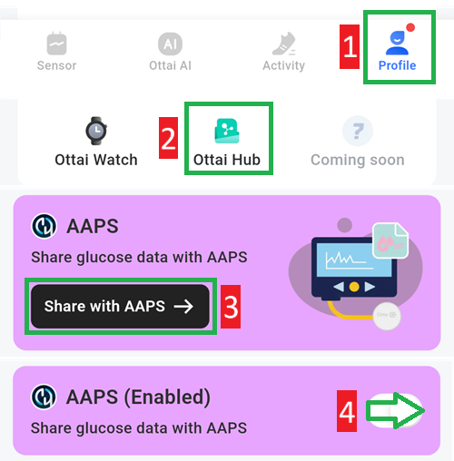

# Ottai M8

## Usare M8 con l'app Ottai

-   Scarica e installa l'apk da <https://play.google.com/store/apps/details?id=com.ottai.seas>. Per la versione cinese di Ottai usa <https://ottai.com.cn/70ICjxAI4i>

-   Avviare il sensore

- Seleziona **Syai/Ottai** in [**Configurazione → Sorgente Glicemia**](#Config-Builder-bg-source).

Attiva la trasmissione (broadcast) nell'app Ottai:

1. Seleziona Profile
2. Ottai hub
3. Tap Share with AAPS, accept the third party data transfer agreement
4. Attiva Share glucose data with AAPS

