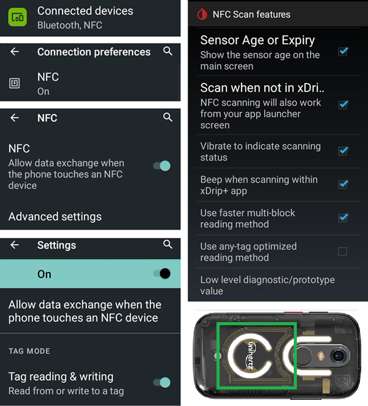

# Jelly

## Jelly Star Mini

**Funzioni**

* Android 13
* 8 GB RAM

**Vantaggi**

* È davvero piccolo.
* Even if you tell people, they might not consider it as a normal smartphone and will accept it more easily as an exception when phones are normally not allowed.

**Svantaggi**

* Consigliato solo a chi usa il loop da tempo. Alcune impostazioni non sono facili da riconoscere: devi sapere per esperienza, da un normale telefono Android con AAPS, come e dove si trova ogni cosa. Alcuni pulsanti di AAPS sono piccoli e difficili da toccare: serve un tocco preciso, non dita grosse.
* Can only be used as LooperPhone. It's better to have a normal smartphone in your pocket. 

### Ottimizzazione della durata della batteria

The Jelly comes with strong optimization features that **must** be disabled for AAPS (and other DIY apps like BYODA, xDrip, OOP2, Juggluco, etc...).

You can leave Intelligent assistance enabled, but it **must be disabled for DIY apps**.

Puoi attivare l'NFC per i sensori Libre.

### Ottimizzazione della durata della batteria

To avoid interference with **AAPS**, the Jelly Star 'battery usage' should be disabled by selecting 'unrestricted' for **AAPS** (and for other **DIY apps** like BYODA, xDrip, OOP2, Juggluco, etc...).

### Google Play Protect

Ricorda di disattivare Google Play Protect.

### Remote Connection for Wear apk

Con alcuni smartwatch, come i Samsung Galaxy, l'opzione 'Remote connection' (Connessione remota) nelle funzioni avanzate dell'app Galaxy Wearable deve essere **attiva** per usare il Jelly, **Wear.apk** e **AAPS** da remoto via Wi-Fi.

