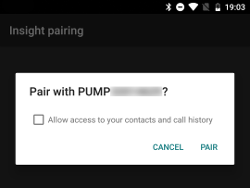
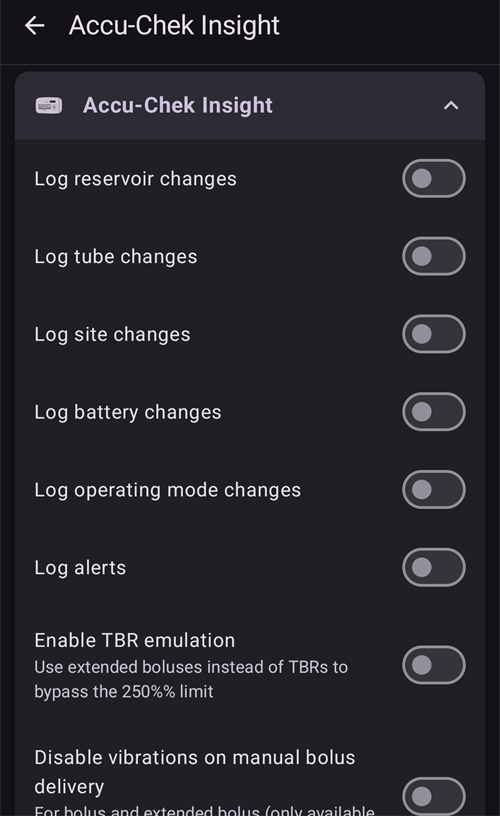

# Accu-Chek Insight

**Questo software è parte di una soluzione fai da te (DIY) di pancreas artificiale e non è un prodotto, ma richiede che TU legga, impari e capisca il sistema, incluso come usarlo. Non è qualcosa che gestisce il diabete al posto tuo, ma ti permette di migliorare il tuo diabete e la tua qualità di vita, se sei disposto a dedicarci il tempo necessario. Non avere fretta, concediti il tempo per imparare. Tu solo sei responsabile di quello che ne fai.**

```{admonition} Accu-Chek Insight is being phased out :class: note

Roche is withdrawing from the insulin pump market to refocus its diabetes portfolio on the Accu-Chek SmartGuide CGM. It has communicated the end of sales of both the Accu-Chek Combo and Accu-Chek Insight pumps; its remaining Accu-Chek Solo micropump is also being wound down (last deliveries in Germany at the end of 2025). The change is being rolled out by region, starting in Germany, with other European markets expected to follow. Support for the Insight is already listed as ended (see [Pumps no longer sold](./Future-possible-Pump-Drivers.md)). Se usi questo micro, pianifica per tempo il passaggio a un micro supportato.

    <br />```{note}
    Before **AAPS** had a native Insight driver, the Insight was controlled through the separate [SightRemote](https://github.com/TebbeUbben/SightRemote) app. SightRemote is no longer needed or maintained: if you still have it installed from those days, uninstall it and use a current version of **AAPS** instead.
    

```{contents} Indice :depth: 1 :local: true

    <br />## Pump capabilities with AAPS
    
    * Communicates with **AAPS** over your phone's native Bluetooth, without an additional communication device.
    * Automatic DST and timezone handling.
    
    ## Requisiti hardware e software
    
    * Un micro Roche Accu-Chek Insight (qualsiasi firmware, funzionano tutti)
    
    Nota: AAPS scrive i dati sempre nel **primo profilo basale del micro**.
    
    * Un telefono Android con Android 12 o più recente (vedi [Telefoni](../Getting-Started/Phones.md))
    * L'app AAPS installata sul telefono
    
    ## Configurazione
    
    * Il micro Insight deve essere connesso a un solo dispositivo alla volta. If you have previously used the Insight remote control (meter), you must remove the meter from the paired devices list of your pump: **Menu** > **Settings** > **Communication** > **Remove device**.
    
       
    
    * In [Configuration > Pump](#Config-Builder-pump), select the **Accu-Chek Insight** card. Può essere attivo un solo micro alla volta.
    
       
    
       Once it is selected, the **Accu-Chek Insight** card shows two buttons, **Settings** and **Open plugin**:
    
       
    
       **Settings** opens the settings of the Accu-Chek Insight driver (see [Settings in AAPS](#Accu-Chek-Insight-Pump-settings-in-aaps)).
    
       **Apri plugin** (oppure **Gestisci → Micro**) apre la schermata del micro Accu-Chek Insight. Before a pump is paired it looks like this:
    
       
    
    (accu-chek-insight-pairing)=
    ### Pairing
    
    * On the pump screen, tap **Insight pairing**. The pairing wizard opens and searches for nearby Bluetooth devices (top of the picture below).
    * Sul micro Insight vai su **Menu** > **Settings** > **Communication** > **Add Device**. The pump shows the following screen (bottom of the picture below) with the serial number of the pump.
    
       
    
    * Back on your phone, tap the pump serial number in the list of Bluetooth devices. If Android asks you to confirm the pairing, tap **Pair**.
    
       
    
    * The pump and the phone both show a code. Check that the codes are the same on both devices. Conferma sul micro e tocca **Sì** sul telefono. (Tap **No** if the codes do not match.)
    
       
    
    * The phone shows **Pairing completed**. Tocca **Esci** per tornare alla schermata del micro.
    
       
    
    * To check that all is well, look at the pump screen (**Manage → Pump**). Once the pump is paired, it shows information about the pump, such as **Serial number**, **Manufacturing date**, **Release software version** and **Bluetooth address**.
    
       
    
       ```{admonition} Older screenshot
       :class: note
       Apart from the top of the first picture, the pairing screenshots above are from an earlier **AAPS** version and may look different in **AAPS** 4.
       ```
    
    * To remove the pairing, tap **Unpair** on the pump screen and confirm **Reset pairing information?**. The **Insight pairing** button then appears again.
    
    Note: There is no permanent connection between the pump and the phone. **AAPS** only connects when needed (for example to set a temporary basal rate, give a bolus or read the pump history). Altrimenti le batterie del telefono e del micro si scaricherebbero troppo in fretta.
    
    (Accu-Chek-Insight-Pump-settings-in-aaps)=
    ## Settings in AAPS
    
    Open the settings with **Settings** on the **Accu-Chek Insight** card in **Configuration** > **Pump**, or with the gear icon in the top-right corner of the pump screen.
    
    
    
    Nelle impostazioni Insight di **AAPS** puoi attivare queste opzioni:
    
    * **Registra cambi serbatoio**: registra automaticamente un cambio della cartuccia di insulina quando cambi la cartuccia nel micro.
    
    * **Log tube changes**: adds a note to the **AAPS** database when you run the "tube filling" program on the pump.
    
    * **Log site changes**: adds a note to the **AAPS** database when you run the "cannula filling" program on the pump. **Note: A site change also resets Autosens.**
    
    * **Log battery changes**: records a battery change when you put a new battery in the pump.
    
    * **Registra cambi modalità operativa**: aggiunge una nota al database di **AAPS** ogni volta che avvii, fermi o metti in pausa il micro.
    
    * **Log alerts**: adds a note to the **AAPS** database whenever the pump issues an alert (except reminders, bolus and TBR cancellation, which are not recorded).
    
    * **Abilita emulazione TBR**: il micro Insight può impostare basali temporanee (TBR) solo fino al 250%. To get around this limit, TBR emulation tells the pump to deliver an extended bolus for the extra insulin if a TBR of more than 250% is requested.
    
      **Nota: usa un solo bolo esteso alla volta. Several extended boluses at the same time might cause errors.**
    
    * **Disable vibrations on manual bolus delivery**: stops the Insight pump from vibrating when it delivers a manual bolus (or extended bolus). Only available with Insight firmware 3.x.
    
    * **Disable vibrations on automated bolus delivery**: stops the Insight pump from vibrating when it delivers an automatic bolus (SMB or temp basal with TBR emulation). Only available with Insight firmware 3.x.
    
    * **Min. durata recupero [s]** e **Max. recovery duration [s]**: how long **AAPS** waits before trying again after a failed connection attempt. Puoi scegliere da 0 a 20 secondi. Se hai problemi di connessione, scegli un tempo di attesa più lungo.
        <br><br>Esempio per min. durata recupero = 5 e max. durata recupero = 20
        <br><br>nessuna connessione -> attendi <b>5</b> sec.
          <br>  riprova -> nessuna connessione -> attendi <b>6</b> sec.
          <br>  riprova -> nessuna connessione -> attendi <b>7</b> sec.
          <br>  riprova -> nessuna connessione -> attendi <b>8</b> sec.
          <br>...
          <br>riprova -> nessuna connessione -> attendi <b>20</b> sec.
          <br>riprova -> nessuna connessione -> attendi <b>20</b> sec.
          <br>...
    
    * **Disconnect delay [s]**: how long (in seconds) **AAPS** waits before disconnecting from the pump after an operation is finished. Puoi scegliere da 0 a 15 secondi. Il valore predefinito è 5 secondi.
    
    For periods when the pump was stopped, **AAPS** logs a temporary basal rate of 0%.
    
    ### The pump screen
    
    The Accu-Chek Insight pump screen (**Manage → Pump**) shows the current status of the pump, for example **Status**, **Last connected**, **Operating mode**, **Battery**, **Reservoir level**, today's total daily doses (**TDD Bolus**, **TDD Basal**), basal rates and the last bolus. Once the pump is paired, it has these buttons:
    
    * **Refresh**: refreshes the pump status.
    * **Enable notification of TBR end (pump setting)** / **Disable notification of TBR end (pump setting)**: a standard Insight pump sounds an alarm when a TBR finishes. Questo pulsante attiva o disattiva quell'allarme senza bisogno del software di configurazione.
    * **Unpair**: removes the pairing with the pump (see [Pairing](#accu-chek-insight-pairing)).
    
    
    
    ```{admonition} Older screenshot
    :class: note
    The screenshot above is from an earlier **AAPS** version. In **AAPS** 4 the pump screen looks different and also has an **Unpair** button.
    

## Settings in the pump

Configure alarms in the pump as follows:

* Menu > Settings > Device settings > Mode settings > Quiet > Signal > Sound
* Menu > Settings > Device settings > Mode settings > Quiet > Volume > 0 (remove all bars)
* Menu > Modes > Signal mode > Quiet

This will silence all alarms from the pump, allowing AAPS to decide if an alarm is relevant to you. If AAPS does not acknowledge an alarm, its volume will increase (first beep, then vibration).

(Accu-Chek-Insight-Pump-vibration)=

### Vibrazione

Depending on the firmware version of your pump, the Insight will vibrate briefly every time a bolus is delivered (for example, when AAPS issues an SMB or TBR emulation delivers an extended bolus).

* Firmware 1.x: No vibration by design.
* Firmware 2.x: Vibration cannot be disabled.
* Firmware 3.x: AAPS eroga il bolo in silenzio.

La versione del firmware si trova nel menu.

## Sostituzione della batteria

Con il loop la batteria dell'Insight dura da 10 a 14 giorni, al massimo 20 giorni. The user reporting this is using Energizer lithium batteries.

Il micro Insight ha una piccola batteria interna che tiene attive le funzioni essenziali, come l'orologio, mentre cambi la batteria removibile. If changing the battery takes too long, this internal battery may run out of power, the clock will reset, and you will be asked to enter a new time and date after inserting a new battery. If this happens, all entries in AAPS prior to the battery change will no longer be included in calculations as the correct time cannot be identified properly.

(Accu-Chek-Insight-Pump-insight-specific-errors)=

## Errori specifici di Insight

### Bolo Esteso

Just use one extended bolus at a time as multiple extended boluses at the same time might cause errors.

### Timeout

A volte il micro Insight non risponde mentre **AAPS** stabilisce la connessione. **AAPS** mostra allora la notifica "Timeout durante la connessione - riavvia il bluetooth".


In questo caso spegni il Bluetooth sul micro E sul telefono per circa 10 secondi, poi riaccendilo.

## Fuso orario con Insight

For information on traveling across time zones see section [Timezone traveling with pumps](#timezone-traveling-insight).

## Dove trovare aiuto

Development of the Insight driver is done by the community on a **volunteer** basis. Prima di chiedere aiuto, per favore:

1. **Read** the relevant section of this documentation to confirm how the feature is meant to work.
2. **Ask** on the *#AAPS* channel on [Discord](https://discord.gg/4fQUWHZ4Mw), or in one of the other [community channels](../GettingHelp/WhereCanIGetHelp.md).
3. **Report a bug** by searching the [existing issues](https://github.com/nightscout/AndroidAPS/issues); if yours is not listed, open a [new issue](https://github.com/nightscout/AndroidAPS/issues) and attach your [log files](../GettingHelp/AccessingLogFiles.md).

Quando chiedi aiuto, indica marca e modello del telefono, versione di Android, versione di **AAPS** e una descrizione semplice del problema (cosa è cambiato, quando ha funzionato l'ultima volta).