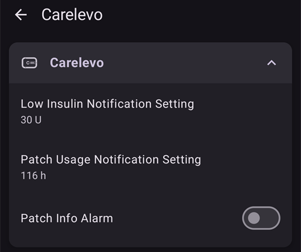

# CareLevo

The CareLevo is a tubeless patch pump made by CareMedi. Each patch holds up to 300 U of insulin and is worn for up to 7 days (168 hours). It communicates with **AAPS** over your phone's Bluetooth, with no additional device.

```{admonition} New driver
:class: warning
Il driver CareLevo è nuovo in **AAPS**. Leggi tutta questa pagina prima di attivare la tua prima patch e tieni a portata di mano le istruzioni per l'uso del micro.
```

The smallest dose the patch can deliver is 0.05 U. Set your basal rates in the **Profile** to a minimum of 0.05 U/h in steps of 0.05 U/h, otherwise the insulin the **Profile** expects and the insulin the patch delivers differ slightly. **AAPS** usa le velocità basali accettate dalla patch.

```{contents} Table of contents
:depth: 1
:local: true
```

## Funzioni del micro con AAPS

* Communicates with **AAPS** over your phone's native Bluetooth, without an additional communication device.
* Bolus in steps of 0.05 U.
* Basal rates from 0.05 U/h to 15 U/h in steps of 0.05 U/h, with 30-minute basal segments.
* Basali temporanee impostate come velocità assoluta, fino a 12 ore.
* Bolo esteso fino a 8 ore.
* I cambi di ora legale e di fuso orario vanno gestiti a mano. La patch ti avvisa quando cambia il fuso orario.

## Configurazione del micro

1. Apri il **menu** (☰) in alto a sinistra nella schermata principale di **AAPS** e seleziona **Configurazione**.
1. Seleziona **Carelevo** nella sezione Micro.
1. Premi il tasto Indietro per tornare alla schermata principale.


## Settings

Apri la schermata del micro con **Gestisci → Micro** (oppure **Configurazione → Micro → Apri plugin**).

Open the CareLevo settings by pressing the **Settings** (gear) icon in the upper right corner. Ci sono tre impostazioni:



### Low Insulin Notification Setting

The patch notifies you when the insulin remaining in the reservoir reaches the chosen amount. It can be set from 20 U to 50 U in 5 U steps. The default is 30 U. Independently of this setting, the patch raises a critical alarm and stops delivering insulin when less than 10 U remain.

### Impostazioni Notifiche Uso Patch

The patch notifies you when it has been worn for the chosen number of hours, so you can plan the change. Si può impostare da 24 a 167 ore. Il valore predefinito è 116 ore.

### Allarme Info Patch

When this is on, the patch beeps when a bolus, extended bolus or temporary basal starts and when it ends. Il valore predefinito è disattivato.

## La schermata del micro


The pump screen shows the **Bluetooth status** (No Active Patch, Disconnected or Connected), the **Serial No.** of the patch, its **Activation Time** and **Expiration**, the current **Basal Rate** and **Temp basal rate**, the **Insulin Remaining** (remaining / filled), the **Patch Time Remaining** and the **Total insulin delivered**.

I pulsanti dipendono dallo stato della patch:

* **Attiva patch**: avvia l'attivazione di una nuova patch, vedi sotto.
* **Guida All'Insulina**: mostra i dodici passi per riempire una patch di insulina.
* **Sospendi erogazione** / **Riprendi l'erogazione**: mette in pausa e riavvia l'erogazione di insulina, vedi sotto.
* **Discard Patch**: stops the current patch so a new one can be activated.

## Activating a patch

Before you start, make sure a **Profile** is active in **AAPS** and that Bluetooth is on. The patch must be activated within a limited time once it is switched on; if the time runs out, the patch raises a **Patch Application Timeout** alarm and cannot be used.

Premi **Attiva patch** nella schermata del micro e segui i passi. Puoi annullare in qualsiasi momento prima dell'inserimento dell'ago; quello che hai inserito viene scartato.

### Select the insulin

Conferma l'insulina che usi. La patch richiede insulina ad azione rapida U-100.

### Fill the patch with insulin

Fill the patch with 50 to 300 U, considering how long you will wear it. Premi **Guida All'Insulina** se ti servono le istruzioni per il riempimento. Then tap the fill amount and select the amount you filled; **AAPS** uses it to show the insulin remaining.

### Connect the patch

1. Take the patch out of its blister and remove the needle cap.
1. Premi il pulsante di accensione della patch per più di un secondo. After the beep, tap **Search Patch**.
1. When the patch found is the right one, tap **Confirm**. Se non lo è, tocca **Riscansiona**.

### Controllo di sicurezza

Quando la patch è connessa, premi **Controllo di sicurezza**. The patch tests itself and primes. Check that a droplet of insulin has formed at the needle tip. Se non vedi nessuna goccia, premi **Riprova**. When the check is complete, press **Next**.

### Sito e applicazione della patch

1. Select the site where you will wear the patch.
1. Pulisci bene il sito con un tampone imbevuto di alcol.
1. Remove the backing tape and attach the patch to your skin with the marked dot facing upward.
1. Premi **Avanti** quando la patch è applicata.

### Insert the needle

1. Ruota il cappuccio di sicurezza nella direzione della freccia e toglilo.
1. Premi fino in fondo il pulsante dell'applicatore e tienilo premuto per 10 secondi. A beep sounds when the needle is inserted.
1. Remove the applicator and press **Confirm Insertion**.

Se l'inserimento non riesce, **AAPS** ti dice quanti tentativi restano. When no attempt is left, the patch raises a **Needle Insertion Error** alarm and must be replaced.

L'erogazione di insulina inizia appena l'inserimento è confermato.

## Messaggi sul bolo

If the patch refuses a bolus, **AAPS** tells you why. For example *Bolus can't be delivered. Bolus available: 2.8 U* means the patch can deliver only that amount now.

If you stop a bolus and the patch does not confirm the stop, **AAPS** waits for the bolus to end and records the amount the patch reports. Se un bolo non è stato registrato (per esempio perché è stato fermato mentre era in corso), **AAPS** lo aggiunge dal totale della patch e ti chiede di controllare l'IOB prima di riprovare.

## Sospendere e riprendere l'erogazione di insulina

Press **Suspend Infusion** on the pump screen and select how long delivery should pause: from 30 minutes to 4 hours in 30-minute steps. Delivery does not resume by itself: when the pause is over, the patch raises a **Start Insulin** alert. Premi **Riprendi l'erogazione** nella schermata del micro, oppure **Avvia Insulina** nell'avviso, e conferma.

## Scartare una patch

Premi **Scarta patch** nella schermata del micro e conferma. L'erogazione di insulina si ferma e la patch non si può più usare. Togli la patch dal corpo e attivane una nuova.

Quando un allarme critico ha fermato la patch, l'allarme offre invece **Disattiva patch**. Pressing it discards the patch the same way.

(carelevo-alarms-and-notifications)=

## Allarmi e notifiche

The patch reports three levels of events. All of them are shown as **AAPS** notifications.

### Allarmi critici

L'erogazione di insulina si è fermata. Agisci subito:

* **Insulina Bassa**: restano meno di 10 U. Disattiva la patch e cambiala.
* **Patch Expired**: the patch reached the end of its life. Disattiva la patch e cambiala.
* **Batteria scarica**: scarta la patch e cambiala.
* **Temperatura Alta/Bassa**: spostati in un ambiente con una temperatura adatta, tra 40 ℉ e 99 ℉ (4.4 ℃ e 37.2 ℃).
* **Auto off**: la patch si è fermata perché l'avviso Auto off è stato ignorato. Premi **Avvia Insulina** per riavviare l'erogazione basale.
* **Timeout Applicazione Patch**, **Autodiagnosi Non Riuscita**, **Errore patch**, **Occlusione** e **Errore inserimento ago**: disattiva la patch e cambiala.

### Avvisi

L'erogazione di insulina continua, ma qualcosa richiede la tua attenzione:

* **Insulina Bassa**: il serbatoio ha raggiunto la quantità impostata in **Impostazione notifica insulina bassa**. Preparati a cambiare la patch.
* **La patch scadrà presto** e **Durata operativa della patch scaduta**: cambia la patch.
* **Low Battery**: prepare to change the patch.
* **Temperatura Alta/Bassa**: l'erogazione è in pausa finché la patch non torna tra 40 ℉ e 99 ℉ (4,4 ℃ e 37,2 ℃).
* **Auto off**: tocca **OK**. Se viene ignorato, l'avviso diventa un allarme critico e l'erogazione si ferma.
* **Attivazione patch incompleta**: tocca **OK** per completare l'attivazione.
* **Start Insulin**: the pause you set has ended. Tocca **Avvia Insulina** per riprendere l'erogazione.
* **Attiva Bluetooth** e **BLE Non Connesso**: il telefono non riesce a raggiungere la patch. Turn Bluetooth on or check the patch connection.

### Notices

For information only: **Low Insulin**, **Patch Usage Time Notification** (the time set in **Patch Usage Notification Setting** has passed), **Patch Check Notification**, **Time Zone Change** and **Check Blood Glucose** (a set time after a bolus).

The patch also reports when its own low glucose suspend (**LGS**) function starts or ends. **AAPS** does not use this function; the loop handles low glucose itself.

## Dove trovare aiuto

Report problems with the CareLevo driver on the [AAPS GitHub issues page](https://github.com/nightscout/AndroidAPS/issues) or in the AAPS community channels, see [Where can I get help](../GettingHelp/WhereCanIGetHelp.md).
