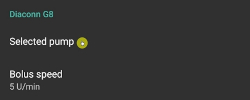

# Diaconn G8

```{contents} Table of contents
:depth: 1
:local: true
```

## Funzioni del micro con AAPS

* Communicates with **AAPS** over your phone's native Bluetooth, without an additional communication device.
* I cambi di ora legale e di fuso orario vanno gestiti a mano.

## Insulin Pump Bluetooth Pairing

- Tocca il **menu** (☰) in alto a sinistra.


- Tocca **Configurazione** > **Micro** e seleziona **Diaconn G8**.


Once it is selected, the **Diaconn G8** card shows two buttons, **Settings** and **Open plugin**:


**Settings** opens the settings of the Diaconn G8 driver (see [Diaconn G8 insulin pump option setting](#diaconn-g8-insulin-pump-option-setting) below).

**Apri plugin** (oppure **Gestisci** > **Micro**) apre la schermata del micro Diaconn G8. Before a pump is paired it looks like this:




```{admonition} Older screenshot
:class: note
The screenshot above is from an earlier **AAPS** version. In **AAPS** 4 pairing starts from the **Pair** button on the pump screen; there is no **Selected pump** setting.
```

- On the pump screen, tap **Pair**. The **Diaconn Pump Pairing** screen opens and **AAPS** scans for nearby pumps.
- Tap your insulin pump's model number once it appears in the list (for example **DIACONN-65010**).


- Ci sono due modi per controllare il numero di modello:

1. Le ultime 5 cifre del numero di serie (SN) sul retro del micro.
2. Click on O button > Information > BLE > Last 5 digits.


- Once you select your pump, a window appears asking for a PIN code. Inserisci il PIN mostrato sul micro per completare la connessione.

 

- When **Pairing successful!** is shown, tap **OK** to go back to the pump screen.

## Controllo dello stato del micro e sincronizzazione dei log

- Quando il micro è connesso, apri la schermata del micro (**Gestisci** > **Micro**). Mostra lo stato del micro (batteria, serbatoio, ultima connessione, ultimo bolo, velocità basale e altro).
- Tocca **Aggiorna** per connetterti al micro, aggiornare lo stato e sincronizzare i log.
- Tocca **Storico micro** per vedere lo storico letto dal micro.


```{admonition} Older screenshot
:class: note
The screenshot above is from an earlier **AAPS** version. In **AAPS** 4 lo stato del micro è mostrato nella schermata del micro (**Gestisci** > **Micro**) e si sincronizza con il pulsante **Aggiorna**.
```

(diaconn-g8-bluetooth-troubleshooting)=

## Bluetooth Troubleshooting

**Cosa fare se la connessione Bluetooth con il micro è instabile.**

### Metodo 1) Riavvia AAPS, poi controlla di nuovo il micro

- Tocca il **menu** (☰) in alto a sinistra.
- Tocca **Esci** in fondo al menu.


- Avvia di nuovo **AAPS** e controlla la connessione al micro.

### Method 2) If the first method doesn't work, disconnect Bluetooth and then reconnect.

- Press and hold the Bluetooth button at the top for about 3 seconds.


- Click on the Setting button on the paired Diaconn G8 Insulin pump.


- Disaccoppia.


- In **AAPS**, open the pump screen (**Manage** > **Pump**), tap **Unpair** and confirm **Reset pairing information?**.
- Repeat the Bluetooth pairing process for the pump (see above).

## Altre informazioni

(diaconn-g8-insulin-pump-option-setting)=

### Diaconn G8 Insulin pump option setting

- **Configurazione** > **Micro** > **Diaconn G8** > **Impostazioni**
- Oppure, nella schermata del micro (**Gestisci** > **Micro**), tocca l'icona delle impostazioni (ingranaggio) in alto a destra.


- **Velocità bolo** imposta la velocità con cui il micro eroga un bolo.
- If the **Log reservoir change** option is activated, the relevant details are automatically uploaded to the careportal when an "Insulin Change" event occurs.
- If the **Log needle change** option is activated, the relevant details are automatically uploaded to the careportal when a "Site Change" event occurs.
- If the **Log tube change** option is activated, the relevant details are automatically added as a note when a "Tube Change" event occurs.
- If the **Log battery change** option is activated, the relevant details are automatically uploaded to the careportal when a "Battery Change" event occurs. You can also record a battery change yourself with **Manage** > **Pump Battery Change**. (Note: To change the battery, please stop all in-progress injection functions before proceeding.)
- **Diaconn Cloud Sync** sends the pump logs to the Diaconn Cloud.


```{admonition} Older screenshot
:class: note
The screenshot above is from an earlier **AAPS** version. In **AAPS** 4 a battery change is recorded with **Manage** > **Pump Battery Change**; there is no **Actions** tab.
```

### Extended Bolus function

- Se usi il bolo esteso, il loop chiuso viene disattivato.
- Vedi [questa pagina](#extended-bolus-and-why-they-wont-work-in-closed-loop-environment) per sapere perché il bolo esteso non funziona con il loop chiuso.

## Dove trovare aiuto

Development of the Diaconn G8 driver is done by the community on a **volunteer** basis. Prima di chiedere aiuto, per favore:

1. **Read** the relevant section of this documentation to confirm how the feature is meant to work.
2. **Ask** on the *#AAPS* channel on [Discord](https://discord.gg/4fQUWHZ4Mw), or in one of the other [community channels](../GettingHelp/WhereCanIGetHelp.md).
3. **Report a bug** by searching the [existing issues](https://github.com/nightscout/AndroidAPS/issues); if yours is not listed, open a [new issue](https://github.com/nightscout/AndroidAPS/issues) and attach your [log files](../GettingHelp/AccessingLogFiles.md).

When asking for help, include your phone make and model, Android version, **AAPS** version, and a plain-English description of the problem (what changed, when it last worked).
