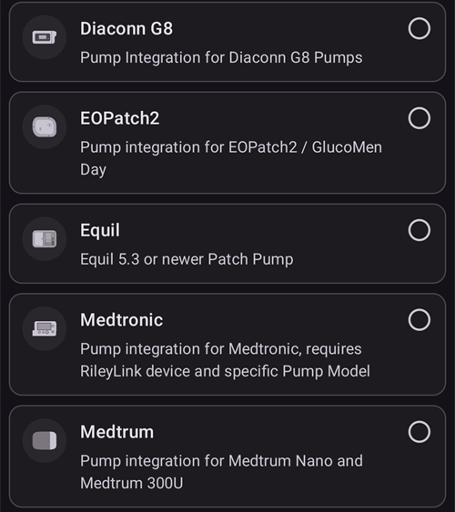
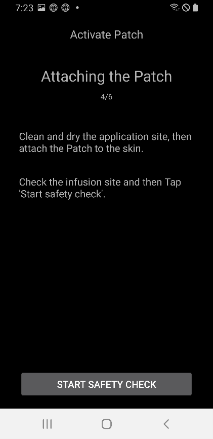
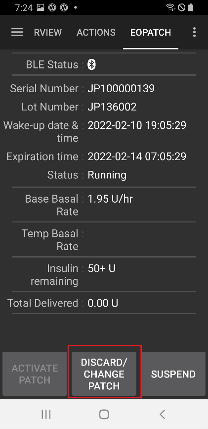
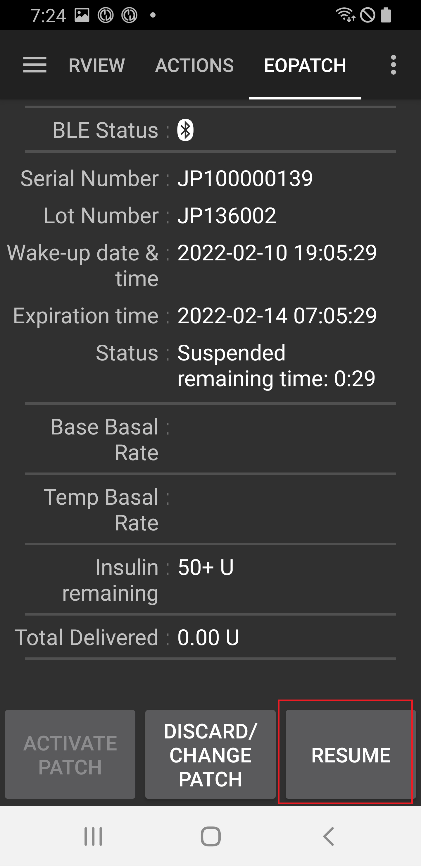

# EOPatch2

The patch needs rapid-acting U-100 insulin, such as NovoRapid or Humalog. Use the rapid-acting insulin your doctor has prescribed for you.

The smallest dose the patch can deliver is 0.05 U. Set every basal rate in your **Profile** to at least 0.05 U/hr, in steps of 0.05 U/hr. Otherwise **AAPS** rounds each rate to the nearest 0.05 U/hr (never down to 0) and uses the rates the patch really gives, so the total insulin per day differs slightly from your **Profile**. Allo stesso modo, i boli devono essere di almeno 0,05 U.

```{contents} Table of contents
:depth: 1
:local: true
```

## Funzioni del micro con AAPS

* Communicates with **AAPS** over your phone's native Bluetooth, without an additional communication device.
* I cambi di ora legale e di fuso orario vanno gestiti a mano.

## Configurazione del micro

1. Apri il **menu** (☰) in alto a sinistra nella schermata principale di **AAPS** e seleziona **Configurazione**.
1. In the **Pump** section, select **EOPatch2**.
1. Premi il tasto Indietro per tornare alla schermata principale.

 

Once it is selected, the **EOPatch2** card shows two buttons, **Settings** and **Open plugin**:


## Settings

Open the EOPatch2 settings in one of two ways:

* premi **Impostazioni** sulla scheda **EOPatch2** in **Configurazione**, oppure
* open the pump screen (**Manage** → **Pump**) and press the gear icon in the top-right corner.

Ci sono tre impostazioni:


### Avvisi livello serbatoio basso

A warning appears when the insulin left in the patch drops to this amount or less. Puoi impostarla da 10 a 50 U, a passi di 5 U. Il valore predefinito è 10 U.

### Promemoria scadenza patch

Reminds you how much time is left before the current patch expires. Puoi impostarlo da 1 a 24 ore, a passi di 1 ora. Il valore predefinito è 4 ore.

### Promemoria buzzer della patch

When this is on, the patch beeps when a bolus, extended bolus or temporary basal starts and when it ends. It has no effect on your normal basal. Il valore predefinito è disattivato.

## Attivare una nuova patch

### Open the activation wizard

Apri la schermata del micro con **Gestisci** → **Micro** (oppure premi **Apri plugin** sulla scheda **EOPatch2** in **Configurazione**). When no patch is active, the screen shows **Not activated** and an **Activate Patch** button at the bottom.

Premi **Attiva patch** per avviare la procedura guidata.


La procedura guidata ti accompagna in ogni passo. The row of dots at the top shows how far along you are.

```{note}
Se non hai mai attivato un **Profilo** in **AAPS**, la procedura guidata mostra prima una pagina **Profilo richiesto**. Seleziona il profilo da usare e premi **Attiva profilo**.
```

### Riempimento insulina

Insert the syringe needle into the insulin fill port on the patch. Slowly push the plunger to fill the patch. Once there is more than 80 U in the patch, it beeps once and starts up (boots).

When you hear the beep, press **Start pairing**.


```{warning}
- Non girare la leva di azione dell'ago finché la procedura guidata non te lo dice. Girarla troppo presto può causare gravi problemi durante il riempimento o il controllo di sicurezza.
- The patch holds 80 to 200 U. If you put in less than 80 U, the patch does not work.
- Take the insulin out of the refrigerator 15 to 30 minutes before filling, so it reaches room temperature. The insulin must be at least 10°C.
```

### Patch pairing

**AAPS** now tries to pair with the patch automatically. During pairing, two Android Bluetooth pairing requests appear. Premi **OK** sulla prima. Press **OK** again on the second one, which shows a passkey.

```{warning}
- Keep the patch and your phone within 30 cm of each other while pairing.
- After the patch has booted, it beeps every 3 minutes until pairing is complete.
- You must finish activating the patch within 60 minutes of it booting. Se non ci riesci, scarta la patch.
```

  

```{admonition} Older screenshot
:class: note
The two Bluetooth pairing screenshots are from an earlier **AAPS** version: the **AAPS** screen behind the Android pairing request looks different in **AAPS** 4.
```

### Select insulin

Seleziona l'insulina con cui hai riempito la patch e premi **Avanti**. Dopo l'attivazione **AAPS** applica un cambio profilo con questa insulina.

### Preparazione per il fissaggio della patch

Remove the adhesive tape from the patch, then press **Next**.

If a needle sticks out, or if the patch is wet, dirty or its adhesive tape is folded, press **Discard** instead and use a new patch.


### Posizione del sito

Questo passo compare solo se **Gestisci la rotazione del sito del micro** è attivo nelle impostazioni della rotazione del sito. Tap the place on the body diagram where you will attach the patch and press **Next**, or press **Skip**.

### Fissaggio della patch

Insulin should go into a spot with fatty tissue under the skin, but few nerves or blood vessels. The abdomen, arm or thigh are good choices. Clean and dry the site, then attach the patch to your skin.

Controlla il sito di infusione, poi premi **Avvia controllo di sicurezza**.

```{warning}
- Press down the edges of the patch tape evenly, so the whole patch sticks firmly to your skin.
- Se la patch non aderisce completamente, può entrare aria tra la patch e la pelle. Questo indebolisce l'adesivo e la resistenza all'acqua della patch.
```



### Controllo di sicurezza

Il controllo di sicurezza dura circa 30 secondi. When it is finished, the patch beeps once. Se non riesce, premi **Riprova**.

```{warning}
For safe use, do not turn the needle action lever until the safety check is complete.
```

 

```{admonition} Older screenshot
:class: note
The screenshots from **Prepare for attaching the Patch** to **Safety check** are from an earlier **AAPS** version and may look different in **AAPS** 4.
```

### Inserimento dell'ago

Tieni ferma la patch. Gira la leva di azione dell'ago verso l'alto di più di 100° per inserire l'ago. The patch beeps once when the needle is inserted correctly. Then keep turning the lever all the way to remove it. Premi **Avanti**.

```{caution}
If you go to the next step without hearing the beep, a **Needle insertion Error** appears. Check for the beep and press **Retry**. Se l'errore rimane, premi **Scarta** per disattivare la patch.
```

### Patch activation completed

The last page confirms that the patch is active and that it will remind you when it nears its expiration time. Premi **Termina** per tornare alla schermata del micro.

## Scartare la patch

Replace the patch when it is low on insulin, when it expires, or if it is faulty. We recommend using each patch for no more than 84 hours after it boots.

1. Apri la schermata del micro (**Gestisci** → **Micro**). Mentre una patch è attiva, premi **Scarta patch**.
1. The **Discard Patch** page shows the time left and the insulin left in the patch. Premi **Scarta patch**.
1. Una finestra ti chiede di confermare. Premi di nuovo **Scarta patch**.
1. Quando la patch è stata disattivata, la procedura guidata mostra **Lo scarto della patch è completato.** Togli la patch dal corpo e premi **Conferma**.

After that, the wizard continues straight on to activating a new patch (see above). Premi la freccia indietro se vuoi fermarti qui.

While no patch is active, **AAPS** shows the pump as suspended and records a 0 U/hr temporary basal, so no basal insulin is counted in IOB until the next patch is activated.

   

```{admonition} Older screenshot
:class: note
Gli screenshot qui sopra sono di una versione precedente di **AAPS**. In **AAPS** 4 la schermata del micro si apre da **Gestisci** → **Micro**, e il pulsante si chiama **Scarta patch**.
```

```{admonition} If the patch does not respond
:class: warning
If **AAPS** cannot reach the patch, it may show a page about turning off the patch's alarm by hand: remove the patch from your body, peel off the adhesive tape, and use a clip to press firmly into the hole next to the insulin fill port.

La pagina **Scarta patch** ha anche un pulsante **Forza Reset**. It only clears the patch from **AAPS**, without sending any command to the patch. The patch keeps delivering insulin until its battery runs out or you turn it off by hand. Use it only if a normal discard fails, and remove the patch from your body.
```

## Sospendere e riprendere l'erogazione di insulina

Suspending insulin delivery also cancels any extended bolus and temporary basal. When you resume, these are **not** restarted. While insulin delivery is suspended, the patch beeps every 15 minutes.

### Sospendere l'erogazione di insulina

1. Apri la schermata del micro (**Gestisci** → **Micro**) e premi **Sospendi micro**.
1. Una finestra spiega cosa verrà sospeso. Premi **Conferma**.
1. In the **Basal Suspending Time** dialog, choose how long to suspend: 30 min, 1 hr, 1 hr 30 min or 2 hr. Premi **Conferma**.

Insulin delivery is suspended for the time you chose.

  

```{admonition} Older screenshot
:class: note
Gli screenshot qui sopra sono di una versione precedente di **AAPS**. In **AAPS** 4 la schermata del micro si apre da **Gestisci** → **Micro**, e il pulsante si chiama **Sospendi micro**.
```

### Riprendere l'erogazione di insulina

1. Apri la schermata del micro (**Gestisci** → **Micro**) e premi **Riprendi micro**.
1. In the **Resume insulin delivery** dialog, press **Confirm**.

 

```{admonition} Older screenshot
:class: note
Gli screenshot qui sopra sono di una versione precedente di **AAPS**. In **AAPS** 4 la schermata del micro si apre da **Gestisci** → **Micro**, e il pulsante si chiama **Riprendi micro**.
```

```{warning}
When the suspend time ends, **AAPS** shows an **End of insulin suspend** warning. L'erogazione di insulina **non** riparte finché non la confermi. If you do not, you could develop hyperglycemia.
```

(eopatch2-alarms-and-warnings)=

## Alarms and warnings

### Allarmi

Alarms are for urgent, top-priority situations and need your action straight away. **AAPS** sounds an alarm that keeps going until you acknowledge it, and shows the message as a notification on the **Overview** screen. Un allarme significa che c'è un problema con la patch in uso. In many cases the patch has to be discarded and replaced with a new one.

Quando premi **Conferma** sulla notifica, **AAPS** gestisce l'allarme. Per la maggior parte degli allarmi, questo disattiva la patch. For an **Inappropriate temperature** alarm, the button is **Retry**.

 

```{admonition} Older screenshot
:class: note
The alarm screenshots are from an earlier **AAPS** version and may look different in **AAPS** 4.
```

The different alarms are explained below.

| Allarme                    | Spiegazione                                                                                                                                                           |
| -------------------------- | --------------------------------------------------------------------------------------------------------------------------------------------------------------------- |
| Serbatoio vuoto            | La patch ha finito l'insulina.                                                                                                                                        |
| Patch scaduta              | Il tempo di utilizzo della patch è finito e non può più erogare insulina.                                                                                             |
| Occlusione                 | The patch's insulin path seems to be blocked.                                                                                                                         |
| Power on self-test failure | The patch found an unexpected error during its self-test after booting.                                                                                               |
| Inappropriate temperature  | The patch is outside its normal operating temperature while you activate or use it. Move the patch to a place with a suitable temperature (4.4 to 37°C).              |
| Errore inserimento ago     | L'ago non è stato inserito correttamente durante l'attivazione. Check that the needle insertion edge of the patch and the needle action lever are in a straight line. |
| Errore batteria patch      | The patch's internal battery is about to run out and the patch will power off.                                                                                        |
| Errore attivazione patch   | La patch non è stata attivata completamente entro 60 minuti dall'avvio.                                                                                               |
| Errore patch               | The patch found an unexpected error while being activated or used.                                                                                                    |

### Warnings

Warnings are for medium- or low-priority situations. A warning appears as a notification on the **Overview** screen.


```{admonition} Older screenshot
:class: note
This screenshot is from an earlier **AAPS** version: in **AAPS** 4 the warning appears on the main screen, which looks different.
```

The different warnings are explained below.

| Warning                              | Spiegazione                                                                                                                         |
| ------------------------------------ | ----------------------------------------------------------------------------------------------------------------------------------- |
| End of insulin suspend               | Il tempo di sospensione che hai scelto è finito. Premi **Riprendi micro** sulla notifica per riavviare l'erogazione di insulina.    |
| Low reservoir                        | The insulin left in the patch is below the amount set in **Low reservoir Alerts**.                                                  |
| Durata operativa della patch scaduta | Il periodo di utilizzo della patch è finito.                                                                                        |
| La patch scadrà presto               | La patch deve essere scartata entro 1 ora.                                                                                          |
| Attivazione patch incompleta         | Patch activation was interrupted for more than 3 minutes after pairing. Apri la schermata del micro e finisci di attivare la patch. |
| Patch battery low                    | The patch's battery is low.                                                                                                         |

## Dove trovare aiuto

Development of the EOPatch2 driver is done by the community on a **volunteer** basis. Prima di chiedere aiuto, per favore:

1. **Read** the relevant section of this documentation to confirm how the feature is meant to work.
2. **Ask** on the *#AAPS* channel on [Discord](https://discord.gg/4fQUWHZ4Mw), or in one of the other [community channels](../GettingHelp/WhereCanIGetHelp.md).
3. **Report a bug** by searching the [existing issues](https://github.com/nightscout/AndroidAPS/issues); if yours is not listed, open a [new issue](https://github.com/nightscout/AndroidAPS/issues) and attach your [log files](../GettingHelp/AccessingLogFiles.md).

When asking for help, include your phone make and model, Android version, **AAPS** version, and a plain-English description of the problem (what changed, when it last worked).
