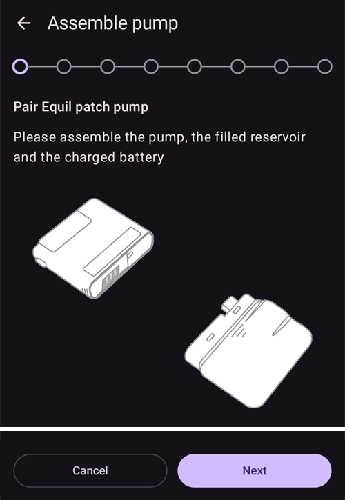
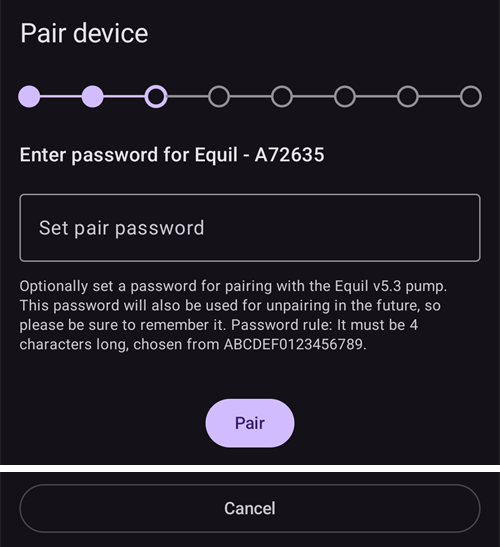

# Equil

Queste istruzioni servono per configurare il micro Equil.

```{contents} Table of contents
:depth: 1
:local: true
```

## Funzioni del micro con AAPS

* Tubeless patch pump that communicates with **AAPS** over your phone's native Bluetooth, without an additional communication device.
* **AAPS** tratta l'Equil come un micro patch con un serbatoio da 200 U: la schermata principale mostra le spie di stato del micro patch, e **Carica/Riempi** e **Cambio batteria micro** non sono disponibili. Riempimento, caricamento e cambio della batteria si fanno nelle procedure guidate del micro.
* While the pump is suspended or stopped, **AAPS** records a 0 U/h temporary basal, so no basal insulin is counted in IOB.
* I cambi di ora legale e di fuso orario vanno gestiti a mano.

## Requisiti hardware e software
* **Hardware Equil compatibile**

  Al momento sono supportati Equil 5.3 e 5.4.

* **AAPS** built and installed using the [Build APK](../SettingUpAaps/BuildingAaps.md) instructions

## Configurazione

### Select Equil pump

Apri il **menu** (☰) in alto a sinistra, scegli **[Configurazione](#Config-Builder-pump)** e sotto **Micro** seleziona **Equil**.

Once it is selected, the **Equil** card shows two buttons, **Settings** and **Open plugin**:


**Apri plugin** (oppure **Gestisci** → **Micro**) apre la schermata del micro Equil. Before a pump is paired it looks like this:


### Settings

Open the Equil settings with **Settings** on the **Equil** card, or with the gear icon in the top-right corner of the pump screen.


* **Low battery alarm**: warns you when the pump battery is low.
* **Low drug storage alarm**: warns you when the insulin in the reservoir is low.
* **Alert tone**: how the pump alerts you: **Mute**, **Vibrate only**, **Tone only** or **Vibrate and tone**.
* **Bolus speed**: how fast a bolus is given: **1.5 U/min (standard)**, **3 U/min**, **6 U/min** or **12 U/min**. A faster bolus may give more occlusion alarms.


```{admonition} Max basal and max bolus on the patch
:class: note
The patch itself refuses any basal rate above a maximum that **AAPS** programs into it. **AAPS** takes the higher of your **max basal** [setting](../SettingUpAaps/Preferences.md) and the highest hourly basal rate in your **Profile**, so the patch always accepts your profile and the temp basals the loop asks for. **AAPS** also sends your maximum allowed bolus to the patch.

When you change your **max basal** or **max bolus**, **AAPS** sends the new values to the patch automatically. Vengono inviati anche a ogni cambio profilo. There is nothing to set on the patch itself.
```

### Pair the pump

On the pump screen, press **Pair**. Una procedura guidata ti accompagna in ogni passo. The row of dots at the top shows how far along you are.

If Android asks whether **AAPS** may find and connect to nearby devices, press **Allow**. **AAPS** ne ha bisogno per trovare il micro.


La procedura guidata ha questi passi. Press **Next** to move on, or **Cancel** to leave the wizard.

1. **Profilo richiesto**: compare solo se non hai mai attivato un **Profilo** in **AAPS**. Seleziona il profilo da usare e premi **Attiva profilo**.
1. **Assemble pump**: put together the pump, the filled reservoir and the charged battery.

   

1. **Find Pump**: **AAPS** scans for nearby Equil pumps. Select your pump from the list.

   
1. **Pair device**: you can enter a pairing password in **Set pair password**. Deve essere lunga 4 caratteri, scelti tra `ABCDEF0123456789`. Premi **Associa**.

   

1. **Select Insulin**: only shown if you have more than one insulin set up. Select the insulin in the reservoir.
1. **Carica/Riempi**: il micro **non** deve essere sulla sua base. Press **Prime/Fill** and prime the reservoir until there is a drop of insulin on the needle tip. Premi **Avanti**.

   
1. **Rotazione del Sito**: compare solo se **Gestisci la rotazione del sito del micro** è attivo nelle impostazioni della rotazione del sito. Tap where you will attach the pump, or press **Skip**.
1. **Attach pump**: attach the pump to its base plate.

   
1. **Riempi la cannula**: quando il micro è sulla base, premi **Spurga l'aria** per togliere l'aria dalla cannula. Premi **Avanti**.

   

1. **Confirm**: put the pump on your body and press **Finish**.

   

```{warning}
If you set your own pairing password (recommended for your safety), store it somewhere safe. La password viene salvata nel micro. The pump asks for it at every new pairing until you unpair it properly in **AAPS**. Until then, the pump also cannot be used with the original handheld controller (PDA).
```

### Pump screen after pairing

Once the pump is paired, the pump screen shows these buttons:

* **Aggiorna**: legge subito lo stato e lo storico del micro.
* **Sospendi** / **Riprendi erogazione**: ferma o riavvia l'erogazione di insulina.
* **Change reservoir**: guides you through detaching the pump, fitting a new reservoir (and, if needed, a new battery), priming and attaching it again. The first step asks *Will you also put on a new infusion set (base plate and cannula)?*
  * **Sì, nuovo set di infusione**: scegli il sito, la cannula viene riempita e **AAPS** registra un cambio insulina e un cambio cannula.
  * **No, solo serbatoio o batteria**: la cannula non viene riempita e **AAPS** registra solo un cambio insulina.

  After a reservoir change the battery level shows **-** until **AAPS** reads it again from the pump.

  

* **Storico**: mostra gli eventi registrati dal micro.
* **Unpair device**: guides you through detaching the pump and unpairing it from **AAPS**. This stops insulin delivery, moves the pump plunger back to the bottom, and deletes the pairing.

### Allarmi

* L'allarme di insulina bassa suona una volta a ogni livello (10 U, 5 U e 2 U) e quando il serbatoio è vuoto. L'allarme di batteria bassa suona una volta al 10% e una volta al 5%. Each level alarms only once until the next reservoir change.
* Pump alarms and stops are also recorded as announcements in the treatments, at the time the pump logged them, so you can see later when and why the pump stopped.
* Se il serbatoio si svuota durante un bolo, **AAPS** registra solo l'insulina erogata fino a quel momento e ti indica entrambe le quantità.

## Dove trovare aiuto

Development of the Equil driver is done by the community on a **volunteer** basis. Prima di chiedere aiuto, per favore:

1. **Read** the relevant section of this documentation to confirm how the feature is meant to work.
2. **Ask** on the *#AAPS* channel on [Discord](https://discord.gg/4fQUWHZ4Mw), or in one of the other [community channels](../GettingHelp/WhereCanIGetHelp.md).
3. **Report a bug** by searching the [existing issues](https://github.com/nightscout/AndroidAPS/issues); if yours is not listed, open a [new issue](https://github.com/nightscout/AndroidAPS/issues) and attach your [log files](../GettingHelp/AccessingLogFiles.md).

When asking for help, include your phone make and model, Android version, **AAPS** version, and a plain-English description of the problem (what changed, when it last worked).
