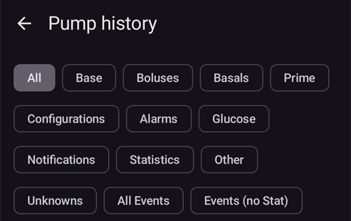

# Micro Medtronic

Il driver non funziona con i modelli più recenti, compresi tutti i modelli che finiscono con G (530G, serie 600 [630G, 640G, 670G], serie 700 [770G, 780G], ecc.).

Queste combinazioni di modello e firmware sono compatibili:

- 512/712 (qualsiasi versione del firmware)
- 515/715 (qualsiasi versione del firmware)
- 522/722 (qualsiasi versione del firmware)
- 523/723 (firmware 2.4A or lower)
- 554/754 EU release (firmware 2.6A or lower)
- 554/754 Canada release (firmware 2.7A or lower)

You can find out how to check the firmware on the pumps at [OpenAPS docs](https://openaps.readthedocs.io/en/latest/docs/Gear%20Up/pump.html#how-to-check-pump-firmware-check-for-absence-of-pc-connect) or [LoopDocs](https://loopkit.github.io/loopdocs/build/step3/#medtronic-pump-firmware).

    {contents} Indice
    :depth: 1
    :local: true

## Funzioni del micro con AAPS

* Richiede un dispositivo compatibile con RileyLink per comunicare con **AAPS**.
* Automatic DST and timezone handling.

## Requisiti hardware e software

- **Phone:** The Medtronic driver should work with any android phone that supports Bluetooth connections. **IMPORTANT: Phone manufacturers Bluetooth implementations can vary so how each phone model behaves can vary. Per esempio, alcuni telefoni gestiscono in modo diverso l'attivazione e la disattivazione del Bluetooth. This can impact the user experience when AAPS needs to reconnect to your Rileylink type device.**
- **RileyLink Compatible Device:** Android phones cannot communicate to Medtronic pumps without a separate device to handle communications. Questo dispositivo si collega al tuo telefono via Bluetooth e al tuo micro con una connessione radio compatibile. The first such device was called a Rileylink but a number of other options are now available which can offer additional functionality.
    
    - Rileylink disponibile su [getrileylink.org](https://getrileylink.org/product/rileylink916)
    - Orangelink disponibile su [getrileylink.org](https://getrileylink.org/product/orangelink)
    - Emalink (multiple model options) available at [github.com](https://github.com/sks01/EmaLink)
    - Gnarl (some additional DIY required) details available at [github.com](https://github.com/ecc1/gnarl)

A comparison chart for the various Rileylink compatible devices can be found at [getrileylink.org](https://getrileylink.org/rileylink-compatible-hardware-comparison-chart)

(MedtronicPump-configuration-of-the-pump)=

## Configurazione del micro

The following settings should be configured on the pump in order for AAPS to remotely send commands. The steps necessary to make each change on a Medtronic 715 are shown in brackets for each setting. The exact steps may vary based on pump type and/or firmware version.

- **Enable remote mode on Pump** (On the pump press Act and go to Utilities -> Remote Options, Select On, and on next screen do Add ID and add any random id such as 111111). At least one ID must be on the Remote ID list in order for the pump to expect remote communication.
- **Set Max Basal** (On the pump press Act and go to Basal and then select Max Basal Rate) As an example setting this value to four times your maximum standard basal rate would allow a 400% Temporary Basal Rate. The maximum value permitted by the pump is 34.9 units per hour.
- **Set Max Bolus** (On the pump press Act and go to Bolus and then select Max Bolus) This is the largest bolus that the pump will accept. The maximum value permitted by the pump is 25.
- **Imposta il profilo su Standard**. (On the pump press Act and go to Basal and then Select Patterns) The pump will only need one profile as AAPS will manage different profiles on your phone. No other patterns are required.
- **Set Temporary Basal Rate type** (On the pump press Act and go to Basal and then Temp Basal Type). Select Absolute (not Percent).

## Medtronic Configuration of Phone/AAPS

- **Do not pair RileyLink compatible device with the Bluetooth menu on your phone.** Pairing via the Bluetooth menu on your phone will stop AAPS from seeing your Rileylink Compatible device when you follow the instructions below.
- Disable automatic screen rotation on your phone. On certain devices automatic screen rotation causes Bluetooth sessions to restart which would cause issues for your Medtronic pump. 
- Ci sono due modi per configurare il tuo micro Medtronic in AAPS:

1. Using the setup wizard as part of a fresh install
2. In **Configurazione** > **Micro**, selezionando **Medtronic**
    
    
    
    Once it is selected, the **Medtronic** card shows two buttons, **Settings** and **Open plugin**:
    
    
    
    **Impostazioni** apre le impostazioni del driver Medtronic:
    
    
    
    **Open plugin** (or **Manage** > **Pump**) opens the Medtronic pump screen. Before a pump is paired it looks like this:
    
    

When configuring your Medtronic pump with the setup wizard it is possible that you will be prevented from completing setup because of Bluetooth issues (e.g. you cannot successfully connect to the pump). Should this happen you should select the virtual pump option in order to complete the configuration and allow for further troubleshooting by using option 2.

While setting up AAPS to work with your medtronic pump you need to set the following items in **Settings** (see the settings picture above):

- **Pump Serial Number**: Displayed on the back of your pump and starts with SN. You should only enter the 6 numbers shown without any alphabetic characters (e.g. 123456).
- **Pump Type**: The model pump you are using (e.g. 522). 
- **Pump Frequency**: There are two options based on where your pump was originally distributed. Se non sai quale opzione scegliere, controlla le [FAQ](#MedtronicPump-faq): 
    - for US & Canada, frequency used is 916 MHz
    - for Worldwide, frequency used is 868 MHz
- **Max Basal on Pump (U/h)**: This needs to match the setting set on your pump (see Configuration of the pump above). Again this setting must be carefully selected as it will determine how much AAPS can deliver via your basal rate. In pratica questo imposta la velocità basale temporanea massima. As an example, setting this value to four times your maximum standard basal rate would allow a 400% Temporary Basal Rate. The maximum value permitted by the pump is 34.9 units per hour.
- **Max Bolus on Pump (U)** (in an hour): This needs to match the setting set on your pump (see Configuration of the pump above). This setting should be carefully considered as it determines how large a bolus AAPS can ever set.
- **Delay before Bolus is started (s)**: The number of seconds after a bolus is issued before the command is actually sent to the pump. This period of time allows the user to cancel the bolus in the event a bolus command is sent in error. It is not possible to cancel a bolus that has started via AAPS. The only way to cancel a bolus that has already started is to suspend the pump manually followed by resuming it.
- **Codifica Medtronic**: decide dove viene fatta la codifica Medtronic (hardware o software). Selecting Hardware encoding (i.e. carried out by the Rileylink compatible device) is preferred as this results in less data being sent. Selecting Software encoding (i.e. carried out by AAPS) can help in the event frequent disconnects are seen. This setting will be ignored if you have firmware version 0.x on Rileylink devices.
- **Battery Type (Power View)**: In order to correctly determine the remaining battery power level you should select the type of AAA battery in use. When a value other than simple view is selected AAPS will display the remaining calculated battery percentage level and volts. Sono disponibili queste opzioni:
    
    - Non selezionato (Simple view)
    - Alcalina (Extended view)
    - Litio (Extended view)
    - NiZn (Extended view)
    - NiMH (Extended view)
- **Use Scanning**: Activates Bluetooth scanning before connecting with your Rileylink Compatible devices. This should improve the reliability of your connection to the device.

- **Show battery level reported by OrangeLink/EmaLink/DiaLink**: This feature is only supported on newer link devices such as the EmaLink or OrangeLink. The value is shown as **RileyLink Battery** on the Medtronic pump screen.
- **Set neutral temp basals**: By default Medtronic pumps beep on the hour when a temporary basal rate is active. Enabling this option can help reduce the number of beeps heard by interrupting a temporary basal at the hour change in order to suppress the beep.

(pairing-your-rileylink-compatible-device)=

### Pairing your RileyLink compatible device

Your RileyLink compatible device is paired from the Medtronic pump screen, not from the Bluetooth menu of your phone:

- Apri la schermata del micro (**Gestisci** > **Micro**, oppure **Apri plugin** sulla scheda Medtronic in **Configurazione** > **Micro**).
- Tocca **Associa RileyLink**. **AAPS** cerca i dispositivi compatibili con RileyLink nelle vicinanze.
- Tap your device in the list. When **RileyLink paired successfully** is shown, tap **OK**.

## Schermata del micro Medtronic

Per aprire la schermata del micro Medtronic, vai a **Gestisci** > **Micro**. The pump screen displays the current pump status information along with some Medtronic specific actions (see the pump screen picture above).

- **RileyLink Status**: The current status of the connection between your phone and Rileylink compatible device. This should show as Connected at all times. Any other status may require user intervention. 
- **RileyLink Battery**: The current battery level of your EmaLink or OrangeLink device. Only shown if **Show battery level reported by OrangeLink/EmaLink/DiaLink** is enabled in the Medtronic settings.
- **Pump Status**: The current status of the pump connection. As the pump will not be constantly connected this will primarily show the sleep icon. There are a number of possible other status including "Waking Up" when AAPS is trying to issue a command or other possible pump commands such as "Get Time", "Set TBR", etc.
- **Battery**: Shows battery status based on the value chosen for **Battery Type (Power View)** in the Medtronic settings.
- **Last connection**: How long ago the last successful pump connection happened.
- **Last Bolus**: How long ago the last successful bolus was delivered.
- **Base Basal Rate**: This is the base basal rate that runs on pump at this hour in your active Profile.
- **Temp basal**: Temp basal currently being delivered which can be 0 units per hour.
- **Reservoir**: How much insulin is in reservoir (updated at least every hour).
- **Errors**: Error string if there is problem (mostly shows if there is error in configuration).

In fondo alla schermata ci sono questi pulsanti:

- **Aggiorna** serve ad aggiornare lo stato attuale del micro. This should only be used if the connection was lost for a sustained period as this will require a full data refresh (retrieve history, get/set time, get profile, get battery status, etc).
- **Pair RileyLink**: Finds and pairs your RileyLink compatible device (see [above](#pairing-your-rileylink-compatible-device)).
- **Pump history**: Shows pump history (see [below](#MedtronicPump-pump-history)).
- **RL Stats**: Shows RL Stats (see [below](#MedtronicPump-rl-status-rileylink-status)).
- **Wake and Tune Up** and **Reset RileyLink**: See [Actions](#medtronic-actions) below.
- **Clear Bolus Block**: Only shown for a short time after a bolus, while **AAPS** waits for the pump to finish delivering it. Tapping it ends this wait.

(MedtronicPump-pump-history)=

## Pump History

Pump history is retrieved every 5 minutes and stored locally. Only the previous 24 hours worth of history is stored. This allows for a convenient way to see pump behavior should that be required. The only items stored are those relevant to AAPS and will not include a configuration function that has no relevance.

Tocca **Storico micro** nella schermata del micro per aprirlo. By default **All** is selected. Tap one of the filter buttons at the top (for example **Boluses**, **Basals** or **Alarms**) to show only one type of entry.

(MedtronicPump-rl-status-rileylink-status)=

## Stato RL (Stato RileyLink)

 

La finestra Stato RL ha due schede:

- **Settings**: Shows settings about the RileyLink compatible device: Configured Address, Connected Device, Connection Status, Connection Error and RileyLink Firmware versions. Device Type is always Medtronic Pump, Model would be your model, Serial number is configured serial number, Pump Frequency shows which frequency you use, Last Frequency is last frequency used.
- **History**: Shows communication history, items with RileyLink shows state changes for RileyLink and Medtronic shows which commands were sent to pump.

(medtronic-actions)=

## Actions

When the Medtronic driver is used, two additional actions are available on the pump screen (**Manage** > **Pump**):

- **Wake and Tune Up** - In the event that AAPS hasn't connected to your pump for a sustained period (it should connect every 5 minutes), you can force a Tune Up. This will try to contact your pump, by searching all of the possible radio frequencies used by your pump. In the event a successful connection is made the successful frequency will be set as the default. While the tune-up runs, the RileyLink status on the pump screen shows it. If a tune-up fails (for example because the pump was out of range), **AAPS** tries again by itself about every 10 minutes.
- **Reset RileyLink** - If you reset your RileyLink compatible device you may need to use this action so that device can be reconfigured (frequency set, frequency type set, encoding configured).

## Note importanti

### Special attention in NS configuration needed

AAPS is using serial number for synchronization and serial number is exposed to NS. Because knowledge of serial number of old Medtronic pump can be used to control the pump remotely take special care to hardening NS site preventing leakage of SN of your pump. Vedi https://nightscout.github.io/nightscout/security/

### OpenAPS users

OpenAPS users should note that AAPS with Medtronic uses a completely different approach than OpenAPS. Using AAPS the primary method of interacting with the pump is via your phone. In normal use cases it is likely that the only time it is required to use the pump menu is when changing reservoirs. This is very different when using OpenAPS where at least some of a bolus is usually delivered via the quick bolus buttons. In the event the pump is used to manually deliver a bolus there can be issues if AAPS attempts to deliver one at the same time. There are checks to try and prevent issues in such cases but this should still be avoided where possible.

### Logging

In the event you need to troubleshoot your Medtronic pump function select the menu icon in the upper left corner of the screen, select Maintenance and Log Settings. Per risolvere qualsiasi problema con Medtronic, controlla Pump, PumpComm e PumpBTComm.

### CGM Medtronic

Il CGM Medtronic al momento NON è supportato.

### Uso manuale del micro

You should avoid manually bolusing or setting TBRs on your pump. All such commands should be sent via AAPS. Se usi comandi manuali, tra un comando e l'altro devono passare almeno 3 minuti, per ridurre il rischio di problemi.

### Timezone changes and DST (Daylight Saving Time) or Traveling with Medtronic Pump and AAPS

AAPS will automatically detect Timezone changes and will update the Pump's time when your phone switches to the new time.

Traveling east means you are going to be adding hours to the current time (ex. from GMT+0 to GMT+2), which will not result in any issues as there will be no overlap (e.g. it won't be possible to have the same hour twice). Traveling west, however, can result in issues as you are effectively going back in time, which can result in incorrect IOB data.

The issues seen when traveling west are known to the developers and work on a possible solution is ongoing. Vedi https://github.com/andyrozman/RileyLinkAAPS/issues/145 per maggiori dettagli. For now, please be aware that this issue may occur and carefully monitor when changing time zones.

### Is a GNARL a fully compatible Rileylink compatible device?

The GNARL code fully supports all of the functions used by the Medtronic driver in AAPS which means it is fully compatible. It is important to note that this will require additional work as you will have to source compatible hardware and then load the GNARL code on to the device.

**Note from author:** Please note that the GNARL software is still experimental and lightly tested, and should not be considered as safe to use as a RileyLink.

(MedtronicPump-faq)=

## Domande frequenti (FAQ)

(MedtronicPump-what-to-do-if-i-loose-connection-to-rileylink-and-or-pump)=

### What to do if I lose connection to RileyLink and/or pump?

There are a number of options to try and resolve connectivity issues.

- Tocca **Risveglio e Sintonizzazione** nella schermata del micro (**Gestisci** > **Micro**) come descritto sopra.
- Disable Bluetooth on your phone, wait 10 seconds and then enable it again. This will force the Rileylink device to reconnect to the phone.
- Reset the Rileylink device. Poi devi toccare **Reset RileyLink** nella schermata del micro (**Gestisci** > **Micro**).
- Other users have found the following steps to be effective in restoring connectivity when other methods have not: 
    1. Riavvia il telefono
    2. *Mentre* il telefono si riavvia, riavvia il dispositivo Rileylink
    3. Apri AAPS e lascia che la connessione si ripristini

### Come capire quale frequenza usa il mio micro

Sul retro del micro trovi una riga con il numero del modello e un codice speciale di 3 lettere. The first two letters determine the frequency type and the last one determines color. Questi sono i valori possibili per la frequenza:

- NA - North America (in frequency selection you need to select "US & Canada (916 MHz)")
- CA - Canada (in frequency selection you need to select "US & Canada (916 MHz)")
- WW - Worldwide (in frequency selection you need to select "Worldwide (868 MHz)")

(MedtronicPump-pump-unreachable)=

### How to fix the "pump unreachable" error

Some Medtronic pumps report a "pump unreachable" error after an **AAPS** update. Per risolverlo, cambia il tipo di codifica:

1. Vai a **Configurazione** > **Micro** e tocca **Impostazioni** sulla scheda **Medtronic**.
2. Set **Medtronic Encoding** to **Hardware 4b6b Encoding**.

## Dove trovare aiuto

Development of the Medtronic driver is done by the community on a **volunteer** basis. Prima di chiedere aiuto, per favore:

1. **Read** the relevant section of this documentation to confirm how the feature is meant to work.
2. **Ask** on the *#AAPS* channel on [Discord](https://discord.gg/4fQUWHZ4Mw), or in one of the other [community channels](../GettingHelp/WhereCanIGetHelp.md).
3. **Report a bug** by searching the [existing issues](https://github.com/nightscout/AndroidAPS/issues); if yours is not listed, open a [new issue](https://github.com/nightscout/AndroidAPS/issues) and attach your [log files](../GettingHelp/AccessingLogFiles.md).

Quando chiedi aiuto, indica marca e modello del telefono, versione di Android, versione di **AAPS** e una descrizione semplice del problema (cosa è cambiato, quando ha funzionato l'ultima volta).