(medtrum-nano-300u)=
# Medtrum Nano 200U / 300U

These instructions are for configuring the Medtrum insulin pump.

```{contents} Table of contents
:depth: 1
:local: true
```

## Funzioni del micro con AAPS
* All loop functionality supported (SMB, TBR etc)
* Automatic DST and timezone handling
* Il bolo esteso non è supportato dal driver di AAPS

## Requisiti hardware e software
* **Compatible Medtrum pumpbase and reservoir patches**
    - Currently supported:
        - Medtrum TouchCare Nano 200U con basi del micro rif.: **MD0201** e **MD8201**.
        - Medtrum TouchCare 300U con base del micro rif.: **MD8301**.
        - If you have an unsupported model and are willing to donate hardware or assist with testing, please contact us via discord [here](https://discordapp.com/channels/629952586895851530/1076120802476441641).
* **AAPS built and installed** using the [Build APK](../SettingUpAaps/BuildingAaps.md) instructions.
* **Telefono Android compatibile** con connessione Bluetooth BLE
    - Vedi le [Note di rilascio](../Maintenance/ReleaseNotes.md) di AAPS

## Prima di iniziare

**SAFETY FIRST** Do not attempt this process in an environment where you cannot recover from an error (extra patches, insulin, and pump control devices are must-haves).

**The PDM and Medtrum App will not work with a patch that is activated by AAPS.** Previously you may have used your PDM or Medtrum app to send commands to your pump. For security reasons you can only use the activated patch with the device or app that was used to activate it.

*This does NOT mean that you should throw away your PDM. It is recommended to keep it somewhere safe as a backup in case of emergencies, for instance if your phone gets lost or AAPS is not working correctly.*

**Your pump will not stop delivering insulin when it is not connected to AAPS** Default basal rates are programmed on the pump as defined in the current active profile. As long as AAPS is operational, it will send temporary basal rate commands that run for a maximum of 120 minutes. If for some reason the pump does not receive any new commands (for instance because communication was lost due to pump - phone distance) the pump will fall back to the default basal rate programmed on the pump once the Temporary Basal Rate ends.

**The AAPS Profile does not support a 30 minute basal rate time frame** If you are new to AAPS and are setting up your basal rate profile for the first time, please be aware that basal rates starting on a half-hour basis are not supported, and you will need to adjust your basal rate profile to start on the hour. For example, if you have a basal rate of 1.1 units which starts at 09:30 and has a duration of 2 hours ending at 11:30, this will not work. You will need to change this 1.1 unit basal rate to a time range of either 9:00-11:00 or 10:00-12:00. Even though the Medtrum pump hardware itself supports the 30 min basal rate profile increments, AAPS is not able to take them into account with its algorithms currently.

**0U/h profile basal rates are NOT supported in AAPS** While the Medtrum pump does support a zero basal rate, AAPS uses multiples of the profile basal rate to determine automated treatment and therefore cannot function with a zero basal rate. La velocità basale minima del profilo è 0,05 U/h.

A temporary zero basal rate can be achieved through the "Disconnect pump" function or through a combination of Disable Loop/Temp Basal Rate or Suspend Loop/Temp Basal Rate.

## Configurazione

```{caution}
When you activate a patch with **AAPS**, you **MUST** turn off every other device that can talk to the Medtrum pump base, for example an active PDM or the Medtrum app.
```

### Step 1: Select Medtrum pump

#### Opzione 1: nuove installazioni

If you are installing **AAPS** for the first time, the **Setup Wizard** guides you through the setup. Select **Medtrum** when you reach the **Pump** step.

If in doubt, you can also select **Virtual Pump** and select **Medtrum** later, after setting up **AAPS** (see option 2).


#### Opzione 2: la schermata Configurazione

In un'installazione esistente puoi selezionare il micro **Medtrum** in [Configurazione > Micro](#Config-Builder-pump):

Apri il **menu** (☰) in alto a sinistra, tocca **Configurazione** > **Micro** e seleziona la scheda **Medtrum**. Può essere attivo un solo micro alla volta.


Once it is selected, the **Medtrum** card shows two buttons, **Settings** and **Open plugin**:


**Apri plugin** (oppure **Gestisci → Micro**) apre la schermata del micro Medtrum. You use it to change patches and to see the pump status. Before a patch is activated it looks like this:


(medtrum-step-2)=
### Step 2: Change Medtrum settings

Tocca **Impostazioni** sulla scheda **Medtrum** in **Configurazione** > **Micro**. You can also tap the gear icon in the top-right corner of the Medtrum pump screen. Si aprono le **Impostazioni micro Medtrum**:


```{note}
Non c'è più l'impostazione **Numero seriale**. **AAPS** finds your pump base with a Bluetooth scan the first time you activate a patch (see [Step 3](#medtrum-activate-patch)), and remembers its serial number. To use a different pump base, see [Unpair](#medtrum-unpair).
```

#### Impostazioni allarmi

***Predefinito: Suono.***

This setting changes the way that the pump alerts you when there is a warning or error.

- **Beep**: the patch beeps on alarms and warnings.
- **Silent**: the patch does not alert you on alarms and warnings.

Note: In silent mode **AAPS** still sounds the alarm, depending on your phone's volume settings. If you do not respond to the alarm, the patch eventually beeps.

#### Notifica di avviso del micro

***Default: Enabled.***

This setting changes the way **AAPS** shows notifications for non-critical pump warnings. When enabled, a notification is shown on the phone when a pump warning occurs, including:
- Low battery
- Low reservoir (20 units)
- Patch expires soon

Ti consigliamo di lasciarla abilitata quando gli allarmi del micro sono impostati su **Silenzioso**. In either case these warnings are also shown on the Medtrum pump screen under [Active alarms](#medtrum-active-alarms).

(medtrum-patch-expiration)=
#### Scadenza patch

***Default: Enabled.***

This setting changes the behavior of the patch. When enabled, the patch expires after 3 days and gives an audible warning if you have sound enabled. After 3 days and 8 hours the patch stops working.

If this setting is disabled, the patch does not warn you before it stops. With recent pump base firmware, a patch runs for 5 days at most.

#### Avviso di scadenza micro [ore]

***Predefinito: 72 ore.***

This setting changes the time of the expiration warning. When [Patch Expiration](#medtrum-patch-expiration) is enabled, **AAPS** shows a notification this many hours after activation.

#### Insulina massima oraria [Unità]

***Default: 25U.***

Questa impostazione cambia la quantità massima di insulina che può essere erogata in un'ora. If this limit is exceeded, the patch suspends and gives an alarm. Puoi resettare l'allarme con il pulsante **Reset allarmi** nella schermata del micro, vedi [Reset allarmi](#nano-reset-alarms).

Set this to a sensible value for your insulin requirements.

#### Insulina massima giornaliera [Unità]

***Default: 80U.***

Questa impostazione cambia la quantità massima di insulina che può essere erogata in un giorno. If this limit is exceeded, the patch suspends and gives an alarm. Puoi resettare l'allarme con il pulsante **Reset allarmi** nella schermata del micro, vedi [Reset allarmi](#nano-reset-alarms).

Set this to a sensible value for your insulin requirements.

#### Scansione in caso di errore di connessione

***Default: Off.***

Si trova in **Impostazioni avanzate**.

Abilitala solo se hai problemi di connessione. When enabled, the driver scans for the pump again before trying to reconnect to it. Make sure the Location permission for **AAPS** is set to "Allow all the time".

### Step 2b: AAPS alert settings

Queste impostazioni non fanno parte del driver Medtrum. Open them from the **Settings** (gear) icon in the top-right corner of the main screen. See [Settings](../SettingUpAaps/Preferences.md) for more.

#### BT Watchdog

Apri **Impostazioni** > **Micro**:


**BT Watchdog** spegne il Bluetooth del telefono per un secondo se **AAPS** non riesce a connettersi al micro. This may help on some phones where Bluetooth freezes.

Enable this setting if you often have connection problems with your pump.

#### Avvisi locali

Apri **Impostazioni** > **Avvisi locali**:


##### Avviso se il micro è irraggiungibile

***Default: Enabled.***

This setting is forced on when the Medtrum driver is enabled. Ti avvisa quando il micro è irraggiungibile. This can happen when the pump is out of range, or when it is not responding because of a faulty patch or pump base, for example when water leaks between the pump base and the patch.

Per motivi di sicurezza questa impostazione non può essere disattivata.

##### Soglia micro irraggiungibile

***Predefinito: 30 min.***

This setting changes how long **AAPS** waits before alerting you that the pump is unreachable.

You can change this setting when using the Medtrum pump, but we recommend keeping it at 30 minutes for safety reasons.

(medtrum-activate-patch)=
### Step 3: Activate patch

**Prima di continuare:**
- Have your Medtrum pump base and a new reservoir patch ready.
- Spegni gli altri dispositivi che possono comunicare con il micro Medtrum (PDM e app Medtrum).
- Ideally, make sure **AAPS** is set up and a [profile is activated](../DailyLifeWithAaps/ProfileSwitch-ProfilePercentage.md). If no profile is active, the activation starts with a **Profile required** step where you choose the profile to activate.

#### Start the activation

Apri la [schermata del micro Medtrum](#nano-overview) (**Gestisci → Micro**) e tocca **Cambia patch**. If you have set up [settings protection](#Preferences-protection), you must enter your password or PIN first.

If a patch is already active, you are asked to deactivate it first, see [Deactivate patch](#nano-deactivate-patch).

L'attivazione è una procedura guidata passo per passo. Follow the prompts to fill and activate a new patch. Tap **Cancel** at any step to stop.

```{important}
Only put the patch on your body and insert the cannula when the wizard tells you to (after priming is complete).
```

I primi passi che vedi dipendono dalla tua configurazione:

1. **Profile required**: only if no profile is active. Seleziona il profilo da applicare, poi continua.
2. **Find Pump**: only the first time, or after you used [Unpair](#medtrum-unpair). Connect the pump base to a fresh patch to power it on. **AAPS** scans for nearby Medtrum pump bases (their names start with `MT`). Tap yours in the list. **AAPS** saves its serial number, then goes straight to filling the patch.

   

3. **Attiva patch**: solo quando **AAPS** conosce già la base del tuo micro. The screen says "No active patch. Premi **Avanti** per iniziare il processo di attivazione." Make sure the pump base is **not** connected to the patch yet, then tap **Next**.

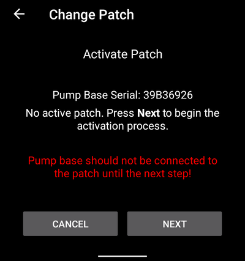

#### Connect and fill the patch

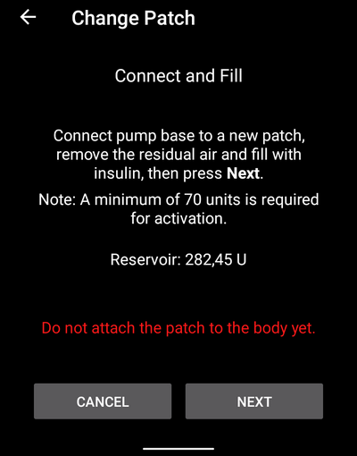

Connect the pump base to the patch, remove the residual air and fill the patch with insulin. Per l'attivazione servono almeno 70 unità. The screen shows the reservoir level. Do not attach the patch to your body yet.

When the patch is detected and filled, the **Next** button appears. Toccalo.

#### Select insulin

This step only appears if you have more than one insulin set up in **AAPS**. Select the insulin you are filling the patch with. Dopo l'attivazione **AAPS** applica un cambio profilo con questa insulina.

#### Prime the patch

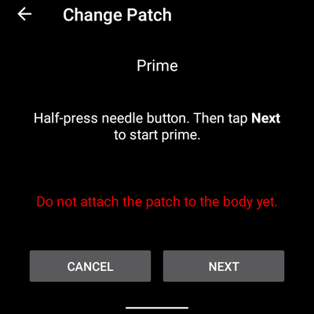

**Non** togliere il blocco di sicurezza. Half-press the needle button on the patch, then tap **Next** to start priming.

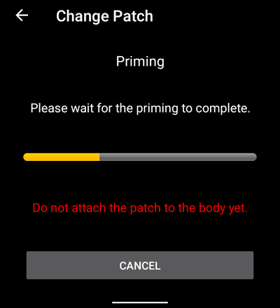

Wait for priming to complete.

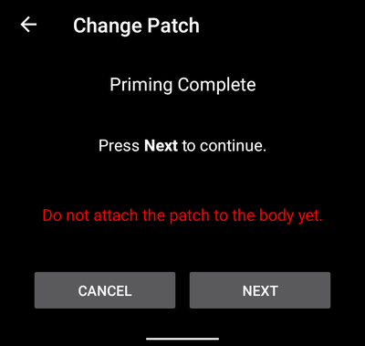

When priming is complete, tap **Next** to continue.

#### Rotazione del Sito

This step only appears if you manage pump sites with [Site Rotation](#Aapsscreens-site-rotation) (setting **Manage pump site rotation**). Choose where you place the patch on your body, or skip this step.

#### Attach patch

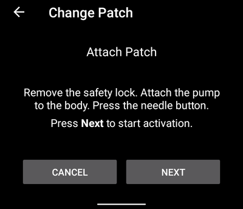

Clean the skin and remove the stickers. Remove the safety lock, attach the patch to your body, and press the needle button to insert the cannula.

Tap **Next** to activate the patch.

#### Activate patch

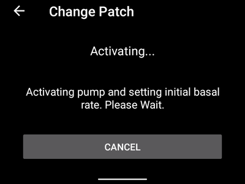

**AAPS** attiva il micro e imposta la velocità basale iniziale. Attendi. When activation is complete, the following screen appears:

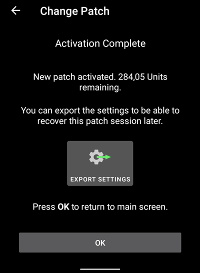

```{admonition} Older screenshot
:class: note
A parte **Trova Micro**, gli screenshot dell'attivazione qui sopra sono di una versione precedente di **AAPS** e in **AAPS** 4 possono avere un aspetto diverso.
```

It shows how many units are left in the patch. Tocca **OK** per tornare alla schermata del micro.

```{tip}
Dopo una nuova attivazione, [esporta le tue impostazioni](../Maintenance/ExportImportSettings.md). This lets you recover this patch session later, for example on a new phone.
```

(nano-deactivate-patch)=

### Deactivate patch

To deactivate the active patch, open the [Medtrum pump screen](#nano-overview) (**Manage → Pump**) and tap **Change Patch**.

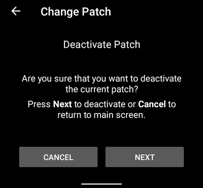

You are asked to confirm that you want to deactivate the current patch. **This cannot be undone.** Tap **Next** to deactivate, or **Cancel** to return to the pump screen.

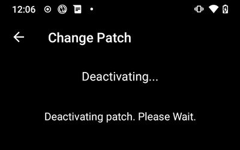

If **AAPS** cannot deactivate the patch (for example because the pump base has already been removed from the patch), tap **Discard** to forget the current patch session. You can then activate a new patch.

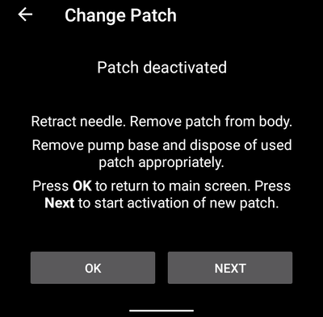

When deactivation is complete, retract the needle and remove the patch from your body. Remove the pump base and dispose of the used patch. Tap **OK** to return to the pump screen, or **Next** to start activating a new patch.

(nano-resume-interrupted-activation)=

### Resume interrupted activation

If a patch activation is interrupted, for example because the phone battery runs out, you can resume it. Apri la [schermata del micro Medtrum](#nano-overview) (**Gestisci → Micro**) e tocca **Cambia patch**.

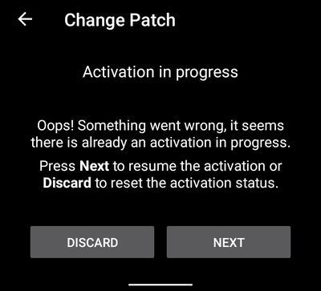

Tocca **Avanti** per riprendere l'attivazione. Tap **Discard** to reset the activation status, so you can activate a new patch.

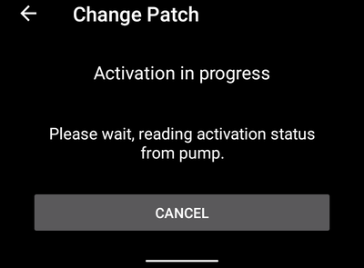

```{admonition} Older screenshot
:class: note
The screenshots in **Deactivate patch** and **Resume interrupted activation** are from an earlier **AAPS** version and may look different in **AAPS** 4.
```

Il driver legge lo stato di attivazione dal micro. Se funziona, la procedura guidata continua dal passo in cui si era fermata.

(nano-overview)=

## Schermata del micro

The Medtrum pump screen (**Manage → Pump**) shows the current status of the Medtrum patch. It also has buttons to change the patch, reset alarms and refresh the status. Un banner in alto mostra gli stati importanti, per esempio **Patch non attivata** o **Il micro è sospeso**.


La schermata può mostrare queste righe. Some rows only appear when they have a value.

- **Last connection**: how long ago **AAPS** last connected to the pump.
- **Ultimo bolo**: l'ultimo bolo erogato.
- **Battery**: the current battery voltage of the patch.
- **Serbatoio**: il livello attuale del serbatoio.
- **Serial number**: the serial number of your pump base.
- **Stato micro**: lo stato attuale del micro. For example **Active** (the patch is activated and running normally) or **Stopped** (the patch is not activated).
- **Base basal rate**: the basal rate from your profile that is running now.
- **Basale temporanea**: la velocità basale temporanea, se ce n'è una in corso.
- **Active bolus**: the bolus that is being delivered right now.
- **Allarmi attivi**: vedi [sotto](#medtrum-active-alarms).
- **Tipo micro**: il modello della base del tuo micro.
- **FW version**: the firmware version of the pump base.
- **Patch no**: the sequence number of the activated patch. It goes up by one every time you activate a new patch.
- **Activation**: the date and time the patch was activated, and how long ago that was.
- **Patch expires**: the date and time when the patch expires. Mostra **Non abilitato** se [Scadenza patch](#medtrum-patch-expiration) è disattivata.

(medtrum-active-alarms)=
### Allarmi attivi

This row shows any alarms that are active right now, for example a low reservoir or an expiring patch.

### Aggiorna

This button refreshes the status of the patch. It is only available when a patch is active and **AAPS** is not connected to the pump at that moment.

### Cambia patch

This button starts the wizard to change the patch. See [Activate patch](#medtrum-activate-patch) for more information.

(medtrum-unpair)=
### Disaccoppia

This button only appears when **AAPS** knows a pump base. It clears the stored pump base serial number and disconnects. The next time you activate a patch, **AAPS** scans for a pump base again (the **Find Pump** step). Usalo se passi a un'altra base del micro. Only do this when no patch is active.

(nano-reset-alarms)=

### Reset allarmi

The **Reset alarms** button only appears on the pump screen when the patch has suspended itself, for example after a maximum daily insulin alarm. Toccalo per resettare gli allarmi e riprendere l'erogazione di insulina.

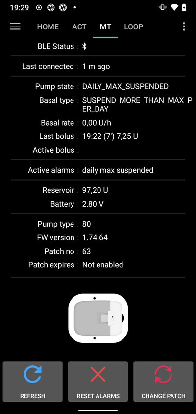

```{admonition} Older screenshot
:class: note
The screenshot above is from an earlier **AAPS** version. In **AAPS** 4 la schermata del micro ha un aspetto diverso, ma il pulsante **Reset allarmi** funziona allo stesso modo.
```

## Switching phone, export/import settings

When you switch to a new phone, do the following:
* [Export settings](../Maintenance/ExportImportSettings.md) on your old phone.
* Transfer the settings file from the old phone to the new phone, and import it into **AAPS**. Tick **Also replace pump settings** on the import screen, otherwise the patch session is not transferred to the new phone.

The imported settings file must be from the patch session you are using now, otherwise the patch will not connect (see [Tubeless pumps](#ExportImportSettings-tubeless-pumps)).

After a settings import, the driver syncs the history with the pump. This can take a while, depending on the age of the settings file. The progress ("Syncing records, ... left") is shown on the main screen:


(medtrum-nano-troubleshooting)=

## Troubleshooting

### Problemi di connessione

If you have connection timeouts or other connection problems:
- In the Android app settings for **AAPS**, set the Location permission to "Allow all the time".
- Try enabling **Scan on connection error** (Medtrum settings > **Advanced Settings**) and **BT Watchdog** (**Settings** > **Pump**), see [Step 2](#medtrum-step-2).

### Bluetooth issues
For known issues with Bluetooth connections, dropouts of pump/pods, or activation and connection issues [Bluetooth Troubleshooting](../GettingHelp/BluetoothTroubleshooting.md)

### Attivazione interrotta

If the activation is interrupted, for example by an empty phone battery or a phone crash, you can resume it. Tap **Change Patch** on the pump screen and follow the steps in [Resume interrupted activation](#nano-resume-interrupted-activation).

### Preventing patch faults

The patch can give a variety of errors. Per evitare errori frequenti:
- Make sure the pumpbase is properly seated in the patch and no gaps are visible.
- When filling the patch do not apply excessive force to the plunger. Do not try to fill the patch beyond the maximum that applies to your model.

## Dove trovare aiuto

All of the development work for the Medtrum driver is done by the community on a **volunteer** basis; we ask that you to remember that fact and use the following guidelines before requesting assistance:

-  **Level 0:** Read the relevant section of this documentation to ensure you understand how the functionality with which you are experiencing difficulty is supposed to work.
-  **Level 1:** If you are still encountering problems that you are not able to resolve by using this document, then please go to the *#Medtrum* channel on **Discord** by using [this invite link](https://discord.gg/4fQUWHZ4Mw).
-  **Livello 2:** Cerca tra le segnalazioni esistenti per vedere se il tuo problema è già stato segnalato in [Issues](https://github.com/nightscout/AAPS/issues). Se esiste, conferma/commenta/aggiungi informazioni sul tuo problema. If not, please create a [new issue](https://github.com/nightscout/AndroidAPS/issues) and attach [your log files](../GettingHelp/AccessingLogFiles.md).
-  **Be patient - most of the members of our community consist of good-natured volunteers, and solving issues often requires time and patience from both users and developers.**