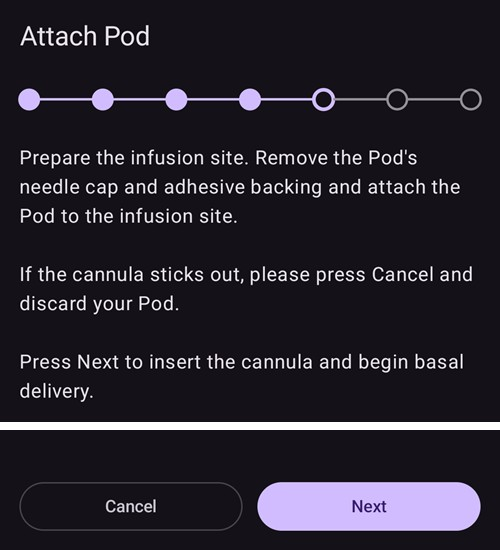
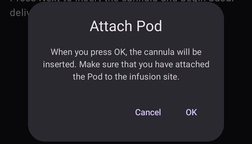
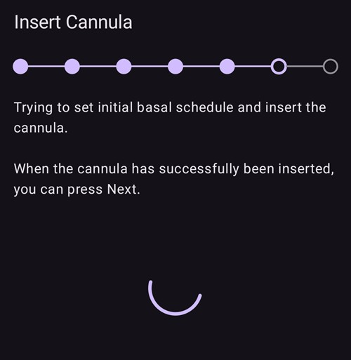
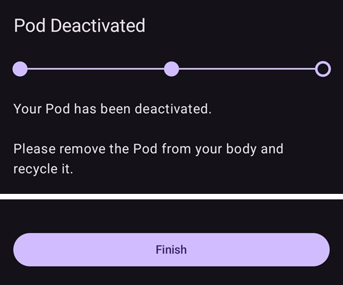
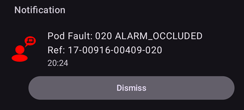

# Omnipod DASH

These instructions are for configuring the **Omnipod DASH** generation pump **(NOT Omnipod Eros)**. The DASH driver is a well-established way to loop with Omnipod.

```{contents} Table of contents
:depth: 1
:local: true
```

## Specifiche di Omnipod DASH

Key characteristics of the **Omnipod DASH** ('DASH'):

- The DASH pods are identified by a **blue needle cap** (the older EROS pod has a clear needle cap). The pods are otherwise identical in terms of physical dimensions.
- DASH does not require a BLE link/bridge device (NO RileyLink, OrangeLink, or EmaLink needed).
- The DASH's Bluetooth connection is used only when sending a command (e.g a Bolus), and disconnects right after issuing the command.
- **AAPS** will wait for pod's accessibility to send commands.
- On pod activation, **AAPS** will find and connect to a new DASH pod.
- Distanza prevista dal telefono: 5-10 metri (può variare).

(omnipod-dash-constraints)=

## Omnipod DASH known AAPS constraints/issues
- General advice is to run **AAPS** on Android 14 or 16. Android 15 has many reported [issues](https://github.com/nightscout/AndroidAPS/issues/3471) from the community. However, if you do run on Android 15 you will likely need to turn on **Bluetooth bonding** (in the **Advanced Settings** section of the [Dash settings](#omnipod-dash-advanced-settings)) to successfully activate and use Pods, see [General Troubleshooting](../GettingHelp/GeneralTroubleshooting.md) for more info on the Bonding settings.
- DST and timezone changes are not applied automatically. After a clock change you must update the pod manually: press **Refresh** on the DASH pump screen, then press **Set time** (shown when the pod and phone time zones differ) or perform a **Profile Switch** (see [Timezone change for Omnipod Dash](#timezone-traveling-with-pumps)).
- Dash only supports basal rate in 0.05 U/h steps. If you try to set Basal with 0.01 steps in your **AAPS profile**, AAPS will not give a warning even though the pod will round up the rate into 0.05 steps. If you open **Pod History** on the DASH pump screen, it will display that 0.05 basal was set. This also means the lowest basal rate allowed by the DASH in **AAPS** is 0.05U/h.
- The settings file contains the active Pod session. Export your settings after each Pod activation, and see [Export and import settings](#omnipod-dash-export-import) before importing settings.
- Quando imposti un nuovo profilo basale, DASH sospende l'erogazione prima di impostare il nuovo **Profilo** basale. Se c'è un'interruzione della comunicazione o un errore, il profilo basale non riparte automaticamente. See section [Resuming Insulin Delivery](#omnipod-dash-resuming-insulin-delivery) for details.
- If alerts are configured, and the pod is about to expire, the pod will keep beeping until alerts are silenced, see [Silencing Pod Alerts](#omnipod-dash-silencing-pod-alerts) for details.
- There are a number of known issues with Bluetooth which can cause pod activation problems. See [Bluetooth Troubleshooting](../GettingHelp/BluetoothTroubleshooting.md) for the known issue and solutions to these problems.

(hardware-software-requirements)=

(omnipod-dash-hardware-software-requirements)=
## Requisiti hardware e software

- Omnipod DASH is identified by the blue needle cap.


- **Un telefono Android compatibile** con Bluetooth Low Energy (BLE) (per maggiori informazioni vedi [Telefoni](../Getting-Started/Phones.md)). Inoltre le informazioni seguenti ti aiutano a valutare altri punti importanti per attivare e usare con successo DASH su un telefono compatibile:
    -  The **AAPS** Omnipod Dash driver connects with the DASH Pod using Bluetooth.  
      **AAPS** will automatically establish a new Bluetooth connection to the Pod every time it needs to send a command (e.g a Bolus), after sending the command the Bluetooth connection is immediately disconnected.
       - **NOTA:**
         - The Bluetooth connection can be interrupted/disturbed by other Bluetooth devices linked to the phone that is running **AAPS**, like earbuds etc... Devices like this can cause connection errors or pod activation issues on some models of phones. It's a good idea to review the [tested hardware setups](https://docs.google.com/spreadsheets/u/1/d/e/2PACX-1vScCNaIguEZVTVFAgpv1kXHdsHl3fs6xT6RB2Z1CeVJ561AvvqGwxMhlmSHk4J056gMCAQE02sAWJvT/pubhtml?gid=683363241&single=true) list for known working configurations when choosing the phone for an Omnipod DASH setup.
         - Ci sono vari problemi noti con il Bluetooth che possono causare difficoltà nell'attivazione del pod (vedi [Risoluzione problemi](#omnipod-dash-troubleshooting) per consigli su altri problemi Bluetooth), in particolare la sezione [Problemi legati al Bluetooth](#omnipod-dash-bluetooth-related-issues).
    - The phone must run **Android 12 or newer**, with **AAPS** built and installed using the [**Build APK**](../SettingUpAaps/BuildingAaps.md) instructions. Usa sempre l'ultima versione rilasciata.
- A supported [**Continuous Glucose Monitor (CGM)**](../Getting-Started/CompatiblesCgms.md)

The instructions below explain how to activate a new pod session using **AAPS**. Aspetta che il Pod attuale sia vicino alla scadenza, perché dovrai attivare un nuovo Pod con **AAPS**. Once a pod is de-activated it cannot be reused/re-activated, the de-activation is final.

## Prima di iniziare

Ensure you have read and understand this whole guide, have read and understand the **Before You Begin** section, as well as  **[Omnipod and AAPS Constraints and Issues](#omnipod-dash-constraints)** to avoid running into a known problem.

### **SAFETY FIRST** - You **SHOULD NOT** try to connect **AAPS** to a pod for the first time without having access to all of the following:
1. Extra pods (3 or more spare)
2. Spare Insulin and MDI equipment
3. A working Omnipod PDM (In case **AAPS** fails)
4. Supported Phones are a must! (See [Hardware/Software Requirements](#hardware-software-requirements))
5. Correct version of AAPS built and installed

### Your Omnipod Dash PDM will become redundant after the AAPS Dash driver activates your pod.
- Before using **AAPS** you or your care giver would have had to manage the Pod using the Omnipod PDM (or in some regions a Phone app) to send commands to your DASH (e.g a Bolus).
- The DASH can only facilitate a single Bluetooth device (e.g PDM or Phone) connection to manage and send commands.
- The device that successfully activates the pod is the only device allowed to communicate with that Pod from that point forward. This means that once you activate a DASH with your Android phone using **AAPS**, **you will no longer be able to use your PDM with that pod!** For the time that Pod is active the **AAPS** Dash driver running on your Android phone is now the new PDM for your pod.
- **DO NOT Throw away your PDM!** It is recommended to keep it around as a backup and for emergencies, for instance when your phone gets lost or **AAPS** is not working correctly.

### Your pod **WILL NOT** stop delivering insulin when it is not connected to AAPS.
Default basal rates are programmed on the pod on activation as defined in the current active [**Profile**](../SettingUpAaps/YourAapsProfile.md).  
As long as **AAPS** is operational it will send basal rate adjustment commands that run for a maximum of 120 minutes.  
When for some reason the pod does not receive any new commands (for instance because communication was lost due to Pod ➜ phone distance) the pod will automatically fall back to default basal rates as defined in your [**Profile**](../SettingUpAaps/YourAapsProfile.md).

### AAPS Profile(s) do not support 30 minute basal rate time frames
If you are new to **AAPS** and are setting up your basal rate [**Profile**](../SettingUpAaps/YourAapsProfile.md) for the first time, please be aware that basal rates starting on a half-hour basis are not supported. For example, on your Omnipod PDM, if you have a basal rate of 1.1 units which starts at 09:30 and has a duration of 2 hours ending at 11:30, it is not possible replicate this exact Basal **Profile** in **AAPS**.  
You will need to change this 1.1 unit basal rate to a time range of either 9:00-11:00 or 10:00-12:00. Even though the DASH hardware itself supports the 30 minute basal rate **Profile** increments, **AAPS** does NOT support this feature.

### 0U/h Profile basal rates are NOT supported in AAPS
While the DASH does support a zero basal rate, **AAPS** uses multiples of the user's **Profile** basal rate to determine automated treatment; it cannot function with a zero basal rate.  
Instead a temporary zero basal rate can be achieved through the "Disconnect pump" function, or through a combination of Disable Loop/Temp Basal Rate or Suspend Loop/Temp Basal Rate.  
**NOTE:** The lowest basal rate allowed by the DASH in **AAPS** is 0.05U/h.

## Selezionare Dash in AAPS

Ci sono **due** modi per selezionare il driver Omnipod DASH in **AAPS**:

### Opzione 1: nuove installazioni

When you install **AAPS** for the first time, the **Setup Wizard** guides you through the key features and installation requirements of **AAPS**. When you reach the **Pump** step, select **Omnipod Dash**.


Se non sei ancora sicuro, per ora puoi selezionare **Micro virtuale** e selezionare **Omnipod Dash** più tardi, dopo aver configurato **AAPS** (vedi Opzione 2).

(omnipod-dash-option-2-config-builder)=
### Opzione 2: la schermata Configurazione

On an existing installation you can select the **Omnipod Dash** pump from the **Configuration** screen:

1. Open the **menu** (☰) in the top-left corner of the main screen and select **Configuration**.
2. Tap **Pump** and select the radio button of **Omnipod Dash** (*"Pump integration for Omnipod Dash (the new, Bluetooth-enabled model with a blue needle cap)"*).

3. Once it is selected, the **Omnipod Dash** card shows two buttons:
   - **Settings** opens the [Dash settings](#omnipod-dash-settings).
   - **Apri plugin** apre la [schermata del micro DASH](#omnipod-dash-tab).

   

### Verifica della selezione del driver Omnipod

To check that **Omnipod Dash** is selected, open **Manage** (bottom navigation of the main screen) and tap **Pump**. The DASH pump screen opens, as shown in the next section.

(omnipod-dash-tab)=

## The DASH pump screen

The DASH pump screen is where you manage your pods: activate and deactivate them, refresh the pod status, silence alerts and look at the pod history. Open it with **Manage** > **Pump**, or with **Open plugin** on the **Omnipod Dash** card in **Configuration** > **Pump**.

Questa è la schermata senza un pod attivo:


E questa è la schermata con un pod attivo:


The **Settings** (gear) icon in the top-right corner opens the [Dash settings](#omnipod-dash-settings).

***NOTE:** If a field on the pump screen shows (uncertain), press **Refresh** to update the pod status.*

### Campi

- **Bluetooth Address:** The Bluetooth address of the pod.

- **Connection quality:** How reliably **AAPS** connects to the pod, shown as *successful connections / all connection attempts :: success rate*, for example `412/420 :: 98.10 %`. Dopo più di 50 connessioni riuscite, il valore diventa giallo sotto il 90 % e rosso sotto il 70 %. Un valore basso indica un problema Bluetooth (vedi [Problemi legati al Bluetooth](#omnipod-dash-bluetooth-related-issues)).

- **Stato erogazione:** lo stato di erogazione grezzo riportato dal pod. This field is shown only in engineering mode builds.

- **ID univoco:** l'ID univoco che **AAPS** ha dato al pod durante l'attivazione.

- **Numero LOT:** il numero di lotto di produzione del pod.

- **Numero sequenza:** il numero di sequenza del pod.

- **Versione firmware:** le versioni del firmware e del Bluetooth del pod.

- **Ora nel pod:** l'ora attuale nel pod, con il suo fuso orario. The text turns red when the time zone of the pod is different from the time zone of the phone, and yellow when the pod time is more than 10 minutes off.

- **Scadenza pod:** la data e l'ora in cui il pod scade (72 ore dopo l'attivazione). Il testo diventa giallo nelle ultime 4 ore prima di questo momento. Non diventa mai rosso, perché il pod continua a erogare insulina anche dopo.

- **Fine definitiva pod:** la fine del periodo di tolleranza del pod (8 ore dopo **Scadenza pod**, per una durata massima del pod di 80 ore). Il testo diventa giallo quando inizia il periodo di tolleranza (a **Scadenza pod**) e rosso nelle ultime 4 ore prima della fine definitiva. During the grace period it also shows the time left, for example *(17m remaining)*. The pod stops delivering insulin at the hard end and must be changed.

- **Stato pod:** lo stato del pod: **Nessun pod attivo**, **Configurazione in corso**, **In esecuzione**, **Sospeso** oppure, dopo un guasto del pod, **ALARM**.

- **Last Connection:** How long ago **AAPS** last communicated with the pod.

  - *Moments ago* - less than 10 seconds ago.

  - *Less than a minute ago* - between 10 and 60 seconds ago.

  - *XX minutes ago* - more than 1 minute ago (and *X hours and XX minutes ago* after an hour).

- **Ultimo bolo:** la quantità dell'ultimo bolo inviato al pod e quanto tempo fa è stato erogato. Un bolo non confermato è segnato con (incerto).

- **Velocità basale originale:** la velocità basale programmata per l'ora attuale nel tuo **Profilo** basale.

- **Temp Basal Rate:** The temporary basal rate (TBR) that is currently running, with its start time and duration. This field is only shown while a TBR is running.

- **Serbatoio:** mostra *Oltre 50 U rimaste* quando nel serbatoio restano più di 50 unità. Sotto le 50 unità viene mostrata la quantità esatta. Il valore diventa rosso sotto le 20 unità.

- **Totale erogato:** la quantità totale di insulina erogata dal serbatoio. This includes the insulin used for priming.

- **Active Pod Alerts:** Alerts that are currently active on the pod, for example *Pod will expire soon* or *Low Reservoir*.

- **Errors:** The pod fault, if the pod has failed, shown in red as *Pod Fault:* followed by the fault code and name, for example *Pod Fault: 020 ALARM_OCCLUDED*. Review the [Pod History](#omnipod-dash-view-pod-history) and the log files for past errors and more detailed information. Vedi [Guasti del pod](#omnipod-dash-pod-failures).

- **PDM Notification:** Shown only after a pod fault. It shows the fault the way the Omnipod PDM would have shown it: a title (for example *Occlusion Detected*, *Empty Reservoir* or *Pod Expired*), what happened (for example *Insulin delivery stopped. Change Pod now.*) and a *Ref:* code.

### Buttons

The buttons at the bottom of the pump screen change with the state of the pod. Only the buttons that make sense at that moment are shown.

- **Aggiorna:** chiede al pod il suo stato attuale.
  - *Use it to update the pod status and to clear fields that show (uncertain).*
  - *See the [Troubleshooting](#omnipod-dash-troubleshooting) section below for more information.*

- **Silence Alerts:** Stops the pod alert beeps (for example pod expiry or low reservoir). Shown only while the pod has an active alert. See [Silencing Pod Alerts](#omnipod-dash-silencing-pod-alerts).

- **Riprendi erogazione:** riprende l'erogazione di insulina su un pod sospeso. Shown only when delivery is suspended. See [Resuming Insulin Delivery](#omnipod-dash-resuming-insulin-delivery).

- **Set time:** Updates the pod to the time zone of your phone by sending your basal **Profile** again. Shown only when the time zone of the pod differs from the time zone of your phone.

- [**Activate Pod**](#omnipod-dash-activate-pod): Primes and activates a new pod. Shown when no pod is active.

- [**Disattiva pod**](#omnipod-dash-deactivate-pod): disattiva il pod attivo. Shown as soon as a pod is paired with **AAPS**, also when an activation stopped part-way (for example because the pod failed during activation). **AAPS** ti chiede di confermare prima di disattivare il pod.

- **Esegui BIP di prova:** fa suonare al pod un singolo bip di prova.

- [**Storico pod**](#omnipod-dash-view-pod-history): mostra lo storico delle attività del pod attivo.

- **Scarta pod:** rimuove da **AAPS** un pod non completato. Shown only when a pod activation stopped part-way. **AAPS** ti chiede di confermare. After discarding, **AAPS** can no longer communicate with that pod: remove it from your body.


```{admonition} Older screenshot
:class: note
The screenshot above is from an earlier **AAPS** version, which had a separate **Pod Management** menu. In **AAPS** 4 all these actions, including **Activate Pod**, **Deactivate Pod**, **Play Test Beep** and **Pod History**, are buttons with text labels directly on the pump screen.
```

(omnipod-dash-activate-pod)=

## Activate Pod

1. Apri la schermata del micro DASH (**Gestisci** > **Micro**) e premi **Attiva pod**. Si apre la procedura guidata di attivazione.

   

   ```{admonition} Older screenshot
   :class: note
   The screenshot above is from an earlier **AAPS** version. In **AAPS** 4 **Activate Pod** is a button directly on the DASH pump screen instead of in the **Pod Management** menu.
   ```

   If you have never activated a **Profile** in **AAPS** before, the wizard first shows the **Profile required** step: select the profile to apply on activation and continue.

2. The **Fill Pod** step is shown. Fill a new pod with enough insulin for 3 days, **at least 80 units**. Listen for two beeps from the pod: they mean the minimum amount of 80 units has been filled. Svuota completamente la siringa di riempimento, anche dopo aver sentito i due bip. Do not remove the pod's needle cap yet.

   ***NOTE:** When you calculate the amount of insulin you need for 3 days, remember that priming the pod uses about 3-10 units.*

   

   

   Make sure that the new pod and the phone running **AAPS** are close to each other and press **Next**.

3. If you use more than one insulin in **AAPS**, the **Select Insulin** step is shown. It shows the **Currently active** insulin. If you filled the pod with a different insulin, press **Change** and select it. **AAPS** applies a **Profile Switch** with this insulin when the activation is finished. Premi **Avanti**.

   

4. On the **Initialize Pod** step, **AAPS** pairs with the new pod and primes it. You hear a click followed by a series of ticking sounds as the pod primes itself. When this has finished successfully, the **Next** button appears. Premi **Avanti**.

       

   ***NOTE**: If an error message such as _Scan failed_ or _'Could not find an available pod for activation'_ appears (this can happen), do not panic. Premi **Riprova**. Nella maggior parte dei casi l'attivazione poi continua con successo.*

   

   If the pod has failed (for example because its activation time was exceeded), **Deactivate Pod** is shown instead of **Retry**. Usalo e ricomincia con un nuovo pod.

   Se premi **Annulla** prima che l'attivazione sia finita, **AAPS** ti chiede di confermare che vuoi uscire. Press **OK** to leave the wizard, or **Cancel** to stay.

   

5. If you manage pump site rotation in **AAPS** (**Manage pump site rotation** in the [Site Rotation](#Aapsscreens-site-rotation) settings), the **Site location** step is shown. Seleziona sul disegno del corpo dove metterai il pod e premi **Avanti**, oppure premi **Salta**.

   

6. Poi prepara il sito di infusione per il nuovo pod. Lavati le mani per evitare ogni rischio di infezione. Pulisci il sito di infusione con acqua e sapone o con una salvietta imbevuta di alcol, e lascia asciugare completamente la pelle all'aria prima di continuare. If the adhesive irritates your skin, consider using a barrier wipe or barrier spray.

   On the **Attach Pod** step, remove the pod's blue plastic needle cap. If the cannula or anything else sticks out of the pod, or it looks unusual, **STOP**: press **Cancel** and start again with a new pod. If everything looks **OK**, take off the white paper backing from the adhesive and stick the pod to the chosen site on your body.

   Quando hai finito, premi **Avanti**.

   

7. A confirmation dialog appears: *When you press OK, the cannula will be inserted.* **Press OK ONLY if you are ready to insert the cannula!**

   

8. On the **Insert Cannula** step, **AAPS** sets your basal schedule and the pod inserts the cannula. This can take some time (1-2 minutes maximum). **Sii paziente!**

   ***NOTA:** è buona pratica pizzicare la pelle vicino al punto di inserimento della cannula prima che la cannula venga inserita. This helps the needle go in smoothly and lowers your chance of occlusions (blockages).*

       

9. When the cannula has been inserted successfully, the **Next** button appears. Premi **Avanti**.

   

10. The **Pod Activated** step is shown. Check that the cannula has been inserted correctly, and change the pod if you think it has not.

    Premi **Termina**.

    Congratulazioni! You have now started a new pod session.

    

11. You are back on the DASH pump screen. Ora mostra le informazioni del tuo pod attivo, tra cui la velocità basale attuale, il livello del serbatoio, l'insulina erogata, gli errori e gli avvisi del pod. **Activate Pod** is replaced by **Deactivate Pod**: you cannot activate another pod without deactivating the active pod first.

    ***NOTA:** per maggiori dettagli sulle informazioni mostrate, vedi [La schermata del micro DASH](#omnipod-dash-tab).*

    

    ***NOTA:** è buona pratica esportare le impostazioni DOPO aver attivato il pod. Export your settings after each pod change and once a month. Copy the exported settings file to a cloud storage location (for example Google Drive) or somewhere off your phone in case you lose your phone (see [**Export settings**](../Maintenance/ExportImportSettings.md)).*

If an earlier activation stopped after the pod was primed, pressing **Activate Pod** continues from the **Attach Pod** step.

(omnipod-dash-deactivate-pod)=

## Deactivate Pod

Under normal circumstances, a pod lasts three days (72 hours), plus a grace period of 8 hours after the pod expiry warning: 80 hours in total.

Per disattivare un pod (perché è scaduto o perché si è guastato):

1. Apri la schermata del micro DASH (**Gestisci** > **Micro**) e premi **Disattiva pod**.

   

2. On the **Deactivate Pod** step, press **Next**. A dialog asks *A deactivated Pod can not be used again. Deactivate this Pod now?* Press **OK** to start deactivating the pod, or **Cancel** to keep it. La disattivazione sospende tutta l'erogazione di insulina e non si può annullare.

   

3. The **Deactivating Pod** step is shown while **AAPS** deactivates the pod. The pod beeps to confirm that deactivation was successful.

   

   ```{admonition} Older screenshot
   :class: note
   The screenshot above is from an earlier **AAPS** version. In **AAPS** 4 the wizard shows its progress as a row of dots at the top instead of a progress bar.
   ```

   When deactivation has finished successfully, the **Next** button appears. Premi **Avanti**.

   

   If deactivation fails, an error message and a **Discard Pod** button are shown. See [Discarding a pod](#omnipod-dash-discard-pod) below before you use it. Puoi anche premere **Annulla** e riprovare **Disattiva pod** più tardi.

4. The **Pod Deactivated** step is shown. Remove the pod from your body and press **Finish**.

   

5. You are back on the DASH pump screen. Check that the **Pod Status** field shows **No Active Pod** and that the **Activate Pod** button is shown again.

   

(omnipod-dash-discard-pod)=

### Scartare un pod

Only discard a pod when all communication with it keeps failing. Se **AAPS** riesce ancora a comunicare con il pod, usa invece **Disattiva pod**.

- **AAPS** ti chiede di confermare prima di scartare il pod.
- Dopo, **AAPS** non può più comunicare con quel pod.
- **L'erogazione di insulina NON è stata sospesa**, perché il pod non è stato disattivato correttamente. **Remove the pod from your body!**
- The **Pod Discarded** step confirms that the pod state has been discarded. Premi **Termina**. Ora puoi attivare un nuovo pod.

(omnipod-dash-resuming-insulin-delivery)=

## Resuming Insulin Delivery

**NOTE**: During **Profile Switches**, like when using the PDM, **AAPS** must suspend delivery on the pod before setting the new basal **Profile**. Se la comunicazione si interrompe tra il comando di sospensione e quello di ripresa, l'erogazione può restare sospesa. Read [**Delivery suspended**](#omnipod-dash-delivery-suspended) in the troubleshooting section for more details.

When insulin delivery is suspended, you need to tell the pod to resume insulin delivery. When the command has been processed successfully, the pod delivers insulin again using the basal rate for the current time from your active basal **Profile**. Il pod accetta di nuovo i comandi per bolo, **TBR** e **SMB**.

1. Apri la schermata del micro DASH e controlla che il campo **Stato pod** mostri **Sospeso**. Premi **Riprendi erogazione** per dire al pod di riprendere la normale erogazione di insulina.

   

2. When the command was successful, the **Pod Status** field shows **Running** and the **Resume Delivery** button disappears.

   

   

   ```{admonition} Older screenshot
   :class: note
   The screenshots above are from an earlier **AAPS** version, which showed a confirmation dialog. In **AAPS** 4 you confirm the result on the DASH pump screen: the **Pod Status** field shows **Running** and the **Resume Delivery** button is gone.
   ```

   If the command fails, **AAPS** shows a warning dialog starting with *Failed to resume delivery*. Premi **Aggiorna** e riprova.

   

(omnipod-dash-silencing-pod-alerts)=

## Silencing Pod Alerts

This section explains how to stop the pod beeps when the pod approaches the end of its life. When these beeps start depends on the **Alerts** settings (see [Dash Settings](#omnipod-dash-settings)):

- **Reminder at hours before expiry (72 Hours):** how many hours before the 72-hour expiry the pod starts to beep.
- **Alert at hours before shutdown (80 Hours):** how many hours before the 80-hour shutdown the pod beeps again.

La durata massima di un pod è 80 ore (3 giorni e 8 ore). However, the pod manufacturer recommends not going beyond 72 hours (3 days).

***NOTE**: The **Silence Alerts** button is only shown on the DASH pump screen while the pod has an active alert, for example pod expiry or low reservoir. If the **Silence Alerts** button is not shown but you hear the pod beeping, press **Refresh**.*

1. Quando si raggiunge l'ora del promemoria, il pod suona per dirti che scadrà presto e che devi cambiarlo. On the DASH pump screen, the **Pod Expires (1)** field shows the exact time the pod will expire (72 hours after activation). The text turns yellow 4 hours before this time. After it, **Pod Hard End** turns yellow and shows the time left until the pod stops delivering insulin. The **Active Pod Alerts (2)** field shows **Pod will expire soon**, and the **Silence Alerts (3)** button is shown.

   

2. Premi **Silenzia avvisi**. **AAPS** invia al pod il comando per fermare i bip di scadenza.

   

   ```{admonition} Older screenshot
   :class: note
   The screenshot above is from an earlier **AAPS** version, where this screen was the **DASH** tab. In **AAPS** 4 the **Silence Alerts** button is on the DASH pump screen (**Manage** > **Pump**).
   ```

3. When the alerts have been silenced, the alert is no longer shown in the **Active Pod Alerts** field, the **Silence Alerts** button disappears, and the pod stops its expiry beeps.

   

   ```{admonition} Older screenshot
   :class: note
   The screenshot above is from an earlier **AAPS** version, which showed a confirmation dialog. In **AAPS** 4 you confirm the result on the DASH pump screen: the alert is gone from the **Active Pod Alerts** field.
   ```

   If the command fails, **AAPS** shows a warning dialog starting with *Failed to silence alerts*. Premi **Aggiorna** e riprova.

The low reservoir alert works the same way. When the insulin left in the pod drops to the **Number of units** set in the **Alerts** settings, the pod beeps. The **Reservoir** field shows the amount left, the **Active Pod Alerts** field shows **Low Reservoir**, and the **Silence Alerts** button is shown. Press **Silence Alerts** to stop the beeps, and plan your next pod change.


(omnipod-dash-view-pod-history)=

## View Pod History

This section explains how to look at the history of your active pod and filter it by type of action. The pod history shows the commands sent to your active pod and their results during its three-day (72 - 80 hours) life.

It is useful to check the boluses, TBRs and basal commands that were sent to the pod. The other categories help with troubleshooting and show the order of events that led up to a failure.

**NOTE:** **Only the last command can be uncertain**. I nuovi comandi *non vengono inviati* finché l'**ultimo comando 'incerto' non diventa 'confermato' o 'negato'**. To 'fix' an uncertain command, press **Refresh** on the DASH pump screen.

1. Apri la schermata del micro DASH e premi **Storico pod**.

   

   ```{admonition} Older screenshot
   :class: note
   The screenshot above is from an earlier **AAPS** version. In **AAPS** 4 **Pod History** is a button directly on the DASH pump screen instead of in the **Pod Management** menu.
   ```

2. The **Pod History** screen opens with the **All** filter selected. Elenca ogni comando con l'ora e il risultato, dal più recente, raggruppati per giorno. Use the filter buttons at the top (for example **Boluses** or **Basals**) to show only one type of command. Premi la freccia indietro per tornare alla schermata del micro DASH.

    

   ```{admonition} Older screenshot
   :class: note
   The second screenshot above is from an earlier **AAPS** version, where you picked the type of command from a **Type** list. In **AAPS** 4 you use the filter buttons shown in the first screenshot.
   ```

   For boluses, the amount is followed by the bolus type when it is not a normal bolus, for example *0.05 U (SMB)* or *0.05 U (Basal correction)*. Una correzione basale è un bolo molto piccolo (un impulso del pod, 0,05 U) che il driver invia da solo; non l'hai richiesto tu.

   ```{admonition} Why basal corrections happen
   :class: note
   The pod delivers basal insulin in pulses of 0.05 U, timed by an internal clock. Each time the basal rate changes (for example when the loop sets a new **TBR**), the pod restarts this clock, and the pulse it was counting towards is lost. Poiché il loop cambia spesso la velocità basale, soprattutto di notte, il pod può finire per erogare meno insulina basale del previsto.

   **AAPS** compares the basal insulin the pod reports as delivered with what it should have delivered. Quando la differenza raggiunge mezzo impulso o più, il driver eroga un impulso in più come correzione basale, così ricevi comunque l'insulina basale richiesta dal tuo profilo e dal loop. No correction is sent while the pod is suspended, or while a zero **TBR** is running.
   ```

(omnipod-dash-settings)=

## Impostazioni Dash

Ci sono due modi per aprire le impostazioni del driver Dash:

- Press the **Settings** (gear) icon in the top-right corner of the [DASH pump screen](#omnipod-dash-tab).
- Open the **menu** (☰) in the top-left corner of the main screen and select **Configuration** > **Pump**. On the **Omnipod Dash** card, press **Settings**.

Le impostazioni sono raggruppate in quattro sezioni espandibili: **BIP di conferma**, **Avvisi**, **Notifiche** e **Impostazioni avanzate**. Tocca una sezione per aprirla:


La maggior parte delle impostazioni sono interruttori on/off.

### BIP di conferma


Confirmation beeps from the pod for bolus, basal, SMB and TBR delivery and changes.

**BIP bolo abilitato:**    il pod suona quando viene erogato un bolo. Attivo di default.

**Basal beeps enabled:**    The pod beeps when a new basal rate is set, or when the active basal rate is canceled or changed. Off by default.

**BIP SMB abilitato:**  il pod suona quando viene erogato un SMB. Attivo di default.

**TBR beeps enabled:**  The pod beeps when a TBR is set or canceled. Off by default.

### Avvisi


```{admonition} Older screenshot
:class: note
The screenshot above is from an earlier **AAPS** version. In **AAPS** 4 queste impostazioni sono nella sezione espandibile **Avvisi**.
```

Pod alerts for pod expiry, shutdown and low reservoir. When you change these settings while a pod is active, **AAPS** sends the new alert settings to the pod.

***NOTE:** An **AAPS** notification is ALWAYS shown for any alert once **AAPS** has communicated with the pod after the alert was triggered. Chiudere la notifica NON ferma l'avviso del pod. Per fermare l'avviso, apri la schermata del micro DASH e premi **Silenzia avvisi**.*

**Promemoria scadenza abilitato:**    quando è attivo, il pod suona quando si raggiunge l'ora del promemoria. Attivo di default.

**Reminder at hours before expiry (72 Hours):** How many hours before the 72-hour pod expiry the reminder starts (1 to 24 hours; default 4).

**Expiration alert enabled:**   When this is on, the pod beeps when the alert time is reached, and again 1 hour before shutdown. Attivo di default.

**Alert at hours before shutdown (80 Hours):**  How many hours before the 80-hour pod shutdown the alert starts (1 to 8 hours; default 8).

**Low reservoir alert enabled:**    The pod alerts you when the insulin left in the reservoir drops to the value in **Number of units**. Attivo di default.

**Number of units:**    The number of units at which the low reservoir alert is triggered (5 to 50 units; default 20).

### Notifiche


Choose whether **AAPS** plays a sound with its notifications when it is uncertain whether a TBR, SMB or bolus was delivered, and when delivery is suspended.

***NOTE:** These are phone notifications only; the pod itself does not beep.*

**Sound for uncertain TBR notifications enabled:**  Plays a sound with the notification when **AAPS** is uncertain whether a TBR was set.

**Suono notifiche SMB incerto abilitato:**  riproduce un suono con la notifica quando **AAPS** non è sicuro che un SMB sia stato erogato.

**Suono notifiche bolo incerto abilitato:**    riproduce un suono con la notifica quando **AAPS** non è sicuro che un bolo sia stato erogato.

**Suono notifica sospensione erogazione abilitato:**     riproduce un suono con la notifica quando l'erogazione di insulina è sospesa.

(omnipod-dash-advanced-settings)=

### Impostazioni avanzate


**Bluetooth bonding:**  Bonds the pod with the phone over Bluetooth. Try it only if the pod cannot keep a stable connection, for example on Android 15 (see [Omnipod DASH known AAPS constraints/issues](#omnipod-dash-constraints)). When it is on, the phone shows pairing requests that you must accept. Leave it off if the pod connects fine. Non ha effetto sotto Android 15. Off by default.

## Insulin and cannula age

The [status row](#screens-sensor-level-battery) on the main screen shows the age of your insulin and cannula. With Omnipod, these work a little differently than with tube-based pumps.

**AAPS** registra automaticamente un cambio cannula e un cambio insulina ogni volta che attivi un pod. This resets the **Insulin** and **Cannula** ages to zero after every pod change. You do not need to record them yourself with **Prime/Fill**. This is because the pod inserts the cannula directly into the skin where it is attached: Omnipod does not use a tube.

**Pump battery** age is not reported: the battery and the insulin reservoir are built into each pod, and the battery always lasts longer than the pod itself (maximum 80 hours).


```{admonition} Older screenshot
:class: note
The screenshot above is from an earlier **AAPS** version, where these ages were shown in the **Careportal** section of the **Actions** tab. In **AAPS** 4 sono mostrate nella riga di stato della schermata principale.
```

### Livello

**Insulin Level**

Il livello di insulina mostrato è la quantità riportata dal pod. However, the pod only reports the actual reservoir level when it is below 50 units. Fino ad allora viene mostrato *Oltre 50 U rimaste*. The amount reported is not exact: when the pod reports 'empty', in most cases the reservoir still has a few units of insulin left.

La schermata del micro DASH mostra il livello così:

  * **Over 50 U left** - The pod reports more than 50 units in the reservoir.
  * **Below 50 units** - The exact amount of insulin left in the reservoir, as reported by the pod.

Nota aggiuntiva:
  * **SMS** - Returns the value, or 50+U when over 50 units, in SMS responses.
  * **Nightscout** - Uploads a value of 50 when over 50 units to Nightscout (version 14.07 and older). Newer versions report a value of 50+ when over 50 units.

(omnipod-dash-troubleshooting)=

## Troubleshooting

This section covers common known issues and solutions for Omnipod DASH use with AAPS. There is also [General Troubleshooting](../GettingHelp/GeneralTroubleshooting.md) section in the documentation that should be reviewed as it covers relevant topics for some Pod issues too.

---

(omnipod-dash-bluetooth-related-issues)=

## Problemi legati al Bluetooth

For known issues with Bluetooth connections, dropouts of pump/pods, or activation and connection issues [Bluetooth Troubleshooting](../GettingHelp/BluetoothTroubleshooting.md)

---

(omnipod-dash-delivery-suspended)=

### Erogazione sospesa

  - There is no suspend button anymore. If you want to "suspend" the pod, you can set a zero **TBR** for x minutes.
  - Durante i **Cambi profilo**, DASH deve sospendere l'erogazione prima di impostare il nuovo **Profilo** basale. Se la comunicazione si interrompe tra i due comandi, l'erogazione può restare sospesa. Quando succede:
     - There will be no insulin delivery, that includes Basal, SMB, Manual bolusing etc.
     - There might be notification that one of the commands is unconfirmed: this depends on when the failure happened.
     - **AAPS** proverà a impostare il nuovo profilo basale ogni 15 minuti.
     - **AAPS** will show a notification informing that the delivery is suspended every 15 minutes, if the delivery is still suspended (resume delivery failed).
     - The [**Resume Delivery**](#omnipod-dash-resuming-insulin-delivery) button is shown on the DASH pump screen if you want to resume delivery manually.
     - If **AAPS** fails to resume delivery on its own (this happens if the pod is unreachable, sound is muted, etc), the pod will start beeping 4 times every minute for 3 minutes, then repeated every 15 minutes if delivery is still suspended for more than 20 minutes.
  - For unconfirmed commands, press **Refresh** on the DASH pump screen to confirm or deny them.

*****NOTE:** When you hear beeps from the pod, do not assume that delivery will continue without checking the phone, delivery might stay suspended, ***so you need to check !******

---
(omnipod-dash-pod-failures)=

### Guasti del pod

- Pods fail occasionally due to a variety of issues, including hardware issues with the Pod itself.
- It is best practice not to raise support / replacement cases with Insulet, since AAPS is not an approved method of using the Pods.
- A list of fault codes can be [**found here**](https://github.com/openaps/openomni/wiki/Fault-event-codes) to help determine the cause.

When a pod fails, it stops delivering insulin and beeps continuously. **AAPS** shows a notification on the main screen with the fault code and name, and the *Ref:* code, for example *Pod Fault: 020 ALARM_OCCLUDED*. Premi **Ignora** per chiudere la notifica. Questo non ferma i bip del pod.



On the DASH pump screen, the **Pod Status** field shows **ALARM**, the **Errors** field shows the pod fault, and the **PDM Notification** field explains it, for example *Occlusion Detected. Insulin delivery stopped. Change Pod now. Check your BG*.


A failed pod cannot be used again. Controlla la tua glicemia, poi [disattiva il pod](#omnipod-dash-deactivate-pod) e attivane uno nuovo.

---
### Preventing error 49 pod failures

This failure is related to an incorrect pod state for a command or an error during an insulin delivery command. This is when the driver and Pod disagree on the actual state. The Pod (out of a built-in safety measure) then reacts with an unrecoverable error code 49 (0x31) ending up with what is know as a “screamer”: the long irritating beep that can only be stopped by punching a hole at the appropriate location at the back of the Pod. The exact origin of a “49 pod failure” often is hard to trace. Può succedere, per esempio, dopo un crash dell'applicazione, quando usi una versione di sviluppo o dopo una reinstallazione.

---

### Avvisi di micro irraggiungibile

When no communication can be established with the pod for a pre-configured time a “Pump unreachable” alert will be raised. Pump unreachable alerts can be configured by pressing the **Settings** (gear) icon on the top right of the main screen, then selecting **Local Alerts** ➜ **Pump unreachable threshold**. Il valore consigliato è un avviso dopo **120** minuti.

---
(omnipod-dash-export-import)=
### Esportare e importare le impostazioni

Exporting **AAPS** settings lets you restore all your settings and Objectives, for example after reinstalling **AAPS** or on a new phone. **Export your settings right after each Pod activation** and copy the file to a safe place off your phone (for example Google Drive), so the active Pod can be restored too. Vedi [Creare e ripristinare i backup](#ExportImportSettings-Settings-Export).

```{admonition} Importing settings can end your active Pod
:class: warning
On the phone that is already running the Pod, leave **Also replace pump settings** unticked: the Pod session is kept and only the other settings are imported. Tick it only on a new phone, with a file exported during the Pod you are wearing now. See [Tubeless pumps](#ExportImportSettings-tubeless-pumps).
```

If the imported settings contain a Pod that is no longer active, see the next section.

---
### Importing settings that contain Pod state from an inactive Pod

When importing settings containing data for a Pod that is no longer active, AAPS will try to connect with it, which will obviously fail. You cannot activate a new Pod in this situation.

Per rimuovere la vecchia sessione del pod:
1. On the DASH pump screen, press **Deactivate Pod**. The deactivation will most likely fail.
2. When it fails, press **Discard Pod** and confirm (see [Discarding a pod](#omnipod-dash-discard-pod)).
3. Once the old pod is removed, you can activate a new pod.

### Errore generico: java.lang.IllegalStateException: Trying to set a Bluetooth Address to ***, but it is already set to ***.

If you receive this error when attempting to Initialize a new pod **AAPS** fails as it still has settings for an old pod stored in configuration.


This can happen if you restore from a backup, or a pod deactivation fails.

Per risolvere, premi **Annulla** per uscire dall'attivazione. On the DASH pump screen, press **Discard Pod** if it is shown. Otherwise press **Deactivate Pod**, and when the deactivation fails, press **Discard Pod** (see [Discarding a pod](#omnipod-dash-discard-pod)).

You should now be able to Activate a new pod.

---
### Reinstallare AAPS

When uninstalling **AAPS** you will lose all your settings, objectives and the current Pod session. **To restore them make sure you have a recent exported settings file available!**

When on an active Pod, use an export made during the current Pod session (see [Export and import settings](#omnipod-dash-export-import)).

1. Esporta le tue impostazioni e conserva una copia in un posto sicuro (per esempio Google Drive).
2. Disinstalla **AAPS** e riavvia il telefono.
3. Installa la nuova versione di **AAPS**.
4. Importa le tue impostazioni.
5. Verify all preferences (optionally import settings again).
6. Attiva un nuovo pod.
7. Quando hai finito: esporta le impostazioni attuali.

---
### Aggiornare AAPS a una versione più recente

Nella maggior parte dei casi non serve disinstallare. You can do an “in-place” install by starting the installation for the new version. This is also possible when on an active Pod session.

1. Esporta le tue impostazioni.
2. Installa la nuova versione di **AAPS**.
3. Verifica che l'installazione sia riuscita
4. RESUME the Pod or activate a new pod.
5. Quando hai finito: esporta le impostazioni attuali.

---
### Avvisi del driver Omnipod

The Omnipod Dash driver presents a variety of unique alerts on the **main screen**, most of them are informational and can be dismissed while some provide the user with an action requiring their input to resolve the cause of the triggered alert.

A summary of the main alerts that you may encounter is listed below:

- *Pod Fault: XXX NAME*, followed by *Ref: ...*: the pod has failed and stopped delivering insulin. Cambia il pod. Vedi [Guasti del pod](#omnipod-dash-pod-failures).
- *Nessun pod attivo*: non è stata trovata nessuna sessione del pod. This notification keeps coming back until you activate a new pod. Once a pod is activated, it disappears automatically.
- *Erogazione insulina sospesa*: il pod ha sospeso l'erogazione di insulina. See [Resuming Insulin Delivery](#omnipod-dash-resuming-insulin-delivery).
- *L'impostazione del profilo basale potrebbe essere fallita. L'erogazione potrebbe essere sospesa! Aggiorna manualmente lo stato del pod nella schermata del micro e riprendi l'erogazione se necessario.* L'impostazione del **Profilo** basale sul pod potrebbe non essere riuscita. Premi **Aggiorna** nella schermata del micro DASH e premi **Riprendi erogazione** se è mostrato.
- *Impossibile verificare se SMB (X U) ha avuto successo. Refresh pod status to confirm or deny this command.* **AAPS** could not confirm that the **SMB** was delivered. Press **Refresh** on the DASH pump screen and check the **Last bolus** field.
- *Stato erogazione bolo incerto. Refresh pod status to confirm or deny.* The same for a normal bolus: press **Refresh** on the DASH pump screen.
- *Il fuso orario sul pod è diverso dal fuso orario sul telefono. La velocità basale non è corretta. Switch profile to fix* See the DST and timezone note in [Omnipod DASH known AAPS constraints/issues](#omnipod-dash-constraints).

(omnipod-dash-where-to-get-help-for-dash)=

## Dove trovare aiuto

All of the development work for the DASH is done by the community on a **volunteer** basis; please keep this in mind and use the following guidelines before requesting assistance:

-  **Level 0:** Read the relevant section of this documentation to ensure you understand how the functionality with which you are experiencing difficulty is supposed to work.
-  **Level 1:** If you are still encountering problems that you are not able to resolve by using this document, then please go to the *#AAPS* channel on **Discord** by using [this invite link](https://discord.gg/4fQUWHZ4Mw). There are also numerous Facebook and other groups you can ask in too (see [**Getting Help**](../GettingHelp/WhereCanIGetHelp.md))
-  **Livello 2:** cerca tra le issue esistenti se il tuo problema è già stato segnalato in [Issues](https://github.com/nightscout/AndroidAPS/issues). Se esiste, conferma/commenta/aggiungi informazioni sul tuo problema. If not, please create a [new issue](https://github.com/nightscout/AndroidAPS/issues) and attach [your log files](../GettingHelp/AccessingLogFiles.md).
-  **Be patient - most of the members of our community consist of good-natured volunteers, and solving issues often requires time and patience from both users and developers.**

When requesting help come prepared with the following information to help those in the community with your specific questions and problems:
- Marca e modello del telefono Android
- Android OS version (e.g 15 or 16)
  - Hai aggiornato di recente la versione di Android?
- The version of **AAPS** you are running
- Plain english description of the problem you are facing considering some of the following things
   - Was it working before now?
   - When did it work or not work?
   - Hai cambiato la configurazione o le impostazioni del profilo?
   - Did you pair a new Bluetooth device?
   - Hai aggiornato o installato una nuova app?
   - Per quanto tempo ha funzionato prima di smettere?
