# Omnipod Eros

These instructions are for configuring the Omnipod Eros generation pump (**NOT Omnipod Dash**).

```{admonition} Omnipod Eros is being phased out
:class: note

The [Omnipod System](https://www.omnipod.com/current-podders/resources/omnipod-system) (the original Omnipod, comprising both the Personal Diabetes Manager (PDM) and the Pod) is being discontinued, and the end date varies by country. Per esempio, in Canada non sarà più disponibile dopo il 30 giugno 2026. Se usi il micro Eros, pianifica per tempo il passaggio a un micro supportato.
```

**This software is part of a DIY artificial pancreas solution and is not a product but requires YOU to read, learn, and understand the system, including how to use it. You alone are responsible for what you do with it.**

```{contents} Table of contents
:depth: 1
:local: true
```

## Requisiti hardware e software

- **Dispositivo di comunicazione con il pod**

> Component that bridges communication from your AAPS enabled phone to Eros generation pods.
> 
> > -   [Sito web di OrangeLink](https://getrileylink.org/product/orangelink)
> > -  [RileyLink 433MHz](https://getrileylink.org/product/rileylink433)
> > -   [Sito web di Emalink](https://github.com/sks01/EmaLink) - [Contatti](mailto:getemalink@gmail.com)
> > -   DiaLink - [Contatti](mailto:Boshetyn@ukr.net)
> > - 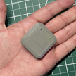  [Sito web di LoopLink](https://www.getlooplink.org/) - [Contatti](https://jameswedding.substack.com/) - Non testato

-   **Mobile Phone Device**

> Component that will operate AAPS and send control commands to the Pod communication device.
> 
> > - Supported [Android phone](#Phones-list-of-tested-phones) with **AAPS** and related components set up.

-   **Dispositivo di erogazione dell'insulina**

> Componente che interpreta i comandi ricevuti dal dispositivo di comunicazione con il pod, che arrivano dal tuo telefono con AAPS.
> 
> > - Un nuovo pod Omnipod (generazione Eros - **NON DASH**)

These instructions assume that you are starting a new pod session. Se non è così, abbi pazienza e inizia questa procedura al prossimo cambio del pod.

In questa pagina, **RileyLink** indica uno qualsiasi dei dispositivi di comunicazione con il pod elencati sopra.

## Prima di iniziare

**SAFETY FIRST** - do not attempt this process in an environment where you cannot recover from an error (extra pods, insulin, charged RileyLink, and phone devices are must-haves).

**Il tuo PDM Omnipod non funzionerà più dopo che il driver Omnipod di AAPS avrà attivato il tuo pod**. Previously you used your Omnipod PDM to send commands to your Omnipod Eros pod. An Omnipod Eros pod only allows a single device to send communication to it. The device that successfully activates the pod is the only device allowed to communicate with it from that point forward. This means that once you activate an Omnipod Eros pod with your RileyLink through the AAPS Omnipod driver, **you will no longer be able to use your PDM with your pod**. The AAPS Omnipod driver with the RileyLink is now your acting PDM. *Questo NON significa che devi buttare via il tuo PDM: ti consigliamo di tenerlo come riserva e per le emergenze, quando AAPS non funziona bene.*

**Only one RileyLink at a time can communicate with a pod.** **AAPS** remembers one paired RileyLink. If you pair a different one, it replaces the previous one.

**Your pod will not shut off when the RileyLink is out of range.** When your RileyLink is out of range or the signal is blocked from communicating with the active pod, your pod will continue to deliver basal insulin. Quando attivi un pod, il profilo basale definito in AAPS viene programmato nel nuovo pod. Should you lose contact with the pod, it will revert to this basal profile. You will not be able to issue new commands until the RileyLink comes back in range and re-establishes the connection.

**30 min Basal Rate Profiles are NOT supported in AAPS.** If you are new to AAPS and are setting up your basal rate profile for the first time please be aware that basal rates starting on a half hour are not supported and you will need to adjust your basal rate profile to start on the hour. For example, if you have a basal rate of say 1.1 units which starts at 09:30 and has a duration of 2 hours ending at 11:30, this will not work.  You will need to update this 1.1 unit basal rate to a time range of either 9:00-11:00 or 10:00-12:00.  Even though the 30 min basal rate profile increments are supported by the Omnipod hardware itself, AAPS is not able to take them into account with its algorithms currently.

## Abilitare il driver Omnipod in AAPS

Puoi abilitare il driver Omnipod in AAPS in **due modi**:

### Opzione 1: la Configurazione guidata

After installing a new version of AAPS, the **Setup Wizard** starts automatically. If you have already exported your settings from a previous installation, you can import them in the wizard. Per le nuove installazioni, continua qui sotto.

Go through the [Setup Wizard](../SettingUpAaps/SetupWizard.md) until you reach the **Pump** step, then select **Omnipod Eros** (the description reads "Pump integration for Omnipod Eros").


The Setup Wizard does not pair your RileyLink. After finishing the wizard, open the Omnipod pump screen and pair it as described in the [RileyLink Setup section](#OmnipodEros-rileylink-setup).

**OPPURE**

### Opzione 2: la schermata Configurazione

Open the top-left **menu** (☰) > **Configuration** > **Pump** and select the **radio button** of **Omnipod Eros**.

Once it is selected, the **Omnipod Eros** card shows two buttons, **Settings** and **Open plugin**:


**Settings** opens the settings of the Omnipod driver (see [Omnipod Settings](#OmnipodEros-omnipod-settings)):


**Apri plugin** apre la schermata del micro Omnipod. You can also open it at any time from the main screen with **Manage** > **Pump**. In questa pagina la chiamiamo **schermata del micro Omnipod**. Before a RileyLink is paired and a pod is activated, it looks like this:


### Verifica della selezione del driver Omnipod

Per verificare di aver abilitato il driver Omnipod, apri **Gestisci** > **Micro** dalla schermata principale. Dovresti vedere la schermata del micro **Omnipod Eros** mostrata sopra. If you have not paired a RileyLink yet, **RileyLink Status** shows **Not Started** and **Pod Status** shows **No Active Pod**.

## Omnipod Configuration

All pod and RileyLink functions are buttons on the [Omnipod pump screen](#OmnipodEros-omnipod-pod-tab) (**Manage** > **Pump**). Some buttons only appear in certain situations, for example when a pod is active.

>  Refresh Pod connectivity and status
> 
>  Pod Management (Activate, Deactivate, Play test beep, RileyLink Stats and Pod history)

```{admonition} Older screenshot
:class: note
Gli screenshot qui sopra sono di una versione precedente di **AAPS**. In **AAPS** 4 there is no **POD MGMT** button or Pod Management menu: **Refresh** and all pod management actions are buttons on the Omnipod pump screen.
```

(OmnipodEros-rileylink-setup)=

### Configurazione del RileyLink

If you have already paired your RileyLink, continue to the [Activating a Pod section](#OmnipodEros-activating-a-pod) below.

*Note: A good visual indicator that the RileyLink is not connected is that the treatment buttons (QuickLaunch toolbar) on the main screen will be missing. This will also occur for about the first 30 seconds after AAPS starts, as it is actively connecting to the RileyLink.*

1. Assicurati che il tuo RileyLink sia completamente carico e acceso.

2. Place the RileyLink [close to your phone](#OmnipodEros-optimal-omnipod-and-rileylink-positioning) (~30 cm away or less).

3. Apri la schermata del micro Omnipod (**Gestisci** > **Micro**) e premi **Associa RileyLink**.

4. The **Pair RileyLink** screen starts scanning for Bluetooth devices right away. Tap your RileyLink in the list of found devices.

   

5. Quando compare **RileyLink associato con successo** con il nome e l'indirizzo del tuo dispositivo, premi **OK**.

6. Back on the Omnipod pump screen, check that **RileyLink Status** changes to **Connected**. **Stato pod** dovrebbe mostrare **Nessun pod attivo**. If the RileyLink does not connect, press **Reset RileyLink**, or restart **AAPS**.

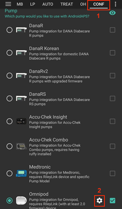 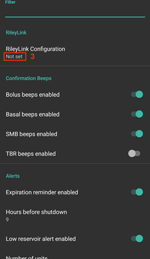

 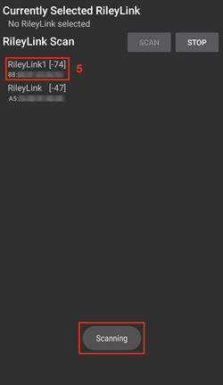

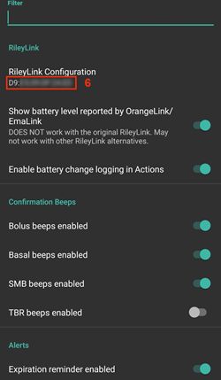

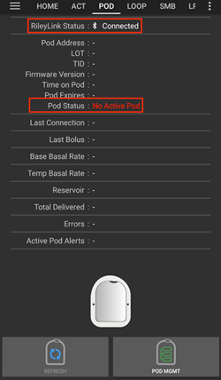

```{admonition} Older screenshot
:class: note
I sei screenshot qui sopra (dopo il passo 6) sono di una versione precedente di **AAPS**. In **AAPS** 4 you pair the RileyLink with the **Pair RileyLink** button on the Omnipod pump screen instead of **RileyLink Configuration** in the Omnipod settings, and scanning starts automatically.
```

```{note}
Per passare a un altro RileyLink (per esempio un dispositivo di riserva), premi di nuovo **Associa RileyLink** e seleziona il nuovo dispositivo. It replaces the one paired before. You do not need to remove the old device first.
```

(OmnipodEros-activating-a-pod)=

### Attivare un pod

Before you can activate a pod, make sure your RileyLink is paired and **RileyLink Status** shows **Connected**. The **Activate Pod** button stays disabled until the RileyLink is ready.

*REMINDER: Pod communication occurs at limited ranges for pod activation pairing due to security safety measures. Before pairing the Pod's radio signal is weaker, however after it has been paired it will operate at full signal power. During these procedures, make sure that your pod is* [within close proximity](#OmnipodEros-optimal-omnipod-and-rileylink-positioning) *(~30 cm away or less) but not on top of or right next to the RileyLink.*

01. Apri la schermata del micro Omnipod (**Gestisci** > **Micro**) e premi **Attiva pod**.

    If you have never activated a profile, a **Profile required** step appears first. Seleziona il profilo da applicare all'attivazione.

    > 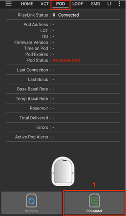  
    > 
    > ```{admonition} Older screenshot
    >     :class: note
    >     Gli screenshot qui sopra sono di una versione precedente di **AAPS**. In **AAPS** 4 **Activate Pod** is a button on the Omnipod pump screen instead of in the **POD MGMT** menu.
    > ```

02. Viene mostrata la schermata **Riempi pod**. Fill a new pod with enough insulin for 3 days and listen for two beeps. Significano che è stata riempita la quantità minima di 80 unità. Svuota completamente la siringa di riempimento, anche dopo aver sentito i due bip. When calculating the total amount of insulin you need for 3 days, please take into account that priming the pod will use 12 to 15 units. Do not remove the pod's needle cap yet.

    > 
    > 
    > Ensure the new pod and RileyLink are within close proximity of each other (~30cm or less) and press **Next**.

03. **Select Insulin** (only shown if you have more than one insulin configured): select the insulin you are filling the pod with and press **Next**. Dopo l'attivazione viene applicato un cambio profilo con questa insulina.

04. On the **Initialize Pod** screen, the pod will begin priming (you will hear a click followed by a series of ticking sounds as the pod primes itself). If RileyLink is out of range of the pod being activated, you will receive an error message **No response from Pod**. If this occurs, [move the RileyLink closer](#OmnipodEros-optimal-omnipod-and-rileylink-positioning) (~30 cm away or less) to but not on top of or right next to the Pod and press **Retry**.

    >  

05. When priming is successful, a green checkmark is shown and the **Next** button becomes enabled. Premi **Avanti**.

    > 

06. **Site location** (only shown if **Manage pump site rotation** is enabled in [Site Rotation](#Aapsscreens-site-rotation)): select where you place the pod on your body and press **Next**.

07. Viene mostrata la schermata **Collega pod**. Prepare the infusion site of the new pod. Remove the pod's plastic needle cap and white paper backing from the adhesive and apply the pod to your chosen site on your body. Se la cannula sporge, premi **Annulla** e scarta il pod. Quando hai finito, premi **Avanti**.

    > 

08. A confirmation dialog appears: "When you press OK, the cannula will be inserted". **Premi OK SOLO se sei pronto a inserire la cannula**.

    > 

09. On the **Insert Cannula** screen, it may take some time before the Omnipod responds and inserts the cannula (1-2 minutes maximum), so be patient.

    > If RileyLink is out of range of the pod being activated, you will receive an error message **No response from Pod**. If this occurs, move the RileyLink closer (~30 cm away or less) to but not on top of or right next to the Pod and press **Retry**.
    > 
    > Se il RileyLink è fuori dalla portata Bluetooth o non ha una connessione attiva con il telefono, ricevi il messaggio di errore **Nessuna risposta da RileyLink**. Se succede, avvicina il RileyLink al telefono e premi **Riprova**.
    > 
    > *NOTE: Before the cannula is inserted, it is good practice to pinch the skin near the cannula insertion point. This ensures a smooth insertion of the needle and will decrease your chances of developing occlusions.*
    > 
    > 
    > 
    >  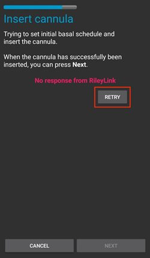

10. A green checkmark appears, and the **Next** button becomes enabled upon successful cannula insertion. Premi **Avanti**.

    > 

11. Viene mostrata la schermata **Pod attivato**. Check that the cannula has been inserted correctly, and change your pod if you think it has not. Premi **Termina**. Congratulazioni! You have now started a new active pod session.

    > 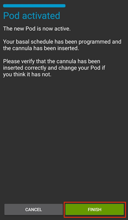 
    > 
    > ```{admonition} Older screenshot
    >     :class: note
    >     The screenshots in steps 2 to 11 are from an earlier **AAPS** version and may look different in **AAPS** 4. The **Select Insulin** and **Site location** steps are not pictured.
    > ```

12. Torni alla schermata del micro Omnipod. The **Activate Pod** button is replaced by **Deactivate Pod**, because you cannot activate another pod without deactivating the active one first.

    The pump screen now shows information about your active pod, including the current basal rate, reservoir level, insulin delivered, pod errors and alerts. For more details, see the [Omnipod pump screen](#OmnipodEros-omnipod-pod-tab) section.

     

    ```{admonition} Older screenshot
    :class: note
    Gli screenshot qui sopra sono di una versione precedente di **AAPS**. In **AAPS** 4 non c'è il menu Gestione pod: torni direttamente alla schermata del micro Omnipod, dove **Disattiva pod** sostituisce **Attiva pod**.
    ```

```{note}
If activation was interrupted after priming (for example the app was closed), press **Activate Pod** again. The wizard continues from the cannula insertion steps.
```

### Disattivare un pod

Under normal circumstances, the life of a pod should run for three days (72 hours) and an additional 8 hours after the pod expiration warning for a total of 80 hours of pod usage.

To deactivate a pod (either from expiration or from a pod failure):

1. Apri la schermata del micro Omnipod (**Gestisci** > **Micro**) e premi **Disattiva pod**.

   >  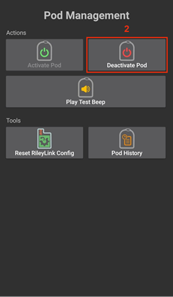 
   > 
   > ```{admonition} Older screenshot
   >    :class: note
   >    Gli screenshot qui sopra sono di una versione precedente di **AAPS**. In **AAPS** 4 **Deactivate Pod** is a button on the Omnipod pump screen instead of in the **POD MGMT** menu.
   > ```

2. On the **Deactivate Pod** screen, first make sure the RileyLink is in close proximity to the pod but not on top of or right next to the pod. Poi premi **Avanti**. A dialog asks *A deactivated Pod can not be used again. Deactivate this Pod now?* Press **OK** to start deactivating the pod, or **Cancel** to keep it. La disattivazione sospende tutta l'erogazione di insulina e non si può annullare.

   > 

3. The **Deactivating Pod** screen appears, and you will receive a confirmation beep from the pod that deactivation was successful.

   > 
   > 
   > **IF deactivation fails** and you do not receive a confirmation beep, you may receive a **No response from RileyLink** or **No response from Pod** message. Premi **Riprova** per tentare di nuovo la disattivazione. If deactivation keeps failing, press **Discard Pod** and confirm. **AAPS** then forgets the pod. Insulin delivery has **not** been suspended, so remove the pod from your body. If your pod has a screaming alarm, you may need to silence it manually (using a pin or a paperclip), because **Discard Pod** does not silence it.
   > 
   > >   

4. A green checkmark appears when deactivation is successful. Premi **Avanti** per vedere la schermata **Pod disattivato**. Ora puoi togliere il pod, perché la sessione attiva è stata disattivata.

   > 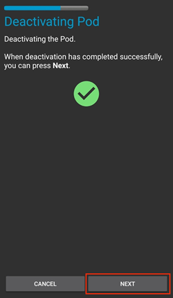

5. Premi **Termina** per tornare alla schermata del micro Omnipod.

   >  
   > 
   > ```{admonition} Older screenshot
   >    :class: note
   >    The screenshots in steps 2 to 5 are from an earlier **AAPS** version and may look different in **AAPS** 4.
   > ```

6. On the Omnipod pump screen, check that **RileyLink Status** shows **Connected** and **Pod Status** shows **No Active Pod**.

   >    
   > 
   > ```{admonition} Older screenshot
   >    :class: note
   >    Gli screenshot qui sopra sono di una versione precedente di **AAPS**. In **AAPS** 4 **Finish** returns you directly to the Omnipod pump screen; there is no Pod Management menu or **Omnipod (POD)** tab.
   > ```

### Sospendere e riprendere l'erogazione di insulina

La procedura qui sotto mostra come sospendere e riprendere l'erogazione di insulina.

*NOTE - if you do not see a **Suspend** button*, it is hidden by default. Attiva **Mostra il tasto "Sospendi erogazione" nella schermata del micro** nelle [impostazioni Omnipod](#OmnipodEros-omnipod-settings), sotto **Altro**.

#### Sospendere l'erogazione di insulina

Usa questo comando per mettere il pod attivo in stato di sospensione. In questo stato il pod non eroga più insulina. Questo comando imita la funzione di sospensione che il PDM Omnipod originale invia a un pod attivo.

1. Apri la schermata del micro Omnipod (**Gestisci** > **Micro**) e premi **Sospendi**. Il comando di sospensione viene inviato al pod attivo tramite il RileyLink.

2. When the pod has suspended all insulin delivery, **Pod Status** shows **Suspended** and the **Suspend** button is replaced by **Resume Delivery**.

   >  
   > 
   > 
   > 
   >  
   > 
   > ```{admonition} Older screenshot
   >    :class: note
   >    Gli screenshot qui sopra sono di una versione precedente di **AAPS**. In **AAPS** 4 these steps take place on the Omnipod pump screen instead of the **Omnipod (POD)** tab, and the result is shown in **Pod Status**.
   > ```

If the command fails, a **Warning** dialog shows "Failed to suspend delivery" with the reason. Controlla la connessione del RileyLink e riprova.

#### Resuming Insulin Delivery

Use this command to instruct the active, currently suspended pod to resume insulin delivery. After the command is successfully processed, insulin will resume normal delivery using the current basal rate based on the current time from the active basal profile. The pod will again accept commands for bolus, TBR, and SMB.

1. Apri la schermata del micro Omnipod e controlla che **Stato pod** mostri **Sospeso**. Premi **Riprendi erogazione**.

2. When the command succeeds, **Pod Status** shows **Running** again and the **Resume Delivery** button disappears (the **Suspend** button is shown again if you have enabled it).

   >  
   > 
   > 
   > 
   >  
   > 
   > ```{admonition} Older screenshot
   >    :class: note
   >    Gli screenshot qui sopra sono di una versione precedente di **AAPS**. In **AAPS** 4 these steps take place on the Omnipod pump screen instead of the **Omnipod (POD)** tab, and the result is shown in **Pod Status**.
   > ```

If the command fails, a **Warning** dialog shows "Failed to resume delivery" with the reason. Controlla la connessione del RileyLink e riprova.

### Silencing Pod Alerts

*NOTE - The **Silence Alerts** button is only shown on the Omnipod pump screen while the pod has an active alert (for example the pod expiration or low reservoir alert), and only if **Automatically silence Pod alerts** is disabled.*

La procedura qui sotto mostra come silenziare i bip del pod che iniziano quando il pod raggiunge l'ora di avviso prima della scadenza. Questa ora di avviso si imposta con **Allarme orario prima dello spegnimento (80 ore)** nelle impostazioni **Avvisi** di Omnipod. La durata massima di un pod è di 80 ore (3 giorni e 8 ore), ma Insulet consiglia di non superare il limite di 72 ore (3 giorni).

*NOTE - If you have enabled **Automatically silence Pod alerts** in the Omnipod **Alerts** settings, **AAPS** silences the alert automatically at the next communication with the pod, and you do NOT need to do it manually.*

1. When the warning time is reached, the pod beeps to tell you that it will soon expire and needs to be changed. On the Omnipod pump screen, **Pod Expires** shows the exact time the pod expires (72 hours after activation); it turns **yellow** 4 hours before. **Fine definitiva pod** mostra quando il pod smette di erogare insulina. **Active Pod Alerts** shows **Pod will expire soon**, and the **Silence Alerts** button appears. **AAPS** also shows a notification about the upcoming pod expiration.

   >   
   > 
   > ```{admonition} Older screenshot
   >    :class: note
   >    Gli screenshot qui sopra sono di una versione precedente di **AAPS**. In **AAPS** 4 the **ACK ALERTS** button is called **Silence Alerts** and is on the Omnipod pump screen.
   > ```

2. Premi **Silenzia avvisi**. The RileyLink sends the command to the pod to stop the expiration warning beeps.

   >  
   > 
   > ```{admonition} Older screenshot
   >    :class: note
   >    The screenshot above is from an earlier **AAPS** version. In **AAPS** 4 the button is called **Silence Alerts**.
   > ```

3. Quando gli avvisi sono silenziati, il pod emette due bip. **Active Pod Alerts** no longer shows the warning, the **Silence Alerts** button disappears and the pod stops its expiration warning beeps.

   >  
   > 
   > ```{admonition} Older screenshot
   >    :class: note
   >    The screenshot above is from an earlier **AAPS** version. In **AAPS** 4 the result is shown on the Omnipod pump screen: the warning disappears from **Active Pod Alerts**.
   > ```

If the command fails (for example the RileyLink is out of range of the pod), a **Warning** dialog shows "Failed to silence alerts" with the reason. Avvicina il RileyLink al pod e riprova.


```{admonition} Older screenshot
:class: note
The screenshot above is from an earlier **AAPS** version. In **AAPS** 4 the **Warning** dialog shows "Failed to silence alerts" with the reason.
```

(OmnipodEros-view-pod-history)=

### View Pod History

This section shows you how to review your active pod history and filter by different action categories. The pod history tool allows you to view the actions and results committed to your currently active pod during its three day (72 - 80 hours) life.

This feature is useful for verifying boluses, TBRs, basal changes that were given but you may be unsure if they completed. The remaining categories are useful in general for troubleshooting issues and determining the order of events that occurred leading up to a failure.

*NOTE:* **Uncertain** commands will appear in the pod history, however due to their nature you cannot ensure their accuracy.

1. Apri la schermata del micro Omnipod (**Gestisci** > **Micro**) e premi **Storico pod**.

   >   
   > 
   > ```{admonition} Older screenshot
   >    :class: note
   >    Gli screenshot qui sopra sono di una versione precedente di **AAPS**. In **AAPS** 4 **Pod History** is a button on the Omnipod pump screen instead of in the **POD MGMT** menu.
   > ```

2. The **Pod History** screen lists all pod actions and their results, newest first, grouped by day. By default **All** is selected. Tap one of the filter buttons at the top to show only one category. Usa la freccia indietro in alto a sinistra per tornare alla schermata del micro Omnipod.

   > 

   >  
   > 
   > ```{admonition} Older screenshot
   >    :class: note
   >    The second screenshot is from an earlier **AAPS** version and may look different in **AAPS** 4.
   > ```

### Vedere le impostazioni e lo storico del RileyLink

The **RileyLink Stats** screen shows the settings of your RileyLink and active pod, and the communication history of both. Ha due schede: **Impostazioni** e **Storico**.

The **RileyLink Stats** button is hidden by default. To show it on the Omnipod pump screen, enable **Show RileyLink Stats button in Pod Management menu** in the [Omnipod settings](#OmnipodEros-omnipod-settings) under **Other**.

#### Manually Re-establish Pod Communication Device Bluetooth Communication

Se il tuo dispositivo di comunicazione con il pod è rimasto per un po' fuori dalla portata Bluetooth del telefono, **Stato RileyLink** può mostrare **RileyLink irraggiungibile** nella schermata del micro Omnipod. **AAPS** normally reconnects by itself when the device is back in range. Se non succede:

1. Make sure the RileyLink is powered on, charged and close to your phone.

2. On the Omnipod pump screen, press **Reset RileyLink**. Un messaggio conferma **Reset configurazione RileyLink**. See the [Reset RileyLink notes](#OmnipodEros-reset-rileylink-config-notes) below.

3. If the **Bluetooth connection** does not re-establish, try manually turning **off** and then back **on** the Bluetooth function on your phone.

4. If it still does not reconnect, press **Pair RileyLink** and select your RileyLink again.

5. Dopo una riconnessione riuscita, **Stato RileyLink** mostra **Connesso**. Puoi controllare anche **Stato connessione** nella scheda **Impostazioni** della schermata **Statistiche RileyLink**. Congratulations, you have now reconnected your configured pod communication device to AAPS!

 

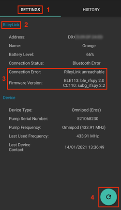


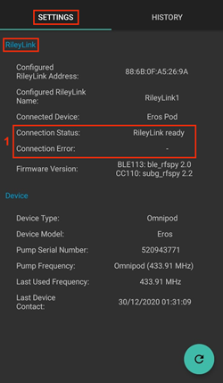

```{admonition} Older screenshot
:class: note
Gli screenshot qui sopra sono di una versione precedente di **AAPS**. In **AAPS** 4 you reconnect with **Reset RileyLink** or **Pair RileyLink** on the Omnipod pump screen instead of the refresh button on the RileyLink Settings screen.
```

#### Impostazioni del dispositivo di comunicazione con il pod e del pod attivo

This screen shows information and status for both the currently paired pod communication device and the currently active Omnipod Eros pod. The information refreshes automatically.

1. Apri la schermata del micro Omnipod (**Gestisci** > **Micro**) e premi **Statistiche RileyLink**. The **Settings** tab shows your currently paired **RileyLink** and the active pod (**Device**).

   > 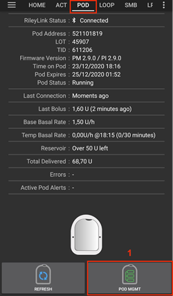 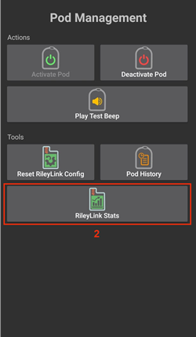 
   > 
   > ```{admonition} Older screenshot
   >    :class: note
   >    Gli screenshot qui sopra sono di una versione precedente di **AAPS**. In **AAPS** 4 **RileyLink Stats** is a button on the Omnipod pump screen instead of in the **POD MGMT** menu.
   > ```

   > 

##### Campi del RileyLink

> - **Address:** MAC address of the paired pod communication device.
> - **Name:** Bluetooth name of the paired pod communication device.
> - **Livello batteria:** il livello attuale della batteria del dispositivo di comunicazione con il pod connesso. Only shown when **Show battery level reported by OrangeLink/EmaLink/DiaLink** is enabled.
> - **Stato connessione**: lo stato attuale della connessione Bluetooth tra il dispositivo di comunicazione con il pod e il telefono con AAPS.
> - **Connection Error:** If there is an error with the pod communication device Bluetooth connection, details are displayed here.
> - **Versione firmware:** la versione del firmware installata sul dispositivo di comunicazione con il pod connesso.

##### Campi del dispositivo - con un pod attivo

> - **Tipo dispositivo:** il tipo di dispositivo che comunica con il dispositivo di comunicazione con il pod (Omnipod (Eros)).
> - **Modello dispositivo configurato:** il modello del dispositivo configurato per comunicare con il dispositivo di comunicazione con il pod.
> - **Connected Device Model:** The model of the device currently communicating with the pod communication device.
> - **Pump Serial Number:** Serial number of the currently activated pod.
> - **Frequenza micro:** frequenza radio usata per comunicare con il pod.
> - **Last Used Frequency:** Last known radio frequency the pod used to communicate with the pod communication device.
> - **Last Device Contact:** Date and time of the last contact the pod made with the pod communication device.

(omnipod-eros-rileylink-and-active-pod-history)=
#### RileyLink and Active Pod History

This tab lists, newest first, each state or action of the RileyLink or the currently connected pod. The history is only available for the currently active pod. Dopo un cambio del pod, questo storico viene cancellato e vengono registrati e mostrati solo gli eventi del pod appena attivato.

1. Apri la schermata del micro Omnipod (**Gestisci** > **Micro**), premi **Statistiche RileyLink** e poi tocca la scheda **Storico**.

   >  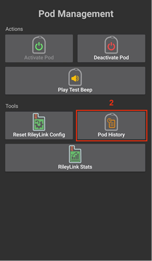 
   > 
   > ```{admonition} Older screenshot
   >    :class: note
   >    Gli screenshot qui sopra sono di una versione precedente di **AAPS**. In **AAPS** 4 **RileyLink Stats** is a button on the Omnipod pump screen instead of in the **POD MGMT** menu.
   > ```

   > 

##### Campi

Ogni voce mostra:

> - **Dispositivo:** il dispositivo a cui si riferisce l'azione o lo stato.
> - **Ora:** l'ora dell'evento.
> - **Stato o azione:** lo stato del dispositivo o l'azione che ha eseguito.

(OmnipodEros-omnipod-pod-tab)=

## Schermata del micro Omnipod

Below is an explanation of the status fields and buttons on the **Omnipod pump screen** (**Manage** > **Pump**, or **Configuration** > **Pump** > **Open plugin**).

The gear icon at the top right opens the [Omnipod settings](#OmnipodEros-omnipod-settings).

*NOTE: If any status field shows (uncertain), press **Refresh** to refresh the pod status and clear it.*


```{admonition} Older screenshot
:class: note
Lo screenshot qui sopra è di una versione precedente di **AAPS**, in cui questa schermata era la scheda **Omnipod (POD)**. In **AAPS** 4 it is the Omnipod pump screen, and some field names and buttons differ.
```

### Campi

- **Stato RileyLink:** mostra lo stato attuale della connessione del RileyLink. Gli errori sono mostrati in rosso.

- *Not Started* - no RileyLink is paired yet, or the connection has not started.
- *RileyLink unreachable* - pod communication device is either not within Bluetooth range of the phone, powered off or has a failure preventing Bluetooth communication.
- *RileyLink ready* - pod communication device is powered on and actively initializing the Bluetooth connection.
- *Connected* - pod communication device is powered on, connected and actively able to communicate via Bluetooth.

- **ID univoco:** mostra l'indirizzo del pod attivo.

- **Numero LOT:** mostra il numero LOT del pod attivo.

- **Sequence Number:** Displays the serial number (TID) of the pod.

- **Versione firmware:** mostra la versione del firmware del pod attivo.

- **Time on Pod:** Displays the current time on the active pod. It is highlighted when it differs from the phone time by more than 5 minutes.

- **Pod Expires:** Displays the date and time when the active pod will expire. Il testo diventa giallo nelle ultime 4 ore prima di questo momento. Non diventa mai rosso, perché il pod continua a erogare insulina anche dopo.

- **Fine definitiva pod:** mostra la fine del periodo di tolleranza del pod (8 ore dopo **Scadenza pod**, per una durata massima del pod di 80 ore). Il testo diventa giallo quando inizia il periodo di tolleranza (a **Scadenza pod**) e rosso nelle ultime 4 ore prima della fine definitiva. During the grace period it also shows the time left, for example *(17m remaining)*. The pod stops delivering insulin at the hard end and must be changed.

- **Stato pod:** mostra lo stato del pod attivo (per esempio **Nessun pod attivo**, **In esecuzione** o **Sospeso**).

- **Last Connection:** Displays the last time communication with the active pod was achieved. Il testo diventa rosso quando viene superata la [soglia di micro irraggiungibile](#OmnipodEros-troubleshooting).

- *Pochi istanti fa* - meno di 20 secondi fa.
- *Meno di un minuto fa* - più di 20 secondi ma meno di 60 secondi fa.
- *1 minuto fa* - più di 60 secondi ma meno di 120 secondi (2 min)
- *XX minutes ago* - more than 2 minutes ago as defined by the value of XX

- **Last Bolus:** Displays the dosage of the last bolus sent to the active pod and how long ago it was issued in parenthesis.

- **Velocità basale originale:** mostra la velocità basale programmata per l'ora attuale nel profilo basale.

- **Temp Basal Rate:** Only shown while a Temporary Basal Rate is running. Displays it in the following format:

- Units / hour @ time TBR was issued (minutes run / total minutes TBR will be run)
- *Example:* 0.00U/h @18:25 ( 90/120 minutes)

- **Reservoir:** Displays **Over 50 U left** when more than 50 units are left in the reservoir. Sotto questo valore viene mostrato il numero approssimato di unità. The text turns red below the low reservoir threshold set in the [Alerts settings](#OmnipodEros-omnipod-settings).

- **Totale erogato:** mostra il numero totale di unità di insulina erogate dal serbatoio. *Note this is an approximation as priming and filling the pod is not an exact process.*

- **Active Pod Alerts:** Reserved for currently running alerts on the active pod. Normally used when pod expiration is past 72 hours and native pod beep alerts are running.

- **Errors:** Displays the last error encountered (shown in red). Review the [Pod history](#OmnipodEros-view-pod-history), [RileyLink history](#omnipod-eros-rileylink-and-active-pod-history) and log files for past errors and more detailed information.

### Buttons

The buttons at the bottom of the pump screen change depending on the situation. Buttons that cannot be used right now are greyed out, for example while the RileyLink is not connected.

**Pod status buttons** (shown when a pod is active):

- **Aggiorna:** invia un comando di aggiornamento al pod attivo per aggiornarne lo stato. Usalo per aggiornare lo stato del pod e cancellare i campi di stato che contengono il testo (incerto). See the [Troubleshooting section](#OmnipodEros-troubleshooting) below for additional information.

  

  ```{admonition} Older screenshot
  :class: note
  Lo screenshot qui sopra è di una versione precedente di **AAPS**. In **AAPS** 4 this is a text button named **Refresh** on the Omnipod pump screen.
  ```

- **Silence Alerts:** Silences the pod expiration and low reservoir beeps and notifications. Only shown when the pod has an active alert and **Automatically silence Pod alerts** is disabled. After the alerts are silenced, the button disappears.

  

  ```{admonition} Older screenshot
  :class: note
  Lo screenshot qui sopra è di una versione precedente di **AAPS**. In **AAPS** 4 this button is called **Silence Alerts**.
  ```

- **Imposta ora:** aggiorna l'ora del pod con l'ora attuale del tuo telefono. Only shown when the time on the pod differs from the phone time by more than 5 minutes.

  

  ```{admonition} Older screenshot
  :class: note
  Lo screenshot qui sopra è di una versione precedente di **AAPS**. In **AAPS** 4 this is a text button named **Set time** on the Omnipod pump screen.
  ```

- **Sospendi:** sospende l'erogazione di insulina sul pod attivo. Compare solo se è attivato nelle impostazioni (**Mostra il tasto "Sospendi erogazione" nella schermata del micro**).

  

  ```{admonition} Older screenshot
  :class: note
  Lo screenshot qui sopra è di una versione precedente di **AAPS**. In **AAPS** 4 this is a text button named **Suspend** on the Omnipod pump screen.
  ```

- **Resume Delivery:** Resumes insulin delivery on the currently suspended, active pod. Compare solo mentre il pod è sospeso.

  

  ```{admonition} Older screenshot
  :class: note
  Lo screenshot qui sopra è di una versione precedente di **AAPS**. In **AAPS** 4 this is a text button named **Resume Delivery** on the Omnipod pump screen.
  ```

**Pod and RileyLink management buttons:**


```{admonition} Older screenshot
:class: note
The screenshot above is from an earlier **AAPS** version. In **AAPS** 4 there is no Pod Management menu: these actions are buttons directly on the Omnipod pump screen.
```

- **Activate Pod:** Primes and activates a new pod. Shown when no pod is active. It is enabled only when the RileyLink is connected.

  

  ```{admonition} Older screenshot
  :class: note
  Lo screenshot qui sopra è di una versione precedente di **AAPS**. In **AAPS** 4 **Activate Pod** is a button on the Omnipod pump screen instead of in the Pod Management menu.
  ```

- **Deactivate Pod:** Deactivates the currently active pod. Shown as soon as a pod is paired, also when an activation stopped part-way (for example because the pod failed during activation). It is enabled only when the RileyLink is connected. **AAPS** ti chiede di confermare prima di disattivare il pod.

- Use this command to deactivate a screaming pod (error 49).
- If deactivation fails, the deactivation wizard offers a **Discard Pod** option.

  

  ```{admonition} Older screenshot
  :class: note
  Lo screenshot qui sopra è di una versione precedente di **AAPS**. In **AAPS** 4 **Deactivate Pod** is a button on the Omnipod pump screen instead of in the Pod Management menu.
  ```

- **Play Test Beep:** Plays a single test beep on the pod when pressed. Shown when a pod is paired.

  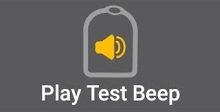

  ```{admonition} Older screenshot
  :class: note
  Lo screenshot qui sopra è di una versione precedente di **AAPS**. In **AAPS** 4 **Play Test Beep** is a button on the Omnipod pump screen instead of in the Pod Management menu.
  ```

- **Storico pod:** mostra lo storico delle attività del pod attivo. See [View Pod History](#OmnipodEros-view-pod-history).

  

  ```{admonition} Older screenshot
  :class: note
  Lo screenshot qui sopra è di una versione precedente di **AAPS**. In **AAPS** 4 **Pod History** is a button on the Omnipod pump screen instead of in the Pod Management menu.
  ```

- **Pair RileyLink:** Scans for your pod communication device and pairs it. Vedi [Configurazione del RileyLink](#OmnipodEros-rileylink-setup).

- **RileyLink Stats:** Opens the RileyLink Stats screen with two tabs. Only shown if enabled in the settings (**Show RileyLink Stats button in Pod Management menu**).

- **Impostazioni** - mostra le informazioni sulle impostazioni del RileyLink e del pod attivo
- **History** - displays RileyLink and Pod communication history

  

  ```{admonition} Older screenshot
  :class: note
  Lo screenshot qui sopra è di una versione precedente di **AAPS**. In **AAPS** 4 **RileyLink Stats** is a button on the Omnipod pump screen instead of in the Pod Management menu.
  ```

- **Reset RileyLink:** Resets the configuration of the currently connected pod communication device. When communication is started, specific data is sent to and set in the RileyLink:

- Vengono impostati i registri di memoria
- Vengono impostati i protocolli di comunicazione
- Tuned Radio Frequency is set
  > 
  > See [additional notes](#OmnipodEros-reset-rileylink-config-notes) below.

  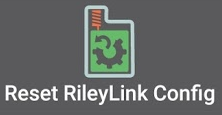

  ```{admonition} Older screenshot
  :class: note
  Lo screenshot qui sopra è di una versione precedente di **AAPS**. In **AAPS** 4 this button is called **Reset RileyLink** and is on the Omnipod pump screen.
  ```

- **Scarta pod:** scarta lo stato di un pod che non risponde, dopo una conferma. Only shown when a pod has been started but not fully paired, as proper deactivation is no longer possible:

- A **pod is not fully paired** and thus ignores deactivate commands.
- A **pod is stuck** during the pairing process between steps.
- A **pod simply does not pair at all.**
  > 
  > After you discard a pod, **AAPS** can no longer communicate with it. Remove the pod from your body.

  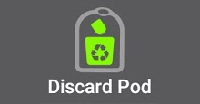

  ```{admonition} Older screenshot
  :class: note
  Lo screenshot qui sopra è di una versione precedente di **AAPS**. In **AAPS** 4 **Discard Pod** is a button on the Omnipod pump screen instead of in the Pod Management menu.
  ```

(OmnipodEros-reset-rileylink-config-notes)=

#### *Note su Reset RileyLink*

- The primary usage of this feature is when the currently active pod communication device is not responding and communication is in a stuck state.
- If the pod communication device is turned off and then back on, press **Reset RileyLink** so that these communication parameters are set again in the pod communication device.
- Se NON lo fai, dovrai riavviare AAPS dopo aver spento e riacceso il dispositivo di comunicazione con il pod.
- This button **DOES NOT** need to be pressed when switching between different pod communication devices.

(OmnipodEros-omnipod-settings)=

## Omnipod Settings

Per aprire le impostazioni del driver Omnipod, puoi:

- premere l'icona a forma di ingranaggio in alto a destra nella schermata del micro Omnipod (**Gestisci** > **Micro**), oppure
- open the top-left **menu** (☰) > **Configuration** > **Pump** and press **Settings** on the **Omnipod Eros** card.

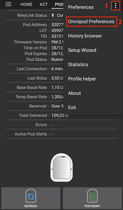

```{admonition} Older screenshot
:class: note
The screenshot above is from an earlier **AAPS** version. In **AAPS** 4 you open the settings with **Settings** on the **Omnipod Eros** card or the gear icon on the Omnipod pump screen, instead of the settings gear in **Configuration** or the 3-dot menu.
```

The settings are grouped as listed below. Tocca un gruppo per espanderlo. Most entries are switches you can enable or disable:


*NOTE: An asterisk (\*) denotes the default for a setting is enabled.*

### RileyLink

Settings for the pod communication device. You pair the device itself with the **Pair RileyLink** button on the pump screen (see [RileyLink Setup](#OmnipodEros-rileylink-setup)).

- **Use Scanning:** Scans before connecting to the OrangeLink. Questo può migliorare le connessioni. Se serve, si può usare anche con altri cloni del RileyLink.

- **Show battery level reported by OrangeLink/EmaLink/DiaLink:** Reports the actual battery level of the OrangeLink/EmaLink/DiaLink. It is **strongly recommended** that all OrangeLink/EmaLink/DiaLink users enable this setting.

- NON funziona con il RileyLink originale.
- Potrebbe non funzionare con le alternative al RileyLink.
- Enabled - Reports the current battery level for supported pod communication devices.
- Disabled - Reports a value of n/a.

- **Enable battery change logging in Actions:** Only available when the battery reporting setting above is enabled. Some pod communication devices can use regular batteries that you can change. With this setting enabled, you can record a **Pump Battery Change** [careportal entry](#aaps-screens-careportal) to note the change and reset the battery age.

### BIP di conferma

Provides confirmation beeps from the pod for bolus, basal, SMB, and TBR delivery and changes.

- **\*Bolus beeps enabled:** Enable or disable confirmation beeps when a bolus is delivered.
- **Basal beeps enabled:** Enable or disable confirmation beeps when a new basal rate is set, active basal rate is canceled or current basal rate is changed.
- **\*SMB beeps enabled:** Enable or disable confirmation beeps when a SMB is delivered.
- **TBR beeps enabled:** Enable or disable confirmation beeps when a TBR is set or canceled.

### Avvisi

Provides AAPS alerts and Nightscout announcements for pod expiration, shutdown, low reservoir based on the defined threshold units.

*Note an AAPS notification will ALWAYS be issued for any alert after the initial communication with the pod since the alert was triggered. Dismissing the notification will NOT silence the alert UNLESS **Automatically silence Pod alerts** is enabled. Per silenziare l'avviso A MANO, apri la schermata del micro Omnipod e premi **Silenzia avvisi**.*

- **\*Expiration reminder enabled:** When enabled, the pod beeps when the time set below is reached.
- **Alert at hours before shutdown (80 Hours):** The number of hours before the pod shuts down (80 hours after activation) at which the expiration reminder is triggered (1 to 8 hours, default 8).
- **\*Low reservoir alert enabled:** Enable or disable an alert when the pod's remaining units low reservoir limit is reached as defined in the Number of units field.
- **Number of units:** The number of units at which to trigger the pod low reservoir alert (5 to 50, default 20).
- **Automatically silence Pod alerts:** When enabled, a notification is still issued, but the alert is silenced automatically at the next communication with the pod after the alert started.

### Notifiche

Provides AAPS notifications and audible phone alerts when it is uncertain if TBR, SMB, or bolus events were successful.

*NOTE: These are notifications only, no audible beep alerts are made.*

- **\*Sound for uncertain TBR notifications enabled:** Enable or disable this setting to trigger an audible alert and visual notification when AAPS is uncertain if a TBR was successfully set.
- **\*Sound for uncertain SMB notifications enabled:** Enable or disable this setting to trigger an audible alert and visual notification when AAPS is uncertain if an SMB was successfully delivered.
- **\*Sound for uncertain bolus notifications enabled:** Enable or disable this setting to trigger an audible alert and visual notification when AAPS is uncertain if a bolus was successfully delivered.

### Other

Provides advanced settings to assist debugging.

- **Mostra il tasto "Sospendi erogazione" nella schermata del micro:** nasconde o mostra il tasto **Sospendi** nella schermata del micro Omnipod.
- **Show Pulse Log button in Pod Management menu:** This setting is still listed, but the current version of the pump screen has no **Pulse Log** button.

- **Show RileyLink Stats button in Pod Management menu:** Hide or display the **RileyLink Stats** button on the Omnipod pump screen.
- **\*DST/Time zone detection enabled:** Allows time zone changes to be automatically detected if the phone is used in an area where DST is observed.

### Switching or Removing an Active Pod Communication Device (RileyLink)

With many alternative models to the original RileyLink available (such as OrangeLink or EmaLink), or the need to have multiple or backup versions of the same pod communication device, you may need to switch to another device.

Per cambiare, apri la schermata del micro Omnipod (**Gestisci** > **Micro**), premi **Associa RileyLink** e seleziona il nuovo dispositivo, come descritto in [Configurazione del RileyLink](#OmnipodEros-rileylink-setup). The new device replaces the previously paired one.

 


 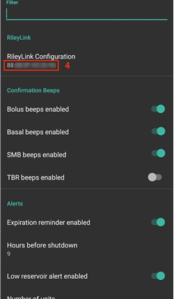

```{admonition} Older screenshot
:class: note
Gli screenshot qui sopra sono di una versione precedente di **AAPS**. In **AAPS** 4 you add a device with **Pair RileyLink** on the Omnipod pump screen instead of **RileyLink Configuration** in the Omnipod settings, and scanning starts automatically.
```

There is no separate button to remove a paired device. If you stop using a RileyLink, simply pair the new one when you need it.


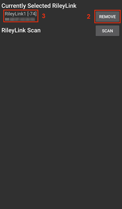

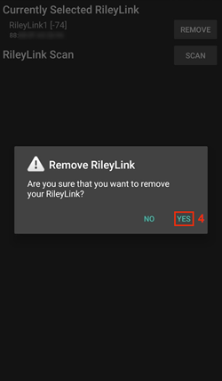


```{admonition} Older screenshot
:class: note
Gli screenshot qui sopra sono di una versione precedente di **AAPS**. In **AAPS** 4 there is no **Remove** button: pairing a new RileyLink replaces the previous one.
```

## Status row and careportal

There are a few items that are specific to how the Omnipod pod differs from tube based pumps, especially after applying a new pod.

The **insulin** and **cannula** ages in the [status row](#screens-sensor-level-battery) of the main screen are **reset** to 0 days and 0 hours **after each pod change**. This is done because of how the Omnipod pump is built and operates. The **pump battery** and **insulin reservoir** are self contained inside of each pod. Since the pod inserts the cannula directly into the skin at the site of the pod application, a traditional tube is not used in Omnipod pumps. *Therefore after a pod change the age of each of these values will automatically reset to zero.* **Pump battery age** is not reported as the battery in the pod will always be more than the life of the pod (maximum 80 hours).


### Livelli

**Insulin Level**

Reporting of the amount of insulin in the Omnipod Eros Pod is not exact. This is because it is not known exactly how much insulin was put in the pod, only that when the 2 beeps are triggered while filling the pod at least 80 units have been filled. Un pod può contenere al massimo 200 unità. Priming can also introduce variance as it is not an exact process. Per questi due motivi, il driver Omnipod è stato scritto per dare la migliore stima possibile dell'insulina rimasta nel serbatoio.

> - **Above 50 Units** - Reports a value of 50+U when more than 50 units are currently in the reservoir.
> - **Below 50 Units** - Reports an approximate calculated value of insulin remaining in the reservoir.
> - **SMS** - Returns value or 50+U for SMS responses
> - **Nightscout** - Uploads value of 50 when over 50 units to Nightscout (version 14.07 and older).  Newer versions will report a value of 50+ when over 50 units.

**Battery Level**

Battery level reporting is a setting that can be enabled to return the current battery level of pod communication devices, such as the OrangeLink, EmaLink or DiaLink.  The RileyLink hardware is not capable of reporting its battery level.  The battery level is reported after each communication with the pod, so when charging a linear increase may not be observed.  Un aggiornamento manuale aggiorna il livello attuale della batteria.  When a supported Pod communication device is disconnected a value of 0% will be reported.

> - **RileyLink hardware is NOT capable of reporting battery level**
> - **"Show battery level reported by OrangeLink/EmaLink/DiaLink" Setting MUST be enabled in the Omnipod settings to report battery level values**
> - **Battery level reporting ONLY works for OrangeLink, EmaLink and DiaLink Devices**
> - **Battery Level reporting MAY work for other devices (excluding RileyLink)**
> - **SMS** - Returns current battery level as a response when an actual level exists, a value of n/a will not be returned
> - **Nightscout** - Battery level is reported when an actual level exists, a value of n/a will not be reported

(OmnipodEros-troubleshooting)=

## Troubleshooting

### Guasti del pod

Pods fail occasionally due to a variety of issues, including hardware issues with the Pod itself. It is best practice not to call these into Insulet, since AAPS is not an approved use case. A list of fault codes can be found [here](https://github.com/openaps/openomni/wiki/Fault-event-codes) to help determine the cause.

### Preventing error 49 pod failures

This failure is related to an incorrect pod state for a command or an error during an insulin delivery command. We recommend that you set Nightscout synchronization to *upload only*: keep all the "Receive ... from NS" options disabled in the synchronization settings of the Nightscout client (see [Nightscout](../SettingUpAaps/Nightscout.md)) to prevent possible failures.

### Avvisi di micro irraggiungibile

Ti consigliamo di impostare gli avvisi di micro irraggiungibile a **120 minuti**. Press the **Settings** (gear) icon at the top right of the main screen, select **Local alerts** > **Pump unreachable threshold** and set it to **120**.

(OmnipodEros-import-settings-from-previous-aaps)=
### Import Settings from previous AAPS

```{admonition} Importing settings can end your active Pod
:class: warning
On the phone that is already running the Pod, leave **Also replace pump settings** unticked: the Pod session is kept and only the other settings are imported. Tick it only with a file exported during the Pod you are wearing now. See [Tubeless pumps](#ExportImportSettings-tubeless-pumps).
```

The safest way to reinstall **AAPS** is between two Pods:

1. Disattiva la sessione del tuo pod. Verify that you do not have an active pod session.
2. Esporta le tue impostazioni e conserva una copia in un posto sicuro.
3. Disinstalla la versione precedente di AAPS e riavvia il telefono.
4. Install the new version of AAPS and verify that you do not have an active pod session.
5. Importa le tue impostazioni e attiva il nuovo pod.

### Avvisi del driver Omnipod

Please note that the Omnipod driver presents a variety of unique alerts on the **main screen**, most of them are informational and can be dismissed while some provide the user with an action to take to resolve the cause of the triggered alert. A summary of the main alerts that you may encounter is listed below:

#### Nessun pod attivo

No active Pod session detected. This alert can temporarily be dismissed by pressing **SNOOZE** but it will keep triggering as long as a new pod has not been activated. Once activated this alert is automatically silenced.

#### Pod sospeso

Avviso informativo: il pod è stato sospeso.

#### Impostazione profilo basale fallita. L'erogazione potrebbe essere sospesa! Aggiorna manualmente lo stato del pod nella schermata del micro e riprendi l'erogazione se necessario.

Informational alert that the Pod basal profile setting has failed. Open the Omnipod pump screen and press **Refresh**, then **Resume Delivery** if needed.

#### Unable to verify whether SMB bolus succeeded. If you are sure that the Bolus didn't succeed, you should manually delete the SMB entry from Treatments.

Avviso: non è stato possibile verificare se il bolo SMB è riuscito. Controlla il campo **Ultimo bolo** nella schermata del micro Omnipod per vedere se l'SMB è riuscito. Se non è riuscito, elimina la voce dai trattamenti.

#### Uncertain if "task bolus/TBR/SMB" completed, please manually verify if it was successful.

Due to the way that the RileyLink and Omnipod communicate, situations can occur where it is *uncertain* if a command was successfully processed. The need to inform the user of this uncertainty was necessary.

Below are a few examples of when an uncertain notification can occur.

- **Boluses** - Uncertain boluses cannot be automatically verified. The notification will remain until the next bolus but a manual pod refresh will clear the message. *By default alerts beeps are enabled for this notification type as the user will manually need to verify them.*
- **TBRs, Pod Statuses, Profile Switches, Time Changes** - a manual pod refresh will clear the message.
- **Pod Time Deviation -** When the time on the pod and the time on your phone differ too much, it is difficult for the AAPS loop to function and make accurate predictions and dosage recommendations. If the time difference between the pod and the phone is more than 5 minutes, a **Set time** button appears on the Omnipod pump screen. Premi **Imposta ora** per sincronizzare l'ora del pod con quella del telefono. If **Pod Status** shows **Suspended** afterwards, press **Resume Delivery** to continue normal pod operations.

## Buone pratiche

(OmnipodEros-optimal-omnipod-and-rileylink-positioning)=

### Posizione ottimale di Omnipod e RileyLink

The antenna used on the RileyLink to communicate with an Omnipod pod is a 433 MHz helical spiral antenna. Due to its construction properties it radiates an omni directional signal like a three dimensional doughnut with the z-axis representing the vertical standing antenna. This means that there are optimal positions for the RileyLink to be placed, especially during pod activation and deactivation routines.


> *(Fig 1. Graphical plot of helical spiral antenna in an omnidirectional pattern*)

Because of both safety and security concerns, pod *activation* has to be done at a range *closer (~30 cm away or less)* than other operations such as giving a bolus, setting a TBR or simply refreshing the pod status. Due to the nature of the signal transmission from the RileyLink antenna it is NOT recommended to place the pod directly on top of or right next to the RileyLink.

The image below shows the optimal way to position the RileyLink during pod activation and deactivation procedures. Il pod può attivarsi anche in altre posizioni, ma avrai più successo con la posizione mostrata nell'immagine qui sotto.

*Note: If after optimally positioning the pod and RileyLink communication fails, this may be due to a low battery which decreases the transmission range of the RileyLink antenna. To avoid this issue make sure the RileyLink is properly charged or connected directly to a charging cable during this process.*


## Dove trovare aiuto

All of the development work for the Omnipod driver is done by the community on a volunteer basis; we ask that you please be considerate and use the following guidelines when requesting assistance:

- **Level 0:** Read the relevant section of this documentation to ensure you understand how the functionality with which you are experiencing difficulty is supposed to work.
- **Level 1:** If you are still encountering problems that you are not able to resolve by using this document, then please go to the *#androidaps* channel on **Discord** by using [this invite link](https://discord.gg/4fQUWHZ4Mw).
- **Level 2:** Search existing issues to see if your issue has already been reported; if not, please create a new [issue](https://github.com/nightscout/AndroidAPS/issues) and attach your [log files](../GettingHelp/AccessingLogFiles.md).
- **Be patient - most of the members of our community consist of good-natured volunteers, and solving issues often requires time and patience from both users and developers.**
