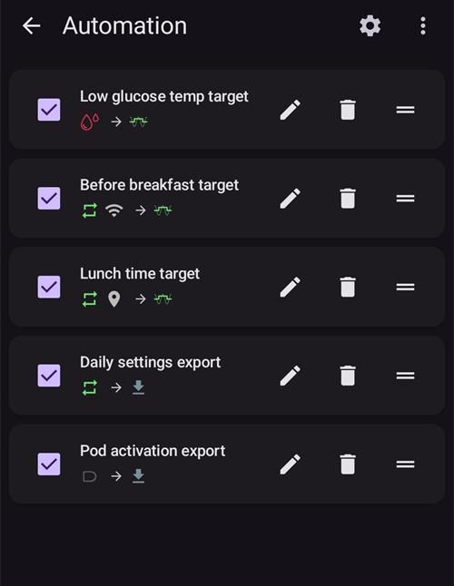
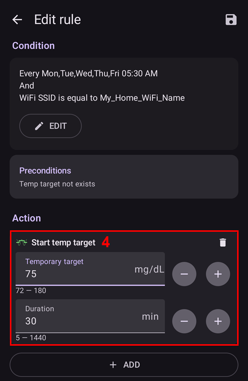
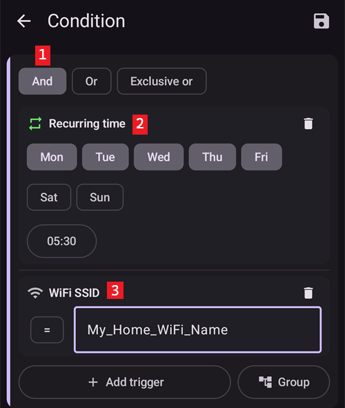

# Automation

```{contents} In this page
:backlinks: entry
:depth: 2
```

## What is an Automation?

"**Automation**" is a feature which can automate tasks in AAPS.

Automation performs specific actions based on one or more conditions or triggers. Triggers can include irregular events like low or high blood glucose (BG) levels, or a set amount of negative insulin on board (IOB). Automations can also handle recurring events, such as meals or exercise at certain times of day, or when the user is within a specific distance of a GPS location or a Wi-Fi SSID area. Automation can execute AAPS settings backups based on a schedule or on every Pod change.

Automation rules are created and modified from the **Automation** screen (**Manage → Automation**). Each rule is defined by two properties:

- One or more conditions or 'triggers' that start an action.

    Think of a certain time schedule, an event or properties value in AAPS

- Una o più azioni da eseguire.

    Per esempio un allarme, l'impostazione di una percentuale del profilo o l'esportazione delle impostazioni di AAPS al cambio del pod.


There are a wide range of Automation options, and users are encouraged to study these within the AAPS app, in the Automation section. You can also search the AAPS user groups on [**Facebook**](https://www.facebook.com/groups/AndroidAPSUsers) and [**Discord**](https://discord.gg/4fQUWHZ4Mw) for Automation examples from other users.

## How Automation can help

1. **Automate recurring tasks:** Automatically executing programmed actions without user interaction.

1. **Decreasing decision fatigue:** The primary benefit of **Automations** is to relieve the user from the burden of having to make manual interventions in **AAPS**. [Research](https://www.ncbi.nlm.nih.gov/pmc/articles/PMC6286423/#ref4) estimates that an average of 180 additional daily decisions have to be made by those living with Type 1 diabetes. **Automations** can lessen the mental load, freeing up the user’s mental energy for other aspects of life.

1. **Potentially improving glycemic control:** for example, **Automations** can help ensure **Temp Targets** are always set when needed, even during busy schedules or periods of forgetfulness. For example, if a child with diabetes has sports scheduled at school on Tuesdays at 10am and Thursdays at 2pm and requires a high Temp Target ('TT') actioned 30 minutes before the sports activity, the **Temp Target** can be enabled by way of an **Automation**.

1. **Enabling AAPS to be highly customized** to be more or less aggressive in specific situations, according to a user's preference. For example, triggering a temporary reduced **Profile** % for a set period of time if negative **IOB** develops in the middle of the night, indicating that the existing **Profile** may be too strong.

The example below illustrates how an **Automation** can enable steps to be eliminated.

User exercises every morning at 6 am: he needs to remember to manually set a "Temp Target-Activity" in AAPS at 5am, before exercising.


The user has set an **Automation** to trigger a 5am ‘Temp Target-Activity’ to ensure their **BG** and **IOB** are optimal, in preparation for their 6 am exercise:


## Key considerations before starting with Automations

1. Before setting up certain Automations, you should have reasonable **BG** control with **AAPS**. Automations should not be used to compensate for sub-optimal basal, **ISF** or **CR** settings (discussed further below). Avoid setting an automated **Profile switch** to compensate for **BG** rises due to _e.g._ food, these are better dealt with via other strategies (SMBs etc).

1. As with any technology, **CGMs**, **Pumps** and phones can malfunction: Technical issues or sensor errors can disrupt the **Automation** actions, and manual intervention may be needed.

1. **Requirements for Automations are likely to change as routines change**. When changing between work/school/holiday periods, set a reminder in your calendar to review which **Automations** are currently active (they are easy to activate and de-activate). For example, if you go on holiday, and no longer need an Automation set up for school sports or daily exercise, or need to adjust the timings.

1. **Automations** may conflict with each other, and it is good to review any new **Automation(s)** setting carefully in a safe environment, and understand why an **Automation** may or may not have triggered in the way you expect.

1. If using Autosens, try to use **Temp Targets** instead of **Profile Switches**. I **Target Temporanei** non riportano Autosens a 0. **Profile Switches** reset Autosens.

1. Most **Automations** should only be set for a **limited time duration**, after which **AAPS** can re-evaluate and repeat the **Automation**, if necessary, and if the condition is still met. For example, "start temp target of 7.0 mmol/L for 30 min" or "start **Profile** 110% for 10 min" _and_ "start temp target of 5.0 mmol/L for 10 min". Using **Automations** to create permanent changes (e.g. to stronger %profile) risks hypoglycemia.

## When can I start using Automation?

**Automations** can be started in **objective 10**.

## Where are Automations located in AAPS?

Open **Manage** in the bottom navigation of the main screen and select **Automation**.

## How can I set up an Automation?

To set up an **Automation**, press the **+** button on the Automation screen to create a ‘rule’:


* give your ‘rule’ a title (Task name);
* premi "**MODIFICA**" sotto **Condizione**. On the **Condition** screen, choose how the triggers are combined (**And**, **Or**, **Exclusive or**) and press "**Add trigger**":


* aggiungi almeno un trigger:


* premi "**AGGIUNGI**" sotto **Azione** e seleziona un'azione:


* save the rule with the **Save** button, and make sure the checkbox left of the rule name is ‘ticked’ to activate the **Automation**:


Per disattivare una regola di **Automazione**, togli la spunta dalla casella a sinistra del nome dell'**Automazione**. The example below shows an **Automation** as either activated (‘ticked') or deactivated (‘unticked’):


When setting up an **Automation**, you can first test it by activating the ‘notification’ option under "Actions". This triggers **AAPS** to first display a notification rather than actually automating an action. When you are comfortable that the notification has been triggered at the correct time/conditions, the **Automation** rule can be updated to replace the ‘Notification’ with an ‘Action’.


```{admonition} Important note
:class: note

**Automations** are still active when the Loop is disabled!
```


## Quando vengono controllate le regole

**AAPS** checks all **Automation** rules each time a new glucose reading has been processed, so rules are evaluated at the pace of your CGM, also while the phone screen is off. Rules are also checked when the phone starts charging, when the network or location changes, and when a Bluetooth device connects. Only one check runs at a time, so a rule whose actions take a while (for example a pump command) cannot be executed twice.

## Limiti di sicurezza

There are safety limits set for **Automations**:

* Un **Target Temporaneo** impostato da un'**Automazione** deve essere tra 72 e 180 mg/dL (o tra 4 e 10 mmol/L).
* The **Profile Percentage** has to be between 50% and 130%.
* Tra un'esecuzione e l'altra di un'**Automazione** (e prima della prima esecuzione) ci sono almeno 5 minuti.

## Uso corretto dei valori negativi

```{admonition} Warning
:class: warning

Fai attenzione quando scegli un valore negativo in un'**Automazione**
```

Caution must be taken when selecting a ‘negative value’ within the ‘Condition’ like "less than" in **Automations**. Per esempio:


**Example 1:** Creating a Condition **"is lesser than"** "-0.1mmol/L" (or "-2mg/dL") will:

Trigger an **Automation** for any number which is **strictly less than** -0.1 (-2). This includes numbers like -0.2, -0.3, -0.4 (-4, -6, -8) and so on. Ricorda che -0,1 (-2) stesso **non è** compreso in questa condizione. (The condition "is equal or lesser than -0.1mmol/L (-2 mg/dL)" _would_ include -0.1 mmol/L or -2 mg/dL).

**Example 2:** Creating a Condition "is greater than" -0.1mmol/L (-2mg/dL) will:

Trigger an **Automation** for any number which is **greater than** -0.1mmol/L (-2mg/dL). This includes numbers like 0, 0.2, 0.4mmol/L, (0, 4, 8mg/dL) and any other positive number.

It is important to carefully consider the exact intention of your **Automation** when choosing these conditions and values.

(automations-automation-triggers)=
## Automation Triggers


Scroll down to see the rest of the list:


There are various ‘Triggers’ that can be selected by the user. I trigger sono le condizioni che devono essere vere perché l'automazione venga eseguita. The list below is non-exhaustive:

**Trigger:** connect conditions

**Opzioni:**

Più condizioni possono essere collegate con
* “And”
* “Or”
* “Exclusive or” (which means that if one - and only one of the - conditions applies, the action(s) will happen)

**Trigger:** time vs. recurring time

**Opzioni:**

* time = single time event
* recurring time = something that happens regularly (i.e. once a week, every working day etc.)

**Trigger:** posizione

**Opzioni:**

* in [Settings > Automation](#preferences-maintenance-settings), the user can select their required location service.

**Trigger:** servizio di localizzazione

**Opzioni:**

* Use passive location: **AAPS** only takes locations when other apps are requesting it.
* Use network location: Location of your Wi-Fi.
* Usa localizzazione GPS (Attenzione! Può consumare molta batteria!)

**Triggers** : pump and sensor data

* Trigger Età della cannula: disponibile per tutti i micro
* Trigger Età dell'insulina: disponibile per i micro supportati
* Trigger Età della batteria: disponibile per i micro supportati
* Trigger Età del sensore: sempre disponibile
* Trigger Attivazione pod: disponibile per i micro patch

Note that for all age related triggers the equal comparison is unlikely to trigger, so in that case two triggers are required to create a range

* Reservoir level trigger: Available for all pumps, comparison "NOT\_AVAILABLE" is not working for this trigger as the value is always filled in **AAPS**
* Pump battery level trigger: Available for supported pumps, comparison "NOT\_AVAILABLE" is not working for this trigger as the value is always filled in **AAPS**

(automations-automation-action)=
## Action


Scroll down to see the rest of the list:


**Actions:** start **Temp Target**

**Opzioni:**

* La **glicemia** deve essere tra 72 mg/dL e 180 mg/dL (4 mmol/L e 10 mmol/L)
* **TT** works only if there is no previous Temp Target — **AAPS** adds this automatically as a "**Preconditions: Temp target not exists**" line to the rule

**Actions:** stop **Temp Target**

**Opzioni:**

nessuno

**Actions:** **Profile Percentage**

**Opzioni:**

* Il **Profilo** deve essere tra 50% e 130%
* works only if the previous Percentage is 100%

**Actions:** **Change smoothing** (in the **Loop & insulin** group)

**Opzioni:**

* select the [smoothing method](../CompatibleCgms/SmoothingBloodGlucoseData.md) to switch to. The list is the same as under **Configuration** > **Smoothing**, and the action does exactly what a change there does: the new method is saved, synced to paired clients, and the BG data is smoothed again right away.
* runs only if that smoothing method is not already active — **AAPS** adds this automatically as a "**Preconditions: Smoothing … is not active**" line to the rule. Once the selected smoothing is active, the rule is skipped silently.
* Example: a new sensor is often noisy during its first day. Two rules with the **Sensor age** trigger give stronger filtering while the sensor settles, and lag-free smoothing after that:
  * **Sensor age** less than 24 h: **Change smoothing** to **Unscented Kalman Filter**
  * **Sensor age** more than 24 h: **Change smoothing** to **Average smoothing**

**Actions:** **Note** (in the **Alerts** group of the list)

**Opzioni:**

* seleziona l'evento da registrare: **Nota**, **Esercizio fisico**, **Domanda**, **Avviso** o **Cambio posizione cannula**, e una nota facoltativa. The name of the action changes to the event you select.
* **Durata**: usata per **Nota**, **Esercizio fisico** e **Cambio posizione cannula**. **Domanda** e **Avviso** non hanno durata: registrano invece la tua glicemia attuale.
* **Pump Site Change** resets the cannula age, as if you had recorded a site change by hand. Example: some pumps (like the Combo) record a reservoir change by themselves, but not the site change. If you always change both together, a rule with **Insulin age** less than 1 hour and **Cannula age** more than 24 hours can record the site change for you.

 

**Azioni:** **Invia SMS a tutti i numeri** (nel gruppo **Avvisi**)

**Opzioni:**

* enter the text of the message. It is sent to all the phone numbers allowed in the [SMS Communicator](../RemoteFeatures/SMSCommands.md) settings. The SMS Communicator plugin must be enabled.

**Azioni:** **Cambia profilo in** (nel gruppo **Profilo**)

**Opzioni:**

* seleziona il **Profilo** da attivare. Viene attivato al 100%, senza spostamento orario. If this profile is already active, the action does nothing.

**Azioni:** **Attiva/disattiva SMB** (nel gruppo **Loop & insulina**)

**Opzioni:**

* choose **On** or **Off**. This changes the **Enable SMB** setting of OpenAPS SMB, exactly as if you had changed it in **Settings**, and stays until you or another rule change it back.

**Azioni:** **Esegui Autotune** (nel gruppo **Loop & insulina**)

**Opzioni:**

* seleziona il profilo da regolare e il numero di giorni: vedi [Eseguire Autotune con una regola di automazione](#autotune-run-autotune-with-an-automation-rule).

**Azioni:** **Interrompi l'elaborazione** (nel gruppo **Loop & insulina**)

**Opzioni:**

* none. While the conditions of a rule with this action are true, **AAPS** does not check the rules below it in the list. As soon as its conditions are false again, the rules below are checked as usual. Add it to a rule that must take priority over the rules below it (see [the order of the Automations](#Automations-the-order-of-the-automations-in-the-list-matters)).

**Azioni:** **Esegui scena**, **Abilita scena**, **Disabilita scena** (nel gruppo **Scene**)

**Opzioni:**

* seleziona la [scena](Scenes.md) da eseguire, abilitare o disabilitare.

Once the ‘Action’ is added,  the default values must be changed to the desired number by clicking and adjusting the default values.


(Automations-the-order-of-the-automations-in-the-list-matters)=
## The order of the **Automations** in the list matters
 **AAPS** will automate the rules created in the order of preference, starting from the top of the **Automation** list. Per esempio, se l'**Automazione** ‘Low’ è l'**Automazione** più importante, sopra tutte le altre regole, questa **Automazione** deve stare in cima alla lista delle **Automazioni** dell'utente, come mostrato sotto:




Per cambiare la priorità delle regole di **Automazione**, tieni premuta la maniglia **=** sul lato destro della regola. Riordina le **Automazioni** spostando le regole in su o in giù.


## How to delete Automation rules

Per cancellare una regola di **Automazione**, tocca l'icona del cestino.


## Examples of Automations

Below are examples of **Automations**. Altre discussioni sulle **Automazioni** e su come gli utenti hanno personalizzato la propria **Automazione** si trovano nei gruppi di discussione su Facebook o su Discord. The examples below should not be replicated without the user having a good understanding of how the **Automation** will work.

(automations-low-glucose-temp-target)=
### Target Temporaneo per glicemia bassa

This **Automation** triggers an automatic **Temp Target** when **BG** falls below a certain threshold — here, when glucose is lesser than 70 mg/dL, a target of 110 mg/dL is started for 30 minutes:


### Lunch Time Temp Target (with ‘Location’)


This **Automation** has been created for a user who eats their lunch at work around the same time every weekday but triggered only if the user is situated within a set ‘location’.  Quindi, se un giorno l'utente non è al lavoro, questa **Automazione** non si attiva.

This **Automation** will set a low **Temp Target** (Eating Soon) at 13:00 to drive BG to 90 mg/dL (or 5 mmol/L) in preparation for lunch.

The ‘Trigger’ location has a name, a position (tap **Pick from map**, or use your current location) and a radius in metres, and fires when you are inside (or outside) the area:


Because of the ‘And’ connection, the **Automation** only happens during the ‘chosen time’ and if the user is at the selected location.

The **Automation** will not be triggered on any other time at this location or at this time outside the 50-metre radius around the chosen position.

### Wi-Fi SSID Location Automation

Using a Wi-Fi SSID is a good option to trigger an **Automation** while within range of a specific Wi-Fi network (compared with GPS): it is fairly precise, uses less battery, and works in enclosed spaces where GPS and other location services might not be available.

Ecco un altro esempio: un **Target Temporaneo** solo nei giorni lavorativi, prima della colazione (1).


L'**Automazione** si attiva alle 5:30 solo dal lunedì al venerdì (2)  
e mentre il telefono è collegato alla rete Wi-Fi di casa (3).


Poi imposta un **Target Temporaneo** di 75 mg/dL per 30 minuti (4). One of the advantages of including the location is that it will not trigger if the user is traveling on vacation, for instance.


Scorri in basso per vedere l'azione: un **Target Temporaneo** di 75 mg/dL per 30 minuti (4).



Here is the screenshot detailing the **Automation** triggers:

1) Under the main “AND” (both conditions need to be met to trigger) 1) Recurring time = M,T,W,T,F At 5:30am  
1) Wi-Fi SSID = My_Home_WiFi_Name



(automating-preference-settings-export)=

## Automating Preference Settings Export

### Unattended Exports: scheduled (daily)

Screenshots detailing the Automation triggers:

1) Condition: Recurring time = M,T,W,T,F At 8:00am 1) Action: Settings Export (For "Text in treatments" enter "Daily")


Note: Export execution will be logged on Careportal

### Unattended Exports: Pod Activation (patch pump only)

Screenshots detailing the Automation triggers:

1) Condition: Pod Activation 1) Action: Settings Export (For "Text in treatments" enter "Pod Activation: settings export")


Note: Export execution will be logged on Careportal. Note : Automation will not trigger **at all** if you have not done a manual settings export before. Vedi [Impostazioni → Manutenzione](#preferences-maintenance-settings) per attivare correttamente l'esportazione automatica delle impostazioni.


## Automation Logs

**AAPS** shows a log of the most recent **Automation** events at the bottom of the **Automation** screen, below the rules. Use it to verify that your rules triggered when you expected them to.

In the example below, the **Low glucose temp target** rule (1) (see [Low Glucose Temp Target](#automations-low-glucose-temp-target) above) is enabled. The log (2) shows that at 03:09 PM, glucose fell below 70 mg/dL and the rule triggered:
* l'azione era "Avvia target temporaneo: 110mg/dL@30 min": un **Target Temporaneo** di 110 mg/dL per 30 minuti;
* **OK** alla fine significa che l'azione è stata eseguita con successo.


(automations-troubleshooting)=

## Troubleshooting

* Problem: __My automations are not being triggered by AAPS?__

Check that the box left of the **Automation** name is ‘ticked’ to ensure the rule is activated:


* Problem: __My automations are being triggered in the wrong order.__

Controlla l'ordine di priorità delle regole, come spiegato sopra.

* Problem: __A condition shows "Unknown trigger … - mai vero".__

The rule contains a trigger that this version of **AAPS** cannot read, for example after you went back to an older version or imported settings from a newer one. Such a trigger is never true, so the rule does not run. It is kept unchanged, so a newer version can still use it. Modifica la regola e sostituisci il trigger, oppure aggiorna **AAPS**.

## Alternatives to Automations

For advanced users, there are other possibilities to automate tasks using IFTTT or a third party Android app called Automate. 
