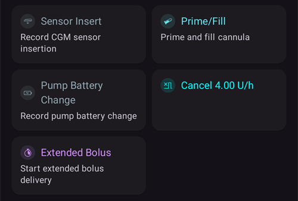
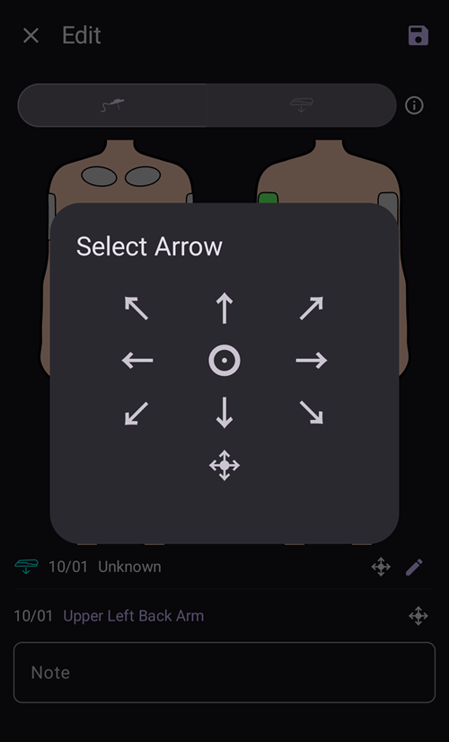

# Micro e cannule

## Cambiare i set di infusione: serbatoi di insulina e cannule

La procedura descritta qui sotto vale solo per i micro con catetere e non per i micro patch come Omnipod, Medtrum Nano, Accu-Chek Solo ecc. This procedure is sometimes referred to as a "set change", with a "full" set change including the insulin reservoir and cannula, and a "partial" set change referring to a change of cannula only.

Patch pumps fill and prime themselves in their own activation wizard, and their cannula is already in the body. **AAPS** does not offer a prime for them: **Prime/Fill** is not shown in the **Manage** sheet or in QuickLaunch. Vedi la pagina del tuo micro in [Micro compatibili](../Getting-Started/CompatiblePumps.md).

Physical cartridge/reservoir changes cannot be done via **AAPS** and have to be carried out via the pump directly. These need to be logged in **AAPS** manually, once completed.

(pumps-cannulas-changing-reservoir-and-cannula)=
### Guida per cambiare sia il serbatoio del micro sia la cannula

1. In **AAPS**, disconnetti il micro: premi l'[icona del loop](#AapsScreens-loop-status) nella schermata principale e seleziona **Disconnetti micro** per 1 ora. L'icona diventa una spina grigia: indica che il micro è disconnesso.

2. Cambia fisicamente il serbatoio di insulina: stacca fisicamente il micro dal corpo e cambia serbatoio/cartuccia e cannula seguendo le istruzioni del produttore.

3. Prime/fill the tubing and cannula: this can be done directly on the pump. Assicurati di eliminare tutte le bolle d'aria nel catetere.

4. Applica la nuova cannula sul corpo. Once the cannula is inserted and the needle is removed, the attached cannula now has a small air gap which also needs to be primed. To announce this in **AAPS** and prime the site: open **Prime/Fill** (in the expanded status panel on the main screen, in the **Manage** sheet, or as a [QuickLaunch](QuickLaunch.md) button) and tick **Record pump site change** and/or **Record insulin cartridge change** as appropriate to record the change. Now press the default insulin cannula prime amount (it is usually around 0.3 U, but check this value is correct for your cannula) and select **OK**. Read the summary message, and confirm to execute the priming by tapping **OK**.

   


5. Reconnect the pump in **AAPS**: press the grey plug icon and select **Reconnect pump** to continue looping.

### Informazioni utili sul cambio di insulina/cannula

* Logging a pump site change resets Autosens to 100%. It also resets the corresponding cannula/insulin status lights and ages on the **AAPS** main screen.

* You can set/adjust the default prime amounts in the **Prime/Fill** settings — type "prime" in the main screen search bar to open them (see [Preferences](../SettingUpAaps/Preferences.md)). See your instruction booklet in your cannula box for how many units (depending on needle length and tubing length) should be primed for your cannula.

* Insulin delivered using the prime function is not taken into account by **AAPS** when calculating insulin on board (IOB), and is marked in the [Treatments history](#aaps-screens-treatments) as "Prime".

* Any insulin bolused from the pump during a pump disconnection will also not be taken into account by **AAPS**. If you happen to bolus directly from the pump while **AAPS** is disconnected, once you reconnect the pump you can announce this insulin (without bolusing it) in the **Insulin** dialog (see [To announce delivered insulin without actually bolusing](#pumps-cannulas-announce-insulin) below).

### Problemi di cannula, sito di infusione, catetere e/o micro

If you are confident that you haven't received any insulin for a period of time, despite **AAPS** recording that you have, and you know exactly when the issue started (_e.g._ you remove the cannula and see that the cannula was kinked during the insertion process) you can correct this in **AAPS**, while being aware that the insulin may in fact have been delivered but may be slow to act for some reason.

```{admonition} Caution - Risk of Hypoglycemia
:class: danger
Elimina un'erogazione di insulina da **AAPS** solo con ESTREMA prudenza, nel caso in cui l'insulina _sia_ stata davvero erogata, e controlla con attenzione la glicemia nelle 24 h successive.
```

To remove boluses and SMBs which you know have not been delivered, open the **menu** (☰), select [Treatments history](#aaps-screens-treatments) and, on the **Carbs and bolus** tab, conservatively delete the logged boluses starting from the point the incident happened. This will correct the "insulin on board" (IOB) value which is key for **AAPS**' calculations; if you now return to the main screen you will see that the IOB has reduced. Be aware that you cannot delete basal insulin which **AAPS** calculates to have been delivered, so that will still be taken into account by **AAPS**.

In less obvious cases of insulin delivery problems _e.g._ leakages, occlusions or tunneling where either you are not sure when the issue started, or think some of the insulin was delivered, you need to be careful. You may detect these issues either by "smelling" the insulin, seeing a wet adhesive, encountering high glucose values or by getting an alarm. As you will never know how much insulin you got into your skin (which might be starting to work after a while) it will be hard to determine the correct amount of insulin which needs to be deducted from the current "insulin on board" (IOB) value. Una strategia è mettere in pausa il loop per 5 ore (o per la durata d'azione della tua insulina) dopo aver risolto il problema di erogazione, e poi riprendere il loop. Così l'IOB sarà corretto quando riprendi il loop.

(pumps-cannulas-disconnecting)=
## Disconnettere il micro per la doccia o per l'attività fisica

If you take your pump off for showering, bathing, swimming, contact sports or other activities you must let **AAPS** know that no insulin is being delivered, to keep the IOB correct. Puoi disconnettere il micro con l'[icona del loop](#AapsScreens-loop-status) nella schermata principale: premila e seleziona **Disconnetti micro** con la durata che ti serve. If the activity takes longer than planned, open the same dialog again and pick a new duration under **Disconnect pump**: the disconnection is extended and the new duration starts from now. Non devi prima riconnettere il micro.

Mentre il micro è disconnesso non ricevi insulina, quindi dovresti riconnetterlo ogni due ore per recuperare la basale mancante. You can do this by connecting, bolusing the missing basal amounts (_e.g._ of the last two hours) before disconnecting again. Questo aiuta a evitare una grave mancanza di insulina, che potrebbe portare a chetoacidosi diabetica (DKA). If it is inconvenient to reconnect the pump during activity (cannula site is covered by wearing a wetsuit _etc._), consider a pen injection instead. This manual injection can be logged in **AAPS**, and doesn't have to be logged at the time of injection (just make a note of the time of injection) since you can announce the insulin and backdate the time the insulin was actually given when you reconnect the pump.

(pumps-cannulas-announce-insulin)=
## Registrare l'insulina erogata senza fare davvero un bolo

Per registrare insulina erogata dal micro mentre **AAPS** era disconnesso, o insulina fatta con la penna: apri la [finestra Insulina](#aaps-screens-buttons-insulin) (**Trattamenti** nella barra di navigazione in basso, o un pulsante di Avvio Rapido), inserisci la quantità in unità e attiva **Il bolo sarà solo registrato (non erogato dal micro)**. A **Time** row (set to **Now**) then lets you record the actual time of the injection: you can ignore it if the injection was given recently. If the bolus was given some time ago, use **-** to move the time back (_e.g._ -30 min), or open the row with the chevron to pick the exact date and time. **AAPS** will then take into account the duration of insulin action and calculate the remaining insulin still in the system accordingly.

If you are using **AAPS** as a caregiver, you can remotely disconnect (and reconnect) the pump very easily by [SMS command](../RemoteFeatures/SMSCommands.md) using commands such as "pump disconnect 120" and "pump connect 120". La durata della disconnessione remota va da 1 a 120 min (in questo esempio è di 120 minuti). This is very useful if the **AAPS** handset is inconvenient for you to access, buried in a pump belt on a kid who is running off towards the swimming complex, or being closely guarded (or in use) by a teenager.

## Riconnettere il micro dopo l'attività

After a long disconnection (1 - 2 hours) it is fairly common for **AAPS** to calculate that you now have negative IOB. Quando riconnetti il micro, a seconda delle tue preferenze, della glicemia attuale, del cibo previsto o dell'attività successiva, puoi:

a) Riconnetti semplicemente il micro in **AAPS** (da grigio a verde, per il loop chiuso) e lascia che sia **AAPS** a ricominciare a erogare insulina

_oppure_

b) If you want to be more aggressive (for example, you are heading for hyperglycemia), you can open the [Bolus wizard](#aaps-screens-bolus-wizard) and bolus for zero carbs, to immediately deliver the calculated missing insulin as a bolus.

Quale strategia preferire è molto personale, ed è meglio scoprirlo provando.


(Aapsscreens-site-rotation)=
## Rotazione del Sito

**Manage → Site Rotation** opens the Site Rotation Dialog in View mode:

- With the two buttons at the top (cannula icon and sensor icon), you can show Cannula sites only, Sensor sites only, or both
- Sono disponibili tutti gli eventi di cambio cannula e cambio sensore degli ultimi 45 giorni.
- Click on a Site area, or in one entry in the list below to filter the list with only entries in selected area. L'area selezionata viene evidenziata in verde chiaro.
- Tap the **pencil** icon next to an entry to open the Edit view and update its Site location, Arrow or Note


- The **cog** icon (upper right) opens the settings: **User profile for site rotation** opens a dialog where you choose **Man**, **Woman** or **Child**, and the **Manage pump site rotation** and **Manage CGM site rotation** switches select which sites you manage.


*Nota: questa impostazione decide se la finestra Rotazione del Sito (modalità modifica) si apre in automatico quando crei una nuova voce con il pulsante "Carica/Riempi" o con il pulsante "Inserimento sensore".*

- For Site change done directly from Pump, you have to open the View Mode and Edit the new entry to select Location and Arrow

Edit Mode allows you to select Location, Arrow, and Note associated to selected Entry:

- The entry being edited is shown below the body images, with its type icon (cannula or sensor)
- Front and back views are shown side by side: tap the area where you placed it
- Quando hai selezionato un sito (evidenziato in verde), nella lista sotto vedi tutte le voci fatte in questo sito negli ultimi 45 giorni.


- You can add an optional arrow by tapping the arrow icon at the right of the entry: the **Select Arrow** dialog lets you specify a sub-location or the pod orientation



- Puoi anche aggiungere una **Nota** sul sito selezionato
- Tocca l'icona **salva** (in alto a destra) per registrare il sito

Filtering can be done graphically on the image, or clicking a therapy event in the list To remove filtering, just click on the image outside any sites


