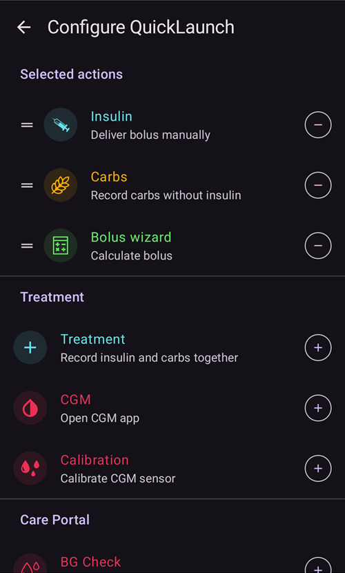
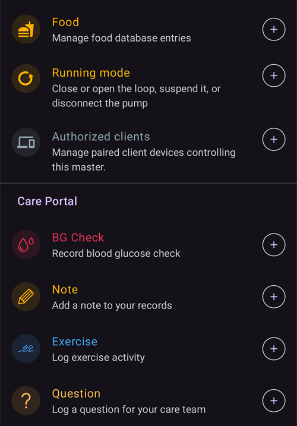

(quicklaunch)=
# QuickLaunch (overview quick-action toolbar)

**QuickLaunch** is the small **quick-action toolbar** that floats at the bottom of the **AAPS** overview, just above the bottom navigation. It is a customizable row of one-tap buttons: you decide which actions live there, in which order, so the things you do most often are always one tap away on the main screen.

```{contents} Table of contents
:depth: 2
:local: true
```


---

## Usare la barra

The toolbar sits on the **overview**, between the graphs and the bottom navigation:


- **Tap** an icon to run its action — exactly as if you had opened it from its normal screen (a bolus or treatment still shows its usual confirmation first).
- **Tieni premuta** un'icona per vedere un **suggerimento** con il nome dell'azione e una breve descrizione.
- If you add **more buttons than fit** on screen, the extra ones move into an **overflow menu** (the **⋮** button at the end of the toolbar).
- Each icon keeps its action's **color** (e.g. insulin, carbs, temp target), so it is recognizable at a glance.

```{admonition} The toolbar is always there
:class: note
L'ultimo pulsante è sempre **Configura Avvio Rapido** (l'ingranaggio **⚙️**). Non si può rimuovere, così puoi sempre raggiungere la schermata di configurazione direttamente dalla barra. Di default la barra contiene solo due pulsanti: il **Calcolatore** e questo ingranaggio.
```

---

## Configuring QuickLaunch

Tocca l'ingranaggio **⚙️** sulla barra (oppure apri **[Configurazione](../SettingUpAaps/ConfigBuilder.md) → … → Configura Avvio Rapido**) per aprire la schermata **Configura Avvio Rapido** (*“Personalizza i pulsanti di azione rapida nella panoramica”*).



La schermata ha due parti:

- **Selected actions** (at the top) — the buttons currently on your toolbar, in toolbar order.
- A **catalog** below it — every action you can add, grouped by category. Ogni voce del catalogo ha un pulsante **➕** per aggiungerla.

### Azioni selezionate: riordinare, modificare, rimuovere

Ogni azione selezionata ha:

- a **⠿ drag handle** — press and drag to **reorder** the buttons (the order here is the order on the toolbar),
- a **−** button — **remove** it from the toolbar,
- and, for a **Profile** shortcut only, a **✏️** button to edit its percentage/duration (see [Profile shortcuts](#profile-shortcuts)).

Changes take effect **immediately** — there is no separate *Save*. Adding an action drops it at the end of the toolbar; reorder it from there.

---

## Le categorie di azioni

The catalog groups everything you can add into the following categories, in this order. Categories that have nothing to offer (e.g. you have no scenes) are simply not shown.

### Trattamento

The everyday treatment and CGM dialogs:

- **Insulin** — deliver a bolus manually.
- **Carbs** — record carbs without insulin.
- **Bolus wizard** — open the bolus calculator.
- **Treatment** — record insulin and carbs together.
- **CGM** — open your CGM app (e.g. xDrip).
- **Calibration** — calibrate the CGM sensor.

### Care Portal

The care-portal events and device-maintenance records:

- **Controllo BG**, **Nota**, **Esercizio fisico**, **Domanda**, **Avviso**,
- **Inserimento sensore**, **Cambio batteria micro**, **Cambio posizione cannula**, **Carica/Riempi**, **Rotazione del Sito**.

**Prime/Fill** and **Pump Battery Change** are only offered when your pump uses them. Patch pumps, for example, fill and change the battery in their own activation steps, so these entries are not shown for them (as in the **Manage** sheet).


These are the same entries you would otherwise reach through the **[Treatments](#v4changes-treatments)** and **[Manage](#v4changes-manage)** sheets — QuickLaunch just puts the ones you use on the overview.

### Gestisci

Le schermate del pannello **[Gestisci](#v4changes-manage)**, nello stesso ordine, così puoi aprire dalla barra quella che usi di più:

- **Profile**, **Insulin settings** (manage and activate insulin configurations — named differently from **Insulin** on purpose, because that button delivers a bolus), **Temp Target**, **QuickWizard**, **Scenes**, **Automation**, **Food**,
- **Running mode** — close or open the loop, suspend it, or disconnect the pump,
- **Authorized clients** — only on a master or a paired client.

These buttons open the screen; they do not start anything by themselves. To start a scene or a QuickWizard in one tap, add it from the **Scenes** or **Quick Wizard** category below.

 

### Assistente Rapido

Each of your **[QuickWizard](QuickWizards.md)** presets can be added as a button, so a recurring meal is one tap from the overview. The button carries the preset's name and shows the carbs/insulin amount; tapping it runs the QuickWizard with its usual confirmation.

QuickWizards set to show on the watch only are not offered. A QuickWizard button on the toolbar follows the same rules as in the **Treatments** sheet: it is hidden outside its [valid time range](#quickwizard_validity) and for a short time after use. It stays in your toolbar configuration and comes back when the QuickWizard can be used again.

### Scene

Ogni **[scena](Scenes.md)** abilitata può essere aggiunta come pulsante. Tapping it asks for confirmation, then activates the scene (the same bundle of actions you would get from the Scenes screen). Questa categoria compare solo se hai almeno una scena.

Il suggerimento e il catalogo mostrano lo stesso riepilogo di **Gestisci → Scene**, per esempio *"3 azioni, 2 h → Cooldown"*, dove il nome dopo la freccia è la scena successiva.

### Automation

Your **user-action** automation rules (the ones you trigger by hand) can be added as buttons. Tapping one asks for confirmation, then runs that rule's actions.

```{admonition} Automation buttons run on the master
:class: note
L'automazione viene eseguita sul **master**, quindi le scorciatoie di automazione sono offerte ed eseguite solo sul master. They are not available on a paired **[client](../RemoteFeatures/ClientMasterControl.md)**.
```

### Preimpostazioni target temporaneo

Each of your **[Temp Target](TempTargets.md)** presets can be added as a button (its name, its target and its duration are shown, for example *"Eating soon — 5.0 mmol/L, 45 min"*). Tapping it asks for confirmation, then starts that temp target.


(profile-shortcuts)=
### Profilo

Every **[profile](ProfileSwitch-ProfilePercentage.md)** can be added as a **shortcut** that performs a **profile switch** in one tap. Unlike most shortcuts, a Profile shortcut carries its own **percentage** and **duration**, which you set after adding it with the **✏️** button:

- **Percentage** (30–250 %, in steps of 5 %) — scale the profile when it is applied. 100 % uses it as-is.
- **Duration** (0–10080 min, that is up to 7 days, in steps of 10 min) — how long the switch lasts. **0 = Permanent** (until you switch again).


This lets you keep several buttons for the **same** profile at different strengths — for example *“Profile 100 %”* and *“Profile 70 % for 2 h”* — and apply either with a single tap. (You can add the same profile more than once with different settings.)

### Plugin


Finally, any **enabled plugin** that has its own screen can be added as a shortcut to open it directly. These are grouped by plugin type — **Pump**, **BG Source**, **APS**, **Loop**, **Sensitivity detection**, **Smoothing**, **Calibration**, **Constraints**, **Communication** and **General** — so you can, for instance, jump straight to your pump or loop screen from the overview.

---

## QuickLaunch and Master/Client

Unlike most of your settings, the **QuickLaunch toolbar is configured per device** — it is stored **locally and is not synced** between your master and paired clients, so each device keeps its own set of buttons. (It *is* included in a settings **backup/export**, so a restore brings it back on the same device.)

What each device can put on its toolbar still depends on what it has: QuickWizards, scenes, temp-target presets and profiles all sync, so a client's catalog offers the same items — you simply choose them per device. Alcuni dettagli da sapere:

- Buttons whose target no longer exists (a deleted QuickWizard, scene or preset, a disabled rule) are **skipped automatically**.
- **Automation** shortcuts are offered and run only on the **master** (automation executes on the master). Scene, QuickWizard, temp-target and profile buttons are available on a client.
- When you tap a button on a client that must run on the master (a bolus, temp target, profile switch or scene), the **master** carries it out and authors the confirmation. Vedi [Controllo Master ↔ Client](../RemoteFeatures/ClientMasterControl.md).

---


<!-- =====================================================================
     Screenshots captured from a real master device:
       - quicklaunch_toolbar.png    (cropped close-up of the overview toolbar pill)
       - quicklaunch_overview.png   (full overview showing the toolbar in place)
       - quicklaunch_config.png     (Configure QuickLaunch: Selected actions + Treatment + start of Manage)
       - quicklaunch_dynamic.png    (catalog: Quick Wizard / Scenes / Automation / Temp Target Presets)
       - quicklaunch_categories.png (catalog: Profile shortcuts + plugin categories)
     No QuickLaunch action was actually run (nothing delivered; only scrolled).
     Maintainers: relocate page + images and fix cross-links as needed.
     ===================================================================== -->
