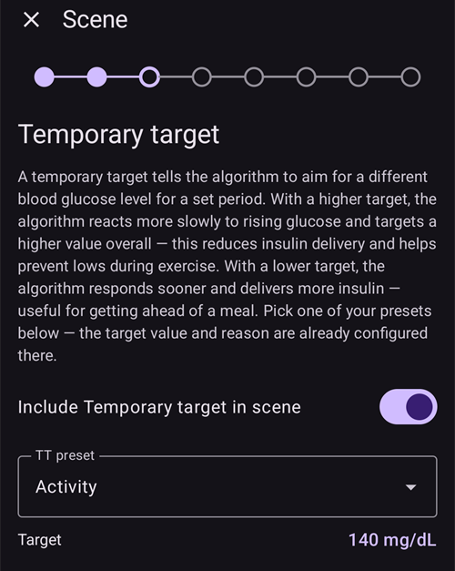
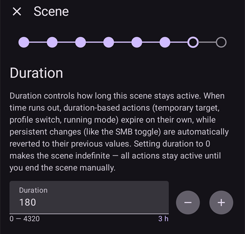
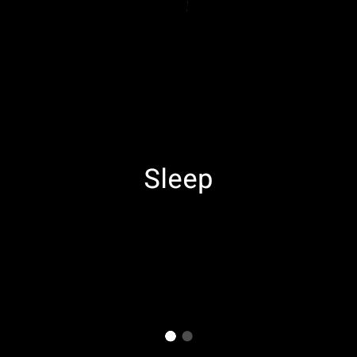

(scenes)=
# Scenes (situation presets)

A **scene** is a named preset that applies a **bundle of actions at once** — for example a *Sleep*, *Exercise* or *Sick Day* preset that switches your profile, sets a temporary target, toggles SMB and adds a care-portal note with a single tap, optionally for a set duration.

```{contents} Table of contents
:depth: 2
:local: true
```

---

## What is a scene

Instead of changing several things by hand every time a recurring situation comes up, you set them up once as a scene and activate it with one tap. A scene can bundle any of these actions:

- **Profile switch** — switch profile and/or scale it by percentage (e.g. 70 %).
- **Temporary target** — set a temp target (e.g. *Activity*, *Eating soon*, or a custom value).
- **SMB on/off** — enable or disable super-micro-boluses while the scene is active.
- **Loop mode** — change the running mode (e.g. to a more conservative mode).
- **Care-portal note** — log an event (e.g. *Exercise*, *Sickness*) so it shows on the graph and in Nightscout.

A scene also has a **duration** — a fixed time (minutes/hours/days) or *Indefinite (manual end)* — and an **end action** that runs when it finishes: either a **notification**, or it can **chain** into another scene (for example *Sick Day → Exercise*).

---

## Gestire le scene

Apri **Gestisci → Scene** per vedere, creare, modificare, abilitare/disabilitare e riordinare le tue scene.


Each scene card shows:

- a **checkbox** to enable/disable the scene,
- an **icon** and **name**,
- a summary — *“N actions, duration”*, and the **→ chained scene** if it chains into another one,
- and three buttons: **▶ activate**, **✏️ edit**, **🗑️ delete**.

Tocca il pulsante **+** per creare una nuova scena.

---

## Creare o modificare una scena

### Start from a template

Per **creare** una scena, tocca il pulsante **+** nella schermata Scene. The first step is **Start from template**: pick a ready-made scene for a common situation — *Exercise*, *Sick Day*, *Sick Day — Vomiting*, *Sleep*, *Post-exercise Night*, *Pre-meal*, *Alcohol*, *Driving*, *Bathing*, *Luteal Phase*, *Hot Weather*, *Medical Procedure* — or start from a *Blank* scene. Each template **pre-fills the recommended actions** and you can adjust everything in the following steps.


After you pick a template, its purpose is explained — *when* and *why* to use it — before you continue:


### Step through the actions

Il resto dell'editor è una breve procedura guidata **passo dopo passo**. Each step is one action type with an *“Include … in scene”* switch — turn it on only for the actions you want this scene to perform, and leave the rest off.


Work through the steps with **Next**/**Back**: *Profile switch*, *Temporary target*, *SMB*, *Loop mode*, *Care-portal note*, then the **duration**, the **end action** (notify or chain into another scene), and finally the scene's **name and icon**. Salva quando hai finito. (Per **modificare** una scena esistente, tocca il suo pulsante **✏️**: vai direttamente a questi passi.)

Each step starts with a short explanation of what the action does. The steps look like this, here with the *Exercise* template:

**Temporary target** — pick one of your temp target presets:



**SMB** — enable or disable SMB while the scene is active:


**Modalità esecuzione**: se vuoi, cambia la modalità del loop:


**Careportal** — the event type and note to log:


**Durata**: per quanto tempo la scena resta attiva; 0 significa finché non la termini tu:



**Follow-up scene** — optionally the scene that starts when this one ends:


**Scena**: il nome e l'icona. Premi **Termina** per salvare:


---

## Attivare una scena

Activate a scene from the **Scenes** list (the **▶** button) or from the **Scenes** entry in the bottom navigation. In the **Scenes** sheet of the bottom navigation, each scene shows the same summary as in the Scenes list, and the **pencil** at the top of the sheet opens **Manage → Scenes** to create or edit your scenes.


If [bolus protection](#Preferences-protection) is on, **AAPS** asks for it before a scene starts or ends. Changing a scene needs the [settings protection](#Preferences-settings-protection) instead.

Before anything is applied you get a **confirmation** that lists exactly what the scene will do, so you can review it:


If the scene chains into another one, the confirmation ends with **→** and the name of that follow-up scene, the same way it is shown in the Scenes list.

When you start the scene from the **Scenes** entry of the bottom navigation, the confirmation is a simpler dialog with the same list of actions. Premi **OK** per attivare:


After you confirm, the actions are applied and the **active scene** is shown at the top of the overview with an **End Scene** button. If the scene chains into another one, the banner also names that follow-up scene:


Le azioni della scena restano attive finché:

- la sua **durata** finisce (viene eseguita l'**azione finale**: una notifica, oppure il passaggio alla scena successiva), oppure
- tocchi **Termina scena** per terminarla a mano. If the scene chains into another one, you get two choices: **Skip to** the follow-up scene (the active scene ends and the follow-up starts now), or **End Scene** (the active scene ends and the follow-up does not start).

A scene without follow-up only asks you to confirm:


Ending a scene **reverts** the changes it made (for example the profile switch and temp target it started).

While a scene is active, the profile and the target on the main screen carry a small scene icon when the scene set them. The **Scenes** sheet of the bottom navigation stays available to start another scene:


When the duration runs out on its own, the changes are reverted straight away and the banner changes to **Scene ended** with a **Dismiss** button. Dismissing only clears the banner from the screen — the scene itself is already over, so automation rules and a chained scene carry on without waiting for it.

---

## Avviare le scene dall'Automazione

A scene does not have to be started by hand — **Automation** can run it for you. When you add an action to an automation rule (**Manage → Automation**), the action picker has a **Scenes** category:

- **Run scene** — activate a scene when the rule's triggers fire (for example at a set time, when you arrive somewhere, or when glucose crosses a threshold).
- **Enable scene** / **Disable scene** — make a scene available (or unavailable) without activating it.


Automation can also **react to** a scene: the trigger list includes a **Scene** trigger, so a rule can run only while a particular scene is active. Combined with a scene's **end action** (revert, notify, or chain into another scene), this lets scenes start, follow on and finish automatically.

---

## Scene con Master/Client e con un orologio

The **currently active scene is synchronized** across all of your paired devices — activate it on one phone and the others show it too.

A paired **client** (**AAPSClient**) can also activate or end a scene: the request is sent to the **master**, which authors the confirmation and applies the scene on its own state. See [Master ↔ Client control](../RemoteFeatures/ClientMasterControl.md) for how that works.

(scenes-from-watch)=
### Da un orologio Wear OS

Scenes are available on a **Wear OS watch** as a **Scene tile**. Swipe to the **Scene** tile in the watch's tile carousel (add it from the carousel's tile list first if it isn't there yet) and tap the scene you want to start:


The tile has four slots. By default each slot fills itself **automatically** with the next of your enabled scenes, in the order they have on the phone. To choose yourself, **long-press the tile** and open its settings: for each of the four slots you can keep **Automatic**, pin a **specific scene**, or select **None** to leave the slot empty. A slot pinned to a scene that has since been deleted or disabled shows **Unavailable** — pick another scene for it.

L'orologio mostra poi una conferma: tocca **✓** per attivare, oppure scorri indietro per annullare:



Just like on a client, the **master authors the confirmation and runs the scene**; the watch only relays the request (via the client phone, if the watch is paired to a client).

While a scene is running — or its **Scene ended** banner is still showing on the phone — the tile shows an **End** button with the name of the scene under it. Tap it to end the active scene, or to clear the leftover banner, from your wrist.

If the running scene chains into another one, the tile also shows a **Skip** button with the name of the follow-up scene under it. Sono le stesse due scelte del telefono:

- **End** — the active scene ends. The confirmation tells you that the follow-up will not start.
- **Skip** — the active scene ends and the follow-up scene starts now. The confirmation names both scenes.

The watch's [Loop Status screen](#WearOsSmartwatch-loop-status) also shows the active scene, the time it has left and its follow-up.

---


<!-- =====================================================================
     Screenshots captured from a real master device:
       - scenes_list.png        (Manage → Scenes management list)
       - templates_picker.png   (create: "Start from template" picker)
       - template_explanation.png (create: chosen template's explanation)
       - scene_editor.png       (scene editor, Profile switch step)
       - scene_confirmation.png (scene activation confirmation — also used on the Client/Master page)
       - scene_active_banner.png (overview active-scene banner with the End Scene button)
       - automation_scene_action.png (Automation action picker — Scenes category)
       - scene_watch_tile.png    (Wear OS Scene tile)
       - scene_watch_confirm.png (Wear OS scene confirmation)
     Maintainers: relocate page + images and fix cross-links as needed.
     ===================================================================== -->
