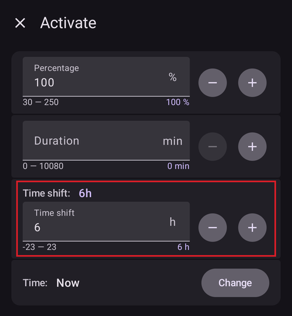
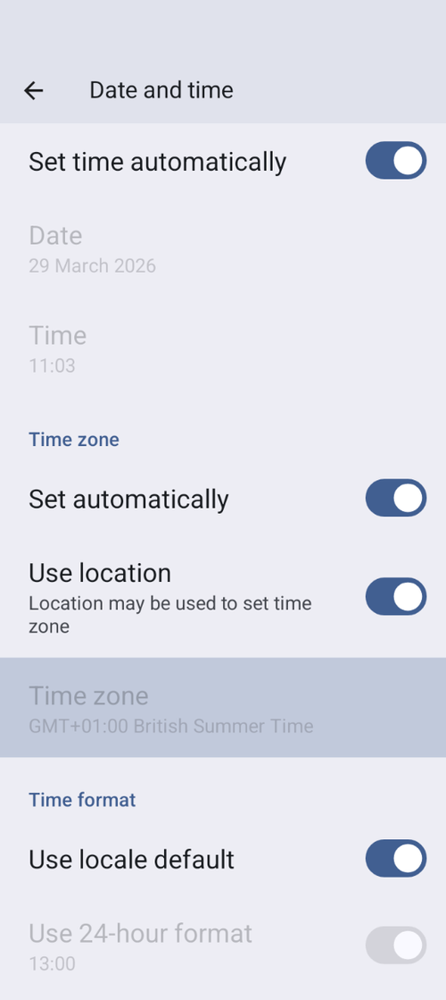

# Cambio di fuso orario e ora legale

When the time zone of your phone changes, **AAPS** calculates **IOB**, basal and sensitivity for the past again from scratch, about 10 seconds after the change. While this runs, the graphs and values on the main screen may take a moment to update.

(timezone-traveling-with-pumps)=

## Cambio di fuso orario per Omnipod Dash

* Aggiorna lo stato del micro in **Gestisci → Micro**
* Temporarily select a different **Profile** and then switch back to your original or desired **Profile**

## Cambio di fuso orario per DanaR, DanaR coreano

There is no issue with changing timezone in phone because pump doesn't use history

(timezone-traveling-danarv2-danars)=

## Cambio di fuso orario per DanaRv2, DanaRS, Dana-i

These pumps require special care because **AAPS** uses history from the pump but the records in pump do not have timezone stamp. **This means that if you change time zone in your phone, records will be read with different time zone and will be doubled.**

Per evitarlo ci sono due possibilità:

### Option 1: Keep home time and timeshift profile

* Turn off 'Automatic date and time' in your phone's settings (manual time zone change).

* Your phone must keep your standard time as at home for the whole travel period.

* Time-shift your **Profile** according to time difference between home time and destination time.
   
   * Tocca il nome del **Profilo** nella schermata principale per aprire la [schermata Profilo](#ProfileSwitch-manage-v4)
   * Seleziona il tuo **Profilo** e tocca **▶ Attiva**
   * Set '**Time shift**' according to your destination and tap **Activate**.
   
   
   
   * e.g. Vienna -> New York: **Profile Switch** +6 hours
   * e.g. Vienna -> Sydney: **Profile Switch** -8 hours

### Option 2: Delete pump history

* Turn off 'Automatic date and time' in your phone settings (manual time zone change)

Quando scendi dall'aereo:

* spegni il micro
* cambia il fuso orario sul telefono
* turn off phone, turn on pump
* cancella lo storico nel micro
* cambia l'ora nel micro
* accendi il telefono
* let phone connect to the pump and fine-tune time

(timezone-traveling-insight)=

## Cambio di fuso orario per Insight

The driver automatically adjusts the time of the pump to the time of the phone.

The Insight also records the history entries in which moment time was changed and from which (old) time to which (new) time. Così **AAPS** può stabilire l'ora corretta nonostante il cambio dell'ora.

It may cause inaccuracies in the **TDDs**. Ma non dovrebbe essere un problema.

Quindi chi usa l'Insight non deve preoccuparsi dei cambi di fuso orario e di ora. There is one exception to this rule: The Insight pump has a small internal battery to power time etc. mentre cambi la batteria "vera". If changing battery takes too long this internal battery runs out of energy, the clock is reset and you are asked to enter time and date after inserting a new battery. In this case all entries prior to the battery change are skipped in calculation in AAPS as the correct time cannot be identified properly.

## Cambio di fuso orario per Accu-Chek Combo

The [Combo driver](../CompatiblePumps/Accu-Chek-Combo-Pump-v2.md) automatically adjusts the time of the pump to the time of the phone. The Combo cannot store timezones, only local time, which is precisely what the driver programs into the pump. In addition, it stores the timezone in the local AAPS preferences to be able to convert the pump's localtime to a full timestamp that has a timezone offset. The user does not have to do anything; if the time on the Combo deviates too much from the phone's current time, the pump's time is automatically adjusted.

Note that this takes some time, however, since it can only be done in the remote-terminal mode, which is generally slow. È un limite del Combo che non si può superare.

## Cambio di fuso orario per Medtrum

The driver automatically adjusts the time of the pump to the time of the phone.

Time zone changes keep the history intact, only TDD may be affected. Manually changing the time on the phone can cause problems with the history and **IOB**. Se cambi l'ora a mano, ricontrolla l'**IOB**.

Quando cambia il fuso orario o l'ora, i **TBR** in corso vengono fermati.

(time-adjustment-daylight-savings-time-dst)=

## ORA LEGALE (DST)

Regolazione dell'ora per l'ora legale.

Depending on your pump and CGM setup, jumps in time can lead to problems with **AAPS** to function correctly. For some pumps it is better to make time zone adjustments while awake before DST takes place and not during the night.

### Regolazione automatica dell'ora legale per la maggior parte dei micro

* However, the **Loop** will be deactivated for 3 hours AFTER the DST switch (usually 1am onwards) has taken place and **AAPS** will default to background basal as selected in your **Profile**. This is done for safety reasons - **IOB** may be too high due to duplicated bolus prior to DST change.
* After DST has taken place, make a **Profile Switch** to the desired **Profile** to enable the **Loop**: tap the profile name on the main screen, then the round **▶** button (see [Activating a profile](#ProfileSwitch-manage-v4)).
* You will also receive a notification on **AAPS** main screen prior to DST change that the **Loop** has been disabled temporarily. This message will appear without beep, vibration or similar sound.

If you bolus with **AAPS'** calculator please do not use **COB** and **IOB** data unless you are sure this data is absolutely correct. Take caution and do not use this feature for a couple of hours after DST switch has taken place.

### Ora legale per Accu-Chek Insight

* Change to DST is done automatically. Non serve fare nulla.

### Ora legale per Accu-Chek Combo

* Change to DST is done automatically. Non serve fare nulla.

### Ora legale per Medtrum

* Change to DST is done automatically. Non serve fare nulla.

### Ora legale per Omnipod Dash

* Puoi lasciare che **AAPS** usi temporaneamente la basale di fondo dopo il cambio dell'ora legale, come spiegato sopra.
* Altrimenti, se non vuoi che **AAPS** usi temporaneamente la basale di fondo durante la notte, puoi cambiare il fuso orario il giorno prima del cambio dell'ora legale, per evitare disturbi notturni. NOTE THIS OPTION MAY CAUSE YOUR POD TO PREMATURELY EXPIRE. PLEASE HAVE SUPPLIES WITH YOU IF OPTING FOR THE FEATURE BELOW.

#### Actions to take before the clock change

1. Switch OFF any Phone's settings that automatically sets the Phone's time zone, so the user can change to a desired time zone that does not use DST. How to enable this will depend on your smartphone and Android version.
   
   * Some phones have two settings, one for automatic setting of the time (which ideally should remain on) and one for automatic setting of the time zone (which you must turn OFF: **Set automatically** under **Time zone** in the screenshot below).
   * Purtroppo alcune versioni di Android hanno un solo interruttore per attivare l'impostazione automatica sia dell'ora sia del fuso orario. You’ll have to turn this off for now.

2. Find a timezone that has the same time as your current location but doesn't use DST.
   
   * A list of these countries is available [https://greenwichmeantime.com/countries](https://greenwichmeantime.com/countries/)
   * Per l'ora dell'Europa centrale (CET) potrebbe essere "Brazzaville" (Congo). Change your phone's timezone to Congo.

3. In **AAPS** refresh your pump and switch to your desired **Profile**.

4. Controlla l'**IOB** e i **COB** di **AAPS**: se non sono corretti, disattiva il **Loop** almeno per la durata del DIA o del tempo massimo di assorbimento dei carboidrati (**Tempo massimo di assorbimento**), il più lungo dei due.

5. Actions to take after the clock change. A good time to make revert to local time zone is with low **IOB**. E.g. an hour before a meal such as breakfast. Ideally your **COB** and **IOB** should both be close to zero.