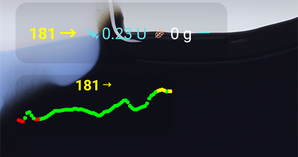

(widgets)=
# Home screen widgets

**AAPS** provides widgets that you can add to your phone's home screen. Un widget mostra i tuoi dati attuali senza aprire l'app. Tocca un widget per aprire **AAPS**.

```{contents} Table of contents
:depth: 2
:local: true
```

---

## Widget disponibili

Sono disponibili cinque widget. They are listed under **AAPS** in the Android widget picker:


| Widget                             | Dimensione predefinita | Cosa mostra                                                                                                                                                                                                                                                |
| ---------------------------------- | ---------------------- | ---------------------------------------------------------------------------------------------------------------------------------------------------------------------------------------------------------------------------------------------------------- |
| **AAPS widget**                    | 5 × 2                  | The status block of the main screen: BG with trend and delta, the loop mode as an icon beside the profile name, target, sensitivity (shown as on the main screen), IOB and COB. The texts shrink to fit the size you give the widget instead of being cut. |
| **Cerchio glicemia AAPS**          | 2 × 2                  | The BG circle of the main screen: a ring in the BG colour, the trend arc, the delta, the BG value and the time since the last reading.                                                                                                                     |
| **AAPS Small**                     | 2 × 2                  | Nome del profilo, glicemia con freccia di tendenza, tempo dall'ultima lettura, delta, IOB e COB.                                                                                                                                                           |
| **AAPS BG + IOB + COB (compatto)** | 4 × 1                  | Una riga con glicemia e freccia di tendenza, IOB e COB.                                                                                                                                                                                                    |
| **Grafico di glicemia AAPS**       | 3 × 1                  | Il valore della glicemia con un piccolo grafico delle ultime letture.                                                                                                                                                                                      |

The **AAPS widget**, the **glucose circle** and the **Small** widget on a home screen:


The **compact** widget and the **BG graph** widget:



BG values use the same colours as in **AAPS**: green in range, yellow above range, red below range.

---

## Aggiungere un widget

The exact steps depend on your phone and its launcher. Sulla maggior parte dei telefoni:

1. Long-press an empty area of the home screen and select **Widgets**.

   

2. Apri **AAPS** nell'elenco e tocca il widget che vuoi.
3. Press **Add** (or drag the widget to the place you want).

   

The widget is placed on the home screen. Right after adding it, it is shown with handles: drag a handle to **resize** the widget, or drag the widget to move it. The glucose circle can be resized to any size.


If the home screen page is full, the phone puts the widget on a new page.

---

## Configurazione widget

Tap the **pencil** button shown on the widget just after you added it. Later, long-press the widget to get the handles and the pencil back.

La finestra **Configurazione widget** ha due impostazioni:

- **Configure opacity** — how opaque the background of the widget is. A low value lets the wallpaper show through.
- **Use black color** — use a black background instead of the default one.


Ogni widget ha la sua configurazione.

---

## Good to know

- A widget only **displays** data. Da un widget non puoi fare un bolo né cambiare nulla.
- Il widget viene aggiornato da **AAPS**. Se **AAPS** non è in esecuzione, o se Android lo limita in background, il widget può mostrare dati vecchi. Controlla il tempo dall'ultima lettura e assicurati che **AAPS** sia escluso dall'[ottimizzazione della batteria](#SetupWizard-StoragePermission).
- Con **AAPSClient**, **AAPSClient2** e **AAPSClient3** lo sfondo del widget è giallo, blu o verde, così puoi distinguere le app. Raise the opacity in the widget configuration if the color is hard to see. Vedi [Informazioni su AAPSClient, AAPSClient2 e AAPSClient3](#remotecontrol-aapsclient-versions).
