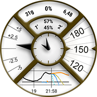

# Custom Watchface Reference Document

This page is for designers of new Watchfaces. It will list all the keywords and features available when you want to create or animate a new watchface.

- New features and keys available in Custom Watchface V2 (Wear apk 3.3.0 or above) are available [here](#cwf-reference-new-v2-features)

## Custom Watchface Format

Custom Watchface is an open format designed for AAPS and associated to the new "AAPS (Custom)" watchface available on Watch.

The Watchface file is a simple zip file, but to be recognized as a Watchface file, the zip file must contain the following files:

- One image file named CustomWatchface (can be bitmap files `CustomWatchface.jpg`, `CustomWatchface.png` or a vector `CustomWatchface.svg`). This file is the little icon used to select the watchface when you click on "Load Watchface" button, and also the image visible within AAPS Wear plugin.
- Un file chiamato `CustomWatchface.json` (vedi [Struttura JSON](#cwf-reference-json-structure) più sotto). This second file is the core file that will include all information required to design the watchface. This json file must be valid (it's probably the most tricky point when you edit manually this file within a text editor, because a missing or additional comma is enough to break the json format). This JSON file must also include a `"metadata"` block with a `"name"` key with not empty value. This will be the name of your custom watchface (see [Metadata settings](#cwf-reference-metadata-settings) below)
- the size of this zip should be as small as possible (less than about 500kb). Se questo file è troppo grande, viene semplicemente bloccato e non viene trasmesso all'orologio.

Il file zip può contenere anche alcuni file di risorse aggiuntivi:

- Hardcoded file names for images that will be used used in standard views included in the watchface (like `Background`, `CoverChart`... see [List of hardcoded resource files](#cwf-reference-list-of-hardcoded-resource-files) below). Tutti questi file possono essere in formato `jpg`, `png` o `svg`. but for most of them, you will have to use `png` or `svg` that manage transparency (jpg are smaller in size compared to png, but with no transparency). Note that the best quality associated to the smallest size will generally be with svg files (vector format).
- File di risorse aggiuntivi con nomi liberi. These additional files can be either image files, or font files (`ttf` and `otf` format are accepted for fonts). Note that for these additional files, the `filename` (without extension) will be used as the keyValue, within JSON file, to specify where or when these files should be used.
  - image files are often used as background of text views or for dynamic animation (like battery level from 0% to 100%)
  - font files allow you to use dedicated fonts within your watchface

(cwf-reference-json-structure)=

## Struttura JSON

JSON files can be edited in Notepad (or notepad++) text editor (prefer notepad++ that recognize JSON and use color formatting)

- it contains string keys `"string_key":` and key values that can be strings like `"key value"`, integer, boolean like `true`or `false` or block of data.
- ogni valore è separato da una virgola `,`
- A block of data starts by `{`  and ends by `}`
- the json file is a whole block so it starts by  `{`  and ends by `}`, and inside this file all embedded blocks are associated to a `"key"` that should be unique within the block
- To improve readability of json file, it's generally indented (each new key is on a new line, each new block is shifted on the right by 4 spaces characters)

(cwf-reference-metadata-settings)=

### Impostazioni Metadata

This block is the first block included into the json file and is mandatory. It contains all the information associated to this watchface, like the name, the author, the date of creation or update, the author version or the plugin version.

Qui sotto trovi un esempio di blocco metadata:

```text
"metadata": {
    "name": "Default Watchface",
    "author": "myName",
    "created_at": "07\/10\/2023",
    "author_version": "1.0",
    "cwf_version": "1.0",
    "comment": "Default watchface, you can click on EXPORT WATCHFACE button to generate a template"
},
```

Note that `/` used for the date is a special character, so to be recognize correctly within json file, you have to put before an "escape" character `\`

You can see in some json file an additional key `"filename"`, this key will be automatically created or updated when the custom watchface will be loaded within AAPS (it will be used to show to the user the zip filename within exports folder), so you can remove this key within metadata block.

(cwf-reference-general-parameter-settings)=

### Impostazioni dei parametri generali

After the first block with metadata, you will set some general parameters (see [List of general parameters](#cwf-reference-list-of-general-parameters) below), this allow you to set Graph colors (Carbs, Bolus, BG values...), and also default colors for value in range, hyper or hypo (default colors of BG value and arrows)

Qui sotto trovi un esempio di parametri generali

```text
"highColor": "#FFFF00",
"midColor": "#00FF00",
"lowColor": "#FF0000",
"lowBatColor": "#E53935",
"carbColor": "#FB8C00",
"basalBackgroundColor": "#0000FF",
"basalCenterColor": "#64B5F6",
"gridColor": "#FFFFFF",
"pointSize": 2,
"enableSecond": true,
```
(cwf-reference-imageview-settings)=

### Impostazioni di ImageView

Custom image can be tuned using correct filename associated to each ImageView included into custom watchface Layout, then the json block is only here to define the position, the size, if the view is visible or not, and optionally tune the color:

Qui sotto trovi un esempio di blocco Image per second_hand (in questo caso nel file zip non c'è nessuna immagine, quindi viene usata l'immagine predefinita della lancetta dei secondi, ma con un colore personalizzato).

```text
"second_hand": {
    "width": 400,
    "height": 400,
    "topmargin": 0,
    "leftmargin": 0,
    "visibility": "visible",
    "color": "#BC906A"
}
```
To have second_hand colored with default BG color (lowRange, midRange or highRange), you just have to modify the latest line with the keyValue `bgColor`

```json
    "color": "bgColor"
```

(cwf-reference-textview-settings)=

### Impostazioni di TextView

TextView ha più parametri disponibili rispetto a ImageView: puoi regolare la rotazione (valore intero in gradi), textsize (valore intero in pixel), gravity (per definire se il testo è centrato (valore predefinito) o allineato a sinistra o a destra), impostare font, fontStyle e fontColor, e anche il colore di sfondo della TextView

```text
"basalRate": {
    "width": 91,
    "height": 32,
    "topmargin": 133,
    "leftmargin": 249,
    "rotation": 0,
    "visibility": "visible",
    "textsize": 23,
    "gravity": "center",
    "font": "default",
    "fontStyle": "bold",
    "fontColor": "#BDBDBD"
},
```
Note that if you don't want to manage one view within your watchface, then put the `"visibility"` key to `"gone"` but also set size and position outside visible area like that:

```text
"second": {
    "width": 0,
    "height": 0,
    "topmargin": 0,
    "leftmargin": 0,
    "rotation": 0,
    "visibility": "gone",
    "textsize": 46,
    "gravity": "center",
    "font": "default",
    "fontStyle": "bold",
    "fontColor": "#BDBDBD"
},
```
If size and position are within visible area, you can get some "flash" of the hidden value during the refresh of the watchface.

If you want to customize background image of a text view, then you can use the key `"background":` and put the filename of image included into zip file as keyValue, you can also just change the background color using `"color:"` key.

```json
"background": "fileName"
```

You also have 4 specific textViews (named freetext1 to freetext4) that have a specific parameter `"textvalue":` that can be used to set for example a label

(cwf-reference-chartview-settings)=

### Impostazioni di ChartView

La vista del grafico è una vista molto particolare, che può condividere alcuni parametri con ImageView o con TextView...

Standard settings for this view is very simple:

```text
"chart": {
    "width": 400,
    "height": 170,
    "topmargin": 230,
    "leftmargin": 0,
    "visibility": "visible"
},
```
The 2 additional parameters you can include for Chart view is a background color (default is transparent), using `"color"` key or a background image using `"background"` key.

(cwf-reference-how-to-build-watchface)=

## How to build/design your first Watchface

### Strumenti necessari

- Text editor: My advice is to use NotePad++ (or equivalent) that is a simple text editor, but added value is you can see formatted text with color code, so it's easier to detect errors. any simple text editor will do the job. Perché lo scopo è regolare le informazioni json.
- Editor di immagini (bitmap e/o vettoriali)
  - If you use Bitmap
    - Image editor should be able to manage transparency (required for all image above background), and png format (if you used bitmap image)
    - L'immagine di sfondo può essere in formato jpg (più piccolo del png)
    - Image editor should allow you to measure in pixel graphical objects (can be a simple square) (top, left, width, height)
    - L'editor di immagini deve poterti mostrare i colori con il codice RRGGBB in esadecimale
    - Image editor should be able to resize image to 400px x 400px (very important to work with this resolution)
  - Se usi immagini vettoriali
    - Vector image should be exported in svg format

### Get template to not start from scratch

When you want to design your first watchface, the best is to start by the default watchface (this will ensure you to have latest version with all available views correctly sorted)

- You can get zip file by clicking on "Export Template" button within Wear plugin and get zip file within AAPS/exports folder
- Note that you will need to have a watch connected to AAPS to see Custom Watchface buttons (but watch is also required to check, test and tune your custom watchface)

Default watchface is very simple and zip file will contains only the 2 files:

- CustomWatchface.png (image of default watchface for WF selection)
- CustomWatchface.json

### Organize your files within your computer

Il modo più semplice di lavorare è avere il telefono collegato al computer e lavorare con due cartelle specifiche:

- one explorer opened on a specific folder that will have all files (json, bitmap images, vector images, fonts), and the CustomWatchface.zip file within it
- another explorer (or navigation tree tuned) opened to have Phone/AAPS/exports folder available

That way working is very easy: each time you tune json file with a text editor, image with image editor (bitmap or vector) you have to just:

1. salvare le modifiche in ogni app
2. trascinare tutti i file nel file CustomWatchface.zip
3. trascinare CustomWatchface.zip nella cartella AAPS/exports del telefono
4. inviare CustomWatchface all'orologio per controllare il risultato

### Initialize Watchface customization

First step you will have to define a watchface Name (necessary to select it easily for testing), and start to tune metadata keys at the beginning of json file

Poi devi decidere quali informazioni vuoi mostrare, cioè quali viste devono essere visibili o nascoste.

- vuoi gestire i secondi o no?
- do you want to design an analog watch or a digital watch (or both...)

Now you can start to modify json file with the `"visibility":` key of each view set to `"visible"` or `"gone"` (if you want to keep or not the view)

Puoi anche iniziare a regolare in modo approssimativo i valori di margine superiore, margine sinistro, larghezza e altezza per iniziare a organizzare la watchface (questi valori verranno regolati dopo con l'editor di immagini)

Note: everything is design within a **400px x 400px rectangle**. So everything will be position in absolute coordinates within this size.

When you design your first watchface, you have to know that everything is organized by layer from the Back to the Top, so each view (ImageView or TextView) can hide something that is behind...


Then within json file all views are sorted from the Back to the Top (this will help you to remember what is behind what...)

If you design or tune your first custom watchface, start by simple things: change visibility of some views, include a dedicated background image without changing json file...

### Gestire i colori

Within json file, you will have several keys to specify colors: `"color"`, `"fontColor"`for views, but also `"highColor"`, `"midColor"`, `"lowColor"`, ... (see [List of General Parameters](#cwf-reference-list-of-general-parameters))

Colors are specified with a text field that starts by `#` followed by RRGGBB (Red, Green, Blue) values in hexadecimal format:

- `"#FFFFFF"` è bianco, `"#000000"` è nero, `"#FF0000"` è rosso...

You can also include 2 additional values for alpha layer and specify a transparency level (AARRGGBB):

- `"#00000000"` è completamente trasparente e `"#FF000000"` è completamente opaco (quindi `"#FF000000"` equivale a `"#000000"`)

You can also use the specific keyvalue `"bgColor"` to automatically use `"highColor"`, `"midColor"`, `"lowColor"` specified in general parameters according to BG Value:

- `"fontColor": "bgColor",` imposta automaticamente il colore del font della vista in base al valore della glicemia
- Note that `sgv` (for BG Value) and `direction` (for trend arrow) views automatically apply BG colors set into general parameters (for these 2 views, if you want to have different colors, you will have to use advanced [dynData](#cwf-reference-dyndata-feature) feature with one step color...)

Per maggiori informazioni sulle ImageView e sulla chiave `"color":`, vedi il capitolo dedicato [Regolare il colore dell'immagine](#cwf-reference-tune-image-color) più sotto.

### Include Hardcoded images

the easiest way to start tuning your watchface is to include within zip file some images with a specific names (see [List of Hardcoded resource files](#cwf-reference-list-of-hardcoded-resource-files))

- L'immagine deve essere in formato `.jpg`, `.png` o `.svg`. but be careful, jpg doesn't manage transparency, so should be only used for background layer. Per tutti i livelli intermedi (cover_chart, cover_plate, lancette) usa immagini `.png` o `.svg`

- If you have a vector image editor (like for example Illustrator), prefer this format that will produce small text files with `.svg` extension the best quality.
- You should take care to use exact filename (including High/lower case)

Now if you want a dedicated background image, you only have to include within the zip file a file named `Background.jpg` (without changing anything else). Invia il file zip all'orologio e controlla il risultato!

If you want to customize hour_hand, minute_hand or second_hand for an analog watch, simply include `HourHand.png` (or `HourHand.svg`), `MinuteHand.png` and `SecondHand.png`.

- these images will automatically rotate around the center of the image, so the images should be set to 00:00:00 (and for a "full frame" analog watch, use a size of 400 x 400 px positioned at top 0 left 0)

You can also noticed within [List of Hardcoded resource files](#cwf-reference-list-of-hardcoded-resource-files) that for each image view, you have two additional hardcoded filenames `High` and `Low` (for example you can include other images named `BackgroundHigh.jpg` and `BackgroundLow.jpg` within zip file). then image will automatically change according to you BG level (within Range, Hyper or Hypo). See AIMICO watchface as example.

(cwf-reference-tune-image-color)=

### Regolare il colore dell'immagine

`"color"` key can  be used to tune default image color:

- applied on background view, it will set the background color (default black)
- applied on cover_plate (simple dial) or hands, it will change the default image (white) by the color specified (including `"bgColor"`)

When you apply `"color"` key on a bitmap image (`.jpg` or `.png`), color will apply an interesting effect on color saturation. So you will still recognize your bitmap.

Infine, sui file immagine `.svg` la chiave `"color"` non ha effetto: considera il colore dei file vettoriali come fisso nell'immagine. If you want to change colors, you will have to include several `svg` files, and use advanced [dynData](#cwf-reference-dyndata-feature) feature to change it

### Use additional fonts for TextViews

Several defaults font are already available within wear apk (see font keys included into [key values](#cwf-reference-key-values) chapter). But if you want to use additional fonts not available as default, you can include additional fonts within zip file:

- i 2 formati di font accettati sono i file `.ttf` e `.otf`
- if you include a custom font within zip file, for example with a file named `myCustomFont.ttf`, then you will have to use the filename to use it within json file for a TextView:

```
"font": "myCustomFont",
```

Keep in mind that some fonts can be included into big files (and you are limited to a maximum size for zip file). So if you only use very few characters (numbers, `.`, `,`), you can use free tools to remove unused characters (for example [here](https://products.aspose.app/font/generator/ttf-to-ttf)) and then reduce font size.

(cwf-reference-advanced-features)=

## Funzioni avanzate

(cwf-reference-preference-feature)=

### Funzione Preferenze

CustomWatchface can automatically tune some watch preferences to have the correct visualization of the watchface (if authorization is given within Wear preferencesby the user).

But this feature should be used with care. Preferences are common with all other watchfaces. So several rules to respect with this feature:

- non impostare mai preferenze che riguardano viste nascoste
- try to maximize the visible views
- feel free to oversize the width of certain views:
  - TBR can be shown as percentage (small width, but also as absolute values much wider)
  - delta or avg delta with detailed information can be wide
  - same for iob2: this view can have total iob, but if detailed iob is selected, then text size can be very long

If you still need some very specific settings to have a correct display (in example below, if there is not enough space for detailed iob, you can "force" this parameter to `false` of your watch, you can include within metadata block some settings constraint like that

```text
"metadata": {
    "name": "Default Watchface",
    "author": "myName",
    "created_at": "07\/10\/2023",
    "author_version": "1.0",
    "cwf_version": "1.0",
    "comment": "Default watchface, you can click on EXPORT WATCHFACE button to generate a template",
    "key_show_detailed_iob": false
},
```

If user authorize custom watchface to modify watch parameter (setting within wear plugin) then Show detailed iob will be set to "disable", and locked to disable (no modification of this parameter possible, until authorization is disabled within wear plugin parameter, or another watchface is selected)

- Note that when a user select a watchface, he can see the number of "required parameter" during watchface selection

In example below Gota watchface has one required parameter. If authorization is not given it will be shown in white color, but authorization is given, then this parameter will be set and locked on the watch (in this case the number is in orange color)


(cwf-reference-twinview-feature)=

### Funzione TwinView

Twin views provide an easy way to adjust the view position based on the visible views. This does not have the power of a layout entirely made up of LinearLayout, but can handle many common cases.

In example below you can see AAPS (Cockpit) watchface with all views visible within settings, and the same watchface with "Show rig battery" disabled and "Show avg delta" disabled


You can see that when one of the twin views is hidden, the other is shifted to be centered

in this example, you can see that within `"uploader_battery"` block, we have `"twinView":` key is added to define `"rig_battery"` view, and in `"rig_battery"` block  `"twinView":` key define `"uploader_battery"` as twin. Poi la chiave aggiuntiva `"leftOffsetTwinHidden":` definisce il numero di pixel di cui spostare la vista quando la gemella è nascosta.

To calculate this number, you can see that the difference between the leftMargin of each of the twin views is 50 pixels, so the offset to stay centered is half in one direction or the other.

If the twin views are positioned vertically, in this case you must use the key `"topOffsetTwinHidden":`

```text
"uploader_battery": {
    "width": 49,
    "height": 30,
    "topmargin": 354,
    "leftmargin": 150,
    "rotation": 0,
    "visibility": "visible",
    "textsize": 23,
    "gravity": "center",
    "font": "roboto_condensed_bold",
    "fontStyle": "bold",
    "fontColor": "#FFFFFF",
    "twinView": "rig_battery",
    "leftOffsetTwinHidden": 25
},
"rig_battery": {
    "width": 49,
    "height": 30,
    "topmargin": 354,
    "leftmargin": 200,
    "rotation": 0,
    "visibility": "visible",
    "textsize": 23,
    "gravity": "center",
    "font": "roboto_condensed_bold",
    "fontStyle": "bold",
    "fontColor": "#FFFFFF",
    "twinView": "uploader_battery",
    "leftOffsetTwinHidden": -25
},
```
(cwf-reference-dyndata-feature)=

### Funzione DynData

DynData is the most powerful feature if you want to include some animation within you watchface, according to some internal values (like BG value, BG level, delta, % of battery... see list of available data [here](#cwf-reference-dyndata-key-values))

To illustrate this feature, I will take the example of AAPS (SteamPunk) watchface:



In this watchface, we will have to manage the [rotation of BG value](#cwf-reference-background-management) (from 30 degrees to 330 degrees) on the right, the [dynamic range of avg_delta](#cwf-reference-avg-delta-management) (scale up to 5mgdl, 10mgdl or 20mgdl according to value), the [rotation of pointer](#cwf-reference-dynamic-rotation-management) that should be synchronized to the scale, and also the different layer of the views...

To be able to manage this Watchface, see below all the images included into the zip file:

Note: to be able to see the transparency, all these images are on a yellow background and surrounded by a red square


- On the first row, Background.jpg and CoverPlate.png will be automatically mapped with associated view (default views filename), and steampunk_pointer.png will be managed by dynData
- On the second row you see the 3 scales of dynamic range for avg_delta that will also be managed by dynData
- On the third row, chartBackground.jpg will be linked manually within chart view, HourHand.png and finally MinuteHand.png files will be automatically mapped with associated views

(cwf-reference-background-management)=

#### Gestione dello sfondo

First, concerning BG value image, no choice here, it can only be in the background layer (otherwise it will be in front of the chart view and chart will not be visible!). So we will have to map BG value to the background, and then rotate background image according to BG value.

Within `"background"` block, we will include 2 dedicated keys to make this rotation:

```text
"background": {
    "width": 400,
    "height": 400,
    "topmargin": 0,
    "leftmargin": 0,
    "dynData": "rotateSgv",
    "rotationOffset": true,
    "visibility": "visible"
},
```
`"dynData":` key will define which block should be used to define the animation (value, range, conversion...) here this block was named "rotateSgv" (choose an explicit name when you use this feature),

`"rotationOffset": true,` will define that the expected animation according to value should be a rotation. (others available keys are `"leftOffset"` and `"topOffset"` if you want to create a slider)

Ora andiamo alla fine del file, dopo l'ultima vista:

```text
"second_hand": {
    "width": 120,
    "height": 120,
    "topmargin": 140,
    "leftmargin": 140,
    "visibility": "gone"
},
"dynData": {
    "rotateSgv": {
        "valueKey": "sgv",
        "minData": 30,
        "maxData": 330
    },
```
You can see that after the latest view (`"second_hand"`), we added a new `"dynData": { ... }` block that  will contains all the animations:

The block defined within `"background"`view was named `"rotateSgv"`, it's the first block you will find into `"dynData"`!

This block is simple: you have a first key named `"valueKey":` that will be used to define which value should be used. in this case `"sgv"` is a "keyValue" that defines BG value (note that in most cases the keyValue has the same name that the view that shows this information).

Concerning BG value, default min data is set to 39mgdl and max  data is set to 400mgdl (see [DynData reference key values](#cwf-reference-dyndata-key-values) below all available keyValues and associated min/max data values).

Within `"rotateSgv"` block the two additional keys (`"minData":` and `"maxData":`) will be used to tune min and max data to 30 and 330. With these min and max values, we will be able to directly use data value (without any conversion) to rotate background in degrees. In questa situazione tutti i valori di glicemia sopra 330 mg/dL vengono limitati a 330, il limite superiore dell'immagine.

#### Gestione del grafico

Default background of chart is transparent, so to hide BG scale included into background image, we will need to include a dedicated background image (this image will include the overall shadows of Steampunk watchface). Il collegamento al file chartBackground.jpg si fa con la chiave `"background":`

Of course, the sizing and positioning of the view must be done to the pixel!

```text
"chart": {
    "width": 216,
    "height": 107,
    "topmargin": 280,
    "leftmargin": 80,
    "visibility": "visible",
    "background": "chartBackground"
},
```
(cwf-reference-avg-delta-management)=

#### Avg delta management

To be able to manage dynamic range of avg delta, we will use the four freetext views. freetext1 will be used to manage the image scale, and freetext2 to freetext4 will be used to manage pointer rotation according to scale.

**freetext1**

As explain before, freetext views are in front of chart and in front of background, that's why we included transparent area to see these images (right side and bottom side of the image)

Note that the removed bottom part of these images has been used as background of chart to have a perfect integration.

```text
"freetext1": {
    "width": 400,
    "height": 400,
    "topmargin": 0,
    "leftmargin": 0,
    "rotation": 0,
    "visibility": "visible",
    "dynData": "avgDeltaBackground"
},
```
For this view we include the link to another `"dynData"`block named `avgDeltaBackground`. Questo blocco gestisce la scala di avgDelta in base al valore di avgDelta.

```text
"avgDeltaBackground": {
    "valueKey": "avg_delta",
    "minData": -20,
    "maxData": 20,
    "invalidImage": "steampunk_gauge_mgdl_5",
    "image1": "steampunk_gauge_mgdl_20",
    "image2": "steampunk_gauge_mgdl_20",
    "image3": "steampunk_gauge_mgdl_10",
    "image4": "steampunk_gauge_mgdl_5",
    "image5": "steampunk_gauge_mgdl_5",
    "image6": "steampunk_gauge_mgdl_10",
    "image7": "steampunk_gauge_mgdl_20",
    "image8": "steampunk_gauge_mgdl_20"
},
```
- `"valueKey":` crea il collegamento con il valore `"avg_delta"`
- min and max Data will also limit the range to the maximum value available within this watchface (from -20mgdl to 20mgdl). For mmol users, keep in mind that all internal values are always in mgdl within AAPS.

Then we will see here how to manage dynamic background image according to value.

`"invalidImage":` is the key to manage image to show when we have an invalid data (or missing data). Here we make the link to additional resource image including into zip file with 5 mgdl scale

Then we will use a series of images, starting from `"image1":` to `"image8":`. Il numero di immagini fornite definisce il numero di passi tra `minData` e `maxData`.

- `image1` will define image to show when avg_delta is equal or close to `minData` and the image with the highest number (here `image8`) will be used to define the image that should be shown when avg_delta is equal or close to `maxData`
- between -20mgdl and 20mgdl, the overall range is 40mgdl, divided by 8 (number of images provided), we will have 8 steps of 5mgdl
- Now we can map background images according to avg_delta value, starting from the lowest values: between -20 and -15, and also between -15 and -10 we will use  `steampunk_gauge_mgdl_20` for the scale, then between -10 and -5 `steampunk_gauge_mgdl_10`, and so on until +15 and +20 where we will again use `steampunk_gauge_mgdl_20` background image

(cwf-reference-dynamic-rotation-management)=

**da freetext2 a freetext4**

Per queste viste combiniamo le immagini dinamiche e la funzione di rotazione spiegata prima:

```text
"freetext2": {
    "width": 276,
    "height": 276,
    "topmargin": 64,
    "leftmargin": 64,
    "rotation": 0,
    "visibility": "visible",
    "dynData": "avgDelta5",
    "rotationOffset": true
},
"freetext3": {
    "width": 276,
    "height": 276,
    "topmargin": 64,
    "leftmargin": 64,
    "rotation": 0,
    "visibility": "visible",
    "dynData": "avgDelta10",
    "rotationOffset": true
},
"freetext4": {
    "width": 276,
    "height": 276,
    "topmargin": 64,
    "leftmargin": 64,
    "rotation": 0,
    "visibility": "visible",
    "dynData": "avgDelta20",
    "rotationOffset": true
},
```
Here each view is dedicated to a specific scale (so is linked to a dedicated dynData block), you can also notice that `"rotationOffset":` key is enabled for these 3 views.Now take a look on the first dynData block:

```text
"avgDelta5": {
    "valueKey": "avg_delta",
    "minData": -20,
    "maxData": 20,
    "rotationOffset": {
        "minValue": -120,
        "maxValue": 120
    },
    "invalidImage": "null",
    "image1": "null",
    "image2": "null",
    "image3": "null",
    "image4": "steampunk_pointer",
    "image5": "steampunk_pointer",
    "image6": "null",
    "image7": "null",
    "image8": "null"
},
```
Here, even if dynamic range will be used only between -5 and +5 avg_delta data, it's important to keep the overall range of -20, +20mgdl to ensure that the pointer will be synchronize with the background during scale switches. That's why we keep the same overall range than for `avgDeltaBackground`  and the same number of steps (8 images).

You can note that either `"invalidImage"` or several `"imagexx"` are with `"null"` key value (it could be any string not existing as a filename within zip file). When a filename is not found, then view background image will be transparent. So the setting ensure that pointer will only be visible for step 4 and step 5 (avg delta between -5mgdl and +5 mgdl), and will not be visible outside this range.

Ora vediamo un nuovo blocco `"rotationOffset":` che contiene due chiavi, `"minValue":` e `"maxValue":`. These values are used to make the conversion between internal data (in mgdl), and the angle rotation we want to have.

- Steampunk watchface is designed to have maximum from -30 degrees to 30 degrees rotation for the pointer. Quindi, in base alla scala (qui da -5 mg/dL a 5 mg/dL), vogliamo avere 30 gradi per questi valori. Because `minData` and `maxData`are 4 times greater, then the corresponding minValues and maxValues are 4 * 30 degrees so -120 and +120 degrees. But for all rotation above or below +-30 degrees the pointer will be hidden (no image visible), and the pointer will only be visible for values between -5 and +5mgdl... So it's exactly what is expected here.

The other dynData blocks are defined the same way to tune `"avgDelta10"`and `"avgDelta20"`

#### vista loop

in Steampunk watchface loop green and red arrows (for status) are disabled, this is also managed with a dedicated dynData block associated to loop view.

```text
    "loopArrows": {
        "invalidImage": "greyArrows",
        "image1": "greenArrows",
        "image2": "redArrows"
    }
```
Because this block is only called by loop View, and default data managed by this view is loop information, then `"valueKey":` key is optional.

Default `minData` and `maxData` for loop are defined to 0min and 28min, so with two images, all data values below 14 min will be shown with background `image1` and all data values above 14 min will be shown with `image2`. 14 min is exactly the threshold to switch from green arrow to red arrow.

In this example, `greyArrows`, `greenArrows` and `redArrows` files are not included into zip file, so these arrows are just removed (invisible), but you can use this block "as is" if you want to tune status arrows with custom background images.

#### rig_battery and uploader_battery views

To finish the overview of dynData feature, we will take a look on battery management. L'idea qui è personalizzare il colore del testo in base al livello della batteria (da 0 a 100%)

```text
"uploader_battery": {
    "width": 60,
    "height": 28,
    "topmargin": 100,
    "leftmargin": 170,
    "rotation": 0,
    "visibility": "visible",
    "textsize": 20,
    "gravity": "center",
    "font": "default",
    "fontStyle": "bold",
    "fontColor": "#00000000",
    "dynData": "batteryIcons",
    "twinView": "rig_battery",
    "topOffsetTwinHidden": -13
},
"rig_battery": {
    "width": 60,
    "height": 28,
    "topmargin": 74,
    "leftmargin": 170,
    "rotation": 0,
    "visibility": "visible",
    "textsize": 20,
    "gravity": "center",
    "font": "default",
    "fontStyle": "bold",
    "fontColor": "#00000000",
    "dynData": "batteryIcons",
    "twinView": "uploader_battery",
    "topOffsetTwinHidden": 13
},
```
You can see here that these both views share the same `dynData` block named `batteryIcons`. It's possible because by default attached data is the one of the view (to without specifying a  `"valueKey":` key within  `batteryIcons` block, it will be applied with `uploader_battery` data or `rig_battery` data according to the view).

Nota che queste due viste usano anche la funzione TwinView spiegata [qui](#cwf-reference-twinview-feature).

Ora diamo un'occhiata al blocco dynData:

```text
"batteryIcons": {
    "invalidFontColor": "#00000000",
    "fontColor1": "#A00000",
    "fontColor2": "#000000",
    "fontColor3": "#000000",
    "fontColor4": "#000000",
    "fontColor5": "#000000"        
},
```
Here we use exactly the same logic that for dynamic background image, but with dedicated keys (`"invalidFontColor"` and  `"fontColor1"` to `"fontColor5"` to specify 5 steps of 20% each one).

- `"fontColor1"` (rosso scuro) viene usato per tutti i valori sotto il 20%, e il bianco per tutti i valori sopra questa soglia.
- If you want to lower the threshold to "below 10%", you just have to add 5 additional keys from `"fontColor6"` to `"fontColor10"` , but you can also adjust each color if you want progressive variation from green to yellow, orange and red...

(cwf-reference-dynpref-feature)=

### Funzione DynPref

Before reading this chapter, you have to understand how [dynData](#cwf-reference-dyndata-feature) works, because DynPref is an advanced usage of DynData: You will now be able to adjust each DynData block according to preferences set by the user:

Per illustrare la funzione DynPref useremo due esempi:

- Steampunk watchface (simple use to include into the same watchface mgdl and mmol version, watchface will automatically switch according to unit selected into aaps).
- AAPS V2 watchface will combine different preferences to be able to manage text color and background according to dark and match divider preferences.

#### Simple usage of dynPref within Steampunk watchface

In Steampunk abbiamo due serie di immagini in base alle unità: l'immagine `background`, che contiene la scala della glicemia e ruota in base al valore della glicemia. and `freeText1` that contains dynamic scale according to avgDelta value.To be able to have one watchface that will automatically show correct units, we should select image according to unit selected.

To do that we will replace `dynData` key by a `dynPref`key within view block:

```text
 "background": {
    "width": 400,
    "height": 400,
    "topmargin": 0,
    "leftmargin": 0,
    "dynPref": "rotateSgv",
    "rotationOffset": true,
    "visibility": "visible"
},
```
L'uso delle chiavi `dynPref` è molto simile a quello delle chiavi `dynData` spiegate nel capitolo precedente

Now we will take a look at the end of the json file, after `dynData` block:

```text
"dynData": {
    ...
},
"dynPref": {
    "rotateSgv": {
        "prefKey": "key_units",
        "true": {
            "valueKey": "sgv",
            "minData": 30,
            "maxData": 330,
            "invalidImage": "Background_mgdl",
            "image1": "Background_mgdl"
        },
        "false": {
            "valueKey": "sgv",
            "minData": 30,
            "maxData": 330,
            "invalidImage": "Background_mmol",
            "image1": "Background_mmol"
        }
    },
    ...
}
```
You can see that the dynpref key defined within `background` view block (`"dynPref": "rotateSgv"`) exists into the `dynPref` json block included at the end of json file:

This block should contains a `"prefKey"`key that will define which preference should be used. In this example the key `"key_units"` is linked to units selected within AAPS on phone, and value is `"true"`if selected unit is mgdl, `"false"`if selected unit is mmol.

Then you will find two json blocks that will use "dynData" format, and that will be used according to selected preference

Note that the "HardCoded" file name for Background image is now replaced by a dynamic image that will be the same whatever the BG value (`Background_mgdl.png`file if key_units is "true", `Background_mmol.png` if key_units is false), and we also include an `"invalidImage"` key to always have a background image even if no data has been received from the phone.

#### Combine different preferences within dynPref with AAPS V2

Most of the time, when you set a preference, it's not to get "dynamic behavior", but only the results according to what you select, but within dynPref, it's considered as a dynamic feature...

- when in `dynData`you specify one full block of parameters (with images, fontColor, Color, ...), with `dynPref`, you will be able to combine each parameter according to one specific preference.
- Here we will see how match divider preference will be associated to dark preference to show when it's enabled (true) white text on black background on dark watchface (dark parameter true) or black text on white background on light watchface (dark false)...

First lets see the beginning of json file:

```text
"dynPrefColor": "prefColorDark",
"pointSize": 2,
"enableSecond": false,
"background": {
    "width": 400,
    "height": 400,
    "topmargin": 0,
    "leftmargin": 0,
    "visibility": "visible",
    "dynPref": "dark"
},
```
`"dynPrefColor": "prefColorDark"` will specify the dynPref block of all default colors outside views. These colors will be tuned according to dark parameter within `"prefColorDark"`:

E alla fine, nel blocco `dynPref`, trovi un blocco dynPref specifico per i colori predefiniti:

```text
"prefColorDark": {
    "prefKey": "key_dark",
    "true": {
        "highColor": "#FFFF00",
        "midColor": "#00FF00",
        "lowColor": "#FF0000",
        "lowBatColor": "#E53935",
        "carbColor": "#FB8C00",
        "basalBackgroundColor": "#0000FF",
        "basalCenterColor": "#64B5F6",
        "gridColor": "#FFFFFF"
    },
    "false": {
        "highColor": "#A0A000",
        "midColor": "#00A000",
        "lowColor": "#A00000",
        "lowBatColor": "#E53935",
        "carbColor": "#D07C00",
        "basalBackgroundColor": "#0000A0",
        "basalCenterColor": "#64B5F6",
        "gridColor": "#303030"
    }
}
```
The difference between this dynPref block and the other standard dynPref blocks used for views is that here you don't have a dynData block for each value of `"key_dark"` parameter, but only the list of main colors (`highColor`, `midColor` , ...)

Lets now take a look on items included into the "divider banner" (in example below `"basalRate"` view linked to `"matchDivider"` dynPref view):

```text
"basalRate": {
    "width": 90,
    "height": 32,
    "topmargin": 127,
    "leftmargin": 242,
    "rotation": 0,
    ...
    "leftOffsetTwinHidden": 33,
    "dynPref": "matchDivider"
},
```
Then within dynPref block, you can see that Match divider parameter (`key_match_divider` key), include the 2 blocks "true" and "false", but these two blocks are only used to define that view will use either "dark" dynBlock (so exactly the same background and text color than the otherviews outside the banner), or "white" dynBLock that will set opposite colors for background and text...

```text
"matchDivider": {
    "prefKey": "key_match_divider",
    "true": {
        "dynPref": "dark"
    },
    "false": {
        "dynPref": "white"
    }
},
"dark": {
    "prefKey": "key_dark",
    "true": {
        "color1": "#000000",
        "fontColor1": "#FFFFFF"
    },
    "false": {
        "color1": "#FFFFFF",
        "fontColor1": "#000000"
    }
},
```
Note that here you are within a "dynData" block, then to define a color or a fontColor, you will use a dynData (not specified here), and a single step (`"color1"` and `'fontColor1'` are used)

- for all parameter other than `image` default "invalid value (if not set specifically by `"invalidColor"` key or `"invalidFontColor"` keys) will be `"color1"` and `"fontColor1"`.


Then we will see a third example with iob views (`iob1` and `iob2`), where we will use smaller text for detailed iob and bigger text for total iob:

```text
"iob1": {
    "width": 125,
    "height": 33,
    "topmargin": 168,
    "leftmargin": 275,
    "rotation": 0,
    "visibility": "visible",
    "textsize": 19,
    ...
    "dynPref": "prefIob1"
},
"iob2": {
    "width": 125,
    "height": 33,
    "topmargin": 196,
    "leftmargin": 275,
    "rotation": 0,
    "visibility": "visible",
    "textsize": 24,
    ...
    "leftOffsetTwinHidden": -10,
    "dynPref": "prefIob2"
},
```
You will see within default view settings the text size (19 on `iob1` and 24 on `iob2`) and the two different `dynPref` block that should tune textsize (according to detailed iob parameter), and colors (according to dark parameter)

```text
"prefIob1": {
    "prefKey": "key_show_detailed_iob",
    "true": {
        "dynPref": "dark",
        "textsize1": 24
    },
    "false": {
        "dynPref": "dark"
    }
},
"prefIob2": {
    "prefKey": "key_show_detailed_iob",
    "true": {
        "dynPref": "dark",
        "textsize1": 19
    },
    "false": {
        "dynPref": "dark"
    }
},
```
You can see here that according to detailed iob parameter (`"key_show_detailed_iob"` key), when it's "true" then textsize is defined to a fix value bigger than default (24 instead of 19): this is done using textsize "step" feature, within only one value so one step... (note that for all parameter others than images,if invalidTextSize is not set, then textsize1 will be used for invalid data)

Poi il blocco dynPref "dark" viene usato per impostare color e fontColor

In this example the dynData block that will be used for iob1 view will be if detailed IOB is enabled and dark enabled:

```text
{
    "color1": "#000000",
    "fontColor1": "#FFFFFF",
    "textsize1": 24
},
```

Quindi il testo sarà bianco su sfondo nero e la dimensione 24 sostituirà la dimensione predefinita di 19 impostata nella vista

The dynData block that will be used for the same view iob1 if detailed IOB is disabled and dark disabled will be:

```text
{
    "color1": "#FFFFFF",
    "fontColor1": "#000000"
},
```

Now the text will be in black on white background with a size of 19

#### Tips and tricks for dynPref

- You can combine as many pref than you want, but be careful, the number of blocks to describe can increase very fast (it's exponential): if you chain 3 parameters and you want to define all situations, you will have 8 blocks to describe, if each parameter has only 2 values...
- Be careful to not build "infinite loop" (for example if dynpref1 block should be completed by dynpref2 block that should be completed by dynpref1 block...). In this case the dynpref blocks will be considered as invalid...
- Non dimenticare di includere l'indice numerico dopo la chiave (quando usi ad esempio la chiave `"textsize"` in una vista, nel blocco di valori dynPref devi usare `"textsize1"`, perché è un formato "dynData", quindi collegato al valore con un solo passo in questo caso)
- Only one key `"valueKey"` should be set for one view, so if the final `dynData` block is built from several `dynPref`blocks, do not include several `"valueKey"`  (and associated `"minData"`, `"maxData"`, ...)

(cwf-reference-new-v2-features)=

### New Features in CustomWatchface V2 (AAPS V3.3.0 or above)

Note that the watchfaces using these new features or views will require the latest wear apk built from 3.3.0 version of AAPS.

Se usi uno zip "v2" con un orologio che ha CustomWatchface V1, avrai informazioni mancanti o contenuti errati nella watchface.

CustomWatchface V2 includes these new features:

- [Nuova vista Status](#cwf-reference-new-status-feature)
- [Nuova vista TempTarget](#cwf-reference-new-temp-target-feature)
- [New Reservoir Level view](#cwf-reference-new-reservoir-level-feature)
- [Nuova funzione di formattazione](#cwf-reference-new-formating-feature)
- [Show External data for Follower](#cwf-reference-show-external-datas) (up to 3 set of data within one single Watchface, for AAPS, AAPSCLIENT and AAPSCLIENT2)

(cwf-reference-new-status-feature)=

#### Nuova vista Status

The key of this view is `"status"` and associated block is automatically included into the template exported from wear apk "Custom Watchface V2" (built from AAPS 3.3.0 version or above)

This view was included into previous AAPS (NoChart), AAPS (BigChart) and AAPS (Large) previous existing watchfaces available and include a string value (built within wear apk).

Queste watchface precedenti sono state rimosse e sostituite da 3 nuove watchface personalizzate in AAPS 3.3.0.

- the minimum information is IOB value (always visible whatever IOB parameter into watch)
- then you have detailed IOB values (BolusIOB|BasalIOB) if enabled within preferences
- e il valore BGI (anche questo se attivato nelle preferenze)

Questa vista `"status"` è associata alla chiave `"key_show_loop_status"` (in dynPref) per gestire la visibilità.

This view could be managed in V1 using `"iob1"`, `"iob2"` and `"bgi"`  existing views, but with the need of complex dynPref settings to manage spacing within each information according to different settings selected within Watch.

(cwf-reference-new-temp-target-feature)=

#### Nuova vista TempTarget

The key of this view is `"tempTarget"` and associated block is automatically included into the template exported from wear apk "Custom Watchface V2" (built from AAPS 3.3.0 version or above).

It shows within watchface:

- Profile target (single value or min-max target values) (default color in white)
- Loop adjusted target (default color in Green)
- Temp Target defined by user (default color in Yellow)

Questa vista `"tempTarget"` è associata alla chiave `"key_show_temp_target"` (in dynPref) per gestire la visibilità.

The DynData Key (associated with color information) is `"tempTarget"` (default DynData key associated with TempTarget View)

DynData value equals:

- 0 (Profile Target),
- 1 (Loop Target) or
- 2 (Target Temporaneo dell'utente)

Note that this view is also available for external data (see [below](#cwf-reference-show-external-datas)) with `"tempTarget_Ext1"` and  `"tempTarget_Ext2"` keys (View and DynData)

(cwf-reference-new-reservoir-level-feature)=

#### New Reservoir Level view

The key of this view is `"reservoir"` and associated block is automatically included into the template exported from wear apk "Custom Watchface V2" (built from AAPS 3.3.0 version or above).

This view show Reservoir level (in `U`) with a White default color, Yellow if Warning Level, Red if Urgent Level

Questa vista `"reservoir"` è associata alla chiave `"key_show_reservoir_level"` (in dynPref) per gestire la visibilità.

Le chiavi DynData associate al livello del serbatoio sono:

-  `"reservoir"`  (Default DynData Key associated with Reservoir Level view) associated with level in insulin `U`
  - Min Value is 0.0 U
  - Max Value is 500.0 U
-  `"reservoirLevel"`
  - 0 (Standard Level, White Color by default)
  - 1 (Warning Level, Yellow color by default)
  - 2 (Urgent Level, Red color by default)

Note that this view is also available for external data (see [below](#cwf-reference-show-external-datas)) with `"reservoir_Ext1"`, `"reservoir_Ext2"`, `"reservoirLevel_Ext1"` and  `"reservoirLevel_Ext2"` keys (View and DynData).

(cwf-reference-new-formating-feature)=

#### Nuova funzione di formattazione per DynData o DynPref

Ora puoi gestire una formattazione personalizzata dei valori grezzi ricevuti dall'orologio e inclusi nella [tabella dei valori delle chiavi dyndata](#cwf-reference-dyndata-key-values) più sotto.

To illustrate how this feature works, lets take as an example AAPS (Large) watchface and look at the results according to "time ago value" and the new "status" view visible or not:


- Nel primo screenshot a sinistra la vista status è visibile (con IOB, IOB dettagliato e BGI), quindi per mostrare il timestamp è disponibile solo 1/3 della riga (informazione molto compatta con `1'`, e per la batteria dell'uploader `U: 55%`)
- In second screenshot, now `status`view has been hidden in watch parameter, so you have a lot of place available to show full label for timestamp information and uploader battery (`1 minute ago` and `Uploader : 55%`)
- In the third screenshot in the right, you have exactly the same setting within watch, but now timestamp has changed and is above "1". now the custom watchface is able to show the label updated with plural management (`2 minutes ago`)

I will not explain below how the whole views are managed within zip file (positioning of each view according to different settings), but I will only focus on the way we manage formatting feature and associated dynamic value within AAPS (Large) watchface.


**Questa funzione richiede un "blocco dinamico"** (può essere un blocco `dynData` o un blocco `dynPref`)

- For AAPS (Large) Watchface, we wanted to have the format tuned according to parameters (short or long format according to `status` view visibility) so we used a `dynPref` block for that.

Iniziamo dalle viste:

```text
"uploader_battery": {
    "width": 200,
    "height": 50,
    "topmargin": 175,
    "leftmargin": 0,
    "rotation": 0,
    "visibility": "visible",
    "textsize": 25,
    "gravity": "center",
    "font": "roboto_condensed_light",
    "fontStyle": "normal",
    "dynPref": "uploader",
    "dynValue": false,
    "fontColor": "#BDBDBD"
},

"timestamp": {
    "width": 200,
    "height": 50,
    "topmargin": 175,
    "leftmargin": 0,
    "rotation": 0,
    "visibility": "visible",
    "textsize": 25,
    "gravity": "center",
    "font": "roboto_condensed_light",
    "fontStyle": "normal",
    "dynPref": "timestamp",
    "dynValue": false,
    "fontColor": "#FFFFFF"
},
```
here the most important key is `"dynValue"`: Having this key information will enable dynamic management of raw value. the boolean behind (true or false) will define if value should be "converted or not"

- `false`: raw value will be use as it is without any limitation or conversion
- `true`: raw value will be converted (using `minData` and `maxData` keys in dynData block and using `minValue` and `maxValue` defined in dynData)

For this watchface, raw values are used without any conversion, so for both views, `"dynValue"` key as been set to `false`.


Now we will take a look on `"uploader"` block defined within `"dynPref"`:

```text
"uploader": {
    "prefKey": "key_show_loop_status",
    "true": {
        "dynPref": "uploader_true_ago",
        "invalidTextvalue": "U: --",
        "textvalue1": "U: %.0f%%"
    },
    "false": {
        "dynPref": "uploader_false_ago",
        "invalidTextvalue": "Uploader: --",
        "textvalue1": "Uploader: %.0f%%"
    }
},
```
By default  `"uploader_battery"` view is linked to `"uploader_battery"` , so no need to add an explicit line with

`"valueKey": "uploader_battery"` (min value 0, max value 100, and raw value is percentage of phone battery)

The formatting string is included into `"textvalue1"` key (`"textvalue1"`, `"textvalue2"`, etc keys are linked to `"textvalue"` key that could be included into `view` block)

- `"textvalue"`  key can be used with formatting information within the view block (in this situation format will be static, whatever the value or the settings)
- Se vuoi modificare le informazioni di formattazione in base alle impostazioni o ai valori, puoi applicare tutta la funzione dynData. Le chiavi dedicate sono la chiave `"invalidTextValue"` (senza "informazioni di formattazione", perché il valore non è valido) e `"textvalue1"`, `"textvalue2"`... (e tanti valori quanti sono i passi che vuoi gestire tra minData e maxData)
- the additional `"dynPref"` keys are used to define other blocks for positioning variation and color variation depending on visible views, dark and matchDivider settings

Concerning now the formatting string, syntax is the following: `%[flags][width][.precision]f`

- `%` is the beginning of a formatting, `f` is the end and should be used for Double value conversion.
  - Note that if you want to use `%` character within your string, you will have to use `%%` to specify that it's not a formatting string but percentage character.
- `[flag]` is optional, mainly can be `+` if you always want a sign before the number, or `(` if you want negative values in parentheses
- `[width]`  is optional, define the minimum number of characters to be written to the output
- `[.precision]` used to define number of digits after radix point.
  - Note that values are Double so it's wise to always set a precision (to avoid a lot of characters after radix point due to kotlin precision)

Quindi nell'esempio qui sopra `%.0f` mostra il valore Double come numero intero


Let's now take a look on timestamp dynPref block to manage plural:

```text
"timestamp": {
    "prefKey": "key_show_loop_status",
    "true": {
        "dynPref": "timestamp_true_uploader",
        "invalidTextvalue": "U: --",
        "textvalue1": "%.0f'"
    },
    "false": {
        "dynPref": "timestamp_false_uploader",
        "minData": 0,
        "maxData": 3,
        "invalidTextvalue": "-- minute ago",
        "textvalue1": "%.0f minute ago",
        "textvalue2": "%.0f minutes ago"
    }
},
```
- here if `status` view is visible (so  `"key_show_loop_status"` key is `true`), a single format is used (`"textvalue1"`), with `'`  as "unit"
- if  `status` view is hidden, you have 2 different format used one for 0 or 1 with singular, and another format for values above 2 with plural
  - `"minData"` and `"maxData"` are used to define the range and be sure the switch from singular to plural will be done between 1 and 2 values
  - Note that `"maxData"` (integer) has been set to 3 and not 2, just because Double data managed into the system is not integer, so a value a bit above or a bit lower 1 may have singular or plural format even if after rounding to integer, the value equals 1.

- For `timestamp` view, it's important to set `"dynValue"` key to `false`,  otherwise because of formatting (singular/plural), all values above 3 will be limited to `3 minutes ago` with conversion using `maxData`...


**Additional comment concerning formatting feature**

- keep in mind that the only dynamic values available are the one listed [here](#cwf-reference-dyndata-key-values)
- All `BG` values are in mgdl unit, if you want to use formatting feature to show values in mmol units, you will have to manage mgdl to mmol conversion. Within a `dynData` or `dynPref` block, the key that should be used to name the block that will include `"minValue"`and `"maxValue"` for value conversion should be named `"dynValue": { ...  }`. (vedi [Chiavi DynData](#cwf-reference-dyndata-keys))
- If within a view you want to use a static formatting string, with `"textvalue"` key to define format, and `"dynValue"` key to define usage of dynamic value, then you will have to also use a `"dynData"` or a `"dynPref"`block (even if empty), to be able to use formatting feature.
- `"textvalue1"`, `"textvalue2"` to textvalue*n* can be used without formatting feature to replace double value step by a dedicated text label (for example with `"day_name"` key value and  seven steps to define custom name of the dayx of the week, ... )

- Per la documentazione completa puoi vedere [Class Formatter](https://docs.oracle.com/javase/8/docs/api/java/util/Formatter.html)

(cwf-reference-show-external-datas)=

#### Show External data for Follower

Custom Watchface is now able to display on the same watchface up to 3 set of data: AAPS, AAPSCLIENT and AAPSCLIENT2

Per usare questa funzione devi:

- have at least 2 of the 3 following apps installed in phone (AAPS, AAPSCLIENT, AAPSCLIENT2)
- enable Broadcast data in AAPSCLIENT and/or AAPSCLIENT2 to broadcast data to the main app used to sync with CustomWatchface (AAPS or AAPSCLIENT)
- Use a CustomWatchface that implement Views with Key including `_Ext1` or `_Ext2` (see [Key and KeyValue reference](#cwf-reference-key-and-keyvalue-reference) below)

Note that if main app in phone is AAPSCLIENT and secondary app which broadcast data is AAPSCLIENT2, you will have to enable `Switch external data in watchface` parameter within Custom Watchface dedicated parameter if you use a watchface which use standard views and Ext1 additional views (Ext1 is linked to AAPSCLIENT and Ext2 is linked to AAPSCLIENT2)

Inoltre sono state aggiunte tre nuove viste (`"patient_name"`, `"patient_name_Ext1"` e `"patient_name_Ext2"` *) per includere automaticamente nella watchface il nome del paziente (impostato nelle preferenze di AAPS) (vedi l'esempio qui sotto)


(cwf-reference-key-and-keyvalue-reference)=

## Key and KeyValue reference

(cwf-reference-list-of-metadata-keys)=

### Elenco delle chiavi Metadata

(cwf-reference-list-of-standard-metadata-keys)=

#### List of Standard information metadata keys

| Chiave             | Commento                                                                                                       |
| ------------------ | -------------------------------------------------------------------------------------------------------------- |
| `"name"`           | Name of custom watchface                                                                                       |
| `"author"`         | Nome o pseudonimo dell'autore o degli autori                                                                   |
| `"created_at"`     | Creation (or update) date, be careful `/` is a special character, so if you use it for the date put `\`before |
| `"cwf_version"`    | Watchface plugin compatible with the design of your watchface                                                  |
| `"author_version"` | The author can specify here the version of his watchface                                                       |
| `"comment"`        | Free text that can be used to give some information or limitation of current watchface                         |

(cwf-reference-preference-keys)=

#### Chiavi delle preferenze

| Chiave                        | Valore predefinito e commento                                                                                                                                                                                                                                |
| ----------------------------- | ------------------------------------------------------------------------------------------------------------------------------------------------------------------------------------------------------------------------------------------------------------ |
| `"key_show_detailed_iob"`     | true will lock detailed IOB data on view `iob2`, then `iob1` (if visible and not replaced by an icon) will show iob total.<br />false will lock total iob on `iob2`view. can be used if the width of `iob2`is too small to show correctly detailed iob |
| `"key_show_detailed_delta"`   | false (only if design is not compatible with the width of detailed delta for `delta`and `avg_delta` views)                                                                                                                                                   |
| `"key_show_bgi"`              | true se il tuo design richiede l'informazione `bgi`                                                                                                                                                                                                          |
| `"key_show_iob"`              | true se il tuo design richiede le viste `iob1` o `iob2`                                                                                                                                                                                                      |
| `"key_show_cob"`              | true se il tuo design richiede le viste `cob1` o `cob2`                                                                                                                                                                                                      |
| `"key_show_delta"`            | true se il tuo design richiede l'informazione `delta`                                                                                                                                                                                                        |
| `"key_show_avg_delta"`        | true se il tuo design richiede l'informazione `avg_delta`                                                                                                                                                                                                    |
| `"key_show_temp_target"`      | true se il tuo design richiede l'informazione `tempTarget`                                                                                                                                                                                                   |
| `"key_show_reservoir_level"`  | true se il tuo design richiede l'informazione `reservoir`                                                                                                                                                                                                    |
| `"key_show_uploader_battery"` | true se il tuo design richiede l'informazione `uploader_battery` (batteria del telefono)                                                                                                                                                                     |
| `"key_show_rig_battery"`      | true se il tuo design richiede l'informazione `rig_battery`                                                                                                                                                                                                  |
| `"key_show_temp_basal"`       | true se il tuo design richiede l'informazione `basalRate`                                                                                                                                                                                                    |
| `"key_show_direction"`        | true se il tuo design richiede l'informazione `direction` (frecce di variazione della glicemia)                                                                                                                                                              |
| `"key_show_ago"`              | true se il tuo design richiede l'informazione `timestamp` (minuti trascorsi dall'ultima glicemia ricevuta)                                                                                                                                                   |
| `"key_show_bg"`               | true se il tuo design richiede l'informazione `sgv` (valore della glicemia)                                                                                                                                                                                  |
| `"key_show_loop_status"`      | true se il tuo design richiede l'informazione `loop` (stato del loop e tempo trascorso)                                                                                                                                                                      |
| `"key_show_week_number"`      | true se il tuo design richiede l'informazione `week_number`                                                                                                                                                                                                  |
| `"key_show_date"`             | true if your design requires `Date`, `Month` or `Day of the week` information                                                                                                                                                                                |

#### Chiavi interne

| Chiave                | Commento                                                                                                                                                                                      |
| --------------------- | --------------------------------------------------------------------------------------------------------------------------------------------------------------------------------------------- |
| `"filename"`          | This key will be created (or updated) automatically when the watchface is loaded and will contains local zip filename within exports folder                                                   |
| `"cwf_authorization"` | this key will be created (when the watchface is loaded) and updated each time authorization preference is changed in Wear settings, and it will be used to synchronize authorization to watch |

(cwf-reference-list-of-general-parameters)=

### Elenco dei parametri generali

| Chiave                   | Commento                                                                                                                                                                                                                                                  |
| ------------------------ | --------------------------------------------------------------------------------------------------------------------------------------------------------------------------------------------------------------------------------------------------------- |
| `"highColor"`            | `"#FFFF00"`(default Yellow): Color of BG value, trend arrows and bg value in graph if bg is above upper limit (Hyper)                                                                                                                                     |
| `"midColor"`             | `"#00FF00"`(default Green): Color of BG value, trend arrows and bg value in graph if bg is within range                                                                                                                                                   |
| `"lowColor"`             | `"#FF0000"`(default Red): Color of BG value, trend arrows and bg value in graph if bg is below lower limit (Hypo)                                                                                                                                         |
| `"lowBatColor"`          | `"#E53935"`(predefinito rosso scuro): colore di `uploader_battery` quando il valore è basso (sotto il 30%)                                                                                                                                                |
| `"carbColor"`            | `"#FB8C00"`(default Orange): Color of Carbs points within graph                                                                                                                                                                                           |
| `"basalBackgroundColor"` | `"#0000FF"`(default Dark blue): Color of TBR curve within graph                                                                                                                                                                                           |
| `"basalCenterColor"`     | `"#64B5F6"`(default Light blue): Color of Bolus or SMB points within graph                                                                                                                                                                                |
| `"gridColor"`            | `"#FFFFFF"`(default White): Color of lines and text scale within graph                                                                                                                                                                                    |
| `"pointSize"`            | 2 (predefinito): dimensione dei punti nel grafico (1 per punti piccoli, 2 per punti grandi)                                                                                                                                                               |
| `"enableSecond"`         | false (default): specify if watchface will manage seconds or not within `time`, `second` or `second_hand` views. it's important to be consistent between view visibility and this overall setting that will allow update every second of time information |
| `"dayNameFormat"`        | "E" (predefinito): da "E" a "EEEE" indica il formato del nome del giorno (numero, nome breve, nome completo)                                                                                                                                              |
| `"monthFormat"`          | "MMM" (predefinito): da "M" a "MMMM" indica il formato del mese (numero, nome breve, nome completo)                                                                                                                                                       |

(cwf-reference-list-of-hardcoded-resource-files)=

### List of HardCoded resource files

For most images, High and Low suffix allow tuning of image according to BG level (in Range, Hyper or Hypo)

| Filenames                                                       | Commento                                                                                                                                                                                                             |
| --------------------------------------------------------------- | -------------------------------------------------------------------------------------------------------------------------------------------------------------------------------------------------------------------- |
| CustomWatchface                                                 | Image shown for watchface selection and within Wear plugin                                                                                                                                                           |
| Background,<br />BackgroundHigh,<br />BackgroundLow | nessuna (predefinito nero): immagine di sfondo. background is always visible and default color is black if no image provided. Color can be modified to fit watchface design                                          |
| CoverChart,<br />CoverChartHigh,<br />CoverChartLow | none (default): Image in front of Chart (transparency should be available to see Chart behind) Can be used to limit boundaries of graph                                                                              |
| CoverPlate,<br />CoverPlateHigh,<br />CoverPlateLow | simple dial (default): image in front of all text values. la trasparenza è obbligatoria per vedere tutti i valori che stanno dietro                                                                                  |
| HourHand,<br />HourHandHigh,<br />HourHandLow       | hour_hand (predefinito): immagine della lancetta delle ore. viene fornita un'immagine predefinita, che si può colorare per adattarla al design analogico. Note axis for rotation will be the center of the image     |
| MinuteHand,<br />MinuteHandHigh,<br />MinuteHandLow | minute_hand (predefinito): immagine della lancetta dei minuti. viene fornita un'immagine predefinita, che si può colorare per adattarla al design analogico. Note axis for rotation will be the center of the image  |
| SecondHand,<br />SecondHandHigh,<br />SecondHandLow | second_hand (predefinito): immagine della lancetta dei secondi. viene fornita un'immagine predefinita, che si può colorare per adattarla al design analogico. Note axis for rotation will be the center of the image |
| ArrowNone                                                       | ?? (default): image shown when no valid arrow is available.                                                                                                                                                          |
| ArrowDoubleUp                                                   | ↑↑ (predefinito): immagine della doppia freccia in su                                                                                                                                                                |
| ArrowSingleUp                                                   | ↑ (predefinito): immagine della freccia singola in su                                                                                                                                                                |
| Arrow45Up                                                       | ↗ (default): image of fortyfive arrow up                                                                                                                                                                             |
| ArrowFlat                                                       | → (default): image of flat arrow                                                                                                                                                                                     |
| Arrow45Down                                                     | ↘ (default): image of fortyfive arrow down                                                                                                                                                                           |
| ArrowSingleDown                                                 | ↓ (predefinito): immagine della freccia singola in giù                                                                                                                                                               |
| ArrowDoubleDown                                                 | ↓↓ (predefinito): immagine della doppia freccia in giù                                                                                                                                                               |

For each above filenames, extension can be either `.jpg`, `.png` or `.svg`. Ma attenzione: `.jpg` non gestisce la trasparenza (quindi la maggior parte dei file dovrebbe essere .png o .svg, per non nascondere le viste che stanno dietro...)

(cwf-reference-list-of-view-keys)=

### List of View keys

This list is sorted from background to foreground this is very important when you organize your watchface to know this order because some image or text can be hidden by other images.

Note: all keys including `_Ext1` or `_Ext2` at the end are new and dedicated for multi users Watchfaces.

| Chiave                                                                                 | Tipo di vista        | Data attached                                                                                                                         | Chiave DynData                                                                                                                                   |
| -------------------------------------------------------------------------------------- | -------------------- | ------------------------------------------------------------------------------------------------------------------------------------- | ------------------------------------------------------------------------------------------------------------------------------------------------ |
| `"background"`                                                                         | Image View           |                                                                                                                                       |                                                                                                                                                  |
| `"chart"`                                                                              | Chart View specifica | Curve grafiche                                                                                                                        |                                                                                                                                                  |
| `"cover_chart"`                                                                        | Image View           |                                                                                                                                       |                                                                                                                                                  |
| `"freetext1"`                                                                          | Text View            |                                                                                                                                       |                                                                                                                                                  |
| `"freetext2"`                                                                          | Text View            |                                                                                                                                       |                                                                                                                                                  |
| `"freetext3"`                                                                          | Text View            |                                                                                                                                       |                                                                                                                                                  |
| `"freetext4"`                                                                          | Text View            |                                                                                                                                       |                                                                                                                                                  |
| `"patient_name"` *<br/>`"patient_name_Ext1"` *<br/>`"patient_name_Ext2"` * | Text View            | Patient Name                                                                                                                          |                                                                                                                                                  |
| `"iob1"`<br/>`"iob1_Ext1"` *<br/>`"iob1_Ext2"` *                           | Text View            | IOB label or IOB Total                                                                                                                |                                                                                                                                                  |
| `"iob2"`<br/>`"iob2_Ext1"` *<br/>`"iob2_Ext2"` *                           | Text View            | IOB totale o IOB dettagliato                                                                                                          |                                                                                                                                                  |
| `"cob1"`<br/>`"cob1_Ext1"` *<br/>`"cob1_Ext2"` *                           | Text View            | Carb label                                                                                                                            |                                                                                                                                                  |
| `"cob2"`<br/>`"cob2_Ext1"` *<br/>`"cob2_Ext2"` *                           | Text View            | COB Value                                                                                                                             |                                                                                                                                                  |
| `"delta"`<br/>`"delta_Ext1"` *<br/>`"delta_Ext2"` *                        | Text View            | Delta breve (5 min)                                                                                                                   | delta<br/>delta_Ext1<br/>delta_Ext2                                                                                                  |
| `"avg_delta"`<br/>`"avg_delta_Ext1"` *<br/>`"avg_delta_Ext2"` *            | Text View            | Delta medio (15 min)                                                                                                                  | avg_delta<br/>avg_delta_Ext1<br/>avg_delta_Ext2                                                                                  |
| `"tempTarget"`*<br/>`"tempTarget_Ext1"` *<br/>`"tempTarget_Ext2"` *        | Text View            | Target glicemico (valore singolo o valori target min - max)                                                                           | tempTarget<br/>tempTarget_Ext1<br/>tempTarget_Ext2                                                                                   |
| `"reservoir"`*<br/>`"reservoir_Ext1"` *<br/>`"reservoir_Ext2"` *           | Text View            | Reservoir level                                                                                                                       | reservoir<br/>reservoirLevel<br/>reservoir_Ext1<br/>reservoirLevel_Ext1<br/>reservoir_Ext2<br/>reservoirLevel_Ext2 |
| `"uploader_battery"`                                                                   | Text View            | livello della batteria del telefono (%)                                                                                               | uploader_battery                                                                                                                                 |
| `"rig_battery"`<br/>`"rig_battery_Ext1"` *<br/>`"rig_battery_Ext2"` *      | Text View            | livello della batteria del rig (%)                                                                                                    | rig_battery<br/>rig_battery_Ext1<br/>rig_battery_Ext2                                                                            |
| `"basalRate"`<br/>`"basalRate_Ext1"` *<br/>`"basalRate_Ext2"` *            | Text View            | % o valore assoluto                                                                                                                   |                                                                                                                                                  |
| `"bgi"`<br/>`"bgi_Ext1"` *<br/>`"bgi_Ext2"` *                              | Text View            | mgdl/(5 min) or mmol/(5 min)                                                                                                          |                                                                                                                                                  |
| `"status"` *<br/>`"status_Ext1"` *<br/>`"status_Ext2"` *                   | Text View            | Synthesis of IOB (whatever IOB setting in watch), Detailed IOB (according to setting in watch and BGI (according to setting in watch) |                                                                                                                                                  |
| `"time"`                                                                               | Text View            | HH:MM o HH:MM:SS                                                                                                                      |                                                                                                                                                  |
| `"hour"`                                                                               | Text View            | HH                                                                                                                                    |                                                                                                                                                  |
| `"minute"`                                                                             | Text View            | MM                                                                                                                                    |                                                                                                                                                  |
| `"second"`                                                                             | Text View            | SS                                                                                                                                    |                                                                                                                                                  |
| `"timePeriod"`                                                                         | Text View            | AM o PM                                                                                                                               |                                                                                                                                                  |
| `"day_name"`                                                                           | Text View            | nome del giorno (vedi dayNameFormat)                                                                                                  | day_name                                                                                                                                         |
| `"day"`                                                                                | Text View            | data DD                                                                                                                               | day                                                                                                                                              |
| `"week_number"`                                                                        | Text View            | (WW) numero della settimana                                                                                                           | week_number                                                                                                                                      |
| `"month"`                                                                              | Text View            | nome del mese (vedi monthFormat)                                                                                                      |                                                                                                                                                  |
| `"loop"`<br/>`"loop_Ext1"` *<br/>`"loop_Ext2"` *                           | Text View            | min ago since last run and status (color arrows in background), color arrows can be tuned with DynData                                | loop                                                                                                                                             |
| `"direction"`<br/>`"direction_Ext1"` *<br/>`"direction_Ext2"` *            | Image View           | TrendArrows                                                                                                                           | direction                                                                                                                                        |
| `"timestamp"`<br/>`"timestamp_Ext1"` *<br/>`"timestamp_Ext2"` *            | Text View            | integer (min ago)                                                                                                                     | timestamp                                                                                                                                        |
| `"sgv"`<br/>`"sgv_Ext1"` *<br/>`"sgv_Ext2"` *                              | Text View            | sgv value (mgdl or mmol)                                                                                                              | sgv<br />sgvLevel<br/>sgv_Ext1<br />sgvLevel_Ext1<br/>sgv_Ext2<br />sgvLevel_Ext2                                  |
| `"cover_plate"`                                                                        | Image View           |                                                                                                                                       |                                                                                                                                                  |
| `"hour_hand"`                                                                          | Image View           |                                                                                                                                       |                                                                                                                                                  |
| `"minute_hand"`                                                                        | Image View           |                                                                                                                                       |                                                                                                                                                  |
| `"second_hand"`                                                                        | Image View           |                                                                                                                                       |                                                                                                                                                  |

**View added in Custom Watchface V2.0 or above (available on AAPS 3.3.0 wear apk or above)*

(cwf-reference-list-of-json-keys)=

### Elenco delle chiavi Json

(cwf-reference-common-keys)=

#### Chiavi comuni

 that can be used on all view types (Text View, image View, graph view)

| Chiave                   | tipo    | commento / valore                                                                                                                                                                      |
| ------------------------ | ------- | -------------------------------------------------------------------------------------------------------------------------------------------------------------------------------------- |
| `"width"`                | int     | larghezza della vista in pixel                                                                                                                                                         |
| `"height"`               | int     | altezza della vista in pixel                                                                                                                                                           |
| `"topmargin"`            | int     | margine superiore in pixel                                                                                                                                                             |
| `"leftmargin"`           | int     | margine sinistro in pixel                                                                                                                                                              |
| `"rotation"`             | int     | angolo di rotazione in gradi                                                                                                                                                           |
| `"visibility"`           | string  | vedi la tabella dei valori delle chiavi                                                                                                                                                |
| `"dynData"`              | string  | key block name that will specify dynamic data to link and associated animation (colors, image, shift, rotation)<br />`"dynData": "customName",` (see below )                     |
| `"leftOffset"`           | boolean | include this key with key value true to enable horizontal shift (positive or negative value) due to dynData value                                                                      |
| `"topOffset"`            | boolean | include this key with key value true to enable vertical shift (positive or negative value) due to dynData value                                                                        |
| `"rotationOffset"`       | boolean | include this key with key value true to enable rotation (positive or negative value) due to dynData value                                                                              |
| `"twinView"`             | string  | key of the other view (generally the other view also include the twinView parameter with the key of this view in it)                                                                   |
| `"topOffsetTwinHidden"`  | int     | number of pixel to shift view position vertically if twin view is hidden (positive or negative value)<br />topOffsetTwinHidden = (topOffset twinView - topOffset thisView)/2     |
| `"leftOffsetTwinHidden"` | int     | number of pixel to shift view position horizontally if twin view is hidden (positive or negative value)<br />leftOffsetTwinHidden= (leftOffset twinView - leftOffset thisView)/2 |
| `"dynPref"`              | string  | key block name that will specify dynamic pref to link and associated animation (colors, image, shift, rotation)<br />`"dynPref": "customName",` (see below )                     |

(cwf-reference-textview-keys)=

#### Chiavi di TextView

| Chiave         | tipo    | comment                                                                                                                                                                                                                                                                                                                                                                                                                                                                                                                                                                                                                                                                                                                                                                                                      |
| -------------- | ------- | ------------------------------------------------------------------------------------------------------------------------------------------------------------------------------------------------------------------------------------------------------------------------------------------------------------------------------------------------------------------------------------------------------------------------------------------------------------------------------------------------------------------------------------------------------------------------------------------------------------------------------------------------------------------------------------------------------------------------------------------------------------------------------------------------------------ |
| `"textsize"`   | int     | size of font in pixel (keep in mind that font can include top and bottom margin so the real text size will generally be smaller than the number of pixel set). Note that size should be smaller than view height to not be truncated                                                                                                                                                                                                                                                                                                                                                                                                                                                                                                                                                                         |
| `"gravity"`    | string  | vedi la tabella dei valori delle chiavi                                                                                                                                                                                                                                                                                                                                                                                                                                                                                                                                                                                                                                                                                                                                                                      |
| `"font"`       | string  | see key value table for available fonts.<br />Can also be font filename (without extension) for fonts included into zip file                                                                                                                                                                                                                                                                                                                                                                                                                                                                                                                                                                                                                                                                           |
| `"fontStyle"`  | string  | vedi la tabella dei valori delle chiavi                                                                                                                                                                                                                                                                                                                                                                                                                                                                                                                                                                                                                                                                                                                                                                      |
| `"fontColor"`  | string  | Manage color of the font<br />`"#RRGGBB"`: color code in RGB format, hexadecimal values #FF0000 is red<br />`"#AARRGGBB"`: AA include Alpha information (transparency), 00 is transparent, FF is opaque<br />`"bgColor"`: keyValue bgColor is an easy way to use highColor, midColor or lowColor according to BG value                                                                                                                                                                                                                                                                                                                                                                                                                                                                     |
| `"allCaps"`    | boolean | true se vuoi il testo in maiuscolo (soprattutto per il nome del giorno o del mese)                                                                                                                                                                                                                                                                                                                                                                                                                                                                                                                                                                                                                                                                                                                           |
| `"background"` | string  | `resource_filename` you can include a resource image as background of the text view (resource file will be resized to fit height and width of text view, but keeping image ratio). text value will be in front of background image.<br />- Note that this key can also be used for `chart` view to set a custom background to the chart, in front of background image                                                                                                                                                                                                                                                                                                                                                                                                                                  |
| `"color"`      | string  | Manage the color of view Background or tune color of image (if bitmap only)<br />`"#RRGGBB"`: color code in RGB format, hexadecimal values #FF0000 is red<br />`"#AARRGGBB"`: AA include Alpha information (transparency), 00 is transparent, FF is opaque<br />`"bgColor"`: keyValue bgColor is an easy way to use highColor, midColor or lowColor according to BG value<br />- For default embedded image (hand, dial) color will be applied directly, for bitmap image (jpg or png) this will apply a saturation gradient filter on image<br />- For svg this parameter will have no effect (color of svg files cannot be modified)<br />- Note that this key can also be used for `chart` view to set a custom background to the chart, in front of background image |
| `"textvalue"`  | string  | Key specific to the 4 free text views included into the layout (from freetext1 to freetext4), this allow you to set the text that should be included (can be a label, or just `:` if you want to add a separator between hour view and minute view...)  
From Custom Watchface plugin v2 (AAPS 3.3), textvalue can be used to include a format string for the other textViews (to use with `dynValue` key and `dynData` or `dynPref`). for example                                                                                                                                                                                                                                                                                                                                                           |
| `"dynValue"`*  | boolean | true if you want to include raw value in (double). Utile con la chiave `textvalue` se vuoi un formato dedicato per mostrare il valore                                                                                                                                                                                                                                                                                                                                                                                                                                                                                                                                                                                                                                                                        |

**Key added in Custom Watchface V2.0 or above (available on AAPS 3.3.0 wear apk or above)*

(cwf-reference-imageview-keys)=

#### Chiavi di ImageView

| Chiave    | tipo   | comment                                                                                                                                                                                                                                                                                                                                                                                                                                                                                                                                                                                                                                                                                                                                                                                                      |
| --------- | ------ | ------------------------------------------------------------------------------------------------------------------------------------------------------------------------------------------------------------------------------------------------------------------------------------------------------------------------------------------------------------------------------------------------------------------------------------------------------------------------------------------------------------------------------------------------------------------------------------------------------------------------------------------------------------------------------------------------------------------------------------------------------------------------------------------------------------ |
| `"color"` | string | Manage the color of view Background or tune color of image (if bitmap only)<br />`"#RRGGBB"`: color code in RGB format, hexadecimal values #FF0000 is red<br />`"#AARRGGBB"`: AA include Alpha information (transparency), 00 is transparent, FF is opaque<br />`"bgColor"`: keyValue bgColor is an easy way to use highColor, midColor or lowColor according to BG value<br />- For default embedded image (hand, dial) color will be applied directly, for bitmap image (jpg or png) this will apply a saturation gradient filter on image<br />- For svg this parameter will have no effect (color of svg files cannot be modified)<br />- Note that this key can also be used for `chart` view to set a custom background to the chart, in front of background image |

(cwf-reference-chartview-keys)=

#### Chiavi di ChartView

| Chiave         | tipo   | comment                                                                                                                                                                                                                                                                                                                                                                                                                                                                                                                                                                                                                                                                                                                                                                                                      |
| -------------- | ------ | ------------------------------------------------------------------------------------------------------------------------------------------------------------------------------------------------------------------------------------------------------------------------------------------------------------------------------------------------------------------------------------------------------------------------------------------------------------------------------------------------------------------------------------------------------------------------------------------------------------------------------------------------------------------------------------------------------------------------------------------------------------------------------------------------------------ |
| `"color"`      | string | Manage the color of view Background or tune color of image (if bitmap only)<br />`"#RRGGBB"`: color code in RGB format, hexadecimal values #FF0000 is red<br />`"#AARRGGBB"`: AA include Alpha information (transparency), 00 is transparent, FF is opaque<br />`"bgColor"`: keyValue bgColor is an easy way to use highColor, midColor or lowColor according to BG value<br />- For default embedded image (hand, dial) color will be applied directly, for bitmap image (jpg or png) this will apply a saturation gradient filter on image<br />- For svg this parameter will have no effect (color of svg files cannot be modified)<br />- Note that this key can also be used for `chart` view to set a custom background to the chart, in front of background image |
| `"background"` | string | `resource_filename` you can include a resource image as background of the text view (resource file will be resized to fit height and width of text view, but keeping image ratio). text value will be in front of background image.<br />- Note that this key can also be used for `chart` view to set a custom background to the chart, in front of background image                                                                                                                                                                                                                                                                                                                                                                                                                                  |

(cwf-reference-key-values)=

### Valori delle chiavi

| Valore della chiave          | chiave     | comment                                                                           |
| ---------------------------- | ---------- | --------------------------------------------------------------------------------- |
| `"gone"`                     | visibility | vista nascosta                                                                    |
| `"visible"`                  | visibility | view visible in watchface (but visibility can be enable or disable in parameters) |
| `"center"`                   | gravity    | il testo è centrato in verticale e in orizzontale nella vista                     |
| `"left"`                     | gravity    | il testo è centrato in verticale ma allineato a sinistra nella vista              |
| `"right"`                    | gravity    | il testo è centrato in verticale ma allineato a destra nella vista                |
| `"sans_serif"`               | font       |                                                                                   |
| `"default"`                  | font       |                                                                                   |
| `"default_bold"`             | font       |                                                                                   |
| `"monospace"`                | font       |                                                                                   |
| `"serif"`                    | font       |                                                                                   |
| `"roboto_condensed_bold"`    | font       |                                                                                   |
| `"roboto_condensed_light"`   | font       |                                                                                   |
| `"roboto_condensed_regular"` | font       |                                                                                   |
| `"roboto_slab_light"`        | font       |                                                                                   |
| `"normal"`                   | fontStyle  |                                                                                   |
| `"bold"`                     | fontStyle  |                                                                                   |
| `"bold_italic"`              | fontStyle  |                                                                                   |
| `"italic"`                   | fontStyle  |                                                                                   |

(cwf-reference-dyndata-keys)=

### Chiavi DynData

| Chiave                    | tipo   | comment                                                                                                                                                                                                                                                                                                                                                                                                                                                                                                                         |
| ------------------------- | ------ | ------------------------------------------------------------------------------------------------------------------------------------------------------------------------------------------------------------------------------------------------------------------------------------------------------------------------------------------------------------------------------------------------------------------------------------------------------------------------------------------------------------------------------- |
| `"dynData"`               | blocco | define the block of all dynamic data blocks that will be used for the views. generally after the last view.<br />All the keys defined within this block will be used as key Value within view block:<br />`"dynData": { dynData blocks }`<br />and each block is defined by a custom name and several keys inside:<br />`"customName": { one dynData block }`                                                                                                                                           |
| `"valueKey"`              | string | name of dynamic data to use (generally same that associated view key).<br />If not existing, the default will be the values used for the view that uses this block. <br />for example you can define one block to customize battery level percentage without specifying valueKey, and then use the same block to customize uploader_battery and rig_battery                                                                                                                                                       |
| `"minData"`               | int    | specify the minimum value to take into account for AAPS data : for example if value is sgv (unit mgdl internally), if minData is set to 50, all bg values below 50mgdl will be set to 50.<br />- Note that minData and maxData will be used to calculate dynamic values (in pixel or in degrees).                                                                                                                                                                                                                         |
| `"maxData"`               | int    | specify the maximum value to take into account for AAPS data : for example if value is sgv (unit mgdl internally), if maxData is set to 330, all bg values above 330mgdl will be set to 330.                                                                                                                                                                                                                                                                                                                                    |
| `"leftOffset"`            | blocco | Indica lo spostamento orizzontale della vista in base ai valori min e max, in pixel.<br />- Contiene la chiave `minValue`, la chiave `maxValue` e la chiave `invalidValue` (facoltativa)<br />- Se i dati sono minori o uguali a minData, la vista viene spostata di minValue pixel; se i dati sono maggiori o uguali a maxData, la vista viene spostata di maxValue pixel<br />Nota: per applicare questo spostamento, `leftOffset` deve essere impostato su true nella vista                                |
| `"topOffset"`             | blocco | Indica lo spostamento verticale della vista in base ai valori min e max, in pixel.<br />- Contiene la chiave `minValue`, la chiave `maxValue` e la chiave `invalidValue` (facoltativa)<br />- Se i dati sono minori o uguali a minData, la vista viene spostata di minValue pixel; se i dati sono maggiori o uguali a maxData, la vista viene spostata di maxValue pixel<br />Nota: per applicare questo spostamento, topOffset deve essere impostato su true nella vista                                     |
| `"rotationOffset"`        | blocco | Indica l'angolo di rotazione in gradi della vista in base ai valori min e max.<br />- Contiene la chiave `minValue`, la chiave `maxValue` e la chiave `invalidValue` (facoltativa)<br />- Se i dati sono minori o uguali a `minData`, la vista ruota di `minValue` gradi; se i dati sono maggiori o uguali a `maxData`, la vista ruota di `maxValue` gradi<br />Nota: per applicare questa rotazione, `rotationOffset` deve essere impostato su true nella vista                                              |
| `"dynValue"`*             | blocco | Indica la conversione dynValue dal range min e max ai valori min e max.<br />- Contiene la chiave `minValue`, la chiave `maxValue` e la chiave `invalidValue` (facoltativa)<br />- Se i dati sono minori o uguali a `minData`, il dynValue inviato sarà minValue (convertito in double); se i dati sono maggiori o uguali a `maxData`, il dynValue calcolato sarà maxValue (convertito in double)<br />Nota: per applicare questa conversione, la chiave `dynValue` deve essere impostata su true nella vista |
| `"minValue"`              | int    | result value to apply to the view (key only applicable within a leftOffset, topOffset or rotationOffset block)                                                                                                                                                                                                                                                                                                                                                                                                                  |
| `"maxValue"`              | int    | result value to apply to the view (key only applicable within a leftOffset, topOffset or rotationOffset block)                                                                                                                                                                                                                                                                                                                                                                                                                  |
| `"invalidValue"`          | int    | result value to apply to the view if data is invalid (key only applicable within a leftOffset, topOffset or rotationOffset block)                                                                                                                                                                                                                                                                                                                                                                                               |
| `"invalidImage"`          | string | `resource_filename` to use for the ImageView or background TextView if the data is invalid                                                                                                                                                                                                                                                                                                                                                                                                                                      |
| image*1_to_n*           | string | `resource_filename` image to use for each step between minData (or close to minData) with `"image1"` and maxData (or close to maxData) with image*n*<br />If for example your put 5 images (from image1 to image5), the range between minData and maxData will be divided in 5 steps and according to data value, the corresponding image will be shown                                                                                                                                                                   |
| `"invalidFontColor"`      | string | Manage fontColor steps if the data is invalid<br />`"#RRGGBB"` or `"#AARRGGBB"`: Color to use if an invalid data is received (can be transparent if AA=00)                                                                                                                                                                                                                                                                                                                                                                |
| fontColor*1_to_n*       | string | Gestisce i passi di fontColor<br />`"#RRGGBB"` o `"#AARRGGBB"`: colore da usare per ogni passo tra minData (o vicino a minData) con `"fontColor1"` e maxData (o vicino a maxData) con fontColor*n*                                                                                                                                                                                                                                                                                                                        |
| `"invalidColor"`          | string | Manage background color or image color steps if the data is invalid<br />`"#RRGGBB"` or `"#AARRGGBB"`: Color to use if an invalid data is received (can be transparent if AA=00)                                                                                                                                                                                                                                                                                                                                          |
| color*1_to_n*           | string | Gestisce i passi del colore di sfondo o del colore dell'immagine<br />`"#RRGGBB"` o `"#AARRGGBB"`: colore da usare per ogni passo tra minData (o vicino a minData) con `"color1"` e maxData (o vicino a maxData) con color*n*                                                                                                                                                                                                                                                                                             |
| `"invalidTextSize"`       | int    | Manage text size steps if the data is invalid                                                                                                                                                                                                                                                                                                                                                                                                                                                                                   |
| textsize*1_to_n*        | int    | Gestisce la dimensione del testo da usare per ogni passo tra minData (o vicino a minData) con `"textsize1"` e maxData (o vicino a maxData) con textsize*n*                                                                                                                                                                                                                                                                                                                                                                      |
| `"invalidLeftOffset"`     | int    | Manage leftOffset steps if the data is invalid                                                                                                                                                                                                                                                                                                                                                                                                                                                                                  |
| leftOffset*1_to_n*      | int    | Gestisce il leftOffset da usare per ogni passo tra minData (o vicino a minData) con `"leftOffset1"` e maxData (o vicino a maxData) con leftOffset*n*<br />Nota: si può usare con dynPref per spostare una vista quando un'altra è nascosta...                                                                                                                                                                                                                                                                             |
| `"invalidTopOffset"`      | int    | Manage topOffset steps if the data is invalid                                                                                                                                                                                                                                                                                                                                                                                                                                                                                   |
| topOffset*1_to_n*       | int    | Gestisce il topOffset da usare per ogni passo tra minData (o vicino a minData) con topOffset1 e maxData (o vicino a maxData) con topOffset*n*<br />Nota: si può usare con dynPref per spostare una vista quando un'altra è nascosta...                                                                                                                                                                                                                                                                                    |
| `"invalidRotationOffset"` | int    | Manage rotationOffset steps if the data is invalid                                                                                                                                                                                                                                                                                                                                                                                                                                                                              |
| rotationOffset*1_to_n*  | int    | Gestisce il rotationOffset da usare per ogni passo tra minData (o vicino a minData) con rotationOffset1 e maxData (o vicino a maxData) con rotationOffset*n*                                                                                                                                                                                                                                                                                                                                                                    |
| `"invalidTextvalue"`*     | string | Manage textvalue if the data in invalid                                                                                                                                                                                                                                                                                                                                                                                                                                                                                         |
| textvalue*1_to_n* *     | string | Manage textvalue to use for each step between minData (or close to minData) with textvalue1 and maxData (or close to maxData) with textvalue*n*<br />Note, can include formatting string if `"dynValue"` is set to true within view                                                                                                                                                                                                                                                                                       |

**Key added in Custom Watchface V2.0 or above (available on AAPS 3.3.0 wear apk or above)*

(cwf-reference-dyndata-key-values)=

### Valori delle chiavi DynData

| Valore della chiave                                                                         | chiave   | comment                                                                                                                                                                                                                                                           |
| ------------------------------------------------------------------------------------------- | -------- | ----------------------------------------------------------------------------------------------------------------------------------------------------------------------------------------------------------------------------------------------------------------- |
| `"sgv"`<br/>`"sgv_Ext1"` *<br>`"sgv_Ext2"` *                                    | valueKey | default minData = 39 mgdl<br />default maxData = 400 mgdl<br />- Note that real maxData is linked to your sensor and units are always in mgdl for internal values                                                                                     |
| `"sgvLevel"`<br/>`"sgvLevel_Ext1"` *<br/>`"sgvLevel_Ext2"` *                    | valueKey | default minData = -1 (Hypo)<br />default maxData = 1 (Hyper)<br />if BG is within Range = 0                                                                                                                                                           |
| `"direction"`<br/>`"direction_Ext1"` *<br/>`"direction_Ext2"` *                 | valueKey | minData predefinito = 1 (doppia freccia in giù)<br />maxData predefinito = 7 (doppia freccia in su)<br />freccia piatta = 4<br />Errore o dati mancanti = 0                                                                                     |
| `"delta"`<br/>`"delta_Ext1"` *<br/>`"delta_Ext2"` *                             | valueKey | default minData = -25 mgdl<br />default maxData = 25 mgdl<br />- Note that real min and maxData can be above, and units are always mgdl for internal values                                                                                           |
| `"avg_delta"`<br/>`"avg_delta_Ext1"` *<br/>`"avg_delta_Ext2"` *                 | valueKey | default minData = -25 mgdl<br />default maxData = 25 mgdl<br />- Note that real min and maxData can be above, and units are always mgdl for internal values                                                                                           |
| `"tempTarget"`*<br/>`"tempTarget_Ext1"` *<br/>`"tempTarget_Ext2"` *             | valueKey | minData predefinito = 0 (target del profilo)<br />maxData predefinito = 2 (Target Temporaneo)<br />Target adattato dal loop = 1<br/>Informazione predefinita o mancante = 0                                                                     |
| `"reservoir"`*<br/>`"reservoir_Ext1"` *<br/>`"reservoir_Ext2"` *                | valueKey | minData predefinito = 0 U<br />maxData predefinito = 500 U                                                                                                                                                                                                  |
| `"reservoirLevel"`*<br/>`"reservoirLevel_Ext1"` *<br/>`"reservoirLevel_Ext2"` * | valueKey | minData predefinito = 0 (colore standard)<br/>maxData predefinito = 2 (colore urgente)<br/>Colore di avviso = 1                                                                                                                                       |
| `"uploader_battery"`                                                                        | valueKey | minData predefinito = 0 %<br />maxData predefinito = 100%                                                                                                                                                                                                   |
| `"rig_battery"`<br/>`"rig_battery_Ext1"` *<br/>`"rig_battery_Ext2"` *           | valueKey | minData predefinito = 0 %<br />maxData predefinito = 100%                                                                                                                                                                                                   |
| `"timestamp"`<br/>`"timestamp_Ext1"` *<br/>`"timestamp_Ext2"` *                 | valueKey | minData predefinito = 0 min<br />maxData predefinito = 60 min                                                                                                                                                                                               |
| `"loop"`<br/>`"loop_Ext1"` *<br/>`"loop_Ext2"` *                                | valueKey | default minData = 0 min<br />default maxData = 28 min<br />- Note that status arrows are in green below 14 min and in red above 14 min so if you put 2 images, you can replace status background with your custom images with default min and maxData |
| `"day"`                                                                                     | valueKey | minData predefinito = 1<br />maxData predefinito = 31                                                                                                                                                                                                       |
| `"day_name"`                                                                                | valueKey | minData predefinito = 1<br />maxData predefinito = 7                                                                                                                                                                                                        |
| `"month"`                                                                                   | valueKey | minData predefinito = 1<br />maxData predefinito = 12                                                                                                                                                                                                       |
| `"week_number"`                                                                             | valueKey | minData predefinito = 1<br />maxData predefinito = 53                                                                                                                                                                                                       |

**Key added in Custom Watchface V2.0 or above (available on AAPS 3.3.0 wear apk or above)*

(cwf-reference-dynpref-keys)=

### Chiavi DynPref

| Chiave           | tipo   | comment                                                                                                                                                                                                                                                                                                                                                                                                                                                                                                                                |
| ---------------- | ------ | -------------------------------------------------------------------------------------------------------------------------------------------------------------------------------------------------------------------------------------------------------------------------------------------------------------------------------------------------------------------------------------------------------------------------------------------------------------------------------------------------------------------------------------- |
| `"dynPref"`      | blocco | define the block of all dynamic preference blocks that will be used for the views. Generally after the last view or after the dynData block.<br />All the keys defined within this block will be used as key Value within view block:<br />`"dynPref": { dynPref blocks }`<br />and each block is defined by a custom name and several keys inside:<br />`"customName": { one dynPref block }`                                                                                                                 |
| `"dynPref"`      | string | *Within a view Block*<br />name of dynamic dynPref block to use (generally same that associated view key or associated preference).                                                                                                                                                                                                                                                                                                                                                                                              |
| `"dynPref"`      | string | *In un blocco dynData parziale incluso in un blocco dynPref*<br />nome del blocco dynPref dinamico da usare per completare il blocco dynData. Questo ti permette di regolare un blocco dynData in base a più preferenze                                                                                                                                                                                                                                                                                                          |
| `"dynPrefColor"` | string | questa chiave è specifica del blocco principale con tutti i colori principali (highColor, midColor, lowColor, colori del grafico...). you will use it if you want to tune main colors according to preferences                                                                                                                                                                                                                                                                                                                         |
| `"prefKey"`      | string | specify the preference key Value that will be used to get user preferences (see [PrefKey values](#cwf-reference-prefkey-values) below). This key should be used within a `dynPref` block.<br />Then according to preference key, the `dynPref`block should contains as many keys than prefKey has values.<br />Note that most of the time preferences are "Boolean" so you should find within the dynPref block these two dynData blocks: <br />`"true": { dynData Block },`<br />`"false": { dynData Block }` |
| `"true"`         | blocco | most preferences will set a boolean `"true"` or `"false"`. You will specify the dynData block to use if preference selected by user is true.<br />Note that if the block also contains a `"dynPref":`key, the dynData block will be merged with other block. This allow you to tune for example color according to one preference, and textsize according to another preference                                                                                                                                                  |
| `"false"`        | blocco | most preferences will set a boolean `"true"` or `"false"`. You will specify the dynData block to use if preference selected by user is false.<br />Note that if the block also contains a `"dynPref":`key, the dynData block will be merged with other block. This allow you to tune for example color according to one preference, and textsize according to another preference                                                                                                                                                 |

(cwf-reference-prefkey-values)=

### Valori di PrefKey

All keys included into [Preference keys](#cwf-reference-preference-keys) chapter above can be used to tune view parameters

Puoi usare anche queste chiavi aggiuntive, incluse nei parametri specifici di AAPS (Custom):

| Chiave                | tipo    | comment                                                                                                                                                                                                                                                                                                                                                             |
| --------------------- | ------- | ------------------------------------------------------------------------------------------------------------------------------------------------------------------------------------------------------------------------------------------------------------------------------------------------------------------------------------------------------------------- |
| `"key_units"`         | boolean | *true*: if units selected on AAPS is mgdl<br />*false*: if units selected on AAPS is mmol                                                                                                                                                                                                                                                                     |
| `"key_dark"`          | boolean | *true*: to use a dark background<br />*false*: to use a light background<br />Note: this parameter is often used in previous AAPS watchfaces (AAPS, AAPS V2...)                                                                                                                                                                                         |
| `"key_match_divider"` | boolean | *true*: divider included into AAPS, AAPS v2 watchfaces will not be visible<br />*false*: divider included into AAPS, AAPS v2 watchfaces will be visible<br />Note: this setting is often combine with dark preference (using `dynPref` key into `dynData`block) to set text color (and background) on the same or opposite color than dark parameter... |
