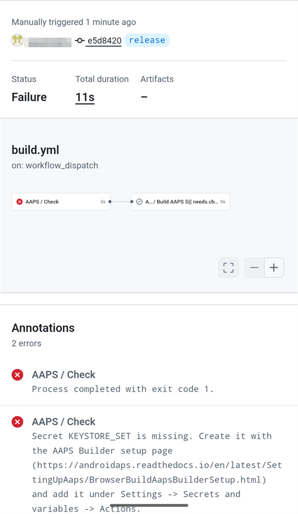

(aaps-ci-troubleshooting)=

# Browser build: troubleshooting

```{note}
This page collects troubleshooting tips for the [Browser build](../SettingUpAaps/BrowserBuild.md).
```

(aaps-builder-troubleshooting)=

## AAPS Builder

### Step 1: the repository

(aaps-builder-ts-repo-exists)=

#### "my-aaps already exists in this account"


You already have this repository, for example from an earlier attempt. Close the GitHub tab, keep that name in step 1 of the setup page and go on. If you already did steps 2 and 3 for it, your key is still in it: continue with [step 4](#aaps-builder-step4). If it was made with an earlier version of the setup page, update its workflow once as explained in [Updating AAPS](#aaps-builder-updates). You prefer a fresh start? Type another name, for example `my-aaps-2`, and use the same keystore in step 2.

(aaps-builder-ts-user-not-found)=

#### "No GitHub user with this name"


- **"No GitHub user with this name"** in step 1: type your GitHub username, as shown in your GitHub profile, not your e-mail.
- **No "Build AAPS" or "Run workflow" button, or the repository is empty**: the repository was not created from the template. Delete it (**Settings** → bottom of the page → **Delete this repository**) and do [step 1](#aaps-builder-step1) again with the **Create my private repository** button.

### Step 3: the secret

(aaps-builder-ts-404)=

#### "Page not found" (404)


- **"Page not found" (404) quando la pagina di configurazione apre GitHub**: accedi a github.com nello stesso browser (GitHub mostra 404 per i repository privati quando non hai fatto l'accesso). Se hai fatto l'accesso, il nome utente o il nome del repository nel passo 1 della pagina di configurazione non corrisponde al tuo repository. Scrivi i nomi esatti.

### Step 4: the build

(aaps-builder-ts-workflow-not-found)=

#### "This workflow does not exist"


Right after the repository is created, GitHub may not have read its workflow file yet: **Build AAPS** is missing from the **Actions** tab, and there is no **Run workflow** button. Any small change to the file makes GitHub read it:

1. In your repository, open **Code**, then the folder `.github`, then `workflows`, then the file `build.yml`.
2. Tap the **⋯** menu at the top right of the file, then **Edit file… In place** (on a computer, click the pencil).

   

3. Tap at the very end of the text and add an empty line (Enter). Tap **Commit changes…** at the top.

   

4. Tap **Commit changes** again.

   

5. Open the **Actions** tab again: **Build AAPS** is now in the list of workflows (on a phone, the list opens with the icon at the left of **All workflows**). Tap it, then **Run workflow**.

   

(aaps-builder-ts-build-failed)=

#### The build failed (red cross)

1. On the setup page, tap **Open my builds** and tap the build with the red cross.

   

2. The page of the build shows **Failure**, and which part failed: **AAPS / Check** (the repository, the secret, the version or the variant: nothing was built) or **AAPS / Build AAPS**.

   

3. Scroll down to **Annotations**, with your finger on the text, not on the diagram. The red lines explain the problem: tap **Show more** to read the whole message, then find it below.

   

- **"Secret KEYSTORE_SET is missing"**: do step 3 of the setup page.
- **The build stops with "This repository is PUBLIC"**: in your repository, open **Settings** → **General** → **Danger Zone** → **Change visibility** → **Private**, then build again.
- **"Version … does not exist"**: only released versions of **AAPS** can be built, the ones on the [tags page](https://github.com/nightscout/AndroidAPS/tags) of nightscout/AndroidAPS, such as `3.3.2.0`. A branch name such as `dev` doesn't work. Use `latest`, or type a tag exactly as listed.
- **"Variant … is not supported"**: your workflow file is an older version. Sostituiscilo come spiegato in [Aggiornare AAPS](#aaps-builder-updates).
- **"The secret is too short"**, **"The secret is not a valid code"** or **"The secret does not contain a keystore"**: the wrong text was pasted into the secret, often the word `KEYSTORE_SET` itself, or only part of the code. In your repository, open **Settings** → **Secrets and variables** → **Actions**, edit `KEYSTORE_SET` and paste the long code from **Copy secret** again (redo step 2 of the setup page first if you closed it).
- **"Keystore, password or alias is wrong"**: check your keystore's password and alias, then redo steps 2 and 3 of the setup page.
- **"Google Drive access has expired or was revoked"**: redo [step 6](#aaps-builder-google-drive) and update the `GDRIVE_OAUTH2` secret.
- **Another error**: [read the build log](#aaps-ci-read-the-logs), then [run the build again](#aaps-ci-rerun). If it fails again the same way, ask for help with the name of the failed step and the error lines. Non condividere mai il contenuto dei tuoi secret.

### Step 5: the app

- **Nessun link Download, oppure si è aperta l'app GitHub**: l'app GitHub non può scaricare le build. Apri la build in Chrome come spiegato nel [passo 5](#aaps-builder-step5). To stop GitHub links opening in the app: Android **Settings** → **Apps** → **GitHub** → **Open by default** → turn off **Open supported links**.

## AAPS-CI Troubleshooting

(aaps-ci-read-the-logs)=
### First: find out what went wrong

Quando una build fallisce, GitHub conserva un log di ogni passo. Il log ti dice quale passo è fallito e perché. Read it before you try anything else: the error message is what you look for on this page, and what helpers will ask for.

1. In your GitHub copy of AndroidAPS, open **Actions**. Una build fallita ha una croce rossa. Tocca il suo nome.

   

2. The run summary shows **Failure** and, below, the job that failed (**Build AAPS**, with a red cross).

   

3. Scroll down to **Annotations** and tap the red **Build AAPS** line.

   

4. Si apre il job. Steps with a grey tick worked. Il passo con la croce rossa è quello fallito: GitHub lo apre per te. The steps after it were skipped (grey circle).

   

5. Leggi le righe subito sopra `Error: Process completed with exit code 1.`: spiegano il problema. In this example, the step **Retrieving Google Drive access token** failed with `invalid_grant` and `Token has been expired or revoked.`, see [Google Refresh Token Expired](#aaps-ci-google-token-expired).

   

```{tip}
Chiedi aiuto? Share the name of the failed step and the error lines (a screenshot like the one above is fine). Non condividere mai il contenuto dei tuoi secret.
```

(aaps-ci-update-secret)=
#### Aggiornare un secret

Many fixes mean replacing the value of a secret. In your GitHub copy of AndroidAPS, go to **Settings** → **Secrets and variables** → **Actions** and tap the pencil next to the secret.


Inserisci o incolla il nuovo valore e tocca **Update secret**. GitHub non mostra mai il vecchio valore: il campo è sempre vuoto.


(aaps-ci-rerun)=
#### Run the build again after a fix

Once you have fixed the cause, you do not need to start from scratch: open the failed run, tap **...** (top right), then **Re-run failed jobs**.


Tocca **Re-run jobs**. Puoi anche avviare una nuova build da **Run workflow**, come al solito.


(aaps-ci-preparation-web)=
### Pagina web aaps-ci-preparation
  - The preparation page is displayed by a temporary local server (for example Simple Web Server on a computer), which also receives the Google refresh token.
  - Se vedi la schermata qui sotto, il server locale si è fermato o non è raggiungibile.
  - Close the preparation page, check that the local server is running, then reopen aaps-ci-preparation.html the same way as in Step 2 and complete the remaining steps. This is needed in particular when creating the initial Google connection during setup.

  

(aaps-ci-google-token-expired)=
### Google Refresh Token Expired
  - Google OAuth2 refresh tokens will expire if not used for 6 months, and may also become invalid under other conditions (e.g., you have changed your Google account password, or manually revoked access). For more details, see the [Google OAuth2 documentation](https://developers.google.com/identity/protocols/oauth2).
  - In the [build log](#aaps-ci-read-the-logs), the step **Retrieving Google Drive access token** fails with `invalid_grant` and `Token has been expired or revoked.`:

  

  - If your build fails due to an expired or revoked Google refresh token, you will need to redo the [Google Drive Auth](#aaps-ci-google-drive-auth) steps to obtain a new `GDRIVE_OAUTH2` token, [update the secret](#aaps-ci-update-secret) in your GitHub repository, then [re-run the build](#aaps-ci-rerun).
  - If the authorization fails again, or Google does not ask for your consent anymore, remove the existing AAPS access from your Google Account first, see [below](#aaps-ci-google-remove-access).

(aaps-ci-google-remove-access)=
### Remove AAPS Access From Your Google Account And Restart The Authorization
  - If the Google Drive authorization keeps failing, or you want to start again from a clean state, first remove the access you previously gave to AAPS, then redo the authorization.
  - On your phone, open [https://myaccount.google.com](https://myaccount.google.com), tap **Security**, scroll down to **Your connections to third-party apps & services** and open the list of linked apps. You can also go directly to [https://myaccount.google.com/connections](https://myaccount.google.com/connections).
  - Tap **AAPS** in the list.

  

  - La pagina mostra l'accesso che hai dato ad AAPS (i file di Google Drive usati con l'app). Tap **Delete all** to remove the connection, or tap **See details** to review it first.

  

  - On the details page, tap **Remove all access**.

  

  - Tap **Confirm**.

  

  - Google conferma che AAPS non ha più accesso. AAPS no longer appears in the list of linked apps.

  

  - Now restart the authorization cleanly: close **both** the preparation page and the file manager app, reopen aaps-ci-preparation.html from the file manager and redo the [Google Drive Auth](#aaps-ci-google-drive-auth) steps. Google will ask you to grant access again and the page will provide a new `GDRIVE_OAUTH2` token.
  - [Update the `GDRIVE_OAUTH2` secret](#aaps-ci-update-secret) in your GitHub repository with the new token, then [re-run the build](#aaps-ci-rerun).

(aaps-ci-disable-software)=
### Disattivare i software che possono disturbare la verifica OAuth
  - Prima di provare a ottenere la chiave OAuth, disattiva sul telefono ogni VPN o app di sicurezza (firewall, antimalware, ...).

(aaps-ci-actions-permission)=
### Check GitHub Actions Permission Settings
  - Make sure GitHub Actions policies are set to “Allow all actions and reusable workflows” (Settings → Actions → General). Se lo cambi, premi **Save** sotto le opzioni.

  

`actions/checkout@v4` and `actions/setup-java@v4` are not allowed to be used in `xxxxx/AndroidAPS`. Actions in this workflow must be: within a repository owned by `xxxxx`

(aaps-ci-workflow-permissions)=
### Check GitHub Workflow Permissions Settings
  - If the build fails immediately with an "Invalid workflow file" error similar to the one below, the default workflow permissions of your repository are too restrictive:

```
Invalid workflow file
The workflow is not valid. .github/workflows/aaps-ci.yml (Line: 361, Col: 3):
Error calling workflow 'xxxxx/AndroidAPS/.github/workflows/cleanup-workflow-runs.yml@...'.
The nested job 'cleanup' is requesting 'actions: write', but is only allowed 'actions: none'.
```

  - Make sure Workflow permissions are set to “Read and write permissions” (Settings → Actions → General → Workflow permissions), then save and re-run the build workflow.

  

(aaps-ci-password-special-characters)=
### Build Fails Checking The Keystore Password
  - In the [build log](#aaps-ci-read-the-logs), the step **Validating keystore, alias and password** fails with `Either KEYSTORE_BASE64, KEYSTORE_PASSWORD, KEY_PASSWORD, or KEY_ALIAS is incorrect`, followed by `Keystore was tampered with, or password was incorrect`. The build stops there: the keystore and passwords are checked before AAPS is built.

  

  - The build workflow keeps every character of your passwords intact. Enter `KEYSTORE_PASSWORD` and `KEY_PASSWORD` exactly as they are, without adding a backslash or any other escape character. If you added backslashes, [update the secrets](#aaps-ci-update-secret) with the password exactly as it is. The example below is wrong: the password is `Example2026`, the backslash was added.

  

  - If the build still fails when signing the APK although your password is correct, and the password contains `$`, a backtick, `"` or `\`, the workflow file in your fork is older than September 2026 and still parses these characters. [Sync your fork](#Update-to-new-version-update-your-repo) with the latest dev, then re-run the build workflow.
  - The vertical bar `|` is a special case. The preparation page of [Option 1](#aaps-ci-option1) combines the keystore, passwords and alias into one `KEYSTORE_SET` secret separated by `|`, and the workflow splits it on that character. La password generata dalla pagina di preparazione contiene solo lettere e cifre, quindi con l'Opzione 1 questo non può succedere. Può succedere solo se hai creato tu un secret `KEYSTORE_SET` con una password che contiene `|`. In that case, delete `KEYSTORE_SET` and enter the separate secrets of [Option 2](#aaps-ci-option2) instead.
