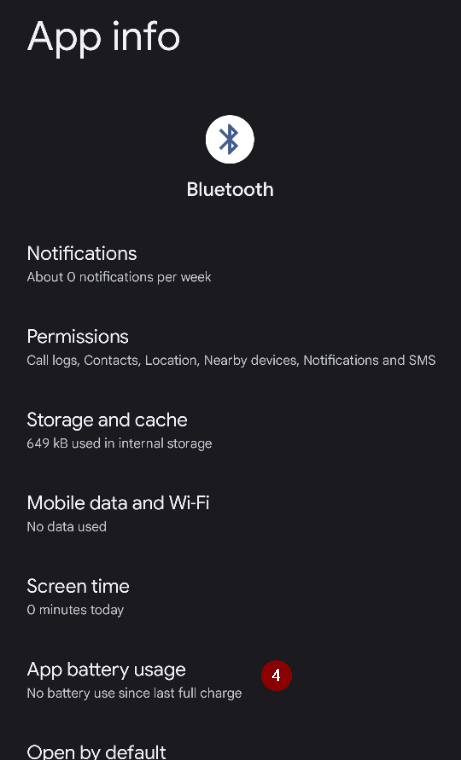

(generaltroubleshooting)=

# Troubleshooting

**Start here when something is not working.** Troubleshooting information lives on many pages across the documentation. This page brings it together: it is a single collection of links, sorted by topic, to help you solve the most common problems.

Se qui sotto non trovi la risposta, controlla anche:

* the [FAQ](../UsefulLinks/FAQ.md) for answers to frequent questions, and
* the [Profile tuning guide](ProfileTuning.md) if your loop runs but your glucose control needs improving.

```{admonition} Still stuck?
:class: tip
If none of the links solve your problem, see [Where can I get help](WhereCanIGetHelp.md) to ask the community (Facebook, Discord), or send your [log files](AccessingLogFiles.md) to the developers.
```

---

(generaltroubleshooting-aaps-app)=

## App AAPS

### Building & updating

* If the build fails, see [If the build fails](#building-aaps-troubleshooting): it lists the troubleshooting section for each build method:
  * [AAPS Builder](#aaps-builder-troubleshooting)
  * [Browser build](#aaps-ci-troubleshooting)
  * [Android Studio](TroubleshootingAndroidStudio.md)
* Keystore perso o nuovo keystore: [Reinstallare AAPS](#reinstall-aaps)
* Updating **AAPS**: [with AAPS Builder](#aaps-builder-updates), [with a browser build (fork)](#update-browser-build-troubleshooting), [with Android Studio](#update-computer-build-troubleshooting)

### Installazione

* [Avviso di Google Play Protect](#transferring-installing-play-protect-warning): l'app viene segnalata come non sicura.
* Installation **blocked** with a message about an unverified developer: see [Android developer verification](#android-developer-verification) for the free installation methods.

### Settings

* [Profile: "Basal rate is not compatible with the current pump"](#your-aaps-profile-basal-not-compatible)
* [Pump: "Data is coming from different pump"](#config-builder-wrong-pump-data)
* [Nightscout Client](TroubleshootingNsClient.md)
* **"AAPS settings cannot be read"** at start: the settings are encrypted with a key that Android keeps for **AAPS**, and that key does not open them any more, for example after the key store of the phone was reset. While this screen is shown, **AAPS** is not running and does not control the pump. Tap **Retry**: it closes and restarts **AAPS**. If that does not help, restart the phone. Use **Start fresh** only when nothing else helps: it sets the unreadable settings file aside (it is renamed and kept) and starts **AAPS** with empty settings. Then import your last [settings export](../Maintenance/ExportImportSettings.md).

### Uso

* [Wrong carb values (slow carbs absorption)](#CobCalculation-detection-of-wrong-cob-values)
* [Automazioni](#automations-troubleshooting)
* [Full closed loop](#full-closed-loop-troubleshooting)

---

(generaltroubleshooting-bluetooth-related-issues)=


## Problemi legati al Bluetooth

For known issues with Bluetooth connections, dropouts of pump/pods, or activation and connection issues [Bluetooth Troubleshooting](../GettingHelp/BluetoothTroubleshooting.md)

---

(generaltroubleshooting-android-related-issues)=

## Problemi legati ad Android

### Ottimizzazione della batteria

**AAPS** può aiutarti a trovare le impostazioni giuste per il tuo telefono: apri il **menu** (☰) > **Informazioni** e tocca **Non terminare l'app?**. It opens the instructions for your phone brand on [Don't kill my app](https://dontkillmyapp.com/). Anche la [configurazione guidata](#setup-wizard-bluetooth-battery-optimisation) ti chiede di disattivare l'ottimizzazione della batteria per **AAPS** e per il Bluetooth.

Android has implemented battery saving setting that are enabled by default. These settings automatically suspend/pause applications that are not required for the system to function to help conserve the amount of battery energy used by apps that don't always need to be running.

When this is enabled, it will very likely cause issue for **AAPS** and other supporting apps like **xDrip**.

It's important to ensure that you have disabled Battery Optimization to ensure **AAPS** and other supporting apps remain active all the time.

Depending on your phone model and make there may be more than one location and setting which needs to have this disabled.

***NOTE:** Follow the steps below to Disable Battery Optimization for the Bluetooth service if your phone has this option, the same steps can be used to disable for **AAPS** and other apps, however the screenshots will only show how to do this for the Bluetooth service.*

#### Pixel phones (stock Android)

* Go to the Android settings, select "Apps".

  

* Select "See all apps"

  

* On the menu on the right, select "Show system" apps.

  

* Ora cerca e seleziona l'app "Bluetooth".

  

* Click the "App battery usage" and select "Unrestricted" (called "Not optimized" on some older Android versions).

  


#### Telefoni Samsung

* Go to the android settings, select "Apps"

* On the icon that supposedly changes the sorting algorithm (1), select "Show system apps" (2).

  

  

* Ora cerca l'app Bluetooth e selezionala per vedere le sue impostazioni.

  

* Select "battery".

  

* Set it to "Unrestricted" (called "Not optimized" on some older Android versions).

  

#### Telefoni Huawei

See this guide for [Huawei Bluetooth & battery optimization](../CompatiblePhones/Huawei.md)

---

(generaltroubleshooting-cgm)=

## Continuous Glucose Monitor (CGM)

Useful links to known issues and steps to resolve for CGMs.

* [Generale](#general-cgm-troubleshooting)
* [Dexcom G6](#DexcomG6-troubleshooting-g6)
* [Libre 2 con Minimal Looper](#minimallooper-troubleshooting)
* [Libre 3](#libre3-experiences-and-troubleshooting)
* [xDrip - nessun dato CGM](#xdrip-identify-receiver)
* [xDrip - Dexcom troubleshooting](#xdrip-troubleshooting-dexcom-g5-g6-and-xdrip)

---

(generaltroubleshooting-pumps)=

## Pumps

Useful links to known issues and steps to resolve for Pumps

* [Accu-Chek Combo](#combov2-tips-for-basic-usage)
* [Accu-Chek Insight](#Accu-Chek-Insight-Pump-insight-specific-errors)
* [CareLevo](#carelevo-alarms-and-notifications)
* [DanaRS](#DanaRS-Insulin-Pump-dana-rs-specific-errors)
* [Diaconn G8](#diaconn-g8-bluetooth-troubleshooting)
* [EOPatch2](#eopatch2-alarms-and-warnings)
* [Medtronic + RileyLink](#MedtronicPump-what-to-do-if-i-loose-connection-to-rileylink-and-or-pump)
* [Medtrum Nano](#medtrum-nano-troubleshooting)
* [Omnipod DASH](#omnipod-dash-troubleshooting)
* [Omnipod Eros](#OmnipodEros-troubleshooting)

---

(generaltroubleshooting-phones)=

## Telefoni

Useful links to known issues and steps to resolve for Phones

* [List of tested phone and device setups](https://docs.google.com/spreadsheets/u/1/d/e/2PACX-1vScCNaIguEZVTVFAgpv1kXHdsHl3fs6xT6RB2Z1CeVJ561AvvqGwxMhlmSHk4J056gMCAQE02sAWJvT/pubhtml?gid=683363241&single=true)
* [Jelly](../CompatiblePhones/Jelly.md)
* [Bluetooth e ottimizzazione della batteria su Huawei](../CompatiblePhones/Huawei.md)

---

(generaltroubleshooting-remote-control)=

## Controllo remoto

* [AAPSClient and remote control (pairing, commands not received)](#client-master-control-troubleshooting)
* ['Nightscout access token' issues](#remotecontrol-nightscout-access-token)
* [Comandi SMS](#SMSCommands-troubleshooting)
* [Android Auto](#android-auto-troubleshooting)

---

(generaltroubleshooting-smartwatches)=

## Smartwatch

Useful links to known issues and steps to resolve for Smartwatches

* [Troubleshooting Wear app](#Watchfaces-troubleshooting-the-wear-app)
* [Watch and phone do not communicate](#wear-os-watch-phone-communication)
* [Wear OS 5](#wear-os-5-troubleshooting)
* [Building the Wear app](#building-aaps-wear-os-troubleshooting)
