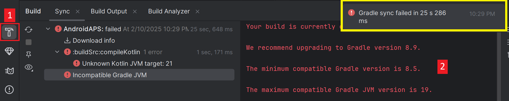
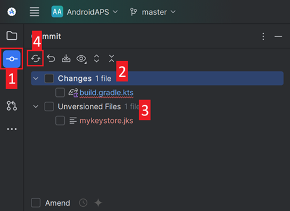
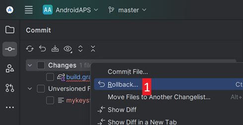
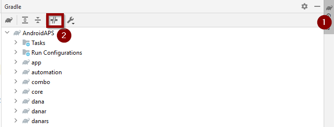
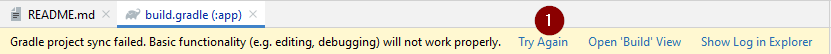

(troubleshooting_androidstudio-troubleshooting-android-studio)=

# Troubleshooting Android Studio

```{contents} List of common issues
:depth: 2
:local: true
```

(troubleshooting_androidstudio-lost-keystore)=
## Keystore perso
If you lost your keystore or its password, an apk signed with a new keystore cannot update your current **AAPS**: you have to uninstall and reinstall it. Vedi [Reinstallare AAPS con un nuovo keystore](#reinstall-aaps).

## Gradle Sync failed
Gradle Sync can fail for various reasons. When you receive a message saying that 'gradle sync failed', open the "Build" tab (1) at the bottom of Android Studio and check what error message (2) is displayed.



```{contents} Likely reasons for gradle sync failures are:
:depth: 1
:local: true
```

*Important*: After you have followed the instructions for your specific problem, you need to trigger the [gradle sync](#gradle-resync) again.

(troubleshooting_androidstudio-uncommitted-changes)=
### Uncommitted changes

Se ricevi un messaggio di errore come questo:


```
Build file 'C:\Data\50-Android\AndroidAPS\app\build.gradle.kts' line: 243

There are uncommitted changes.
Clone sources again as described in wiki and do not allow gradle update
```

#### Step 1 - Check git installation
  * Open the terminal tab (1) at the bottom of Android Studio and copy the following text and paste or type into the terminal (2).
    ```
    git --version
    ```

    

    Nota: tra Git e version ci sono uno spazio e due trattini!

  * You must receive a message saying what Git version is installed, as you can see in the screenshot above. In this case, go to [Step 2](#troubleshooting-android-studio-check-for-uncommitted-changes).

  * Se ricevi un messaggio che dice
    ```
    Git: command not found
    ```
    la tua installazione di Git non è corretta.

  * [Check git installation](#BuildingAaps-steps-for-installing-git)

  * If you are on Windows and Git was just installed, you should restart your computer to make Git globally available after the installation

  * Se Git è installato, hai riavviato (se usi Windows) e Git non si trova ancora:

  * Search your computer for a file "git.exe".

    Note for yourself, which directory it is saved in.

  * Vai alle variabili d'ambiente di Windows, seleziona la variabile "PATH" e fai clic su modifica. Add the directory where you have found your Git installation.

  * Salva e chiudi.

  * Riavvia Android Studio.

(troubleshooting-android-studio-check-for-uncommitted-changes)=
#### Step 2: Check for uncommitted changes.

  * In Android Studio, open the 'Commit' tab (1) on the left-hand side. 
  * You can see either "Changes" (called "Default changeset" in older Android Studio versions) (2) or "Unversioned Files" (3):

    * For "Changes", you probably updated 'Gradle' or changed some of the file contents by mistake.

    * Right click on "Changes" and select "Rollback…" (1)

      

    * I file vengono scaricati di nuovo dal server Git. If there are no other changes in the commit tab, go to [Step 3](#gradle-resync).

  * If you can see "Unversioned Files", you might have stored files in your source code directory by mistake. Maybe they are important files: like your keystore file, that should be moved elsewhere. If you don't know what those files are and you have not created them yourself, you can delete them.

    * Use your regular file explorer on your computer to move or cut and paste that file to a safe place.

    * Go back to Android Studio and click the Refresh button (4) within the Commit tab to make sure the file is not stored in the **AAPS** directory anymore.

      If there are no other changes in the Commit tab, go to [Step 3](#gradle-resync).


#### Step 3: Resync Gradle (again)

Follow the instructions at [Gradle Resync](#gradle-resync).

### Git Pull Failed - Please tell me who you are

If you see this message, Git needs you to identify yourself.


Apri il terminale e scrivi questi due comandi, uno dopo l'altro.

```
git config --global user.name "Your name here"
git config --global user.email your.email@here.com
```

Il tuo nome va scritto tra virgolette.


(troubleshooting_androidstudio-android-gradle-plugin-requires-java-11-to-run)=

(incompatible-gradle-jvm)=
### Gradle JVM incompatibile


```
Your build is currently configured to use incompatible Java 21.0.3 and Gradle 8.2.
Cannot sync the project.

We recommend upgrading to Gradle version 8.9.

The minimum compatible Gradle version is 8.5.

The maximum compatible Gradle JVM version is 19.
```

Oppure:

```
Cause: error: invalid source release: 21
```

Se ricevi il messaggio di errore qui sopra, devi scaricare una versione corretta di JVM prima di provare di nuovo la build:

1.  Check in the [requirement table](#Building-APK-recommended-specification-of-computer-for-building-apk-file) which JVM version you need for the **AAPS** version you are building, and make a note of it.

2. Open the Gradle view by clicking on the elephant (1) on the right side of Android Studio and open the settings (2) and select **Gradle Settings** (3):


3.  In **Gradle JDK** field, check if the appropriate version is selected (1) If not, click on the field, and see if it is already available in the list. The example below shows JVM 21 is labeled as “jbr-21”. Se la trovi, selezionala e hai finito. Se non è disponibile, seleziona **Download JDK** (2).


4. In Version (1), select the JDK required for your **AAPS** version (the one you made a note of when you checked the requirement table). In Vendor (2) seleziona un Vendor qualsiasi. Location (3): non cambiarla. Click **Download** (4).


5.  Chiudi la finestra **Settings** con **OK**.
6. You now need to restart the Gradle Sync. Follow the instructions at [Gradle Resync](#gradle-resync).

(incompatible-version-of-android-gradle-plugin)=
### Incompatible version of Android Gradle plugin

  Se ricevi questo messaggio di errore

`The project is using an incompatible version (AGP x.x.x) of the Android Gradle plugin. Latest supported version is AGP x.x.x`

  

  You are using an outdated version of Android Studio. In the menu, go to Help > Check for updates and install any updates of Android Studio and its plugins that are found.

(troubleshooting_androidstudio-could-not-resolve-no-cached-version)=
### Could not resolve/No cached version

  Potresti ricevere questo messaggio di errore:


  * Sul lato destro, apri la scheda Gradle (1).

    Make sure the button shown at (2) is *NOT* selected.

    

  * Now you need to trigger a [Gradle Resync](#gradle-resync)

(troubleshooting_androidstudio-unable-to-start-daemon-process)=
### Unable to start daemon process

  Se vedi un messaggio di errore come quello qui sotto, probabilmente usi un sistema Windows 10 a 32 bit. This is not supported by Android Studio 3.5.1 and above and unfortunately there is nothing that the **AAPS** developers can do about this!

  There is information on the internet about how to determine whether you have a 32-bit or 64-bit OS - i.e. [this one](https://support.microsoft.com/en-us/windows/32-bit-and-64-bit-windows-frequently-asked-questions-c6ca9541-8dce-4d48-0415-94a3faa2e13d).

  

(gradle-resync)=
### Gradle Resync

  If you can still see the message that the gradle sync failed, now select the link **Try again** (1). 


  If you don't see the message anymore, you can still trigger this manually:

  * Apri la scheda Gradle (1) sul bordo destro di Android Studio.

    

  * Right-click on AAPS (2)

  * Click on "Reload Gradle Project" (3)

## Generate Signed APK generated successfully with 0 build variants

When you generate the signed apk, you might get the notification that generation was successful but that '0 build variants' were generated:


This is a false warning. Check the directory for your selected "Destination folder" for generation (step [Generate Signed APK](#Building-APK-generate-signed-apk)) and you will find the generated apk there!


## App was created with compiler/kotlin warnings

If your build completed successfully but you get compiler or kotlin warnings (indicated by a yellow or blue exclamation mark) then you can just ignore these warnings.

 

Your apk was built successfully and can be transferred to your phone!


## No CGM data is received by AAPS

* If you are using patched Dexcom G6 app: this app is outdated. Usa invece l'app [BYODA](#DexcomG6-if-using-g6-with-build-your-own-dexcom-app).

* If you are using xDrip: identify receiver as described on [xDrip settings page](#xdrip-identify-receiver).


## Apk non installato


* Make sure you have transferred the “app-full-release.apk” file to your phone.
* This error usually means the new apk is signed with a different keystore than your installed **AAPS**. If you still have your previous keystore, select it and build again. Otherwise, see [Reinstalling AAPS with a new keystore](#reinstall-aaps).
* If "App not installed" is displayed on your phone follow these steps:

1. [Export settings](../Maintenance/ExportImportSettings.md) (in AAPS version already installed on your phone)
2. Uninstall **AAPS** on your phone.
3. Attiva la modalità aereo e spegni il Bluetooth.
4. Install new version (“app-full-release.apk”)
5. [Import settings](../Maintenance/ExportImportSettings.md)
6. Riaccendi il Bluetooth e disattiva la modalità aereo

## Apk installato ma versione vecchia

Se hai fatto la build dell'app con successo, l'hai trasferita sul telefono e installata con successo, ma il numero di versione resta lo stesso, forse hai dimenticato di [aggiornare la tua copia locale](#Update-to-new-version-update-your-local-copy)

## None of the above worked

If none of the above tips helped you might consider building the apk from scratch:

1. [Export settings](../Maintenance/ExportImportSettings.md) (in AAPS version already installed on your phone)

2. Tieni pronte la password della chiave (key password) e la password del keystore (key store password).

    Oppure usa semplicemente un nuovo keystore.

3. Build the apk from scratch as described [here](#Building-APK-download-AAPS-code).

4. When you have built the apk successfully delete the existing apk on your phone, transfer the new apk to your phone and install.
5. [Importa impostazioni](../Maintenance/ExportImportSettings.md) di nuovo per ripristinare i tuoi obiettivi e le tue impostazioni.
6. You should check your battery optimization options and disable them again.

## Worst case scenario

If the above does not solve your build issue you may wish to try to uninstall Android Studio completely and rebuild from scratch.  Some users find that this can resolve their build problem.  When deleting Android Studio, do not delete Android user settings and **Make sure to uninstall all files associated with Android Studio.** If you do not completely remove Android Studio with all hidden files, uninstalling may cause new problems instead of solving your existing one(s). Manuals for complete uninstall can be found online i.e.

[https://stackoverflow.com/questions/39953495/how-to-completely-uninstall-android-studio-from-windowsv10](https://stackoverflow.com/questions/39953495/how-to-completely-uninstall-android-studio-from-windowsv10).

Installa Android Studio da zero come descritto [qui](#Building-APK-install-android-studio).
