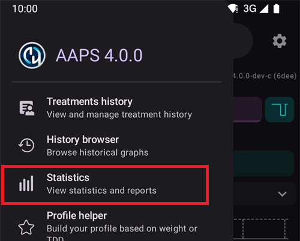
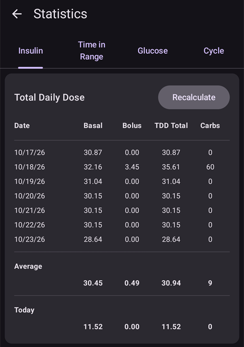
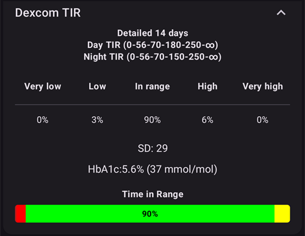
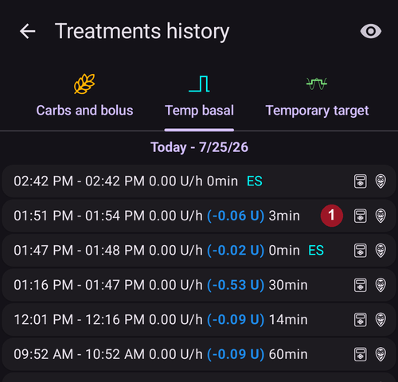

# Reviewing your data

## Navigatore della cronologia di AAPS

**AAPS** conserva tutta la tua cronologia (**glicemia**, trattamenti, basale, target, **Cambio profilo**, …) in un database locale sul telefono. Questo database non fa parte dell'[esportazione delle impostazioni](../Maintenance/ExportImportSettings.md). You can review it in **AAPS** itself with the **History browser** and the **Statistics** screen described below. For long-term reviews and reports, upload your data to [Nightscout](../SettingUpAaps/Nightscout.md) or [Tidepool](../SettingUpAaps/Tidepool.md).

**AAPS** history can be reviewed in the **History browser**: open the **menu** (☰) and select **History browser**.

- Tap the **date card** to pick the day you want to review.
- The graphs open zoomed out to show the **whole selected day**. Pinch to zoom in on part of it.
- Use the **<** and **>** arrows to move one day back or forward, and **Now** to return to the current day.
- I grafici mostrano gli stessi dati dei grafici della schermata principale (glicemia, trattamenti, basale, IOB, COB, attività, deviazioni...).

(reviewing-statistics)=
## Statistiche di AAPS

**AAPS** provides basic monitoring statistics.

Most values are referenced by ADA 2023 [recommendations](https://diabetesjournals.org/care/article/46/Supplement_1/S97/148053/6-Glycemic-Targets-Standards-of-Care-in-Diabetes).

Per aprirle, apri il **menu** (☰) e seleziona **Statistiche**.

La schermata **Statistiche** ha quattro schede: **Insulina**, **Tempo nell’intervallo**, **Glicemia** e **Ciclo**. Tap a tab, or swipe left or right to move between them.

(reviewing-tdd)=
### Scheda Insulina: Dose totale giornaliera

The **Total Daily Dose** card shows one line per day for the previous days (up to one week) for which **AAPS** has insulin data, then their **Average**, then **Today** so far. Right after installing **AAPS**, only **Today** is shown. Le colonne sono:

- **Basale**: solo la basale.
- **Bolus**: the sum of bolus treatments and SMBs.
- **TDD Total**: the Total Daily Dose of insulin (**TDD**), the sum of bolus and basal insulin delivered during the day.
- **Carbs**: declared carbs and eCarbs treatments.

The **TDD** section is calculated when you open the page and takes a few seconds to compute. Tocca **Ricalcola** per calcolarla di nuovo.

The **TDD** is your bolus plus basal insulin per day. Some doctors use - especially for new pumpers - a basal-bolus ratio of 50:50: the total base basal (**TBB**, the sum of your basal rates over 24 hours) should then be about half of the TDD. Others prefer a TBB of 32 % to 37 % of the TDD.

Come la maggior parte delle regole pratiche, ha una validità reale limitata. Il tuo diabete può essere diverso!

### Scheda Tempo nell’intervallo

Tempo nell'intervallo (**TIR**): 70-180 mg/dL o 3,9-10 mmol/L.

Le informazioni sul **TIR** sono disponibili per 7 e 30 giorni, in base alla quantità di dati presenti nel database di **AAPS**.

Time In Tight Range (TITR) 70-140 mg/dL or 3.9-7.8 mmol/L statistics are available below (the screen shows this range as 70-141).

**Parla dei target con il tuo diabetologo**

Il tuo diabete può essere diverso. Any suggested targets should be discussed with your endocrinologist or supporting medical team. Se usate nel modo corretto, le statistiche di AAPS possono essere uno strumento efficace per seguire l'andamento della __glicemia__ e controllare i progressi.

Below, the **Dexcom TIR** card shows detailed 14 days **TIR** statistics.

**SD**: deviazione standard, un [indicatore](https://www.ncbi.nlm.nih.gov/pmc/articles/PMC3125941/) della variabilità della glicemia (più è alta, peggio è).

HbA1c: the estimate of the resulting glycated hemoglobin, based on the average of CGM measurements. This is an indicative value that might not match blood HbA1c tests.

(reviewing-statistics-agp)=
### Scheda Glicemia: Profilo Glicemico Ambulatoriale (AGP)

The **Ambulatory Glucose Profile** (**AGP**) shows how your glucose usually moves over the day. Scegli il periodo con i pulsanti in alto: **Oggi**, **24h**, **7d**, **30d** o **90d**.

- **Il grafico**: un giorno da mezzanotte a mezzanotte. The line is the **Median** (half of your readings at that hour were lower, half were higher). Around it, one band holds the middle half of your readings (**25–75%**) and a wider band most of them (**10–90%**). Una fascia stretta significa che a quell'ora la tua glicemia è simile da un giorno all'altro. Le linee tratteggiate indicano il tuo **Limite BASSO**, 140 mg/dL (7,8 mmol/L) e il tuo **Limite ALTO**.
- **Glycemic overview**: the time spent in your range, in the tight range (70–140 mg/dL or 3.9–7.8 mmol/L), above your range and below it, then your **Average** and **Median** glucose. Your range is the **LOW mark** and **HIGH mark** set in [Range for visualization](#Preferences-range-for-visualization).
- **eA1c** and **GMI**: two estimates of HbA1c calculated from your CGM readings. Like the HbA1c above, they might not match your blood HbA1c tests.
- **SD** (deviazione standard) e **CV** (coefficiente di variazione): quanto varia la tua glicemia. Un valore più basso significa una glicemia più stabile.
- **Giorni**: quanti giorni di dati del CGM sono stati usati.

 

Below the AGP, the **Glucose Pentagon (CGP)** card draws five measures of your last 14 days of glucose as a pentagon. A smaller pentagon means better glucose control.

### Scheda Ciclo: Pattern ciclo TDD

**TDD Cycle Pattern** overlays your daily insulin totals in 28-day cycles, to help you spot recurring patterns. Ogni ciclo è disegnato come una linea (**Cicli individuali**), insieme alla loro media.

- **Raw TDD** / **Cleaned TDD**: choose the total daily dose as delivered, or the TDD minus insulin for carbs.
- **Scostamento ciclo**: sposta l'inizio del ciclo (da 0 a 27 giorni).

Servono almeno 56 giorni di dati (2 cicli). Con meno dati, la scheda mostra **Dati insufficienti (servono almeno 56 giorni per 2 cicli)**. Il pattern viene calcolato solo quando apri la scheda **Ciclo**, perché legge 168 giorni di dati.

(aaps-screens-treatments)=
## Cronologia trattamenti

Open the **menu** (☰) in the top-left corner of the main screen and select **Treatments history**. In this view, you can view and alter the history of the following treatments, each on its own tab (swipe the tab row to see all of them):

* CHO e boli
* [Bolo Esteso](#Extended-Carbs-extended-bolus-and-switch-to-open-loop-dana-and-insight-pump-only)
* Basale temporanea
* [Target temporaneo](../DailyLifeWithAaps/TempTargets.md)
* [Cambio profilo](../DailyLifeWithAaps/ProfileSwitch-ProfilePercentage.md)
* Careportal: notes and careportal entries
* Modalità esecuzione: cronologia dello stato del loop
* Voce utente: altre note che non vengono inviate a Nightscout

At the end of each line, small icons show where the data comes from or has been sent to:
* **Nightscout** icon (the Nightscout logo): the data comes from or has been recorded to Nightscout
* **Pump** icon: the data comes from the pump history (it has been processed by the pump)
* **Trash can** icon: the entry has been deleted (it is shown only when you display deleted entries with the **eye** icon at the top right)

(screens-bolus-carbs)=
### CHO e boli

In questa scheda puoi vedere il registro dei boli e dei carboidrati. Each bolus (line **1**) shows the remaining associated IOB next to the insulin amount. L'origine del bolo può essere:
* Pasto (inserito a mano con i pulsanti Insulina, Assistente Rapido o Calcolatore)
* SMB, when using the SMB Functionality

Le voci dei carboidrati (riga **2**) sono mostrate con la loro quantità in grammi.

If you have used the [Bolus Wizard](#aaps-screens-bolus-wizard) to calculate insulin dosage, you can press the “Calc” text on the bolus line to show the details of how the bolus was calculated.

Depending on the pump used, insulin and carbs can be shown in one single line, or will result in multiple lines: one for the calculation detail, one for the carbs, one for the bolus itself.

The Treatments history can be used to correct faulty carb entries (_i.e._ you over- or underestimated carbs). Nota che non è possibile modificare una voce esistente: devi seguire questa procedura:

1. Check and remember actual COB and IOB on the main screen.
2. Depending on pump, carbs might be shown together with insulin in one line or as a separate entry (i.e. with Dana RS).
3. Remove the entry with the faulty carb amount: press the trashcan icon, select the lines to remove, and then press the trashcan icon again to finalize.
4. Make sure carbs are removed successfully by checking COB on the main screen again.
5. Do the same for IOB if there is just one line including carbs and insulin.

   → If carbs are not removed as intended, and you add additional carbs as explained here (6.), COB will be too high and that might lead to too high insulin delivery.

6. Enter the correct carb amount again (**Treatments → Carbs** in the bottom navigation, or a [QuickLaunch](#quicklaunch) **Carbs** button) and make sure to set the correct event time.
7. If there is just one line including carbs and insulin you have to add also the amount of insulin. Make sure to set the correct event time and check IOB on the main screen after confirming the new entry.

### Basale temporanea

The **temp basals** applied by the loop are shown here. When there is still an impact on the IOB for an entry, the information is shown next to the rate (line **1**). Può essere:
* Positive IOB if the temp basal was higher than the one set in the Profile
* Negative IOB for a zero-temp (as on line **1**) or if the temp basal was lower than the one set in the Profile

Eliminare le voci cambia solo i tuoi report in Nightscout e probabilmente altera il tuo IOB reale: non è consigliato.

A sinistra di una riga, una S rossa significa “Sospeso”: succede quando la basale al momento non viene erogata. This is a normal situation when in the process of changing a pod, for example.

### Target temporaneo

Qui puoi vedere la cronologia dei target temporanei.

### Cambio profilo

Qui puoi vedere la cronologia dei cambi profilo. You may see multiple entries each time you switch profile : line **1**, stored both in NS and Pump History, corresponds to the actual switch. Line **2**, stored in Nightscout but not in Pump History, corresponds to the request of a profile switch made by the user.

Deleting the entries only affects your reports in Nightscout and will never actually change the current profile.

You can use the **Clone** button shown on line **2** to make a copy of a **Profile Switch**. See [Your AAPS Profile > Manage your profiles](#your-aaps-profile-clone-profile-switch) for more information.

### Careportal

This tab shows all notes and careportal entries recorded in Nightscout.

(AapsScreens-running-mode)= (aaps-screens-running-mode)=
### Modalità esecuzione

Questa scheda mostra la cronologia dei cambi dello [stato del loop](#AapsScreens-loop-status): aperto, chiuso, LGS, sospeso, disconnesso.

### Voce utente

Questa scheda elenca le azioni fatte in **AAPS** dall'utente o da un'**Automazione** (cambi di modalità del loop, cambi profilo, trattamenti, esportazioni delle impostazioni...). Queste voci non vengono inviate a Nightscout.

------

## Qual è la differenza tra Nightscout e Tidepool?

Nightscout can facilitate the user’s storage of **AAPS’** data and offers a wide range of [reporting tools](https://nightscout.github.io/nightscout/reports/).

Whereas, Tidepool allows the user to [review their data](https://www.tidepool.org/viewing-your-data) and provides [simple sharing with your endo team](https://www.tidepool.org/providers/how-it-works#tidepool-data-platform).