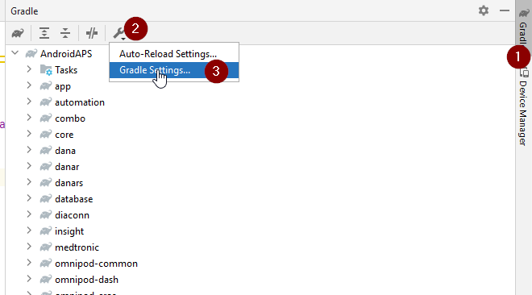
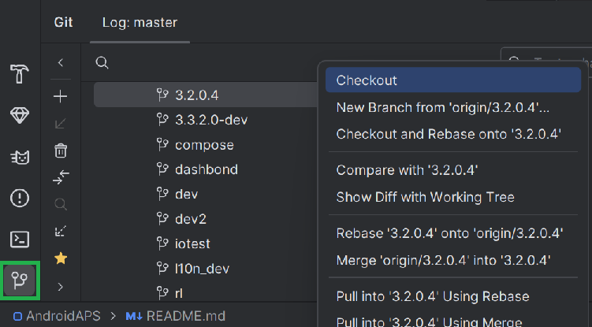
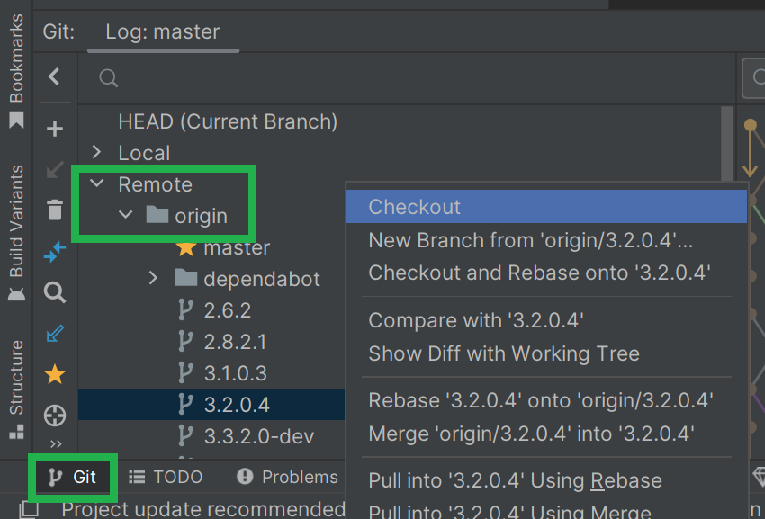
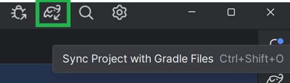
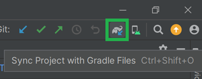

# Updating to AAPS 3.2.0.4

(update-aaps-3204)=

## Build yourself instead of download

**The AAPS app (an apk file) is not available for download, due to regulations around medical devices. It is legal to build the app for your own use, but you must not give a copy to others!**

See [FAQ page](../UsefulLinks/FAQ.md) for details.

## Computer and software specifications for building AAPS 3.2.0.4

* A specific **[Android Studio](https://developer.android.com/studio/)** version may be required to build the apk.

| AAPS Version            | Preferred<br/>Android Studio<br/>Version | Alternative<br/>Android Studio<br/>Version | Gradle | JVM |
| ----------------------- | ---------------------------------------------------- | ------------------------------------------------------ | ------ |:--- |
| [3.2.0.4](#version3204) | Hedgehog (2023.1.1)                                  | fino a Meerkat                                         | 8.2    | 17  |

The "preferred version" is packaged with the appropriate JVM version. The preferred version is also the minimal version you can use to build **AAPS**. You will **NOT** be able to build on a version older than the "preferred" one. If using a different version, you may encounter issues related to JVM version. See the [Troubleshooting Android Studio](#incompatible-gradle-jvm) page to help solve these issues. If your current Android Studio version is not listed in the table, you must update it first.

The Gradle version is linked to the source code, you will always get the correct Gradle version when downloading / updating the source code. It is mentioned here for reference only, you don't have to take action on it.

* I [sistemi Windows a 32 bit](#troubleshooting_androidstudio-unable-to-start-daemon-process) non sono supportati da Android Studio. Please keep in mind that both **64 bit CPU and 64 bit OS are mandatory condition.** If your system DOES NOT meet this condition, you have to change affected hardware or software or the whole system.

<table class="tg">
<tbody>
  <tr>
    <th class="tg-baqh">Sistema operativo (solo 64 bit)</th>
    <td class="tg-baqh">Windows 8 o successivo</td>
    <td class="tg-baqh">Mac OS 10.14 o successivo</td>
    <td class="tg-baqh">Qualsiasi Linux che supporta Gnome, KDE o Unity DE;&nbsp;&nbsp;GNU C Library 2.31 o successiva</td>
  </tr>
  <tr>
    <th class="tg-baqh"><p align="center">CPU (solo 64 bit)</th>
    <td class="tg-baqh">Architettura CPU x86_64; Intel Core di seconda generazione o più recente, oppure CPU AMD con supporto per <br><a href="https://developer.android.com/studio/run/emulator-acceleration#vm-windows" target="_blank" rel="noopener noreferrer"><span style="text-decoration:var(--devsite-link-text-decoration,none)">Windows Hypervisor</span></a></td>
    <td class="tg-baqh">Chip basati su ARM, oppure Intel Core di seconda generazione o più recente con supporto per <br><a href="https://developer.android.com/studio/run/emulator-acceleration#vm-mac" target="_blank" rel="noopener noreferrer"><span style="text-decoration:var(--devsite-link-text-decoration,none)">Hypervisor.Framework</span></a></td>
    <td class="tg-baqh">Architettura CPU x86_64; Intel Core di seconda generazione o più recente, oppure processore AMD con supporto per AMD Virtualization (AMD-V) e SSSE3</td>
  </tr>
  <tr>
    <th class="tg-baqh"><p align="center">RAM</th>
    <td class="tg-baqh" colspan="3"><p align="center">8 GB o più</td>
  </tr>
  <tr>
    <th class="tg-baqh"><p align="center">Disco</th>
    <td class="tg-baqh" colspan="3"><p align="center">Almeno 30 GB di spazio libero. È consigliato un SSD.</td>
  </tr>
  <tr>
    <th class="tg-baqh"><p align="center">Risoluzione</th>
    <td class="tg-baqh" colspan="3"><p align="center">1280 x 800 Minimum <br></td>
  </tr>
  <tr>
    <th class="tg-baqh"><p align="center">Internet</th>
    <td class="tg-baqh" colspan="3"><p align="center">Banda larga</td>
  </tr>
</tbody>
</table>

**It is strongly recommended (not mandatory) to use SSD (Solid State Disk) instead of HDD (Hard Disk Drive) because it will take less time when you are building the AAPS apk file.**  You can still use a HDD when you are building the **AAPS** apk file. Se lo fai, la build può richiedere molto tempo, ma una volta avviata puoi lasciarla andare senza controllarla.

## Help and support during 3.2.0.4 building process

If you run into difficulties in the process of building the **AAPS** app, there is a dedicated [**troubleshooting Android Studio**](https://androidaps.readthedocs.io/en/3.2/GettingHelp/TroubleshootingAndroidStudio.html) section, please consult that first.

If you think something in the building instructions is wrong, missing or confusing, or you are still struggling, please reach out to other **AAPS** users group on [Facebook](https://www.facebook.com/groups/AndroidAPSUsers) or [Discord](https://discord.gg/4fQUWHZ4Mw). Se vuoi cambiare qualcosa tu stesso (aggiornare gli screenshot _ecc._), invia una [pull request (PR)](../SupportingAaps/HowToEditTheDocs.md).

```{note}
This page provides both example pictures for the **New** and old (**Classic**) Android Studio user interfaces.
```

## Overview for updating 3.2.0.x to 3.2.0.4

```{contents} Steps for updating to 3.2.0.4
:depth: 1
:local: true
```

### Export your current settings

Export your settings from the existing **AAPS** version on your phone. You might not need it, but better be safe than sorry.

See the [Export & import settings](ExportImportSettings.md) page if you don't remember how to do this.

### Aggiorna la tua copia locale di AAPS

* Apri il tuo progetto AAPS esistente con Android Studio. You might need to select your project. (Double) click on the AAPS project.


<br>


* In the menu bar of Android Studio, select Git -> Fetch


<br>


* In basso a destra vedrai un messaggio che dice che il Fetch è riuscito.


<br>


* In the menu bar, now select Git -> Pull


<br>


* Lascia tutte le opzioni come sono (origin/master) e seleziona Pull


<br>


* Wait while download is in progress, you will see this as info in the bottom bar. Quando ha finito, vedrai un messaggio di successo.

  ```{note}
  I file aggiornati possono essere diversi! Questo non indica un problema.
  ```


<br>


* Gradle Sync will be running to download some dependencies. Aspetta che finisca.


<br>


### Select JVM version 17

- Open the Gradle view by clicking on the elephant (1) on the right side of Android Studio and open the settings (2) and select **Gradle Settings** (3):


<br>



- In **Gradle JDK** field (1), check if the appropriate version: **jbr-17** is selected. If not, click on the field, and see if it is already available in the list. If it is not in the list (the screenshot below shows a computer where only **jbr-21** is available), select **Download JDK...** (2).


- In Version (1) seleziona **17**. In Vendor (2) select JetBrains Runtime or any Vendor. Location (3): non cambiarla.


- Chiudi la finestra **Settings** con **OK**.

### Seleziona il branch AAPS 3.2.0.4

- In basso a sinistra seleziona il simbolo di Git, fai clic con il tasto destro su 3.2.0.4 e scegli Checkout.



<br>



### Sincronizza il progetto con Gradle

```{admonition} WARNING!
:class: warning
**Non aggiornare mai Gradle.** Sincronizzalo sempre con il progetto.
```

Use the elephant icon and Sync Project with Gradle Files (or follow [this](#gradle-resync)) for the new UI.



Or ([this](https://androidaps.readthedocs.io/en/3.2/GettingHelp/TroubleshootingAndroidStudio.html#gradle-resync)) for the classic UI.



### Build the Signed 3.2.0.4 APK

Your sourcecode is now the current released version, and all prerequisites have been checked. It's time to build the signed apk as described in the [build signed apk section](#Building-APK-generate-signed-apk).

### Transfer and install the 3.2.0.4 APK

Devi trasferire l'apk sul telefono per poterlo installare.

```{note}
If you completed the build with the same existing key store in Android Studio, then you do not need to remove the existing app on your phone. When you install the apk, follow the prompts to install updates.
For other scenarios such as establishing a new key store in Android Studio for your signed apk, you will need to delete the old app before installing the apk. **Make sure to export your settings!**
```

Vedi le istruzioni per [trasferire e installare AAPS](../SettingUpAaps/TransferringAndInstallingAaps.md)

### Controlla la versione 3.2.0.4 di AAPS sul telefono

After you installed the new apk, you can check the AAPS version on your phone by clicking the three dots menu on the top right and then About. Dovresti vedere la versione attuale.

